# AI Codebase Deep Dive — MD Bank

> Engenharia reversa dos 6 projetos do workspace `MD_BANK_IA`: arquitetura, dependências, fluxos de execução, explicação linha a linha, recursos de IA e decisões técnicas. Este documento complementa a [análise de arquitetura existente](arquitetura.md) e aponta onde ela está desatualizada.

| Item | Valor |
|---|---|
| Data da análise | 2026-10-14 |
| Revisão analisada | branch `main` no commit `b95d574`, com `recursos/db.json` modificado e não commitado |
| Método | Leitura de todo o código versionado; histórico git; logs em `logs/`; código-fonte das bibliotecas instaladas nos `.venv` locais; scripts de verificação isolados, executados fora do repositório ([Apêndice A](#apêndice-a--scripts-de-verificação-executados)) |
| O que **não** foi feito | Nenhum serviço foi iniciado, nenhuma chamada ao LLM foi feita e nenhum arquivo do projeto foi alterado (só este documento foi criado) |
| Público | Engenheiros experientes que estão aprendendo os frameworks e protocolos de IA usados aqui (LangChain, LangGraph, MCP, A2A, AG-UI) |

## Convenções

**Evidência.** Toda afirmação relevante carrega um marcador:

| Marcador | Significado |
|---|---|
| **[Fato]** | Comprovado pelo código do repositório, pelos logs, pelo histórico git ou pelo código-fonte das bibliotecas instaladas. A fonte é citada. |
| **[Teste]** | Comprovado por um script isolado do [Apêndice A](#apêndice-a--scripts-de-verificação-executados), que não importa os serviços nem chama o LLM. |
| **[Inferência]** | Conclusão técnica derivada das evidências, mas não observada em execução. |
| **[Hipótese]** | Motivação provável de uma decisão. Não há registro dos autores. |

**Referências.** O formato é `caminho/arquivo.py:L10-L25`, com link para a linha no repositório. Bibliotecas de terceiros são citadas pelo caminho dentro de `site-packages` do `.venv` indicado. Os links para `logs/*.log` só funcionam na cópia local, porque a pasta `logs/` não é versionada.

**Trechos de código.** Os blocos reproduzem o código do repositório. Em alguns blocos longos, os comentários decorativos de seção (`# -----`) foram omitidos. Quando um trecho é abreviado, isso é indicado no próprio bloco ou logo antes dele, sempre com a referência às linhas completas.

**Versões.** Os `requirements.txt` não fixam versões (exceto `a2a-sdk<1`). As versões citadas como "instaladas" vêm dos `.venv` locais (Python 3.14, via `uv`), criados em 2026-10-12. As imagens Docker (Python 3.13) resolvem as versões no momento do build e **podem ser diferentes**.

**Dados sensíveis omitidos.** O `recursos/db.json` contém nomes e CPFs. Os `.env` contêm credenciais. Um log contém um IP público. Nenhum desses valores aparece aqui. Os exemplos usam dados fictícios.

## Índice

1. [Resumo executivo dos 6 projetos](#1-resumo-executivo-dos-6-projetos)
2. [Inventário e estrutura do workspace](#2-inventário-e-estrutura-do-workspace)
3. [Visão arquitetural consolidada](#3-visão-arquitetural-consolidada)
4. [Mapa de dependências e frameworks](#4-mapa-de-dependências-e-frameworks)
5. [Projeto 1 — `recursos` (servidor MCP)](#5-projeto-1--recursos-servidor-mcp)
6. [Projeto 2 — `agents` (agentes especialistas A2A)](#6-projeto-2--agents-agentes-especialistas-a2a)
7. [Projeto 3 — `supervisor` (orquestrador)](#7-projeto-3--supervisor-orquestrador)
8. [Projeto 4 — `bfa` (registro e descoberta)](#8-projeto-4--bfa-registro-e-descoberta)
9. [Projeto 5 — `frontend` (Streamlit)](#9-projeto-5--frontend-streamlit)
10. [Projeto 6 — `frontend2` (React + AG-UI)](#10-projeto-6--frontend2-react--ag-ui)
11. [Fluxos de execução e integração](#11-fluxos-de-execução-e-integração)
12. [Decisões arquiteturais e trade-offs](#12-decisões-arquiteturais-e-trade-offs)
13. [Comparativo entre projetos](#13-comparativo-entre-projetos)
14. [Riscos, limitações e oportunidades de melhoria](#14-riscos-limitações-e-oportunidades-de-melhoria)
15. [Glossário de conceitos técnicos](#15-glossário-de-conceitos-técnicos)
16. [Referências aos arquivos e linhas de código](#16-referências-aos-arquivos-e-linhas-de-código)
- [Apêndice A — Scripts de verificação executados](#apêndice-a--scripts-de-verificação-executados)

---

## 1. Resumo executivo dos 6 projetos

O MD Bank é uma **prova de conceito (PoC) de assistente bancário conversacional multiagente**, em português, para um banco digital fictício. O usuário conversa em linguagem natural para abrir conta, pedir cartão de crédito e consultar dados por CPF. O objetivo declarado é demonstrar três protocolos abertos de IA: **AG-UI** (usuário ↔ agente), **A2A** (agente ↔ agente) e **MCP** (agente ↔ ferramentas) **[Fato]** [README.md:L3](../README.md#L3).

| # | Projeto | Pasta | Papel | Linguagem | Frameworks centrais | Ponto de entrada | Porta host → container |
|---|---|---|---|---|---|---|---|
| 1 | `recursos` | [recursos/](../recursos) | Servidor MCP: dados (`db.json`) e regras de negócio como *tools* | Python | FastMCP | `fastmcp run app.py:mcp` | 8084 → 8000 |
| 2 | `agents` | [agents/](../agents) | Dois agentes especialistas expostos via A2A: `abrir_conta` e `cartao_credito` | Python | a2a-sdk, LangChain `create_agent`, langchain-mcp-adapters, langchain-anthropic | `uvicorn server:app` | 8081 e 8082 → 8000 |
| 3 | `supervisor` | [supervisor/](../supervisor) | Orquestrador: classifica a intenção com LLM, delega via A2A e agrega. Expõe REST e AG-UI | Python | FastAPI, LangGraph, LangChain, a2a-sdk (cliente), ag-ui-protocol | `uvicorn app:app` | 8080 → 8000 |
| 4 | `bfa` | [bfa/](../bfa) | Registro unificado de agentes e tools, com busca lexical BM25. **Não é consumido por nenhum serviço** | Python | FastAPI, a2a-sdk (resolver de card), rank-bm25, NumPy | `uvicorn app:app` | 8083 → 8000 |
| 5 | `frontend` | [frontend/](../frontend) | Chat síncrono (uma requisição por mensagem) | Python | Streamlit, requests | `streamlit run app.py` | 9090 → 9090 |
| 6 | `frontend2` | [frontend2/](../frontend2) | Chat com resposta progressiva (SSE) e painel de "state compartilhado" | JavaScript (JSX) | React 18, Create React App 5, Tailwind 3, react-markdown, framer-motion | `npm start` | 3000 → 3000 |

**Natureza do conjunto.** Os projetos são **complementares e formam uma arquitetura integrada**: frontends → supervisor → agentes → recursos, cada salto com um protocolo diferente. A exceção é o `bfa`. Ele lê os outros serviços na inicialização, mas nenhum serviço o chama **[Fato]**: não há referência a `bfa` no código Python ou JavaScript fora da própria pasta.

**Tamanho.** São cerca de 1.415 linhas de Python e 680 de JavaScript/CSS de código-fonte, mais configuração.

### Principais achados

| # | Achado | Gravidade | Evidência principal | Seção |
|---|---|---|---|---|
| 1 | **A memória de conversa é uma só para todos os usuários.** Roteador e agentes usam `thread_id="1"` fixo; `session_id`/`client_id` são ignorados. O prompt do agente de cartão manda "usar memória para recuperar CPF", o que pode aplicar o CPF de um cliente ao pedido de outro | Crítica | [supervisor/src/agents.py:L83-L92](../supervisor/src/agents.py#L83-L92), [agents/cartao_credito/agent/cartoes.py:L51](../agents/cartao_credito/agent/cartoes.py#L51) | [7.7](#77-limitações-e-riscos), [14](#14-riscos-limitações-e-oportunidades-de-melhoria) |
| 2 | **Há duas orquestrações com semânticas diferentes.** `/chat` roda os agentes em paralelo (LangGraph `Send`); `/` (AG-UI) roda em sequência. No caso "cartão sem conta", o modo paralelo cria uma condição de corrida | Alta | [supervisor/src/services.py:L105-L155](../supervisor/src/services.py#L105-L155) e [L163-L236](../supervisor/src/services.py#L163-L236); **[Teste]** de paralelismo | [11.4](#114-cenário-crítico-cartão-sem-conta-no-modo-paralelo) |
| 3 | **A saída do roteador não é validada.** Nome de agente inválido é descartado em silêncio pelo LangGraph (`/chat` devolve texto vazio) ou gera `KeyError` (stream). Qualquer exceção vira `abrir_conta`, e o log real mostra um erro de configuração mascarado assim | Alta | [supervisor/src/agents.py:L94-L106](../supervisor/src/agents.py#L94-L106), [logs/supervisor.err.log](../logs/supervisor.err.log) | [7.5](#75-recursos-de-ia-do-supervisor) |
| 4 | **Dependências sem versão fixada já quebraram ambientes.** O `.venv` de `abrir_conta` está vazio; o de `recursos` mistura `fastmcp` 4.1.0 (exige `mcp>=2`) com `mcp` 1.30.0; e as `tags` das tools somem ou não conforme a versão do pacote de tipos MCP | Alta | `requirements.txt`, [logs/recursos.err.log](../logs/recursos.err.log), **[Teste]** | [4.5](#45-discrepâncias-entre-o-declarado-o-importado-e-o-instalado) |
| 5 | **`--stateless false` liga o modo stateless.** No CLI do FastMCP (cyclopts), `--stateless` é um flag booleano e o `false` vira argumento posicional | Média | [recursos/Dockerfile:L18](../recursos/Dockerfile#L18), **[Teste]** | [5.3](#53-arquivos-de-build-e-configuração) |
| 6 | **A persistência é frágil.** Escrita não atômica, sem lock, leitura-depois-escrita sujeita a corrida (TOCTOU), números aleatórios sem checagem de unicidade e caminho absoluto `/app/db.json`, que não aponta para `recursos/db.json` fora do Docker. Além disso, `db.json` com nomes e CPFs é versionado no git | Alta (privacidade) | [recursos/app.py:L13-L40](../recursos/app.py#L13-L40), [L164-L226](../recursos/app.py#L164-L226) | [5.6](#56-limitações-e-riscos) |
| 7 | **O BFA não é usado, e seu limiar de confiança quase nunca atua.** Os scores são normalizados pelo máximo, então qualquer palavra em comum (até "com") vira match "confiante" | Média | [bfa/registry.py:L55-L124](../bfa/registry.py#L55-L124), **[Teste]** | [8.5](#85-recursos-de-ia-e-recuperação-bm25) |
| 8 | **O frontend2 duplica respostas e pode perder eventos.** O backend manda o state completo a cada evento e o cliente concatena (respostas duplicadas). O parser SSE não tem buffer (evento partido entre chunks se perde). A extração por regex não reconhece o Markdown típico do LLM | Média | [frontend2/src/StateContext.js:L11-L17](../frontend2/src/StateContext.js#L11-L17), [frontend2/src/ChatPage.jsx:L58-L94](../frontend2/src/ChatPage.jsx#L58-L94), **[Teste]** | [10.6](#106-limitações-e-riscos) |
| 9 | **Não há controle de acesso.** Nenhum serviço autentica; o CORS reflete qualquer origem com credenciais; e mensagens internas de exceção voltam ao cliente | Alta (em produção) | [supervisor/app.py:L24-L42](../supervisor/app.py#L24-L42) | [14](#14-riscos-limitações-e-oportunidades-de-melhoria) |
| 10 | **Custo e latência não têm limite.** O histórico cresce sem fim (thread única); o roteador recria o agente a cada chamada; `abrir_conta` rebusca as tools MCP a cada mensagem; `create_agent` fixa `recursion_limit=9999`; e o *adaptive thinking* do Haiku 5.5 roda sem `effort` configurado | Média | [4.4](#44-análise-dos-frameworks-principais), [11.6](#116-chamadas-ao-llm-por-mensagem-e-custo) | [11.6](#116-chamadas-ao-llm-por-mensagem-e-custo) |
| 11 | **Regras de negócio duplicadas e responsabilidades sobrepostas.** "Conta antes de cartão" aparece em 4 lugares, e o agente `abrir_conta` também emite cartão | Média | [6.5](#65-recursos-de-ia-dos-agentes) | [12](#12-decisões-arquiteturais-e-trade-offs) |
| 12 | **A observabilidade é mínima.** Há `print` e `logging` sem correlação entre serviços, nenhum tracing e nenhum healthcheck no Compose | Baixa/Média | [11.5](#115-matriz-de-falhas-timeouts-e-retries) | [14](#14-riscos-limitações-e-oportunidades-de-melhoria) |

---

## 2. Inventário e estrutura do workspace

### 2.1 Como os 6 projetos foram identificados

- **[Fato]** Há 6 diretórios de projeto com código na raiz: `agents/`, `bfa/`, `frontend/`, `frontend2/`, `recursos/`, `supervisor/`.
- **[Fato]** `agents/` contém dois serviços implantáveis de forma independente (`abrir_conta` e `cartao_credito`). Cada um tem seu próprio `Dockerfile`, `requirements.txt` e serviço no Compose, e a estrutura é idêntica: `server.py` + `executor.py` + `agent/*.py`. Este documento trata `agents/` como **um projeto com dois subprojetos**.
- **[Fato]** O workspace do VS Code lista 7 pastas de serviço (os agentes separados) mais a raiz [MD_BANK_IA.code-workspace:L2-L11](../MD_BANK_IA.code-workspace#L2-L11), e o [docker-compose.yml](../docker-compose.yml) define 7 serviços. A contagem "6 projetos" corresponde às 6 pastas raiz.

### 2.2 Árvore do repositório

Arquivos versionados, com o número de linhas. Lockfiles, logs e `.gitignore` estão resumidos.

```text
MD_BANK_IA/
├── README.md (58)                     visão geral e índice da documentação
├── docker-compose.yml (72)            7 serviços, bind mounts e portas
├── MD_BANK_IA.code-workspace (88)     pastas e configurações de debug (VS Code)
├── .gitignore (45)                    segredos, Python, Node, logs, IDE
├── .vscode/settings.json (4)
├── scripts/                           start/stop via Docker Compose
│   ├── start.ps1 (40)  start.sh (36)  stop.ps1 (7)  stop.sh (8)
├── docs/                              documentação existente
│   ├── arquitetura.md (215)  depuracao-vscode.md (119)  execucao-docker.md (146)
│   ├── execucao-local-uv.md (306)  exemplos-de-conversa.md (33)
│   └── AI_CODEBASE_DEEP_DIVE.md       este documento
├── logs/                              NÃO versionado (*.log no .gitignore); usado como evidência
├── recursos/                          PROJETO 1 — servidor MCP
│   ├── app.py (307)  db.json (26)  requirements.txt (1)  Dockerfile (18)
├── agents/                            PROJETO 2 — agentes A2A
│   ├── abrir_conta/
│   │   ├── server.py (65)  executor.py (27)  agent/abrir_conta.py (69)
│   │   └── requirements.txt (9)  Dockerfile (18)  .env (não versionado)
│   └── cartao_credito/
│       ├── server.py (55)  executor.py (26)  agent/cartoes.py (92)
│       └── requirements.txt (9)  Dockerfile (18)  .env (não versionado)
├── supervisor/                        PROJETO 3 — orquestrador
│   ├── app.py (80)  requirements.txt (10)  Dockerfile (18)  .env (não versionado)
│   └── src/  agents.py (106)  services.py (236)  schemas.py (7)
├── bfa/                               PROJETO 4 — registro e descoberta
│   ├── app.py (76)  discovery.py (49)  mcp_discovery.py (46)  registry.py (124)
│   └── requirements.txt (7)  Dockerfile (18)
├── frontend/                          PROJETO 5 — Streamlit
│   └── app.py (50)  requirements.txt (2)  Dockerfile (24)
└── frontend2/                         PROJETO 6 — React
    ├── package.json (41)  package-lock.json (16 218)  pnpm-lock.yaml (12 173)
    ├── Dockerfile (17)  tailwind.config.js (19)  public/index.html (11)
    └── src/  index.jsx (11)  index.css (10)  App.jsx (18)  StateContext.js (37)
              Layout.jsx (46)  ChatPage.jsx (113)  StateUtilPage.jsx (184)
              components/  ChatBox.jsx (98)  PromptSuggestions.jsx (25)
                           AgentSelector.jsx (28)  EventStream.jsx (17)  StatusPanel.jsx (14)
              services/    agentAdapter.js (60)
```

Cada projeto Python também tem `.dockerignore`, `.gitignore` e `.vscode/settings.json`, com duas exceções: `frontend/` não tem `.dockerignore` nem `.gitignore` próprios, e o `.vscode/settings.json` do `supervisor` existe só localmente (o `.gitignore` do próprio supervisor o ignora).

### 2.3 Linha do tempo do repositório

O histórico git é a principal evidência para **motivações** de decisões, porque não há ADRs, issues ou comentários explicativos no código.

| Commit | Data (−03:00) | Mensagem | O que mudou no código **[Fato]** |
|---|---|---|---|
| `8f7fe36` | 2026-10-12 09:53 | first commit | Só o `README.md` |
| `a77d144` | 2026-10-12 09:55 | feat - implementacao de uma poc agentica... | Todo o código inicial. LLM = **OpenAI `gpt-4o`** com `temperature` 0 / 0.2 / 0.3 e `OPENAI_API_KEY`; `langchain_openai` nos requirements; leitura da resposta com `.content` |
| `111a6ba` | 2026-10-12 09:56 | doc - ajuste | `README.md` |
| `2769290` | 2026-10-12 19:38 | feat - ajustando cobase | Migração para **Anthropic `claude-sonnet-5-5`** sem `temperature`; `.content` trocado por `str(....text)`; `a2a-sdk` passa a `<1`; `langchain_openai` trocado por `langchain-anthropic`; imports ordenados e código formatado (há um `.ruff_cache` 0.17.0 na raiz); workspace, configurações de debug, `db.json` e documentação adicionados |
| `b95d574` | 2026-10-12 20:22 | doc - ajustando doc | Modelo trocado para **`claude-haiku-5-5`** nos três serviços; scripts `start/stop`; documentação |

**[Fato]** Os logs em `logs/` são de 19:04–19:06 de 2026-10-12, **antes** do commit `2769290` (19:38). Eles registram o erro `` `temperature` is not supported for claude-sonnet-5-5 at non-default values `` ([logs/supervisor.err.log](../logs/supervisor.err.log)). Esse erro é levantado **no cliente**, por `langchain_anthropic` (`supervisor/.venv/.../langchain_anthropic/chat_models.py:L1809-L1828`), antes de qualquer chamada HTTP. Isso explica a remoção de `temperature` no commit seguinte (ver [ADR-09](#adr-09--migração-de-provedor-openai--anthropic)).

### 2.4 Cobertura da análise

| Categoria | Arquivos | Tratamento |
|---|---|---|
| Código-fonte Python | 15 arquivos `.py` | Linha a linha |
| Código-fonte JS/JSX/CSS | 14 arquivos em `frontend2/` | Linha a linha (componentes não usados incluídos) |
| Build e configuração | Dockerfiles, `requirements.txt`, `package.json`, `tailwind.config.js`, `docker-compose.yml`, scripts, `.code-workspace`, `.vscode/settings.json`, `.dockerignore` | Linha a linha |
| `.gitignore` | 7 arquivos | Função e diferenças (6 iguais; `supervisor/.gitignore` é o template Python do GitHub) |
| Lockfiles | `package-lock.json`, `pnpm-lock.yaml` | Função, versões resolvidas e consistência com `package.json` (sem leitura linha a linha) |
| Dados | `recursos/db.json` | Só o esquema; o conteúdo (dados pessoais) foi omitido |
| Segredos | 3 arquivos `.env` (não versionados) | Só os nomes das chaves: `ANTHROPIC_API_KEY`, `ANTHROPIC_WORKSPACE_ID` |
| Logs | 12 arquivos em `logs/` (não versionados) | Usados como evidência de runtime; o IP público presente em `frontend.out.log` foi omitido |
| Documentação existente | `README.md`, `docs/*.md` | Cruzada com o código; divergências apontadas |
| **Não disponíveis** | `frontend2/node_modules/` (diretório vazio), `agents/abrir_conta/.venv` (sem pacotes) | Versões do frontend2 tiradas do `package-lock.json`; as do agente `abrir_conta` são inferidas pelo `cartao_credito`, que tem o mesmo `requirements.txt` |

### 2.5 Infraestrutura transversal

#### Arquivo: `docker-compose.yml`

**Responsabilidade:** subir os 7 serviços em uma rede Docker comum, com o código montado por volume para hot reload.
**Quem usa:** `docker compose up` e os scripts em `scripts/`.

```yaml
services:

  supervisor:
    build: ./supervisor
    container_name: mdbank_supervisor_agents
    ports:
      - "8080:8000"
    volumes:
      - ./supervisor:/app
  # ... (frontend, abrir_conta_agent, cartao_credito_agent, bfa, recursos seguem o mesmo padrão)
  bfa:
    container_name: bfa
    build:
      context: ./bfa
    volumes:
      - ./bfa:/app
    ports:
      - "8083:8000"
    depends_on:
      - recursos
      - supervisor
      - abrir_conta_agent
      - cartao_credito_agent
  frontend-ag-ui:
    build: ./frontend2
    container_name: frontend-ag-ui
    ports:
      - "3000:3000"
    volumes:
      - ./frontend2:/app
      - /app/node_modules
    environment:
      - CHOKIDAR_USEPOLLING=true
      - WATCHPACK_POLLING=true
      - CHOKIDAR_INTERVAL=1000
      - FAST_REFRESH=true
    command: npm start
```

| Linha(s) | Código | Explicação técnica | Motivação / impacto |
|---|---|---|---|
| [L1](../docker-compose.yml#L1) | `services:` | Arquivo no formato da Compose Specification (sem a chave `version:`). Todos os serviços entram na rede padrão `<projeto>_default` | O DNS interno do Docker resolve **o nome de cada serviço**. É por isso que o código usa URLs como `http://recursos:8000` ([agents/abrir_conta/agent/abrir_conta.py:L22](../agents/abrir_conta/agent/abrir_conta.py#L22)) |
| [L3-L9](../docker-compose.yml#L3-L9) | `supervisor:` / `build: ./supervisor` / `"8080:8000"` / `./supervisor:/app` | Monta a imagem pelo `Dockerfile` da pasta, publica a porta interna 8000 como 8080 no host e faz bind mount do código em `/app` | O bind mount sobrepõe o código copiado no build (`COPY . .`). Com `--reload` no `CMD`, mudanças locais recarregam o servidor. Em contrapartida, em runtime o container depende da pasta do host e não é autocontido. O `.env` também é lido dessa pasta ([2.6](#26-variáveis-de-ambiente-e-segredos)) |
| [L11-L17](../docker-compose.yml#L11-L17) | `frontend:` `"9090:9090"` | Streamlit escuta 9090 dentro do container | Chama o supervisor pelo **DNS interno** (`supervisor:8000`), porque a chamada parte do servidor Python, não do navegador ([9.1](#91-visão-geral)) |
| [L19-L35](../docker-compose.yml#L19-L35) | `abrir_conta_agent` (8081) e `cartao_credito_agent` (8082) | Um container por agente; `container_name` igual ao nome do serviço | Os nomes coincidem com as URLs fixas no supervisor ([supervisor/src/services.py:L31-L34](../supervisor/src/services.py#L31-L34)) e nos AgentCards ([agents/abrir_conta/server.py:L40](../agents/abrir_conta/server.py#L40)) |
| [L37-L49](../docker-compose.yml#L37-L49) | `bfa:` com `depends_on` | `depends_on` sem `condition` só **ordena a criação** dos containers; não espera o serviço ficar pronto (não há `healthcheck`) | Por isso o BFA tenta de novo ([bfa/discovery.py:L24-L47](../bfa/discovery.py#L24-L47)) e o log mostra falhas de conexão ([logs/bfa.out.log](../logs/bfa.out.log)). `supervisor` está em `depends_on` sem que o BFA o chame |
| [L51-L58](../docker-compose.yml#L51-L58) | `recursos:` (8084) | Servidor MCP | Nenhum agente declara `depends_on: recursos`. Isso não quebra a subida porque os agentes só se conectam ao MCP na primeira requisição **[Inferência]** ([6.3](#63-arquivo-por-arquivo)) |
| [L59-L72](../docker-compose.yml#L59-L72) | `frontend-ag-ui:` / `- /app/node_modules` / `CHOKIDAR_USEPOLLING` ... / `command: npm start` | O volume anônimo em `/app/node_modules` impede que o bind mount esconda os pacotes instalados na imagem. As variáveis ligam polling nos watchers (chokidar/webpack) e o Fast Refresh do React | Em bind mounts no Windows/WSL os eventos de arquivo nem sempre propagam, e o polling contorna isso. O diretório `frontend2/node_modules` vazio no host é consistente com o ponto de montagem criado pelo Docker **[Inferência]**. `command` repete o `CMD` do Dockerfile |

**O que o Compose não tem [Fato]:** `env_file`, `healthcheck`, `restart`, limites de recursos e redes customizadas. Todas as portas ficam publicadas no host, inclusive as dos serviços internos (agentes, MCP, BFA).

#### Arquivos: `scripts/start.ps1`, `scripts/start.sh`, `scripts/stop.ps1`, `scripts/stop.sh`

**Responsabilidade:** atalhos multiplataforma para `docker compose up/down`, com checagens básicas.

| Linha(s) | Código | Explicação técnica | Motivação / impacto |
|---|---|---|---|
| [start.ps1:L3-L5](../scripts/start.ps1#L3-L5) | `param([switch]$NoBuild)` | Parâmetro booleano de linha de comando do PowerShell | Permite subir sem rebuild |
| [start.ps1:L7-L9](../scripts/start.ps1#L7-L9) | `$ErrorActionPreference = 'Continue'` / `Split-Path -Parent $PSScriptRoot` / `Set-Location $root` | Não interrompe em erros não fatais; vai para a raiz do repositório (pai de `scripts/`) | O script funciona a partir de qualquer diretório |
| [start.ps1:L11-L20](../scripts/start.ps1#L11-L20) | `Get-Command docker` / `docker info *> $null` / `$LASTEXITCODE` | Verifica se o binário existe e se o daemon responde | Falha cedo com mensagem clara |
| [start.ps1:L22-L26](../scripts/start.ps1#L22-L26) | `foreach ($envFile in ...) { if (-not (Test-Path $envFile)) { Write-Warning ... } }` | Avisa (sem abortar) quando falta algum dos três `.env` | O Compose não injeta variáveis; sem o arquivo, a chave não chega ao container ([2.6](#26-variáveis-de-ambiente-e-segredos)) |
| [start.ps1:L28-L32](../scripts/start.ps1#L28-L32) | `$composeArgs = @('compose','up','-d')` / `+= '--build'` / `& docker @composeArgs` | Monta o array de argumentos e usa *splatting* (`@composeArgs`) | Sobe em segundo plano, com build por padrão |
| [start.ps1:L34-L40](../scripts/start.ps1#L34-L40) | `docker compose ps` / `Write-Host ...` | Mostra o status e as URLs | Só informativo |
| [start.sh:L4](../scripts/start.sh#L4) | `set -euo pipefail` | Aborta em erro, variável indefinida ou falha em pipe | Mais estrito que a versão PowerShell |
| [start.sh:L6](../scripts/start.sh#L6) | `cd "$(dirname "${BASH_SOURCE[0]}")/.."` | Vai para a raiz do repositório | Igual ao `.ps1` |
| [start.sh:L8-L30](../scripts/start.sh#L8-L30) | `command -v docker`, `docker info`, laço dos `.env`, `args=(compose up -d)`, `--build` exceto com `--no-build` | Mesma lógica com arrays Bash | — |
| [stop.ps1:L6-L7](../scripts/stop.ps1#L6-L7) / [stop.sh:L8](../scripts/stop.sh#L8) | `docker compose down` | Para e remove os containers e a rede | `recursos/db.json` sobrevive porque está no host (bind mount) |

#### Arquivo: `MD_BANK_IA.code-workspace`

**Responsabilidade:** workspace multipasta do VS Code com configurações de depuração (debugpy) por serviço.

| Linha(s) | Código | Explicação técnica | Motivação / impacto |
|---|---|---|---|
| [L2-L11](../MD_BANK_IA.code-workspace#L2-L11) | `"folders": [ { "name": "agents/abrir_conta", "path": ... }, ... ]` | Cada serviço vira uma "workspace folder" com nome | Permite `${workspaceFolder:<nome>}` nas configurações e um interpretador por pasta |
| [L15-L24](../MD_BANK_IA.code-workspace#L15-L24) | `"name": "recursos (MCP)"`, `"module": "fastmcp.cli"`, `--host 127.0.0.10 --port 8000 --path /mcp_gateway`, `"justMyCode": false` | Roda o CLI do FastMCP como módulo, sob o debugger | `fastmcp` é um pacote sem `__main__` executável, por isso `fastmcp.cli` ([docs/execucao-local-uv.md:L215](execucao-local-uv.md)). `justMyCode: false` permite entrar no código do FastMCP |
| [L25-L69](../MD_BANK_IA.code-workspace#L25-L69) | `"module": "uvicorn"`, `"args": ["server:app", "--host", "127.0.0.12", "--port", "8000"]` etc. | Cada serviço escuta em um IP de loopback próprio (`127.0.0.10`–`127.0.0.14`), sempre na porta 8000 | Reproduz localmente os nomes DNS do Docker, combinado com entradas no arquivo `hosts` ([docs/execucao-local-uv.md:L53-L86](execucao-local-uv.md#rede-local)), sem mudar o código. Roda **sem** `--reload` para os breakpoints funcionarem |
| [L52-L60](../MD_BANK_IA.code-workspace#L52-L60) | `"supervisor (React)"`, `127.0.0.1:8080` | Segunda instância do supervisor | O React chama `http://localhost:8080/` direto do navegador ([frontend2/src/ChatPage.jsx:L38](../frontend2/src/ChatPage.jsx#L38)) |
| [L80-L86](../MD_BANK_IA.code-workspace#L80-L86) | `"compounds": [{ "name": "Backend completo", ..., "stopAll": true }]` | Inicia várias configurações juntas | A ordem da lista não garante prontidão; o BFA pode subir antes dos agentes (o mesmo problema do Compose) |

### 2.6 Variáveis de ambiente e segredos

- **[Fato]** Existem `.env` em `supervisor/`, `agents/abrir_conta/` e `agents/cartao_credito/`, com as chaves `ANTHROPIC_API_KEY` e `ANTHROPIC_WORKSPACE_ID` (valores não lidos neste documento).
- **[Fato]** Nenhum `.env` foi versionado em nenhum commit, e o `.gitignore` da raiz ignora `.env` e `.env.*` ([.gitignore:L1-L4](../.gitignore#L1-L4)). O aviso em [docs/execucao-docker.md:L45](execucao-docker.md) ("o `.gitignore` do projeto não ignora `.env`") está **desatualizado**.
- **[Fato]** Cada serviço chama `load_dotenv()` ao importar o módulo do LLM. Sem argumentos, o `python-dotenv` 1.2.4 procura o `.env` a partir do diretório do **arquivo que fez a chamada**, subindo pelos diretórios pais (`dotenv/main.py:L340-L374`). Sob um debugger, ele usa o `cwd`. Por isso o `.env` em `/app` (bind mount) é encontrado a partir de `/app/agent/abrir_conta.py` ou `/app/src/agents.py`.
- **[Fato]** O código passa `api_key=os.getenv("ANTHROPIC_API_KEY")` explicitamente. `ANTHROPIC_WORKSPACE_ID` não é lido pelo projeto. O SDK `anthropic` só o usa no fluxo de *Workload Identity Federation* (`anthropic/lib/credentials/_constants.py:L51`), que não entra em ação quando há uma API key **[Inferência]**.
- **[Fato]** `recursos/db.json` **é versionado** (commit `2769290`) e contém registros com nome e CPF. O `.gitignore` ignora `*.db`, mas não `db.json`.

---

## 3. Visão arquitetural consolidada

### 3.1 Relação entre os projetos

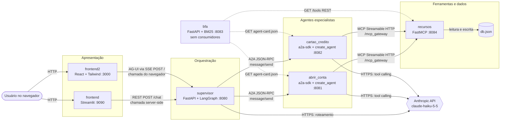

As setas tracejadas são chamadas que só ocorrem na inicialização do BFA. Nenhuma seta chega ao BFA.

### 3.2 A pilha de três protocolos

O valor didático do repositório está em usar um protocolo diferente em cada fronteira. Resumo dos três:

> **Conceito — MCP (Model Context Protocol).** Protocolo aberto (JSON-RPC 2.0) para conectar aplicações de LLM a **ferramentas e dados**. Um *host* (a aplicação com o LLM) abre um *cliente* MCP para cada *servidor*. O servidor expõe três primitivas: **tools** (funções que o modelo decide chamar), **resources** (dados endereçados por URI, controlados pela aplicação) e **prompts** (modelos de mensagem, normalmente escolhidos pelo usuário). A sessão começa com `initialize` (negociação de versão e capacidades), seguido de `tools/list`, `tools/call` etc. No transporte **Streamable HTTP**, cada mensagem é um `POST` em um único endpoint, e a resposta pode ser JSON ou um stream SSE.
>
> **Aqui:** servidor = `recursos` (FastMCP, endpoint `/mcp_gateway`); clientes = os dois agentes (via `langchain-mcp-adapters`). Os agentes usam **só tools**. Resources e prompts existem, mas só são consumidos internamente pelas próprias tools do servidor ([5.5](#55-recursos-de-ia-e-conceitos-mcp)).

> **Conceito — A2A (Agent2Agent).** Protocolo aberto para **agentes conversarem com agentes** como pares opacos (cada um esconde seu LLM, ferramentas e memória). Cada agente publica um **AgentCard** em `/.well-known/agent-card.json`, com nome, URL, habilidades (*skills*), modos de entrada e saída e capacidades (streaming, push). A comunicação principal é JSON-RPC 2.0 com métodos como `message/send` (bloqueante) e `message/stream` (SSE). A unidade de trabalho é uma **Task** com estados, ou uma resposta direta em **Message** composta de **Parts** (texto, arquivo, dados).
>
> **Aqui:** servidores = os dois agentes (`A2AStarletteApplication`); cliente = supervisor (`ClientFactory`, sem streaming); leitor de cards = BFA. Os agentes respondem sempre com uma `Message` simples, sem criar `Task` ([6.4](#64-rastreamento-de-chamadas)).

> **Conceito — AG-UI (Agent–User Interaction Protocol).** Protocolo orientado a eventos entre um **agente de backend e a interface**. O cliente faz `POST` de um `RunAgentInput` (`threadId`, `runId`, `messages`, `state`, `tools`, `context`) e recebe um stream de eventos tipados, em geral via SSE: ciclo de vida (`RUN_STARTED`, `RUN_FINISHED`, `RUN_ERROR`), texto incremental (`TEXT_MESSAGE_START/CONTENT/END`), ferramentas (`TOOL_CALL_*`) e **estado compartilhado** (`STATE_SNAPSHOT` com o estado completo e `STATE_DELTA` com um JSON Patch).
>
> **Aqui:** servidor = rota `POST /` do supervisor ([supervisor/app.py:L45-L80](../supervisor/app.py#L45-L80)); cliente = `frontend2`, com parsing manual de SSE. O backend emite um evento **fora do padrão**, `STATE_UPDATE` ([7.5](#75-recursos-de-ia-do-supervisor)).

| Fronteira | Protocolo | Transporte | Biblioteca do lado servidor | Biblioteca do lado cliente |
|---|---|---|---|---|
| Navegador → supervisor | AG-UI | HTTP POST + SSE (`text/event-stream`) | `ag-ui-protocol` 1.0.0 (modelos + `EventEncoder`) + `StreamingResponse` do FastAPI | `fetch` + `ReadableStream` manual (`@ag-ui/client` declarado mas não usado) |
| Streamlit → supervisor | REST próprio | HTTP POST JSON | FastAPI + Pydantic (`ChatRequest`) | `requests` |
| Supervisor → agentes | A2A | JSON-RPC 2.0 sobre HTTP (`message/send`) | `a2a-sdk` 0.3.26 (`A2AStarletteApplication`) | `a2a-sdk` (`ClientFactory` → `JsonRpcTransport`) |
| Agentes → recursos | MCP | Streamable HTTP em `/mcp_gateway` | FastMCP | `langchain-mcp-adapters` 0.3.2 → SDK `mcp` 1.x |
| Serviços → LLM | Anthropic Messages API | HTTPS | — | `langchain-anthropic` 1.7.6 → `anthropic` 1.13.0 |
| BFA → agentes e recursos | A2A (só o card) + REST | HTTP GET | — | `A2ACardResolver` + `httpx` |

### 3.3 Topologia de rede e endereçamento

- **[Fato]** Todos os endereços são fixos no código, com os nomes DNS do Compose e a porta interna 8000: `http://recursos:8000/mcp_gateway`, `http://abrir_conta_agent:8000`, `http://cartao_credito_agent:8000`, `http://supervisor:8000/chat`. Não há variáveis de ambiente para eles.
- **[Fato]** Os dois frontends usam endereços diferentes porque **as chamadas partem de lugares diferentes**:
  - o Streamlit executa no servidor (container) e alcança `supervisor:8000` pela rede Docker ([frontend/app.py:L4](../frontend/app.py#L4));
  - o React executa **no navegador do usuário**, fora da rede Docker, e só alcança a porta publicada no host, `localhost:8080` ([frontend2/src/ChatPage.jsx:L38](../frontend2/src/ChatPage.jsx#L38)). Isso também é o que torna o CORS necessário ([supervisor/app.py:L24-L30](../supervisor/app.py#L24-L30)).
- **[Fato]** O cliente A2A não usa a URL de onde baixou o card: usa `card.url` (`a2a/client/client_factory.py:L207-L208`). Se um agente rodar em outro host ou porta e o `AgentCard.url` continuar `http://abrir_conta_agent:8000/` ([agents/abrir_conta/server.py:L40](../agents/abrir_conta/server.py#L40)), o supervisor descobre o card e depois manda as mensagens para o endereço errado **[Inferência]**.
- **[Fato]** Fora do Docker, o projeto reproduz os nomes DNS com IPs de loopback (`127.0.0.10`–`127.0.0.14`) e o arquivo `hosts` ([docs/execucao-local-uv.md:L53-L86](execucao-local-uv.md#rede-local)).

### 3.4 Camadas por projeto

As camadas abaixo só foram atribuídas onde o código as separa de fato. Onde a tabela diz "misturado", a responsabilidade existe, mas sem separação em módulos.

| Projeto | Apresentação / interface | Aplicação / orquestração | Domínio / regras | Infraestrutura / integração |
|---|---|---|---|---|
| `recursos` | Protocolo MCP + rota `/tools` | — | Tools com as regras (conta antes de cartão, idempotência por CPF), misturadas com o acesso a dados | `load_db`/`save_db` (arquivo JSON), resources MCP como camada de leitura |
| `agents` | Servidor A2A (`server.py`) | `AgentExecutor` (`executor.py`) | Prompt de sistema (regras em linguagem natural) | `create_agent` + `ChatAnthropic` + `MultiServerMCPClient` (`agent/*.py`) |
| `supervisor` | `app.py` (REST + AG-UI) | `services.py` (grafo, stream e cliente A2A misturados) | Prompt do roteador (`agents.py`) | `request_agent` (A2A), `_llm` (Anthropic) |
| `bfa` | `app.py` (endpoints REST) | `lifespan` (descoberta na inicialização) | `registry.py` (indexação e ranking) | `discovery.py`, `mcp_discovery.py` |
| `frontend` | `app.py` (Streamlit) | misturado em `app.py` | — | `requests.post` |
| `frontend2` | componentes JSX | `ChatPage.sendMessage` + `StateContext` | `StateUtilPage.extractData` (regex sobre texto do LLM) | `fetch` + parsing SSE em `ChatPage.jsx` |

### 3.5 Modelo de execução

| Projeto | Servidor | Modelo de concorrência | Estado em memória do processo |
|---|---|---|---|
| `recursos` | Uvicorn (ASGI), iniciado pelo CLI do FastMCP | `asyncio`, 1 processo | `contas_mdbank`, `cartoes_mdbank` (dicionários globais) |
| `agents` | Uvicorn + Starlette (a2a-sdk) | `asyncio`; cada requisição A2A vira uma *task* produtora | `InMemorySaver` (histórico), `InMemoryTaskStore`; `cartao_credito` também guarda o agente compilado |
| `supervisor` | Uvicorn + FastAPI | `asyncio`; o grafo LangGraph roda os nós de um *superstep* em paralelo | `InMemorySaver` do roteador, `CLIENT_CACHE` de clientes A2A, `HTTPX_CLIENT` |
| `bfa` | Uvicorn + FastAPI | Rotas `def` síncronas rodam no threadpool do Starlette; `lifespan` assíncrono | `AGENT_REGISTRY`, `BM25_INDEX`, `BM25_KEYS` (globais) |
| `frontend` | Servidor do Streamlit 1.65 (o log mostra Uvicorn na porta 9090 [Fato] [logs/frontend.err.log](../logs/frontend.err.log)) | Uma sessão por aba; o script **inteiro** reexecuta a cada interação | `st.session_state.messages` por sessão |
| `frontend2` | Dev server do CRA (webpack) | Event loop do navegador | Context React (`StateProvider`) |

---

## 4. Mapa de dependências e frameworks

### 4.1 Como ler as versões

- **Declarado:** o que está em `requirements.txt` / `package.json`. Só `a2a-sdk<1` tem restrição.
- **Instalado (local):** versão encontrada no `.venv` da pasta, em 2026-10-12. Ela prova uma resolução real, mas **não** a da imagem Docker, que roda `pip install` no build ([recursos/Dockerfile:L13-L14](../recursos/Dockerfile#L13-L14)).
- **Tipo:** *direta* (declarada e importada), *transitiva* (vem de outro pacote), *direta não declarada* (importada sem estar no manifesto), *declarada não usada*, *dev*.

### 4.2 Matriz framework × projeto

| Framework / biblioteca | recursos | agents | supervisor | bfa | frontend | frontend2 |
|---|---|---|---|---|---|---|
| FastMCP (servidor MCP) | ● | | | | | |
| SDK `mcp` (protocolo MCP) | ◐ (via fastmcp) | ◐ (via adapters) | | | | |
| langchain-mcp-adapters (cliente MCP → tools LangChain) | | ● | | | | |
| a2a-sdk | | ● servidor | ● cliente | ● resolver de card | | |
| LangChain (`create_agent`, `init_chat_model`) | | ● | ● | | | |
| langchain-anthropic + SDK `anthropic` | | ● | ● | | | |
| LangGraph | | ◐ (checkpointer) | ● (StateGraph, Send, checkpointer) | | | |
| ag-ui-protocol (Python) | | | ● | | | |
| FastAPI / Starlette / Uvicorn | ◐ Starlette/Uvicorn | ◐ Starlette/Uvicorn | ● | ● | | |
| httpx | | ◐ | ● | ● | | |
| Pydantic | ◐ | ◐ | ● | | | |
| python-dotenv | | ● | ● | declarado, não usado | | |
| rank-bm25 + NumPy | | | | ● | | |
| Streamlit + requests | | | | | ● | |
| React + react-dom + react-scripts (CRA) | | | | | | ● |
| react-router-dom, Tailwind, react-markdown, remark-gfm, framer-motion, lucide-react | | | | | | ● |
| @ag-ui/client | | | | | | só em código morto |

● direta  ◐ transitiva ou indireta

### 4.3 Dependências por projeto

#### `recursos`

| Dependência | Declarado | Instalado (local) | Tipo | Responsabilidade | Onde é usada |
|---|---|---|---|---|---|
| `fastmcp` | `fastmcp` ([requirements.txt:L1](../recursos/requirements.txt#L1)) | 4.1.0 (+ `fastmcp-slim` 4.1.0) | direta | Servidor MCP, decorators, CLI `fastmcp run`, rotas customizadas | [recursos/app.py:L6-L7](../recursos/app.py#L6-L7), [L11](../recursos/app.py#L11), [Dockerfile:L18](../recursos/Dockerfile#L18) |
| `mcp` / `mcp-types` | — | `mcp` 1.30.0, `mcp-types` 2.3.0 | transitiva | Tipos e implementação do protocolo | Via FastMCP |
| `starlette` | — | 1.7.0 | direta não declarada | `Request` e `JSONResponse` da rota `/tools` | [recursos/app.py:L8-L9](../recursos/app.py#L8-L9) |
| `uvicorn` | — | 0.54.0 | transitiva | Servidor ASGI usado pelo CLI no transporte `http` | Dockerfile `CMD` |
| `cyclopts` | — | 5.2.0 | transitiva | Parser de argumentos do CLI do FastMCP | `--stateless false` ([5.3](#53-arquivos-de-build-e-configuração)) |

**[Fato]** O `.venv` local de `recursos` também tem `langchain`, `langgraph`, `a2a-sdk`, `rank-bm25`, `langchain-mcp-adapters` e outros, que não estão no seu `requirements.txt`. **[Inferência]** Os requirements de outros projetos foram instalados nesse ambiente. Isso causou o conflito descrito em [4.5](#45-discrepâncias-entre-o-declarado-o-importado-e-o-instalado).

#### `agents` (`abrir_conta` e `cartao_credito` têm `requirements.txt` idênticos)

| Dependência | Declarado | Instalado (local, `cartao_credito`) | Tipo | Responsabilidade | Onde é usada |
|---|---|---|---|---|---|
| `a2a-sdk[http-server]` | `<1` | 0.3.26 | direta | Servidor A2A (Starlette), tipos, executor, fila de eventos, task store | `server.py:L1-L4`, `executor.py:L3-L6` |
| extra `http-server` | — | `starlette` 1.7.0, `sse-starlette` 3.5.0, `fastapi` 0.143.0 | transitiva | App ASGI e suporte a SSE | Via `A2AStarletteApplication` |
| `uvicorn` | sem versão | 0.54.0 | direta (runtime) | Servidor ASGI | `Dockerfile` `CMD` |
| `langchain` | sem versão | 1.4.4 | direta | `create_agent`, `init_chat_model` | `agent/*.py:L4-L5` |
| `langchain-anthropic` | sem versão | 1.7.6 | direta (carregada dinamicamente) | `ChatAnthropic`, escolhido por `init_chat_model(model_provider="anthropic")` | `agent/*.py:L12-L16` |
| `anthropic` | — | 1.13.0 | transitiva | SDK HTTP da Messages API (sobre `httpx2`) | Via `ChatAnthropic` |
| `langchain-mcp-adapters` | sem versão | 0.3.2 | direta | `MultiServerMCPClient`: converte tools MCP em tools LangChain | `agent/*.py:L7`, `L18-L25` |
| `langgraph` | — | 1.2.14 | **direta não declarada** (vem de `langchain`, que exige `langgraph>=1.2.11,<1.3.0`) | `InMemorySaver` | `agent/*.py:L8`, `L27` |
| `langchain-core` | — | 1.6.10 | transitiva | `HumanMessage`, `BaseTool`, Runnables | `agent/*.py:L6` |
| `python-dotenv` | sem versão | 1.2.4 | direta | `load_dotenv()` | `agent/*.py:L3`, `L10` |
| `httpx` | sem versão | 0.28.1 | declarada, não importada diretamente | Cliente HTTP do a2a-sdk e do SDK MCP | — |
| `pydantic` | sem versão | 2.14.0 | declarada, não importada diretamente | Base dos tipos A2A e LangChain | — |
| `langchain-community` | sem versão | 0.4.2 | **declarada não usada** | — | Nenhum import |

**[Fato]** O `.venv` de `cartao_credito` ainda tem `langchain_openai` 1.7.0, `openai` 3.28.0 e `tiktoken`, que sobraram da versão com `gpt-4o` (commit `a77d144`). O `.venv` de `abrir_conta` **não tem nenhum pacote**, o que é consistente com o log `No module named uvicorn` ([logs/abrir_conta.err.log](../logs/abrir_conta.err.log)).

#### `supervisor`

| Dependência | Declarado | Instalado (local) | Tipo | Responsabilidade | Onde é usada |
|---|---|---|---|---|---|
| `fastapi` | sem versão | 0.143.0 | direta | Rotas, validação do corpo, `StreamingResponse`, CORS | [supervisor/app.py:L12-L14](../supervisor/app.py#L12-L14) |
| `uvicorn` | sem versão | 0.54.0 | direta (runtime) | Servidor ASGI | Dockerfile `CMD` |
| `a2a-sdk` | `<1` (sem extra) | 0.3.26 | direta | Cliente A2A: `A2ACardResolver`, `ClientFactory`, `ClientConfig`, tipos | [supervisor/src/services.py:L7-L8](../supervisor/src/services.py#L7-L8) |
| `ag-ui-protocol` | sem versão | 1.0.0 | direta | Modelos de evento e `EventEncoder` (SSE) | [supervisor/app.py:L4-L11](../supervisor/app.py#L4-L11), [services.py:L9-L14](../supervisor/src/services.py#L9-L14) |
| `langgraph` | sem versão | 1.2.14 | direta | `StateGraph`, `START`, `END`, `Send`, `InMemorySaver` | [services.py:L15-L16](../supervisor/src/services.py#L15-L16), [agents.py:L10](../supervisor/src/agents.py#L10) |
| `langchain` | sem versão | 1.4.4 | direta | `create_agent`, `init_chat_model` | [agents.py:L6-L7](../supervisor/src/agents.py#L6-L7) |
| `langchain-core` | — | 1.6.10 | transitiva (importada diretamente) | `HumanMessage`, `JsonOutputParser` | [agents.py:L8-L9](../supervisor/src/agents.py#L8-L9) |
| `langchain-anthropic` | sem versão | 1.7.6 | direta (carregada dinamicamente) | `ChatAnthropic` | [agents.py:L16-L20](../supervisor/src/agents.py#L16-L20) |
| `httpx` | sem versão | 0.28.1 | direta | `AsyncClient` compartilhado com timeout de 30 s | [services.py:L6](../supervisor/src/services.py#L6), [L26](../supervisor/src/services.py#L26) |
| `pydantic` | — | 2.14.0 | **direta não declarada** (vem do FastAPI) | `BaseModel`, `Field` | [schemas.py:L1](../supervisor/src/schemas.py#L1), [agents.py:L11](../supervisor/src/agents.py#L11), [services.py:L17](../supervisor/src/services.py#L17) |
| `python-dotenv` | sem versão | 1.2.4 | direta | `load_dotenv()` | [agents.py:L5](../supervisor/src/agents.py#L5), [L14](../supervisor/src/agents.py#L14) |
| `langchain-community` | sem versão | 0.4.2 | **declarada não usada** | — | — |

#### `bfa`

| Dependência | Declarado | Instalado (local) | Tipo | Responsabilidade | Onde é usada |
|---|---|---|---|---|---|
| `fastapi` | sem versão | 0.143.0 | direta | Rotas e `lifespan` | [bfa/app.py:L1-L3](../bfa/app.py#L1-L3), [L26](../bfa/app.py#L26) |
| `uvicorn` | sem versão | 0.54.0 | direta (runtime) | Servidor ASGI | Dockerfile |
| `httpx` | sem versão | 0.28.1 | direta | Clientes HTTP da descoberta | [discovery.py:L3](../bfa/discovery.py#L3), [mcp_discovery.py:L3](../bfa/mcp_discovery.py#L3) |
| `a2a-sdk` | `<1` | 0.3.26 | direta | Só o `A2ACardResolver` | [discovery.py:L4](../bfa/discovery.py#L4) |
| `rank-bm25` | sem versão | 0.2.2 | direta | `BM25Okapi` | [registry.py:L5](../bfa/registry.py#L5) |
| `numpy` | sem versão | 2.5.4 | direta | `np.argsort` | [registry.py:L4](../bfa/registry.py#L4), [L69](../bfa/registry.py#L69) |
| `python-dotenv` | sem versão | 1.2.4 | **declarada não usada** | — | — |

#### `frontend`

| Dependência | Declarado | Instalado (local) | Tipo | Responsabilidade | Onde é usada |
|---|---|---|---|---|---|
| `streamlit` | sem versão | 1.65.0 | direta | UI de chat, sessão, servidor | [frontend/app.py:L2](../frontend/app.py#L2) |
| `requests` | sem versão | 2.34.2 | direta | `POST` síncrono ao supervisor | [frontend/app.py:L1](../frontend/app.py#L1), [L37](../frontend/app.py#L37) |

#### `frontend2` (versões do `package-lock.json`, já que `node_modules` está vazio)

| Dependência | Declarado ([package.json](../frontend2/package.json)) | Resolvido no `package-lock.json` | Tipo | Onde é usada |
|---|---|---|---|---|
| `react`, `react-dom` | `^18.2.0` | 18.3.1 | direta | Todos os componentes; [index.jsx:L1-L2](../frontend2/src/index.jsx#L1-L2) |
| `react-scripts` | `5.0.1` | 5.0.1 | direta (build e dev server) | `scripts` do [package.json:L5-L10](../frontend2/package.json#L5-L10). Inclui `tailwindcss ^3.0.2` e a integração com PostCSS |
| `react-router-dom` | `^6.18.0` | **ausente no lock** | direta | [App.jsx:L2](../frontend2/src/App.jsx#L2), [Layout.jsx:L1](../frontend2/src/Layout.jsx#L1) |
| `tailwindcss` | `^3.3.2` | 3.4.19 | direta | [index.css:L1-L3](../frontend2/src/index.css#L1-L3), [tailwind.config.js](../frontend2/tailwind.config.js) |
| `@tailwindcss/typography` | `^0.5.9` | 0.5.19 | direta | Classes `prose` em [ChatBox.jsx:L45](../frontend2/src/components/ChatBox.jsx#L45) |
| `autoprefixer`, `postcss` | `^10.4.14`, `^8.4.24` | 10.4.27, 8.5.8 | direta (build) | Pipeline CSS do CRA |
| `react-markdown` / `remark-gfm` | `^8.0.3` / `^3.0.1` | 8.0.7 / 3.0.1 | direta | [ChatBox.jsx:L2-L3](../frontend2/src/components/ChatBox.jsx#L2-L3), [StateUtilPage.jsx:L3-L4](../frontend2/src/StateUtilPage.jsx#L3-L4) |
| `framer-motion` | `^10.12.16` | 10.18.0 | direta | [StateUtilPage.jsx:L5](../frontend2/src/StateUtilPage.jsx#L5) |
| `lucide-react` | `^0.257.0` | **ausente no lock** | direta | [ChatBox.jsx:L4](../frontend2/src/components/ChatBox.jsx#L4) |
| `@ag-ui/client` | `^0.0.47` | 0.0.47 (depende de `@ag-ui/core`, `rxjs`, `zod`, `fast-json-patch`) | direta, **só em código morto** | [services/agentAdapter.js:L1](../frontend2/src/services/agentAdapter.js#L1) |
| `postcss-cli` | `^10.1.0` (dev) | 10.1.0 | dev, **não usada** por nenhum script | — |

### 4.4 Análise dos frameworks principais

Para cada framework: o que é, o problema que resolve, como foi usado, por que faz sentido, alternativas e o que acontece se for removido.

#### FastMCP (`recursos`)

- **O que é:** framework de alto nível para servidores MCP. Decorators (`@mcp.tool`, `@mcp.resource`, `@mcp.prompt`) transformam funções Python em primitivas MCP. O JSON Schema de entrada é gerado a partir dos *type hints*, e o servidor pode rodar em stdio, SSE ou Streamable HTTP.
- **Problema que resolve:** implementar o protocolo (JSON-RPC, handshake, listagens, chamadas, notificações) sem escrever o servidor de baixo nível.
- **Inicialização:** `mcp = FastMCP("ContaService")` ([recursos/app.py:L11](../recursos/app.py#L11)), servido por `fastmcp run app.py:mcp --transport http --path /mcp_gateway` ([recursos/Dockerfile:L18](../recursos/Dockerfile#L18)). O CLI importa o objeto `mcp` do módulo e sobe um app Starlette/Uvicorn.
- **Interação:** `@mcp.custom_route` ([L247](../recursos/app.py#L247)) registra uma rota HTTP comum no mesmo app ASGI, fora do protocolo MCP, consumida pelo BFA. `Context` dá às tools acesso ao próprio servidor (`read_resource`, `get_prompt`, `info`).
- **Por que faz sentido aqui [Inferência]:** expõe as regras de negócio como ferramentas padronizadas, que qualquer cliente MCP descobre e chama. Os agentes não precisam conhecer o formato do `db.json`.
- **Alternativas:** o servidor de baixo nível do SDK `mcp`; uma API REST com OpenAPI convertida em tools; tools LangChain locais em cada agente (mais simples, mas perde o desacoplamento e a reutilização).
- **Se for removido:** `client.get_tools()` falha nos agentes, que ficam sem acesso a dados (o prompt proíbe inventar). O BFA perde a fonte de tools.

#### a2a-sdk (agents, supervisor, bfa)

- **O que é:** SDK Python do protocolo A2A. Traz os tipos (`AgentCard`, `AgentSkill`, `Message`, `Part`, `Task`), o lado servidor (apps Starlette/FastAPI, `DefaultRequestHandler`, `AgentExecutor`, `EventQueue`, `TaskStore`) e o lado cliente (`A2ACardResolver`, `ClientFactory` e transportes JSON-RPC, REST e gRPC).
- **Inicialização no servidor:** `AgentCard` → `DefaultRequestHandler(agent_executor, InMemoryTaskStore())` → `A2AStarletteApplication(...).build()` ([agents/abrir_conta/server.py:L37-L65](../agents/abrir_conta/server.py#L37-L65)).
- **Inicialização no cliente:** `A2ACardResolver(...).get_agent_card()` → `ClientFactory(ClientConfig(streaming=False)).create(card)` ([supervisor/src/services.py:L69-L79](../supervisor/src/services.py#L69-L79)).
- **Por que `<1` [Hipótese]:** evitar mudanças incompatíveis da série 1.x. O pin entrou no commit `2769290`, sem explicação registrada.
- **Alternativas:** chamadas REST próprias entre serviços; expor cada agente como **tool MCP** ("agent-as-tool"); grafos remotos do LangGraph; gRPC.
- **Se for removido:** o supervisor perde o canal com os agentes, e os agentes perdem o servidor HTTP. O BFA perde a descoberta.

#### LangChain 1.x: `create_agent` e `init_chat_model` (agents, supervisor)

- **`init_chat_model`** é uma fábrica: `model_provider="anthropic"` importa `langchain_anthropic.ChatAnthropic` sob demanda (`langchain/chat_models/base.py:L57`). Por isso `langchain-anthropic` precisa estar instalado, mesmo sem ser importado explicitamente.
- **`create_agent`** monta e **compila um grafo LangGraph** de agente com tool calling:
  - um nó `model` e, se houver tools, um nó `tools` (`ToolNode`) (`langchain/agents/factory.py:L1611-L1615`);
  - uma aresta condicional depois do modelo: se a última `AIMessage` tiver `tool_calls` pendentes, cada chamada vira um `Send("tools", [tool_call])` e roda em paralelo; se não tiver, o grafo termina (`factory.py:L1991-L2040`);
  - o grafo compilado usa **`recursion_limit` = 9.999** (`factory.py:L1897-L1899`). Na prática, não há teto para o laço modelo → ferramenta → modelo;
  - com `tools=[]` (roteador do supervisor) não há nó `tools`: é uma única chamada ao modelo.
- **Erros de ferramenta:** o `ToolNode` só converte em mensagem para o modelo os erros de validação de argumentos (`ToolInvocationError`) e relança os demais (`langgraph/prebuilt/tool_node.py:L383-L391`). Os erros de negócio do MCP (`isError=True`) voltam ao modelo como `ToolMessage` por causa do adaptador ([próximo item](#langchain-mcp-adapters-agents)).
- **Alternativas:** um laço manual com o SDK `anthropic` (controle total); `langgraph.prebuilt.create_react_agent` (o antecessor); o *Tool Runner* do SDK da Anthropic; LlamaIndex, CrewAI ou PydanticAI.

#### langchain-anthropic + SDK `anthropic`

- **`ChatAnthropic`** traduz mensagens LangChain para a Messages API. Padrões observados no código-fonte instalado:
  - `max_tokens` vem do perfil do modelo, 128.000 para `claude-haiku-5-5` (`langchain_anthropic/chat_models.py:L1684-L1693`, `data/_profiles.py:L143-L170`);
  - `max_retries=2` e `timeout` nulo, ou seja, o padrão do SDK: 600 s, com 5 s para conectar (`anthropic/_constants.py:L10-L11`);
  - rejeita no cliente `temperature`/`top_p` diferentes de 1 e qualquer `top_k` para `claude-sonnet-5-5` e `claude-fable-5*` (`chat_models.py:L1809-L1828`).
- **Sobre o modelo `claude-haiku-5-5`:** contexto de 1M tokens, saída de até 128K e US$ 0,10 / US$ 0,50 por milhão de tokens de entrada/saída (prompts de até 100K tokens). Valores de amostragem diferentes do padrão são rejeitados pela API, e o *adaptive thinking* fica **ligado por padrão**, com `effort` padrão `medium`. Fonte: referência da API da Anthropic em 2026-10.
- **Consequência no código [Inferência]:** com thinking ligado, a resposta tem blocos de pensamento e de texto, e `AIMessage.content` vira uma **lista de blocos**. A propriedade `.text` concatena só os blocos de texto **[Teste]** ([Apêndice A.3](#a3-langchain-core-text-e-jsonoutputparser)). Isso justifica a troca de `.content` por `str(...text)` no commit `2769290`.

#### LangGraph (supervisor e, indiretamente, agents)

- **`StateGraph`** é uma máquina de estados: os nós são funções que recebem o estado e devolvem atualizações parciais; as arestas definem a ordem; os **reducers** (`Annotated[list[str], add]`) dizem como juntar atualizações concorrentes da mesma chave.
- **`Send(node, payload)`**, devolvido por uma aresta condicional, cria tarefas dinâmicas (padrão *map-reduce*). Cada `Send` vira uma execução do nó com o próprio payload, e todas rodam no mesmo *superstep*, **em paralelo** **[Teste]** ([Apêndice A.4](#a4-langgraph-send-em-paralelo-lista-vazia-e-nó-inexistente)).
- **`InMemorySaver`** é um *checkpointer*: grava o estado ao fim de cada passo, indexado por `thread_id`. É o que dá "memória" aos agentes `create_agent` entre requisições. Fica só na RAM do processo.
- **Alternativas:** um laço `asyncio.gather` simples (para o fan-out); checkpointers persistentes (`SqliteSaver`, `PostgresSaver`); orquestração sem framework.

#### langchain-mcp-adapters (agents)

- **O que é:** cliente MCP que converte cada tool MCP em uma `StructuredTool` do LangChain.
- **Comportamento verificado (0.3.2):**
  - `get_tools()` abre uma sessão, faz `initialize` e `tools/list` e fecha (`client.py:L166-L211`);
  - **cada chamada de tool abre uma sessão nova** (`initialize` + `tools/call`) (`client.py:L175` e `tools.py:L460-L480`);
  - o transporte `"http"` é um apelido de `streamable_http` (`sessions.py:L451`), com timeout de 30 s e leitura SSE de 300 s (`sessions.py:L56-L57`);
  - um resultado `isError=True` vira `ToolMessage` de erro para o modelo (`handle_tool_errors=True` por padrão), enquanto falhas de conexão sobem como exceção (`tools.py:L99-L151`, `L273-L274`);
  - o conteúdo vira blocos LangChain, e o `structuredContent` vai para o `artifact` (`response_format="content_and_artifact"`, `tools.py:L533`).
- **Alternativas:** o `ClientSession` do SDK `mcp` com conversão manual; o conector MCP da própria API da Anthropic (o servidor precisaria estar acessível pela internet).

#### ag-ui-protocol 1.0.0 (supervisor)

- **[Fato]** Os modelos aceitam campos em snake_case e camelCase (`alias_generator=to_camel`, `populate_by_name=True`), **mantêm campos desconhecidos** (`extra="allow"`) e omitem opcionais nulos na serialização (`ag_ui/_generated/models.py:L18-L48`).
- **[Fato]** O `EventEncoder` desta versão **ignora o parâmetro `accept`** (`__init__` só tem `pass`), sempre devolve `text/event-stream` e codifica cada evento como `data: <json camelCase>\n\n` (`ag_ui/encoder/encoder.py:L13-L36`). A lógica de `Accept` em [supervisor/app.py:L48-L52](../supervisor/app.py#L48-L52) não tem efeito nessa versão.
- **[Fato]** Os tipos padrão de evento incluem `STATE_SNAPSHOT`, `STATE_DELTA`, `CUSTOM` e `RUN_ERROR`, mas não `STATE_UPDATE` (`_generated/models.py:L90-L120`).

#### Bibliotecas de suporte

| Biblioteca | Papel concreto | Por que faz sentido | Alternativa |
|---|---|---|---|
| FastAPI / Starlette / Uvicorn | ASGI: rotas, validação Pydantic, `StreamingResponse` (SSE), `lifespan`, CORS | Padrão de fato para APIs Python assíncronas; o a2a-sdk e o FastMCP também usam Starlette | Litestar, aiohttp |
| httpx | Cliente HTTP assíncrono; o mesmo cliente é passado ao a2a-sdk (pool compartilhado) | API parecida com `requests`, mas assíncrona | aiohttp |
| Pydantic | Validação de `ChatRequest`, `RunAgentInput`, `RouterOutput`; tipos A2A e MCP | Integração nativa com FastAPI e LangChain | dataclasses + validação manual |
| python-dotenv | Carrega `.env` no `os.environ` | Simples para desenvolvimento | `env_file` no Compose ou secrets do orquestrador |
| rank-bm25 + NumPy | Ranking lexical BM25 em memória | Sem infraestrutura, sem modelo de embeddings | Embeddings + banco vetorial; tool search da API Anthropic |
| Streamlit | Chat com `st.chat_message` e `st.chat_input` | Interface de demonstração com poucas linhas | Gradio, Chainlit |
| CRA (`react-scripts` 5) | Dev server, Babel e webpack sem configuração; Tailwind embutido quando há `tailwind.config.js` | Zero configuração | Vite (o CRA não é mais mantido ativamente) |
| react-markdown + remark-gfm | Renderiza Markdown (tabelas GFM) das respostas do LLM | O LLM responde em Markdown | `marked` + sanitização |

### 4.5 Discrepâncias entre o declarado, o importado e o instalado

| # | Discrepância | Evidência | Consequência |
|---|---|---|---|
| D1 | `langgraph` importado pelos agentes sem estar declarado | `agent/*.py:L8`; `langchain-1.4.4` exige `langgraph>=1.2.11,<1.3.0` (METADATA) | Funciona por transitividade, mas quebra se `langchain` deixar de depender de `langgraph` |
| D2 | `pydantic` (supervisor) e `starlette` (recursos) importados sem declaração | [supervisor/src/schemas.py:L1](../supervisor/src/schemas.py#L1), [recursos/app.py:L8-L9](../recursos/app.py#L8-L9) | Mesmo risco |
| D3 | `langchain-community` declarado e nunca importado | agents e supervisor | Build mais lento e imagem maior |
| D4 | `python-dotenv` declarado e não usado no BFA | [bfa/requirements.txt:L4](../bfa/requirements.txt#L4) | Idem |
| D5 | Sobras do OpenAI nos `.venv` locais | `langchain_openai` 1.7.0, `openai` 3.28.0 em supervisor e cartao_credito | Inofensivo, mas mostra ambientes não recriados |
| D6 | **`.venv` de `recursos` quebrado** | `fastmcp-slim[server]==4.1.0` exige `mcp>=2.0.0,<3.0.0`; `langchain-mcp-adapters` 0.3.2 (instalado no mesmo venv) exige `mcp>=1.24.0,<2.0.0`; ficou `mcp` 1.30.0; o CLI falha com `No module named 'mcp.server.mcpserver'` ([logs/recursos.err.log](../logs/recursos.err.log)); **[Teste]** `import fastmcp` falha | O servidor MCP não sobe localmente. Mostra também que **cliente e servidor MCP não podem compartilhar ambiente** nessas versões, o que é um argumento a favor de um venv por serviço |
| D7 | `.venv` de `abrir_conta` vazio | Diretório sem `site-packages` populado; log `No module named uvicorn` | O agente não sobe localmente |
| D8 | `package-lock.json` desatualizado em relação ao `package.json` | Faltam `react-router-dom` e `lucide-react`; o `pnpm-lock.yaml` também não tem `react-router-dom`, `lucide-react`, `react-markdown`, `remark-gfm` nem `@tailwindcss/typography` | O Docker usa `npm install`, que resolve o que falta e regrava o lock na imagem: o build não é reproduzível. Com `npm ci`, o build falharia. Dois lockfiles de gerenciadores diferentes confundem a ferramenta |
| D9 | Python 3.13 nas imagens, 3.14 nos venvs locais; Node 20 na imagem, 24 local | Dockerfiles; `pyvenv.cfg`; `node --version` | Diferenças de comportamento entre o ambiente local e o container |
| D10 | O comportamento de `annotations` das tools depende da versão | **[Teste]** `mcp.types.ToolAnnotations` (extra=allow) mantém `tags`/`examples`; `mcp_types.ToolAnnotations` (usado pelo FastMCP 4.1.0) os **descarta** | Com FastMCP 4.x, `/tools` devolve `tags: []` e o índice do BFA perde termos ([5.4](#54-rastreamento-de-chamadas)) |

### 4.6 Como as bibliotecas se encadeiam em uma chamada de agente

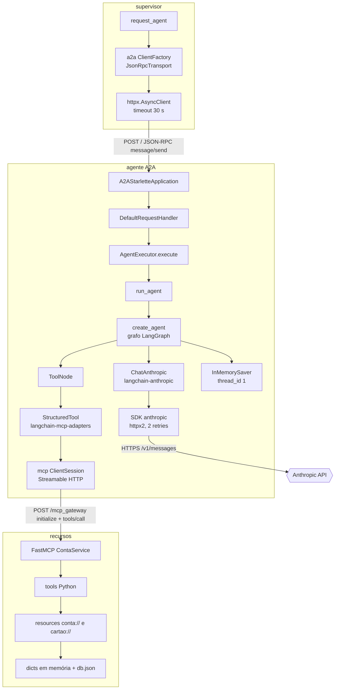

---

## 5. Projeto 1 — `recursos` (servidor MCP)

### 5.1 Visão geral

| Aspecto | Descrição |
|---|---|
| Nome e propósito | Servidor MCP `ContaService` ([recursos/app.py:L11](../recursos/app.py#L11)): a camada de dados e regras de negócio do banco fictício |
| Problema que resolve | Dá aos agentes um jeito **determinístico e padronizado** de consultar e alterar contas e cartões, para que o LLM não invente dados. A regra "cartão só com conta" é aplicada aqui, em código, e não apenas em prompt ([L204-L208](../recursos/app.py#L204-L208)) |
| Linguagem | Python (3.13 na imagem; 3.14 no `.venv` local) |
| Frameworks | FastMCP (protocolo MCP), Starlette (rota HTTP extra) |
| Arquitetura | Um único módulo: 2 *resource templates*, 2 prompts, 5 tools e 1 rota HTTP. O estado fica em dicionários globais, persistidos em um arquivo JSON a cada escrita |
| Ponto de entrada | `fastmcp run app.py:mcp --transport http --host 0.0.0.0 --port 8000 --path /mcp_gateway` ([recursos/Dockerfile:L18](../recursos/Dockerfile#L18)). O CLI importa o módulo e usa o objeto `mcp` |
| Integrações de entrada | MCP via Streamable HTTP em `/mcp_gateway` (agentes); `GET /tools` (BFA) |
| Integrações de saída | Arquivo `/app/db.json` |
| Relação com os demais | É a base da pilha. Não chama nenhum outro serviço |

**Arquitetura interna:**

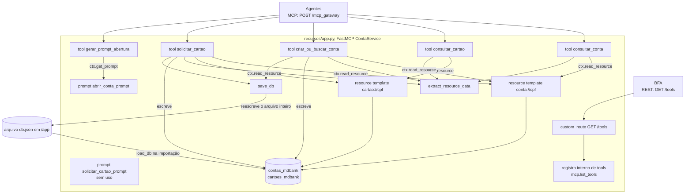

**Fluxo de uma chamada de tool**, do agente até o arquivo. Exemplo: `solicitar_cartao`.

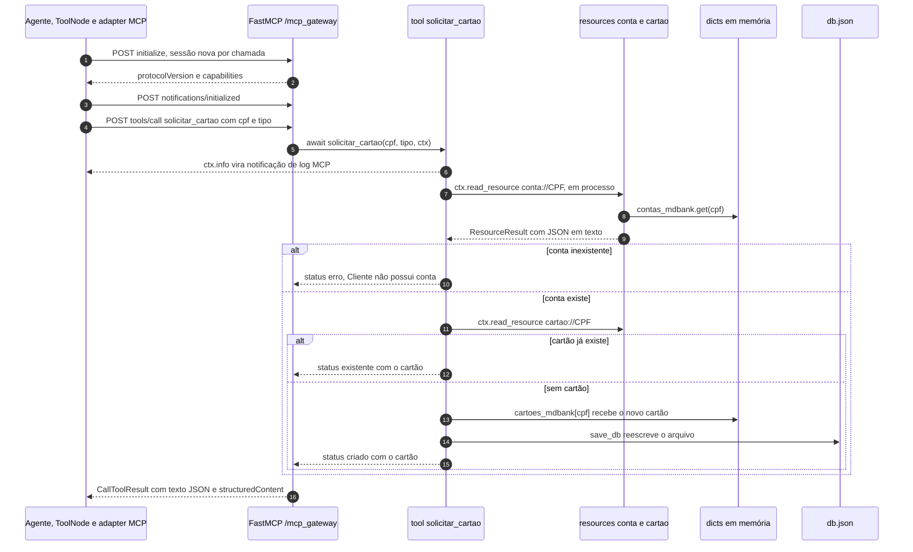

**[Fato]** `ctx.read_resource` e `ctx.get_prompt` **não fazem chamada de rede**: delegam ao próprio servidor, em processo (`fastmcp/server/context.py:L574-L607`). As resources e os prompts funcionam como uma camada interna de acesso usada pelas tools.

### 5.2 Arquivo: `recursos/app.py`

**Responsabilidade:** definir o servidor MCP inteiro (dados, regras, primitivas MCP e uma rota de catálogo).
**Por que existe:** isola os dados e as regras de negócio atrás de um protocolo que qualquer agente pode descobrir.
**Posição na arquitetura:** camada mais baixa (dados e domínio).
**Quem o invoca:** o CLI do FastMCP, na subida; os agentes, via MCP; o BFA, via `GET /tools`.
**O que ele invoca:** só o sistema de arquivos.
**Dependências utilizadas:** `fastmcp` (`FastMCP`, `Context`, `Message`), `starlette` (`Request`, `JSONResponse`), stdlib (`json`, `os`, `random`, `typing`).

#### Bloco 1 — Importações, instância do servidor e caminho do banco ([L1-L13](../recursos/app.py#L1-L13))

```python
import json
import os
import random
from typing import Any, Dict, Optional

from fastmcp import Context, FastMCP
from fastmcp.prompts import Message
from starlette.requests import Request
from starlette.responses import JSONResponse

mcp = FastMCP("ContaService")

DB_FILE = "/app/db.json"
```

| Linha(s) | Código | Explicação técnica | Motivação / impacto |
|---|---|---|---|
| [L1](../recursos/app.py#L1) | `import json` | Serialização da stdlib (`dumps`/`loads`/`dump`/`load`) | Usada nas resources ([L74](../recursos/app.py#L74)), no parsing ([L59](../recursos/app.py#L59)) e na persistência ([L25](../recursos/app.py#L25), [L33](../recursos/app.py#L33)) |
| [L2](../recursos/app.py#L2) | `import os` | Acesso ao sistema operacional | `os.path.exists` ([L21](../recursos/app.py#L21)) e `os.getpid` ([L42](../recursos/app.py#L42)) |
| [L3](../recursos/app.py#L3) | `import random` | Gerador pseudoaleatório Mersenne Twister, **não criptográfico** | Gera números de conta, cartão e limite ([L174](../recursos/app.py#L174), [L216](../recursos/app.py#L216), [L220](../recursos/app.py#L220)). Não há garantia de unicidade |
| [L4](../recursos/app.py#L4) | `from typing import Any, Dict, Optional` | Só *type hints*; nenhum efeito em runtime | Documenta os retornos de `load_db` e `extract_resource_data` |
| [L6](../recursos/app.py#L6) | `from fastmcp import Context, FastMCP` | `FastMCP` é o servidor. `Context` é o objeto injetado em funções que declaram um parâmetro desse tipo: o FastMCP 4.1.0 converte `ctx: Context` em dependência injetada no registro (`fastmcp/server/dependencies.py:L340-L360`) e filtra argumentos externos com esse nome (`L900-L910`) | O LLM não vê nem preenche `ctx`, que só aparece do lado do servidor **[Inferência]** a partir do mecanismo de injeção |
| [L7](../recursos/app.py#L7) | `from fastmcp.prompts import Message` | Classe Pydantic `Message(content, role="user")`, que embrulha `str` em `TextContent` (`fastmcp/prompts/base.py:L38-L66`) | Monta as mensagens dos prompts ([L90-L101](../recursos/app.py#L90-L101)) |
| [L8-L9](../recursos/app.py#L8-L9) | `from starlette.requests import Request` / `from starlette.responses import JSONResponse` | Tipos de requisição e resposta do Starlette, o framework ASGI por baixo do FastMCP | Necessários na rota customizada `/tools` ([L247-L307](../recursos/app.py#L247-L307)). `starlette` não está no `requirements.txt` (é transitiva) |
| [L11](../recursos/app.py#L11) | `mcp = FastMCP("ContaService")` | Cria o servidor. O nome é enviado em `serverInfo.name` na resposta ao `initialize` | O CLI procura a variável pelo nome (`app.py:mcp`). Renomear a variável quebra o `CMD` do Dockerfile |
| [L13](../recursos/app.py#L13) | `DB_FILE = "/app/db.json"` | Caminho **absoluto** POSIX | No Docker, `/app` é o bind mount de `./recursos`, então grava em `recursos/db.json` no host (por isso o `git status` mostra `M recursos/db.json`). Fora do Docker, no Windows, um caminho iniciado por `/` é relativo à **raiz do drive atual** (ex.: `D:\app\db.json`). **[Fato]** `D:\app` não existe nesta máquina. **[Inferência]** Em execução local, `load_db` devolve um banco vazio e `save_db` falha (exceção capturada em [L34-L35](../recursos/app.py#L34-L35)): os dados ficam só na memória, contra o que diz [docs/execucao-docker.md:L121](execucao-docker.md) |

#### Bloco 2 — Persistência ([L15-L42](../recursos/app.py#L15-L42))

```python
def load_db() -> Dict[str, Any]:
    if not os.path.exists(DB_FILE):
        return {"contas": {}, "cartoes": {}}
    try:
        with open(DB_FILE, "r") as f:
            return json.load(f)
    except Exception:
        return {"contas": {}, "cartoes": {}}


def save_db():
    try:
        with open(DB_FILE, "w") as f:
            json.dump({"contas": contas_mdbank, "cartoes": cartoes_mdbank}, f, indent=2)
    except Exception as e:
        print("Erro ao salvar DB:", e)


db = load_db()
contas_mdbank = db.get("contas", {})
cartoes_mdbank = db.get("cartoes", {})

print("PID:", os.getpid())
```

| Linha(s) | Código | Explicação técnica | Motivação / impacto |
|---|---|---|---|
| [L20](../recursos/app.py#L20) | `def load_db() -> Dict[str, Any]:` | Função síncrona que devolve o banco inteiro | Chamada uma única vez, na importação ([L38](../recursos/app.py#L38)) |
| [L21-L22](../recursos/app.py#L21-L22) | `if not os.path.exists(DB_FILE): return {"contas": {}, "cartoes": {}}` | Sem arquivo, começa vazio | Primeira execução sem `db.json` |
| [L23-L25](../recursos/app.py#L23-L25) | `with open(DB_FILE, "r") as f: return json.load(f)` | `open` sem `encoding` usa a codificação padrão da plataforma (UTF-8 no Linux do container; cp1252 no Windows) | Funciona porque `json.dump` grava ASCII com escapes (`ensure_ascii=True` por padrão) |
| [L26-L27](../recursos/app.py#L26-L27) | `except Exception: return {"contas": {}, "cartoes": {}}` | Qualquer erro, inclusive JSON corrompido, vira banco vazio, **sem log** | **[Inferência]** Se o arquivo for truncado (por exemplo, queda durante a escrita), o serviço sobe vazio e a próxima escrita sobrescreve o arquivo só com os dados novos: perda silenciosa |
| [L30-L33](../recursos/app.py#L30-L33) | `with open(DB_FILE, "w") as f: json.dump({...}, f, indent=2)` | O modo `"w"` **trunca o arquivo antes** de escrever, e o banco inteiro é reescrito a cada mudança | Simples, mas não atômico (não usa arquivo temporário + `os.replace`), sem `fsync` e sem lock entre processos. A E/S é síncrona dentro de tools `async`, então bloqueia o event loop durante a escrita (desprezível com um arquivo pequeno) |
| [L34-L35](../recursos/app.py#L34-L35) | `except Exception as e: print("Erro ao salvar DB:", e)` | A falha é só impressa | A tool devolve `"criada"`/`"criado"` ao LLM **mesmo que a gravação tenha falhado** |
| [L38-L40](../recursos/app.py#L38-L40) | `db = load_db()` / `contas_mdbank = db.get("contas", {})` / `cartoes_mdbank = db.get("cartoes", {})` | Executa **na importação**. Os dicionários globais passam a ser a fonte da verdade; o arquivo é só uma cópia *write-through* | Edições manuais no `db.json` com o serviço no ar não são vistas e serão sobrescritas. Com mais de um processo (workers), cada um teria sua cópia e as escritas divergiriam **[Inferência]** |
| [L42](../recursos/app.py#L42) | `print("PID:", os.getpid())` | Imprime o PID na importação | **[Hipótese]** Depuração para saber quantos processos o CLI/reloader cria. O `logs/recursos.out.log` local está vazio porque o processo falhou antes, ao importar o CLI ([logs/recursos.err.log](../logs/recursos.err.log)) |

**Esquema do `db.json`** (valores fictícios; o arquivo real tem dados pessoais e não foi reproduzido):

```json
{
  "contas":  { "<cpf>": { "nome": "<nome>", "numero": 12345, "saldo": 0.0 } },
  "cartoes": { "<cpf>": { "numero": 123456, "tipo": "platinum", "limite": 3000 } }
}
```

**[Fato]** O arquivo versionado tem dois cartões com `"tipo": "Gold"` e `"tipo": "platinum"`. A grafia mista mostra que o tipo não é normalizado nem validado ([L200](../recursos/app.py#L200), [L219](../recursos/app.py#L219)).

#### Bloco 3 — Utilitário `extract_resource_data` ([L49-L64](../recursos/app.py#L49-L64))

```python
def extract_resource_data(resource_result) -> Optional[Dict[str, Any]]:
    if not resource_result:
        return None
    try:
        if not resource_result.contents:
            return None

        raw = resource_result.contents[0].content

        if isinstance(raw, str):
            return json.loads(raw)

        return raw
    except Exception as e:
        print("Erro extract_resource_data:", e)
        return None
```

| Linha(s) | Código | Explicação técnica | Motivação / impacto |
|---|---|---|---|
| [L49](../recursos/app.py#L49) | `def extract_resource_data(resource_result) -> Optional[Dict[str, Any]]:` | Recebe o retorno de `ctx.read_resource` | **[Fato]** No FastMCP 4.1.0 esse retorno é um `ResourceResult` com `.contents: list[ResourceContent]` (`fastmcp/server/context.py:L593-L607`, `fastmcp/resources/base.py:L116-L141`). **[Hipótese]** O helper existe para isolar as tools desse formato, que variou entre versões do FastMCP |
| [L50-L51](../recursos/app.py#L50-L51) | `if not resource_result: return None` | Guarda contra `None` | Defensivo |
| [L53-L54](../recursos/app.py#L53-L54) | `if not resource_result.contents: return None` | Lista vazia vira "sem dados" | — |
| [L56](../recursos/app.py#L56) | `raw = resource_result.contents[0].content` | Usa só o **primeiro** item (`str` ou `bytes`) | As resources deste servidor devolvem um único texto JSON |
| [L58-L59](../recursos/app.py#L58-L59) | `if isinstance(raw, str): return json.loads(raw)` | Desfaz o `json.dumps` das resources ([L74](../recursos/app.py#L74)) | Ida e volta entre dict e string só porque a resource precisa devolver conteúdo serializável |
| [L61](../recursos/app.py#L61) | `return raw` | Caminho para `bytes` | Não ocorre neste código |
| [L62-L64](../recursos/app.py#L62-L64) | `except Exception as e: print(...); return None` | Engole qualquer erro | **[Inferência]** Para quem chama, um erro de parsing parece "conta inexistente" (`not data`). Em `criar_ou_buscar_conta` isso levaria a **recriar** uma conta existente com outro número |

#### Bloco 4 — Resources MCP ([L67-L81](../recursos/app.py#L67-L81))

```python
@mcp.resource("conta://{cpf}")
async def obter_conta(cpf: str):
    cpf = cpf.strip()
    data = contas_mdbank.get(cpf, {"erro": "Conta não encontrada"})
    return json.dumps(data)


@mcp.resource("cartao://{cpf}")
async def obter_cartao(cpf: str):
    cpf = cpf.strip()
    data = cartoes_mdbank.get(cpf, {"erro": "Cartão não encontrado"})
    return json.dumps(data)
```

> **Conceito — Resource e resource template no MCP.** Uma *resource* é um dado endereçado por URI, que o cliente pode listar (`resources/list`) e ler (`resources/read`). Quando a URI tem placeholders (`conta://{cpf}`), ela é um **resource template**, listado em `resources/templates/list`, e o FastMCP liga cada placeholder ao parâmetro de mesmo nome da função. Pela especificação, resources são **controladas pela aplicação**: o host decide o que colocar no contexto do modelo, enquanto tools são **controladas pelo modelo**.

| Linha(s) | Código | Explicação técnica | Motivação / impacto |
|---|---|---|---|
| [L70](../recursos/app.py#L70) | `@mcp.resource("conta://{cpf}")` | Registra um resource template com o esquema de URI customizado `conta` | Dá endereços estáveis para os dados. Aqui só as tools os leem, em processo |
| [L71](../recursos/app.py#L71) | `async def obter_conta(cpf: str):` | Corrotina; `cpf` vem do trecho da URI | Poderia ser síncrona (não há `await`), mas o FastMCP aceita os dois |
| [L72](../recursos/app.py#L72) | `cpf = cpf.strip()` | Remove só espaços nas pontas | CPF com pontuação (`123.456.789-09`) e sem pontuação (`12345678909`) são **chaves diferentes**. Os exemplos de conversa do projeto usam as duas formas ([docs/exemplos-de-conversa.md:L10-L12](exemplos-de-conversa.md)) |
| [L73](../recursos/app.py#L73) | `contas_mdbank.get(cpf, {"erro": "Conta não encontrada"})` | Devolve um dict sentinela em vez de erro de protocolo | As tools detectam o caso com `"erro" in data`. O padrão é simples, mas mistura dado e erro no mesmo canal |
| [L74](../recursos/app.py#L74) | `return json.dumps(data)` | Uma `str` vira um único `ResourceContent` `text/plain` (`fastmcp/resources/base.py:L122-L124`) | O tipo MIME não indica JSON (`application/json`), por isso o parsing manual em [L58-L59](../recursos/app.py#L58-L59) |
| [L77-L81](../recursos/app.py#L77-L81) | `@mcp.resource("cartao://{cpf}")` ... | Igual a [L70-L74](../recursos/app.py#L70-L74), para cartões | — |

#### Bloco 5 — Prompts MCP ([L84-L102](../recursos/app.py#L84-L102))

```python
@mcp.prompt
def abrir_conta_prompt(nome: str, cpf: str):
    return [
        Message("O cliente deseja abrir conta."),
        Message(f"Nome: {nome} | CPF: {cpf}"),
        Message("Verifique se já existe conta antes de criar.", role="assistant"),
    ]


@mcp.prompt
def solicitar_cartao_prompt(cpf: str, tipo: str):
    return [
        Message(f"Cliente quer cartão {tipo}"),
        Message(f"CPF: {cpf}"),
        Message("Verifique se possui conta antes de emitir cartão.", role="assistant"),
    ]
```

> **Conceito — Prompt no MCP.** Um *prompt* é um modelo parametrizado de mensagens que o servidor oferece (`prompts/list`, `prompts/get`). Pela especificação, prompts são **controlados pelo usuário**: o host os mostra como comandos ou atalhos, e não é o modelo que decide usá-los.

| Linha(s) | Código | Explicação técnica | Motivação / impacto |
|---|---|---|---|
| [L87](../recursos/app.py#L87) | `@mcp.prompt` | Decorator **sem parênteses**. O nome do prompt é o da função e os argumentos (`nome`, `cpf`) viram parâmetros obrigatórios | Publica o modelo de mensagens |
| [L88-L93](../recursos/app.py#L88-L93) | `return [Message("O cliente deseja abrir conta."), Message(f"Nome: {nome} \| CPF: {cpf}"), Message("Verifique...", role="assistant")]` | Três mensagens: duas `user` (padrão) e uma `assistant` | A instrução "Verifique se já existe conta" está como **fala do assistente**, um papel que representa o que o modelo disse, não instruções a ele **[Análise]**. O CPF é interpolado no texto |
| [L96-L102](../recursos/app.py#L96-L102) | `def solicitar_cartao_prompt(cpf: str, tipo: str): ...` | Mesmo padrão para cartão | **[Fato]** Não é usado em nenhum lugar do repositório. Só fica disponível via `prompts/list` |

#### Bloco 6 — Tools MCP ([L105-L241](../recursos/app.py#L105-L241))

> **Conceito — Tool no MCP e *function calling*.** Uma *tool* é uma função com nome, descrição e `inputSchema` (JSON Schema). O cliente a lista (`tools/list`) e a repassa ao LLM como ferramenta disponível. O LLM decide **se e quando** chamá-la, gerando os argumentos (um bloco `tool_use` na API da Anthropic). O host executa `tools/call` e devolve o resultado ao modelo. A **descrição** é a principal forma de "ensinar" o modelo a usar a tool, ou seja, é engenharia de prompt.

**Tool `consultar_conta`** ([L110-L128](../recursos/app.py#L110-L128))

```python
@mcp.tool(
    description="Consulta se um cliente possui conta bancária a partir do CPF",
    annotations={
        "tags": ["conta", "banco", "consulta", "cpf"],
        "examples": [
            "consultar conta cpf 123",
            "ver se tenho conta",
            "checar conta existente",
            "buscar conta pelo cpf",
            "cliente possui conta?",
        ],
    },
)
async def consultar_conta(cpf: str, ctx: Context):
    resource = await ctx.read_resource(f"conta://{cpf}")
    data = extract_resource_data(resource)
    if not data or "erro" in data:
        return {"existe": False}
    return {"existe": True, "conta": data}
```

| Linha(s) | Código | Explicação técnica | Motivação / impacto |
|---|---|---|---|
| [L110-L111](../recursos/app.py#L110-L111) | `@mcp.tool(description="Consulta se um cliente possui conta bancária a partir do CPF", ...)` | Registra a tool. `description` é o texto que o LLM recebe | É o que leva o modelo a escolher esta tool quando o prompt manda "chamar consultar_conta" |
| [L112-L121](../recursos/app.py#L112-L121) | `annotations={"tags": [...], "examples": [...]}` | **Uso fora da especificação.** No MCP, `ToolAnnotations` são *hints* de comportamento padronizados (`title`, `readOnlyHint`, `destructiveHint`, `idempotentHint`, `openWorldHint`). `tags`/`examples` não fazem parte do esquema | Servem ao índice do BFA (via [L285-L297](../recursos/app.py#L285-L297)). **[Teste]** Se os campos sobrevivem **depende da versão**: `mcp.types.ToolAnnotations` (extra=allow) os mantém, mas `mcp_types.ToolAnnotations`, usado pelo FastMCP 4.1.0, os **descarta** em silêncio ([Apêndice A.2](#a2-toolannotations-e-campos-extras)). O FastMCP oferece `tags=` e `meta=` próprios para isso (`fastmcp/server/server.py:L1794-L1799`) |
| [L123](../recursos/app.py#L123) | `async def consultar_conta(cpf: str, ctx: Context):` | `cpf: str` vira propriedade obrigatória do `inputSchema`; `ctx` é injetado | O LLM só precisa fornecer o CPF |
| [L124](../recursos/app.py#L124) | `resource = await ctx.read_resource(f"conta://{cpf}")` | Leitura em processo da resource (sem rede) | O `cpf` **não** é normalizado aqui. A resource faz `strip` ([L72](../recursos/app.py#L72)) |
| [L125](../recursos/app.py#L125) | `data = extract_resource_data(resource)` | `ResourceResult` → dict | — |
| [L126-L127](../recursos/app.py#L126-L127) | `if not data or "erro" in data: return {"existe": False}` | Não encontrado (ou erro de parsing) vira `existe: False` | É o sinal que o agente de cartão usa para decidir ([agents/cartao_credito/agent/cartoes.py:L56-L61](../agents/cartao_credito/agent/cartoes.py#L56-L61)) |
| [L128](../recursos/app.py#L128) | `return {"existe": True, "conta": data}` | Um retorno `dict` sem anotação de tipo gera `content` (texto JSON) **e** `structuredContent` (o dict) (`fastmcp/tools/base.py:L367-L432`) | Os dados completos da conta (nome, número, saldo) vão para o contexto do LLM e, portanto, para o provedor |

**Tool `consultar_cartao`** ([L131-L148](../recursos/app.py#L131-L148)). Estrutura idêntica à anterior: lê `cartao://{cpf}` e devolve `{"existe": False}` ou `{"existe": True, "cartao": data}`.

| Linha(s) | Código | Explicação técnica | Motivação / impacto |
|---|---|---|---|
| [L131-L142](../recursos/app.py#L131-L142) | `@mcp.tool(description="Consulta se o cliente possui cartão de crédito", annotations={...})` | Mesmo padrão de registro | Nenhum prompt de agente menciona esta tool. O modelo pode usá-la por iniciativa própria |
| [L143-L148](../recursos/app.py#L143-L148) | `resource = await ctx.read_resource(f"cartao://{cpf}")` ... `return {"existe": True, "cartao": data}` | Igual a [L124-L128](../recursos/app.py#L124-L128) | — |

**Tool `criar_ou_buscar_conta`** ([L151-L184](../recursos/app.py#L151-L184))

```python
async def criar_ou_buscar_conta(nome: str, cpf: str, ctx: Context):
    cpf = cpf.strip()
    await ctx.info(f"[Conta] Processando CPF {cpf}")

    resource = await ctx.read_resource(f"conta://{cpf}")
    data = extract_resource_data(resource)

    if data and "erro" not in data:
        return {"status": "existente", "conta": data}

    numero_conta = random.randint(10000, 99999)
    conta = {
        "nome": nome,
        "numero": numero_conta,
        "saldo": 0.0,
    }

    contas_mdbank[cpf] = conta
    save_db()

    return {"status": "criada", "conta": conta}
```

| Linha(s) | Código | Explicação técnica | Motivação / impacto |
|---|---|---|---|
| [L151-L163](../recursos/app.py#L151-L163) | `@mcp.tool(description="Cria uma conta bancária ou retorna uma existente", ...)` | A descrição já diz que a operação é idempotente por CPF | Ajuda o LLM a chamá-la com segurança quando há dúvida |
| [L164](../recursos/app.py#L164) | `async def criar_ou_buscar_conta(nome: str, cpf: str, ctx: Context):` | Dois argumentos obrigatórios para o LLM | O modelo precisa obter nome **e** CPF antes de chamar. Sem validação de formato ou dígitos verificadores do CPF |
| [L165](../recursos/app.py#L165) | `cpf = cpf.strip()` | Normalização mínima | Ver [L72](../recursos/app.py#L72) |
| [L166](../recursos/app.py#L166) | `await ctx.info(f"[Conta] Processando CPF {cpf}")` | Envia uma notificação MCP de log (`notifications/message`, nível `info`) ao cliente, no stream da requisição, e também registra no logger do servidor em `DEBUG` (`fastmcp/server/context.py:L834-L848`) | Observabilidade do lado do cliente. **[Inferência]** Os agentes não exibem esses logs, porque o `MultiServerMCPClient` é criado sem callbacks. O CPF vai em texto plano para os logs |
| [L168-L169](../recursos/app.py#L168-L169) | `resource = await ctx.read_resource(...)` / `data = extract_resource_data(resource)` | Verifica se a conta existe | **Ponto de suspensão** (`await`): outra corrotina pode rodar aqui |
| [L171-L172](../recursos/app.py#L171-L172) | `if data and "erro" not in data: return {"status": "existente", "conta": data}` | Caminho idempotente | O `nome` recebido é ignorado se o CPF já existe; não há conflito nem aviso |
| [L174](../recursos/app.py#L174) | `numero_conta = random.randint(10000, 99999)` | 90.000 valores possíveis, sem checagem de colisão | Pelo paradoxo do aniversário, ~50% de chance de duas contas com o mesmo número a partir de ~354 contas (√(2·90.000·ln 2)) |
| [L175-L179](../recursos/app.py#L175-L179) | `conta = {"nome": nome, "numero": numero_conta, "saldo": 0.0}` | Saldo como `float` | Para dinheiro, `float` acumula erro de arredondamento (alternativas: `Decimal` ou inteiro em centavos). Aqui o saldo nunca muda |
| [L181-L182](../recursos/app.py#L181-L182) | `contas_mdbank[cpf] = conta` / `save_db()` | Grava na memória e persiste | **[Inferência] TOCTOU:** duas chamadas simultâneas para o mesmo CPF podem passar pela checagem de [L171](../recursos/app.py#L171) antes de qualquer uma gravar. As duas criam contas com números diferentes, e a última escrita vence. O cenário é plausível porque a memória é compartilhada entre usuários ([6.6](#66-limitações-e-riscos)) |
| [L184](../recursos/app.py#L184) | `return {"status": "criada", "conta": conta}` | Resultado estruturado | Também retorna `"criada"` quando `save_db` falhou ([L34-L35](../recursos/app.py#L34-L35)) |

**Tool `solicitar_cartao`** ([L187-L226](../recursos/app.py#L187-L226))

```python
async def solicitar_cartao(cpf: str, tipo: str, ctx: Context):
    cpf = cpf.strip()
    await ctx.info(f"[Cartão] Solicitação para CPF {cpf}")

    resource = await ctx.read_resource(f"conta://{cpf}")
    conta = extract_resource_data(resource)

    if not conta or "erro" in conta:
        return {"status": "erro", "mensagem": "Cliente não possui conta"}

    resource_cartao = await ctx.read_resource(f"cartao://{cpf}")
    cartao_existente = extract_resource_data(resource_cartao)

    if cartao_existente and "erro" not in cartao_existente:
        return {"status": "existente", "cartao": cartao_existente}

    numero_cartao = random.randint(100000, 999999)
    cartao = {
        "numero": numero_cartao,
        "tipo": tipo,
        "limite": random.randint(1000, 5000),
    }

    cartoes_mdbank[cpf] = cartao
    save_db()

    return {"status": "criado", "cartao": cartao}
```

| Linha(s) | Código | Explicação técnica | Motivação / impacto |
|---|---|---|---|
| [L187-L199](../recursos/app.py#L187-L199) | `@mcp.tool(description="Solicita emissão de cartão de crédito para um cliente", ...)` | A descrição não lista os tipos válidos | Os tipos (`platinum, gold, silver, mdzao`) estão só no prompt do agente de cartão ([cartoes.py:L40](../agents/cartao_credito/agent/cartoes.py#L40)) |
| [L200](../recursos/app.py#L200) | `async def solicitar_cartao(cpf: str, tipo: str, ctx: Context):` | `tipo` é texto livre, sem `enum` | Daí `"Gold"` e `"platinum"` no `db.json`. Com `Literal["platinum","gold","silver","mdzao"]` no type hint, o FastMCP geraria um `enum` no schema, e o modelo seria guiado e validado |
| [L201-L202](../recursos/app.py#L201-L202) | `cpf = cpf.strip()` / `await ctx.info(...)` | Igual a [L165-L166](../recursos/app.py#L165-L166) | — |
| [L204-L208](../recursos/app.py#L204-L208) | `if not conta or "erro" in conta: return {"status": "erro", "mensagem": "Cliente não possui conta"}` | **Única aplicação determinística** da regra "conta antes de cartão". Devolvida como resultado normal (`isError=False`) | É a garantia real da regra; os prompts apenas reforçam. O modelo recebe a mensagem e decide como comunicá-la |
| [L210-L214](../recursos/app.py#L210-L214) | `cartao_existente ...` / `return {"status": "existente", "cartao": cartao_existente}` | No máximo **um cartão por CPF** | Pedir um cartão de outro tipo devolve o existente, sem upgrade e sem aviso explícito |
| [L216](../recursos/app.py#L216) | `numero_cartao = random.randint(100000, 999999)` | Número de 6 dígitos | Não é um PAN válido (16 dígitos, Luhn). O frontend2 mascara supondo 16 dígitos e acaba **mostrando 4 dos 6** ([10.6](#106-limitações-e-riscos)) |
| [L217-L221](../recursos/app.py#L217-L221) | `cartao = {"numero": ..., "tipo": tipo, "limite": random.randint(1000, 5000)}` | Limite aleatório, sem relação com o tipo ou a renda | Regra de crédito fictícia |
| [L223-L226](../recursos/app.py#L223-L226) | `cartoes_mdbank[cpf] = cartao` / `save_db()` / `return {"status": "criado", ...}` | Mesmo padrão de escrita | Mesma corrida TOCTOU de [L181](../recursos/app.py#L181) |

**Tool `gerar_prompt_abertura`** ([L229-L241](../recursos/app.py#L229-L241))

```python
async def gerar_prompt_abertura(nome: str, cpf: str, ctx: Context):
    prompt = await ctx.get_prompt("abrir_conta_prompt", {"nome": nome, "cpf": cpf})
    return [m.content for m in prompt.messages]
```

| Linha(s) | Código | Explicação técnica | Motivação / impacto |
|---|---|---|---|
| [L229-L238](../recursos/app.py#L229-L238) | `@mcp.tool(description="Gera um prompt para abertura de conta", ...)` | Expõe um **prompt como tool** | Permite que o **modelo** dispare algo que, pelo MCP, seria escolhido pelo usuário |
| [L239](../recursos/app.py#L239) | `async def gerar_prompt_abertura(nome: str, cpf: str, ctx: Context):` | Exige nome e CPF | — |
| [L240](../recursos/app.py#L240) | `prompt = await ctx.get_prompt("abrir_conta_prompt", {...})` | Renderiza o prompt em processo e devolve `GetPromptResult` (`fastmcp/server/context.py:L574-L591`) | Acoplamento por nome (string) com [L88](../recursos/app.py#L88) |
| [L241](../recursos/app.py#L241) | `return [m.content for m in prompt.messages]` | Devolve uma lista de `TextContent`. Como todos os itens são `ContentBlock`, o FastMCP os envia como **três blocos de texto**, sem `structuredContent` (`fastmcp/tools/base.py:L408-L409`, `L584-L586`) | O modelo recebe "O cliente deseja abrir conta.", "Nome: … \| CPF: …" e "Verifique se já existe conta…", **sem os papéis**. **[Análise]** O ganho é pequeno: a checagem de existência já está em `criar_ou_buscar_conta`, e o prompt do agente obriga a chamar esta tool antes ([abrir_conta.py:L45-L47](../agents/abrir_conta/agent/abrir_conta.py#L45-L47)), o que custa uma ida e volta extra ao LLM |

#### Bloco 7 — Rota HTTP `/tools` ([L244-L307](../recursos/app.py#L244-L307))

```python
@mcp.custom_route("/tools", methods=["GET"])
async def list_tools(request: Request) -> JSONResponse:
    try:
        result = await mcp.list_tools()

        schema_map = {
            # [trecho abreviado neste bloco; o dicionário completo está em L252-L280]
            "consultar_conta": {
                "type": "object",
                "properties": {
                    "cpf": {"type": "string", "description": "CPF do cliente"}
                },
                "required": ["cpf"],
            },
            # ... consultar_cartao, criar_ou_buscar_conta, solicitar_cartao, gerar_prompt_abertura
        }

        tools = []

        for tool in result:
            annotations = getattr(tool, "annotations", None)

            tools.append(
                {
                    "name": tool.name,
                    "description": tool.description or "",
                    "inputSchema": schema_map.get(tool.name, {}),
                    "annotations": {
                        "tags": getattr(annotations, "tags", []) if annotations else [],
                        "examples": getattr(annotations, "examples", [])
                        if annotations
                        else [],
                    },
                }
            )

        return JSONResponse(tools)

    except Exception as e:
        print("ERRO /tools:", e)
        return JSONResponse(
            {"error": "failed to list tools", "details": str(e)}, status_code=500
        )
```

| Linha(s) | Código | Explicação técnica | Motivação / impacto |
|---|---|---|---|
| [L245](../recursos/app.py#L245) | `# /tools (CORRIGIDO 🔥)` | Comentário | **[Hipótese]** Indica que a rota foi corrigida depois de algum problema (provavelmente com o schema automático), mas o histórico git começa com ela já assim |
| [L247](../recursos/app.py#L247) | `@mcp.custom_route("/tools", methods=["GET"])` | Rota Starlette comum no **mesmo app ASGI** do MCP, fora do protocolo, em `http://recursos:8000/tools` | Dá ao BFA um catálogo REST simples, sem implementar um cliente MCP. É uma API paralela ao `tools/list` do MCP |
| [L248](../recursos/app.py#L248) | `async def list_tools(request: Request) -> JSONResponse:` | Assinatura de endpoint Starlette | `request` não é usado |
| [L250](../recursos/app.py#L250) | `result = await mcp.list_tools()` | No FastMCP 4.1.0: `async def list_tools(self, *, run_middleware=True) -> Sequence[Tool]` (`fastmcp/server/server.py:L825`) | Objetos `Tool` do FastMCP, com `name`, `description` e `annotations` |
| [L252-L280](../recursos/app.py#L252-L280) | `schema_map = { "consultar_conta": {...}, ... }` | `inputSchema` **escrito à mão** para as 5 tools | Duplica o schema que o FastMCP gera automaticamente. Se a assinatura de uma tool mudar, o BFA passa a ver um schema desatualizado. Uma tool nova recebe `{}` |
| [L282-L285](../recursos/app.py#L282-L285) | `tools = []` / `for tool in result:` / `annotations = getattr(tool, "annotations", None)` | Itera as tools registradas | — |
| [L287-L299](../recursos/app.py#L287-L299) | `tools.append({"name": ..., "description": ..., "inputSchema": ..., "annotations": {"tags": getattr(annotations, "tags", []) ...}})` | Monta o formato que o BFA espera ([bfa/mcp_discovery.py:L22-L41](../bfa/mcp_discovery.py#L22-L41)) | Com o FastMCP 4.x, `tags` e `examples` saem **vazios** ([Apêndice A.2](#a2-toolannotations-e-campos-extras)). O `getattr` com padrão evita exceção, mas também esconde o problema |
| [L301](../recursos/app.py#L301) | `return JSONResponse(tools)` | Lista JSON | O BFA trata o caso de JSON duplamente codificado ([bfa/mcp_discovery.py:L19-L20](../bfa/mcp_discovery.py#L19-L20)), que este endpoint não produz |
| [L303-L307](../recursos/app.py#L303-L307) | `except Exception as e: print(...); return JSONResponse({"error": ..., "details": str(e)}, status_code=500)` | Erro devolvido com a mensagem interna | O BFA não confere `status_code` e tentaria iterar o dict de erro ([8.3](#83-arquivo-por-arquivo)) |

### 5.3 Arquivos de build e configuração

#### Arquivo: `recursos/requirements.txt`

| Linha | Código | Explicação técnica | Motivação / impacto |
|---|---|---|---|
| [L1](../recursos/requirements.txt#L1) | `fastmcp` | Única dependência, **sem versão** | Cada build pode instalar outra versão. As APIs usadas (`ctx.read_resource(...).contents`, `annotations` com campos extras, `custom_route`) mudam entre versões ([4.5](#45-discrepâncias-entre-o-declarado-o-importado-e-o-instalado), D6 e D10) |

#### Arquivo: `recursos/Dockerfile`

O mesmo modelo de Dockerfile, com outro `CMD`, é usado por `agents/*`, `supervisor` e `bfa`. A tabela abaixo vale para todos.

```dockerfile
FROM python:3.13-slim

RUN apt-get update && apt-get install -y \
    build-essential \
    libffi-dev \
    curl \
    && rm -rf /var/lib/apt/lists/*

WORKDIR /app

COPY requirements.txt .

RUN pip install --no-cache-dir --upgrade pip && \
    pip install --no-cache-dir -r requirements.txt

COPY . .

CMD [ "fastmcp", "run", "app.py:mcp", "--transport", "http", "--host", "0.0.0.0", "--port", "8000", "--path", "/mcp_gateway", "--stateless", "false"]
```

| Linha(s) | Código | Explicação técnica | Motivação / impacto |
|---|---|---|---|
| [L1](../recursos/Dockerfile#L1) | `FROM python:3.13-slim` | Imagem Debian mínima com CPython 3.13 | Menor que a imagem completa. Diferente do 3.14 dos venvs locais |
| [L3-L7](../recursos/Dockerfile#L3-L7) | `apt-get install -y build-essential libffi-dev curl && rm -rf /var/lib/apt/lists/*` | Compilador C e headers da libffi, para compilar extensões nativas sem wheel; `curl` para diagnóstico; a limpeza do cache do apt reduz a camada | **[Inferência]** Provavelmente desnecessário: as dependências principais têm wheels para `cp313-manylinux`. Aumenta a imagem e a superfície de ataque |
| [L9](../recursos/Dockerfile#L9) | `WORKDIR /app` | Diretório de trabalho | Coincide com o destino do bind mount do Compose e com `DB_FILE` |
| [L11-L14](../recursos/Dockerfile#L11-L14) | `COPY requirements.txt .` / `RUN pip install --no-cache-dir ...` | Copia só o manifesto antes do código | Aproveita o cache de camadas: mudar código não reinstala dependências. `--no-cache-dir` evita guardar wheels na imagem |
| [L16](../recursos/Dockerfile#L16) | `COPY . .` | Copia o código, respeitando o `.dockerignore` | Em runtime, o bind mount do Compose sobrepõe essa cópia |
| [L18](../recursos/Dockerfile#L18) | `CMD [ "fastmcp", "run", "app.py:mcp", "--transport", "http", ... "--path", "/mcp_gateway", "--stateless", "false"]` | `run` importa `app.py` e usa o objeto `mcp`. `--transport http` = **Streamable HTTP**; `--host 0.0.0.0` escuta em todas as interfaces do container; `--path /mcp_gateway` troca o caminho padrão `/mcp` | **[Teste]** No CLI (cyclopts 5.2.0), `--stateless` é um flag booleano, e `"--stateless", "false"` resulta em **`stateless=True`**, com o `false` capturado por `*server_args` ([Apêndice A.1](#a1-cli-do-fastmcp---stateless-false)). Só `--stateless=false` ou a ausência do flag dão `False`. O próprio CLI descreve o modo como "no session, used internally for reload" (`fastmcp/cli/cli.py:L508-L513`). **[Inferência]** O impacto prático é pequeno, porque o adaptador MCP já abre uma sessão nova por chamada, mas a configuração faz o contrário do que aparenta. A versão do CLI dentro da imagem não foi verificada |

#### Demais arquivos

| Arquivo | Conteúdo | Observação |
|---|---|---|
| [recursos/.dockerignore](../recursos/.dockerignore) | `.venv/`, `venv/`, `__pycache__/`, `*.pyc`, `*.pyo`, `.vscode/`, `.idea/`, `*.swp`, `*.swo` | Evita copiar ambientes locais (compilados para Windows) para a imagem Linux |
| [recursos/.gitignore](../recursos/.gitignore) | Cópia do `.gitignore` da raiz | Redundante com o da raiz |
| [recursos/.vscode/settings.json](../recursos/.vscode/settings.json) | `"python.defaultInterpreterPath": "${workspaceFolder}/.venv/Scripts/python.exe"` | Caminho no formato do Windows (`Scripts/`). O arquivo começa com BOM UTF-8 |

### 5.4 Rastreamento de chamadas

| Função | Quem chama | Parâmetros | Processamento | Dependências | Retorno | Tratamento de erros | Efeitos colaterais |
|---|---|---|---|---|---|---|---|
| `load_db()` | Importação do módulo ([L38](../recursos/app.py#L38)) | — | Lê e parseia o JSON | `os`, `json` | `dict` | Qualquer erro vira banco vazio, sem log | — |
| `save_db()` | `criar_ou_buscar_conta`, `solicitar_cartao` | — | Serializa os dois dicts e trunca/reescreve o arquivo | `json` | `None` | `print` | Escreve em disco; bloqueia o event loop |
| `extract_resource_data(r)` | As 4 tools de dados | `ResourceResult` | Pega o 1º conteúdo e faz `json.loads` | `json` | `dict` ou `None` | `print` + `None` | — |
| `obter_conta(cpf)` / `obter_cartao(cpf)` | `ctx.read_resource` (em processo) ou cliente MCP (`resources/read`) | `cpf` da URI | `dict.get` com sentinela | dicts globais | `str` JSON | — | — |
| `abrir_conta_prompt(nome, cpf)` | `gerar_prompt_abertura` via `ctx.get_prompt`; clientes via `prompts/get` | `nome`, `cpf` | Monta 3 mensagens | `Message` | `list[Message]` | — | — |
| `consultar_conta(cpf)` | LLM do agente → adapter → `tools/call` | `cpf` | Lê a resource | `ctx.read_resource` | `{"existe": bool, "conta"?}` | Erro de parsing = inexistente | — |
| `consultar_cartao(cpf)` | idem | `cpf` | idem | idem | `{"existe": bool, "cartao"?}` | idem | — |
| `criar_ou_buscar_conta(nome, cpf)` | idem | `nome`, `cpf` | Get-or-create | `ctx.info`, `ctx.read_resource`, `random`, `save_db` | `{"status": "existente"\|"criada", "conta"}` | Falha de gravação é invisível | Escreve em memória e em disco; notificação de log |
| `solicitar_cartao(cpf, tipo)` | idem | `cpf`, `tipo` | Valida a conta, checa o cartão, cria | idem | `{"status": "erro"\|"existente"\|"criado", ...}` | Erro de negócio como resultado normal | idem |
| `gerar_prompt_abertura(nome, cpf)` | idem | `nome`, `cpf` | Renderiza o prompt | `ctx.get_prompt` | 3 `TextContent` | — | — |
| `list_tools(request)` | BFA (`GET /tools`) | — | Lista tools + schema fixo + annotations | `mcp.list_tools` | JSON (lista) ou 500 | Expõe `str(e)` | — |

### 5.5 Recursos de IA e conceitos MCP

| Recurso | O que é | Como foi implementado aqui | Por que foi escolhido | Limitações | Alternativas |
|---|---|---|---|---|---|
| **Tools MCP** | Funções que o LLM pode chamar, descritas por nome, descrição e JSON Schema | 5 funções `async` com `@mcp.tool(description=...)` | **[Fato]** O README apresenta o MCP como a camada "agente ↔ ferramentas" ([README.md:L3](../README.md#L3)). **[Inferência]** Também tira as decisões de dados do LLM | Sem `enum` em `tipo`, sem validação de CPF, sem autenticação | Tools LangChain locais; API REST + OpenAPI |
| **Regra de negócio na tool (guardrail determinístico)** | Validar em código em vez de confiar no prompt | `solicitar_cartao` recusa sem conta ([L207-L208](../recursos/app.py#L207-L208)) | **[Inferência]** É a única garantia real; o prompt pode ser ignorado pelo modelo | Uma só regra está protegida assim; a "verificação antes de criar conta" é feita por idempotência | Políticas centralizadas; validação por schema |
| **Resources** | Dados endereçados por URI | 2 templates usados como camada interna de leitura | **[Hipótese]** Demonstrar a primitiva | Os clientes deste projeto não as leem | Funções Python internas comuns |
| **Prompts** | Modelos de mensagem controlados pelo usuário | 2 prompts; 1 é exposto como tool | **[Hipótese]** Demonstrar a primitiva | Uso fora do modelo de controle previsto; um dos prompts não tem uso | Instruções no system prompt do agente |
| **Context logging** | Notificações de log do servidor para o cliente | `ctx.info` em 2 tools | Observabilidade | O CPF vai no log; o cliente não exibe | Logging estruturado no servidor, com mascaramento |
| **Resultado estruturado** | `structuredContent` além do texto | Automático para `dict` | Permite ao cliente ler dados tipados | Os agentes usam só o texto (o adapter coloca o estruturado no `artifact`) | `output_schema` explícito |

**O que não existe:** autenticação no endpoint MCP (o FastMCP tem provedores de auth), autorização por cliente, auditoria, transações, controle de concorrência e idempotência por chave de requisição.

### 5.6 Limitações e riscos

1. **Persistência:** escrita não atômica, sem lock e com corrida TOCTOU ([L168-L182](../recursos/app.py#L168-L182)); falhas de gravação invisíveis ([L34-L35](../recursos/app.py#L34-L35)); JSON corrompido vira banco vazio ([L26-L27](../recursos/app.py#L26-L27)).
2. **Execução local:** o caminho absoluto `/app/db.json` não aponta para `recursos/db.json` fora do container ([L13](../recursos/app.py#L13)).
3. **Identificadores:** números aleatórios sem unicidade; CPF sem normalização nem validação; `tipo` livre.
4. **Privacidade:** CPF em logs e notificações; `db.json` com dados pessoais versionado no git.
5. **Contrato:** `annotations` fora do padrão MCP e dependente da versão; schema da rota `/tools` duplicado à mão.
6. **Operação:** `--stateless false` invertido; dependência sem versão; nenhuma autenticação.

---

## 6. Projeto 2 — `agents` (agentes especialistas A2A)

### 6.1 Visão geral

| Aspecto | Descrição |
|---|---|
| Nome e propósito | Dois agentes especialistas: **abertura de conta** ([agents/abrir_conta](../agents/abrir_conta)) e **cartões de crédito** ([agents/cartao_credito](../agents/cartao_credito)). Cada um é um serviço A2A independente |
| Problema que resolve | Separar o conhecimento de domínio (prompts, fluxo, ferramentas) em unidades que podem ser descobertas, implantadas e evoluídas separadamente, e chamadas por qualquer cliente A2A |
| Linguagem | Python |
| Frameworks | a2a-sdk (servidor), LangChain `create_agent` (laço de tool calling sobre LangGraph), langchain-anthropic (LLM), langchain-mcp-adapters (tools MCP) |
| Arquitetura | Três camadas por agente: `server.py` (protocolo A2A e AgentCard) → `executor.py` (adaptador A2A ↔ agente) → `agent/*.py` (LLM, tools, memória, prompt) |
| Ponto de entrada | `uvicorn server:app --host 0.0.0.0 --port 8000 --reload` ([agents/abrir_conta/Dockerfile:L18](../agents/abrir_conta/Dockerfile#L18)) |
| Integrações | Entrada: A2A JSON-RPC (supervisor) e AgentCard (supervisor e BFA). Saída: MCP (`recursos`) e Anthropic API |
| Relação com os demais | Chamados pelo supervisor; lidos pelo BFA; chamam o `recursos` |

**Diferenças entre os dois subprojetos [Fato]:**

| Aspecto | `abrir_conta` | `cartao_credito` |
|---|---|---|
| Skill (`id` / `name`) | `abrir_conta` / "Abertura de Conta MDBank" | `cartao_credito` / "Cartões de Crédito MDBank" |
| `AgentCard.url` | `http://abrir_conta_agent:8000/` | `http://cartao_credito_agent:8000/` |
| Executor | `AbrirContaExecutor` | `CartaoDeCreditoExecutor` |
| Construção do agente | **A cada requisição**: `build_agent()` refaz `get_tools()` (rede) e `create_agent` ([abrir_conta.py:L62](../agents/abrir_conta/agent/abrir_conta.py#L62)) | **Uma vez por processo**, na primeira requisição, guardado na variável global `agent` ([cartoes.py:L29](../agents/cartao_credito/agent/cartoes.py#L29), [L82-L85](../agents/cartao_credito/agent/cartoes.py#L82-L85)) |
| Prompt de sistema | Fluxo de conta **e** de cartão (sobrepõe o outro agente) | Fluxo de cartão com regras rígidas e "usar memória para recuperar CPF" |
| Tamanho | 65 + 27 + 69 linhas | 55 + 26 + 92 linhas |
| `requirements.txt`, `Dockerfile`, `.dockerignore`, `.gitignore`, `.vscode/settings.json` | idênticos | idênticos |

### 6.2 Arquitetura e fluxo de execução

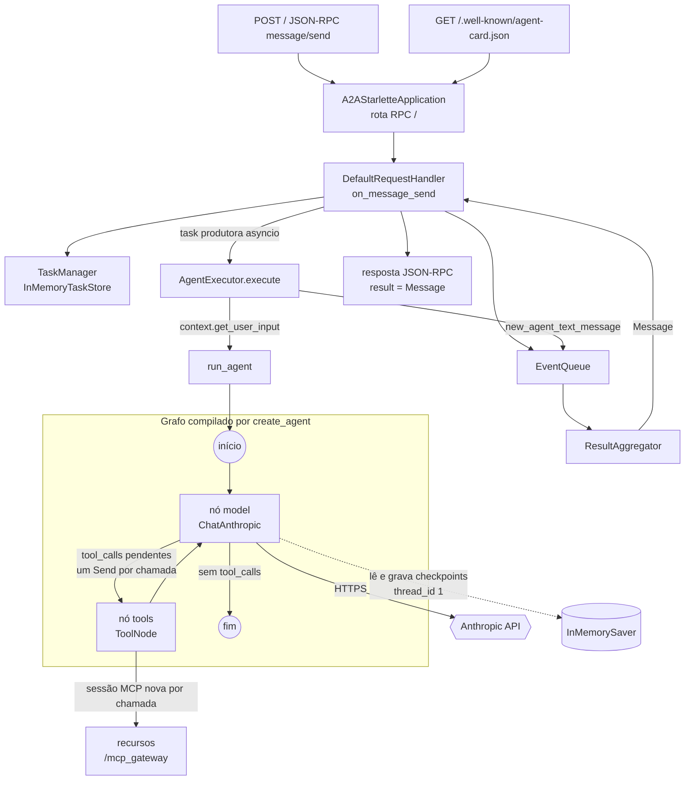

**Sequência de uma abertura de conta.** Fluxo típico pedido pelo prompt de `abrir_conta`. O número de idas ao LLM depende do modelo.

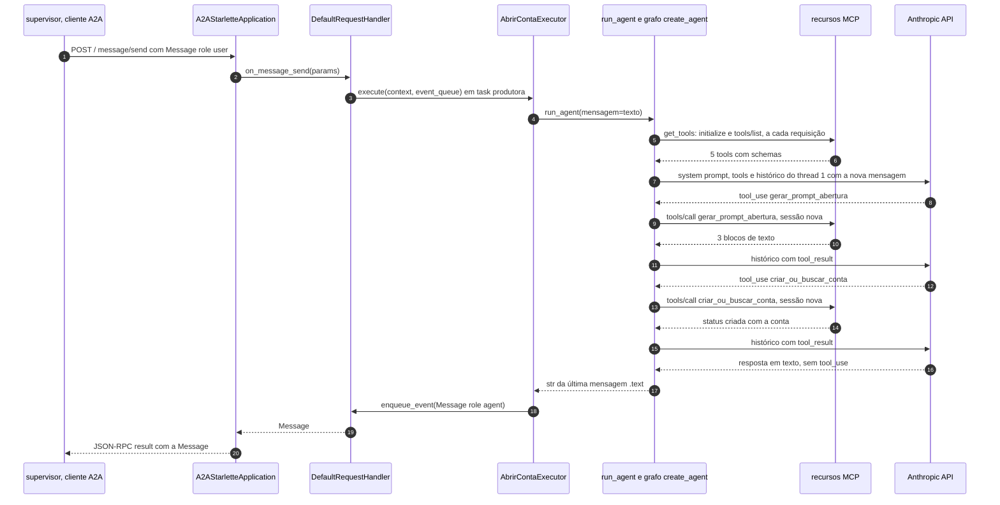

**Operações síncronas e assíncronas.** Toda a cadeia é `async`: Starlette → handler → executor → `agent.ainvoke` → `ChatAnthropic` (cliente assíncrono do SDK) → `ToolNode` → sessões MCP. Para o cliente, porém, `message/send` é **bloqueante** (`blocking=True` por padrão, `a2a/client/base_client.py:L87-L95`): a resposta HTTP só sai quando o agente termina.

### 6.3 Arquivo por arquivo

#### Arquivo: `agents/abrir_conta/server.py`

**Responsabilidade:** publicar o agente como servidor A2A, com o AgentCard e a rota JSON-RPC.
**Quem invoca:** o Uvicorn (`server:app`).
**O que invoca:** `executor.AbrirContaExecutor`, os componentes do a2a-sdk.
**Dependências:** `a2a.server.apps`, `a2a.server.request_handlers`, `a2a.server.tasks`, `a2a.types`.

```python
from a2a.server.apps import A2AStarletteApplication
from a2a.server.request_handlers import DefaultRequestHandler
from a2a.server.tasks import InMemoryTaskStore
from a2a.types import AgentCapabilities, AgentCard, AgentSkill

from executor import AbrirContaExecutor

# -----------------------
# Definição do skill
# -----------------------
skill = AgentSkill(
    id="abrir_conta",
    name="Abertura de Conta MDBank",
    description="Ajuda clientes a abrir uma conta bancária e explica os tipos de contas disponíveis.",
    tags=[
        "conta",
        "abrir conta",
        "abrir conta no banco",
        "conta corrente",
        "conta poupança",
        "abrir conta digital",
        "cadastro bancário",
    ],
    examples=[
        "quero abrir uma conta",
        "como faço para abrir uma conta?",
        "quais tipos de conta vocês oferecem?",
        "quero criar uma conta corrente",
        "posso abrir uma conta digital?",
    ],
)


# -----------------------
# Agent Card
# -----------------------
agent_card = AgentCard(
    name="Agente de Abertura de Conta MDBank",
    description="Especialista em abertura de contas bancárias do MDBank.",
    url="http://abrir_conta_agent:8000/",
    default_input_modes=["text"],
    default_output_modes=["text"],
    skills=[skill],
    version="1.0.0",
    capabilities=AgentCapabilities(),
)

# -----------------------
# Request Handler
# -----------------------
handler = DefaultRequestHandler(
    agent_executor=AbrirContaExecutor(),
    task_store=InMemoryTaskStore(),
)

# -----------------------
# A2A Application
# -----------------------
server = A2AStarletteApplication(
    http_handler=handler,
    agent_card=agent_card,
)

# EXPOSIÇÃO DO APP PARA O UVICORN
app = server.build()
```

| Linha(s) | Código | Explicação técnica | Motivação / impacto |
|---|---|---|---|
| [L1](../agents/abrir_conta/server.py#L1) | `from a2a.server.apps import A2AStarletteApplication` | Fábrica de app ASGI (Starlette) com as rotas do A2A | Exige o extra `http-server` ([requirements.txt:L1](../agents/abrir_conta/requirements.txt#L1)) |
| [L2](../agents/abrir_conta/server.py#L2) | `from a2a.server.request_handlers import DefaultRequestHandler` | Implementação padrão dos métodos A2A (`message/send`, `message/stream`, `tasks/get`, `tasks/cancel`, ...) sobre um `AgentExecutor` e um `TaskStore` | O projeto não precisa implementar o protocolo |
| [L3](../agents/abrir_conta/server.py#L3) | `from a2a.server.tasks import InMemoryTaskStore` | Repositório de `Task` em um dicionário em memória | Perde tudo ao reiniciar. Como os agentes respondem com `Message` e não criam `Task`, na prática fica vazio **[Inferência]** |
| [L4](../agents/abrir_conta/server.py#L4) | `from a2a.types import AgentCapabilities, AgentCard, AgentSkill` | Modelos Pydantic do esquema A2A | Serializados em camelCase no card |
| [L6](../agents/abrir_conta/server.py#L6) | `from executor import AbrirContaExecutor` | Import absoluto por nome de módulo; funciona porque o Uvicorn roda com `cwd=/app`, que entra no `sys.path` | Rodar de outro diretório quebra o import. Importar `executor` também importa `agent.abrir_conta`, que executa `load_dotenv()` e cria o cliente LLM e o cliente MCP **sem conectar** (a conexão MCP só ocorre em `get_tools`) |
| [L11-L14](../agents/abrir_conta/server.py#L11-L14) | `skill = AgentSkill(id="abrir_conta", name=..., description="Ajuda clientes a abrir uma conta bancária e explica os tipos de contas disponíveis.", ...)` | Declara uma capacidade do agente. O `id` é a chave usada pelo BFA ([bfa/discovery.py:L34](../bfa/discovery.py#L34)) | **[Análise]** A descrição promete "explicar os tipos de contas", mas não há tool ou dado sobre tipos de conta, e o prompt proíbe inventar |
| [L15-L23](../agents/abrir_conta/server.py#L15-L23) | `tags=["conta", "abrir conta", ...]` | Palavras-chave da skill | Indexadas pelo BM25 do BFA ([bfa/registry.py:L36-L40](../bfa/registry.py#L36-L40)) |
| [L24-L30](../agents/abrir_conta/server.py#L24-L30) | `examples=[...]` | Exemplos de pedidos | O BFA guarda os exemplos, mas **não os indexa** ([bfa/discovery.py:L39](../bfa/discovery.py#L39) vs [registry.py:L36-L40](../bfa/registry.py#L36-L40)). O supervisor não lê skills: o roteador tem os agentes descritos no prompt |
| [L37-L39](../agents/abrir_conta/server.py#L37-L39) | `agent_card = AgentCard(name=..., description=...` | Metadados do agente | Só para exibição |
| [L40](../agents/abrir_conta/server.py#L40) | `url="http://abrir_conta_agent:8000/"` | Endpoint RPC **absoluto** anunciado no card | **[Fato]** O cliente A2A manda as mensagens para `card.url`, não para a URL onde achou o card (`a2a/client/client_factory.py:L207-L208`). Funciona no Compose e com o arquivo `hosts` do modo local |
| [L41-L42](../agents/abrir_conta/server.py#L41-L42) | `default_input_modes=["text"]` / `default_output_modes=["text"]` | Modos de conteúdo aceitos e produzidos | A especificação sugere tipos MIME (`text/plain`); `"text"` é um atalho |
| [L43-L44](../agents/abrir_conta/server.py#L43-L44) | `skills=[skill]` / `version="1.0.0"` | Lista de skills e versão do agente | Uma skill por agente |
| [L45](../agents/abrir_conta/server.py#L45) | `capabilities=AgentCapabilities()` | Todas as capacidades ficam `None`: `streaming`, `push_notifications`, `state_transition_history`, `extensions` (`a2a/types.py:L1094-L1106`) | O cliente usa o caminho não streaming quando `capabilities.streaming` é falso (`a2a/client/base_client.py:L109`). Bate com o executor, que só emite uma mensagem final |
| [L51-L54](../agents/abrir_conta/server.py#L51-L54) | `handler = DefaultRequestHandler(agent_executor=AbrirContaExecutor(), task_store=InMemoryTaskStore())` | **Uma instância** de executor para todas as requisições | Funciona porque o executor não guarda estado próprio |
| [L59-L62](../agents/abrir_conta/server.py#L59-L62) | `server = A2AStarletteApplication(http_handler=handler, agent_card=agent_card)` | Junta o protocolo e o card | — |
| [L65](../agents/abrir_conta/server.py#L65) | `app = server.build()` | Monta o app Starlette com `POST /` (RPC), `GET /.well-known/agent-card.json`, o **alias legado** `GET /.well-known/agent.json` e, se o card declarar suporte, o endpoint de card estendido autenticado (`a2a/server/apps/jsonrpc/starlette_app.py:L100-L150`) | **[Fato]** O alias legado gera um aviso de depreciação, registrado em [logs/cartao_credito.err.log](../logs/cartao_credito.err.log) quando [docs/execucao-local-uv.md:L226-L227](execucao-local-uv.md) o usa. O nome `app` é o que o Uvicorn carrega |

#### Arquivo: `agents/abrir_conta/executor.py`

**Responsabilidade:** adaptar o contrato do A2A (`RequestContext` + `EventQueue`) à função `run_agent`.
**Quem invoca:** o `DefaultRequestHandler`, em uma task asyncio produtora, a cada `message/send`.
**O que invoca:** `agent.abrir_conta.run_agent`, `new_agent_text_message`.

```python
import logging

from a2a.server.agent_execution import AgentExecutor
from a2a.server.agent_execution.context import RequestContext
from a2a.server.events.event_queue import EventQueue
from a2a.utils import new_agent_text_message

from agent.abrir_conta import run_agent

logger = logging.getLogger("a2a")


class AbrirContaExecutor(AgentExecutor):

    async def execute(self, context: RequestContext, event_queue: EventQueue):
        logger.info("agent.execute.abrir_conta")

        user_text = context.get_user_input()

        response_balance_agent = await run_agent(mensagem=user_text)

        await event_queue.enqueue_event(
            new_agent_text_message(str(response_balance_agent))
        )

    async def cancel(self, context: RequestContext, event_queue: EventQueue):
        logger.info("agent.cancel.balance")
```

> **Conceito — `AgentExecutor` e `EventQueue` no a2a-sdk.** O handler do SDK cuida do protocolo e delega o trabalho a um `AgentExecutor`. O executor **não devolve** a resposta: ele **publica eventos** em uma fila (`Message`, `Task`, `TaskStatusUpdateEvent`, `TaskArtifactUpdateEvent`). Um agregador consome a fila. Em `message/send`, a primeira `Message` (ou a `Task` em estado final) vira o resultado do JSON-RPC; em `message/stream`, cada evento vira um evento SSE.

| Linha(s) | Código | Explicação técnica | Motivação / impacto |
|---|---|---|---|
| [L1](../agents/abrir_conta/executor.py#L1) | `import logging` | Logging da stdlib | — |
| [L3](../agents/abrir_conta/executor.py#L3) | `from a2a.server.agent_execution import AgentExecutor` | Classe base abstrata com `execute` e `cancel` | Contrato exigido pelo `DefaultRequestHandler` |
| [L4](../agents/abrir_conta/executor.py#L4) | `from a2a.server.agent_execution.context import RequestContext` | Contexto da requisição: mensagem, `task_id`, `context_id`, task atual | Os IDs são gerados pelo SDK quando o cliente não os envia (`default_request_handler.py:L235-L248`) |
| [L5](../agents/abrir_conta/executor.py#L5) | `from a2a.server.events.event_queue import EventQueue` | Fila assíncrona de eventos | — |
| [L6](../agents/abrir_conta/executor.py#L6) | `from a2a.utils import new_agent_text_message` | Cria `Message(role=agent, parts=[TextPart(text)], message_id=uuid4)` sem `task_id`/`context_id` (`a2a/utils/message.py:L14-L35`) | A resposta não fica ligada a nenhuma task ou contexto A2A |
| [L8](../agents/abrir_conta/executor.py#L8) | `from agent.abrir_conta import run_agent` | Importa a camada do agente | Executa os efeitos colaterais de importação desse módulo ([L10-L27](../agents/abrir_conta/agent/abrir_conta.py#L10-L27)) |
| [L10](../agents/abrir_conta/executor.py#L10) | `logger = logging.getLogger("a2a")` | Usa o **mesmo nome de logger** do SDK (o SDK registra em filhos de `a2a`) | Sem `basicConfig` neste serviço, o logger raiz fica em `WARNING`, e os `logger.info` deste arquivo **não aparecem** **[Inferência]** |
| [L13](../agents/abrir_conta/executor.py#L13) | `class AbrirContaExecutor(AgentExecutor):` | Implementação concreta | — |
| [L15](../agents/abrir_conta/executor.py#L15) | `async def execute(self, context, event_queue):` | Executado em uma task produtora criada pelo handler | — |
| [L16](../agents/abrir_conta/executor.py#L16) | `logger.info("agent.execute.abrir_conta")` | Marca de execução | Ver [L10](../agents/abrir_conta/executor.py#L10) |
| [L18](../agents/abrir_conta/executor.py#L18) | `user_text = context.get_user_input()` | Junta as partes de texto da mensagem com `"\n"` (`a2a/server/agent_execution/context.py:L83-L97`) | Só o texto **desta** mensagem; o histórico vem do checkpointer do agente, não do A2A |
| [L20](../agents/abrir_conta/executor.py#L20) | `response_balance_agent = await run_agent(mensagem=user_text)` | Chama o agente LangChain. **Não há `try/except`** | **[Hipótese]** O nome `balance` (e `agent.cancel.balance` em [L27](../agents/abrir_conta/executor.py#L27)) sugere código adaptado de um exemplo de "agente de saldo". **[Fato]** Uma exceção sobe ao handler, que registra 'Agent execution failed', cancela o produtor e relança (`default_request_handler.py:L336-L339`); o app JSON-RPC devolve `InternalError(message=str(e))` (`jsonrpc_app.py:L406-L410`) |
| [L22-L24](../agents/abrir_conta/executor.py#L22-L24) | `await event_queue.enqueue_event(new_agent_text_message(str(response_balance_agent)))` | Publica uma `Message` final | O agregador a devolve como resultado de `message/send`. Não há streaming de tokens nem estados de task |
| [L26-L27](../agents/abrir_conta/executor.py#L26-L27) | `async def cancel(...): logger.info("agent.cancel.balance")` | Implementação vazia (só log) | Não cancela o `run_agent` em curso nem publica estado `canceled`. Como nenhuma `Task` é criada, `tasks/cancel` não tem o que cancelar **[Inferência]** |

#### Arquivo: `agents/abrir_conta/agent/abrir_conta.py`

**Responsabilidade:** configurar o LLM, as tools MCP, a memória e o prompt, e executar uma rodada de conversa.
**Quem invoca:** `executor.AbrirContaExecutor.execute`.
**O que invoca:** `MultiServerMCPClient.get_tools` (rede: MCP), `create_agent`, `agent.ainvoke` (rede: Anthropic e MCP).

```python
import os

from dotenv import load_dotenv
from langchain.agents import create_agent
from langchain.chat_models import init_chat_model
from langchain_core.messages import HumanMessage
from langchain_mcp_adapters.client import MultiServerMCPClient
from langgraph.checkpoint.memory import InMemorySaver

load_dotenv()

_llm = init_chat_model(
    model="claude-haiku-5-5",
    model_provider="anthropic",
    api_key=os.getenv("ANTHROPIC_API_KEY"),
)

client = MultiServerMCPClient(
    {
        "conta": {
            "transport": "http",
            "url": "http://recursos:8000/mcp_gateway",
        },  # type: ignore
    }
)

memory = InMemorySaver()


async def build_agent():
    tools = await client.get_tools()

    agent = create_agent(
        _llm,
        tools=tools,
        system_prompt=(
            "Você é um assistente do MDBank para abertura de contas.\n\n"
            "Você deve SEMPRE usar tools para decisões reais.\n\n"
            "Fluxo obrigatório:\n"
            "1. Se cliente pedir cartão:\n"
            "   - Use consultar_conta\n"
            "   - Se não existir:\n"
            "       → informe o problema\n"
            "       → ofereça abrir conta\n\n"
            "2. Para abrir conta:\n"
            "   - Use gerar_prompt_abertura\n"
            "   - Depois criar_ou_buscar_conta\n\n"
            "3. Após conta criada:\n"
            "   - Use solicitar_cartao\n\n"
            "Regras:\n"
            "- Nunca invente dados\n"
            "- Sempre use tools\n"
            "- Use mensagens claras para o cliente\n"
        ),
        checkpointer=memory,
    )

    return agent


async def run_agent(mensagem: str, thread_id: str = "1"):
    agent = await build_agent()

    resultado = await agent.ainvoke(
        {"messages": [HumanMessage(content=mensagem)]},
        {"configurable": {"thread_id": thread_id}},
    )

    return str(resultado["messages"][-1].text)
```

| Linha(s) | Código | Explicação técnica | Motivação / impacto |
|---|---|---|---|
| [L1](../agents/abrir_conta/agent/abrir_conta.py#L1) | `import os` | Leitura de variável de ambiente | [L15](../agents/abrir_conta/agent/abrir_conta.py#L15) |
| [L3](../agents/abrir_conta/agent/abrir_conta.py#L3) | `from dotenv import load_dotenv` | python-dotenv | — |
| [L4](../agents/abrir_conta/agent/abrir_conta.py#L4) | `from langchain.agents import create_agent` | Fábrica do agente de tool calling (LangChain 1.x) | Ver [4.4](#44-análise-dos-frameworks-principais) |
| [L5](../agents/abrir_conta/agent/abrir_conta.py#L5) | `from langchain.chat_models import init_chat_model` | Fábrica de modelos por provedor | Permite trocar o provedor mudando strings (como foi feito na migração do OpenAI) |
| [L6](../agents/abrir_conta/agent/abrir_conta.py#L6) | `from langchain_core.messages import HumanMessage` | Mensagem do usuário no formato LangChain | Entrada do grafo |
| [L7](../agents/abrir_conta/agent/abrir_conta.py#L7) | `from langchain_mcp_adapters.client import MultiServerMCPClient` | Cliente MCP para vários servidores | Só um servidor está configurado |
| [L8](../agents/abrir_conta/agent/abrir_conta.py#L8) | `from langgraph.checkpoint.memory import InMemorySaver` | Checkpointer em memória | `langgraph` não está no `requirements.txt` (vem de `langchain`) |
| [L10](../agents/abrir_conta/agent/abrir_conta.py#L10) | `load_dotenv()` | Carrega o `.env` no `os.environ` **na importação** | Precisa rodar antes de [L15](../agents/abrir_conta/agent/abrir_conta.py#L15) |
| [L12-L16](../agents/abrir_conta/agent/abrir_conta.py#L12-L16) | `_llm = init_chat_model(model="claude-haiku-5-5", model_provider="anthropic", api_key=os.getenv("ANTHROPIC_API_KEY"))` | Cria **um** `ChatAnthropic` por processo, sem chamada de rede | Defaults: `max_tokens` = 128.000 (perfil do modelo), `max_retries`=2, timeout de 600 s do SDK, thinking adaptativo da API com `effort` padrão. Nada disso é configurado aqui. Sem a chave, `api_key` fica `None`; se a falha aparece na criação ou na primeira chamada não foi verificado |
| [L18-L25](../agents/abrir_conta/agent/abrir_conta.py#L18-L25) | `client = MultiServerMCPClient({"conta": {"transport": "http", "url": "http://recursos:8000/mcp_gateway"}})  # type: ignore` | Registra a conexão do servidor `"conta"` sem conectar. `"http"` é aceito em runtime como apelido de Streamable HTTP (`langchain_mcp_adapters/sessions.py:L451`) | O `# type: ignore` existe porque o `TypedDict` da conexão declara `transport: Literal["streamable_http"]` (`sessions.py:L167`). URL fixa com o nome DNS do Compose |
| [L27](../agents/abrir_conta/agent/abrir_conta.py#L27) | `memory = InMemorySaver()` | Um checkpointer por processo, global | A memória sobrevive entre requisições, mas não a reinícios. Compartilhada por todas as conversas que usam o mesmo `thread_id` |
| [L30-L31](../agents/abrir_conta/agent/abrir_conta.py#L30-L31) | `async def build_agent():` / `tools = await client.get_tools()` | Abre uma sessão MCP (`initialize` + `tools/list`) e converte as tools em `StructuredTool` | Roda **a cada mensagem** ([L62](../agents/abrir_conta/agent/abrir_conta.py#L62)): uma ida e volta de rede extra, mas as tools novas do servidor aparecem sem reiniciar o agente (o oposto de `cartao_credito`) |
| [L33-L36](../agents/abrir_conta/agent/abrir_conta.py#L33-L36) | `agent = create_agent(_llm, tools=tools, system_prompt=(...)` | Compila o grafo modelo ↔ tools ([4.4](#44-análise-dos-frameworks-principais)) | Recompilar a cada mensagem custa CPU (pouco) |
| [L37-L38](../agents/abrir_conta/agent/abrir_conta.py#L37-L38) | `"Você é um assistente do MDBank para abertura de contas.\n\n"` / `"Você deve SEMPRE usar tools para decisões reais.\n\n"` | Papel e regra geral, em literais de string concatenados por justaposição (o Python os junta em tempo de compilação) | Reforça o uso de tools contra alucinação de dados |
| [L39-L44](../agents/abrir_conta/agent/abrir_conta.py#L39-L44) | `"1. Se cliente pedir cartão:\n"` ... `"→ ofereça abrir conta\n\n"` | Passo 1: checar a conta quando pedirem cartão | **Sobreposição** com o agente de cartão. Com o roteador escolhendo os dois agentes, os dois checam a conta |
| [L45-L47](../agents/abrir_conta/agent/abrir_conta.py#L45-L47) | `"2. Para abrir conta:\n"` / `"- Use gerar_prompt_abertura\n"` / `"- Depois criar_ou_buscar_conta\n\n"` | Passo 2: obriga uma tool "de prompt" antes da criação | Uma ida e volta extra ao LLM ([5.2](#52-arquivo-recursosapppy), bloco 6) |
| [L48-L49](../agents/abrir_conta/agent/abrir_conta.py#L48-L49) | `"3. Após conta criada:\n"` / `"- Use solicitar_cartao\n\n"` | Passo 3: emitir cartão depois da conta | **[Inferência]** Lido ao pé da letra, leva o agente de **conta** a emitir cartão até sem pedido, e com um `tipo` escolhido pelo modelo (o prompt não lista tipos válidos) |
| [L50-L53](../agents/abrir_conta/agent/abrir_conta.py#L50-L53) | `"Regras:\n- Nunca invente dados\n- Sempre use tools\n- Use mensagens claras para o cliente\n"` | Regras gerais | Não diz para pedir nome e CPF quando faltarem; fica implícito pelos parâmetros obrigatórios das tools |
| [L55](../agents/abrir_conta/agent/abrir_conta.py#L55) | `checkpointer=memory,` | Liga a memória ao grafo | Habilita a continuidade por `thread_id` |
| [L58](../agents/abrir_conta/agent/abrir_conta.py#L58) | `return agent` | Grafo compilado | — |
| [L61](../agents/abrir_conta/agent/abrir_conta.py#L61) | `async def run_agent(mensagem: str, thread_id: str = "1"):` | `thread_id` com **padrão fixo** | **[Fato]** O executor nunca passa `thread_id` ([executor.py:L20](../agents/abrir_conta/executor.py#L20)): **todas as conversas de todos os usuários caem no thread `"1"`** |
| [L62](../agents/abrir_conta/agent/abrir_conta.py#L62) | `agent = await build_agent()` | Reconstrói o agente | Ver [L30-L31](../agents/abrir_conta/agent/abrir_conta.py#L30-L31) |
| [L64-L67](../agents/abrir_conta/agent/abrir_conta.py#L64-L67) | `resultado = await agent.ainvoke({"messages": [HumanMessage(content=mensagem)]}, {"configurable": {"thread_id": thread_id}})` | O checkpointer carrega o estado do thread; a nova mensagem é **acrescentada** à lista `messages` (reducer de mensagens do `AgentState`); o grafo roda o laço até a resposta final; o estado é gravado de novo | O histórico inteiro (mensagens, `tool_use`, `tool_result`, blocos de thinking) é reenviado ao LLM a cada chamada de modelo. O custo cresce sem limite com a conversa compartilhada ([11.6](#116-chamadas-ao-llm-por-mensagem-e-custo)) |
| [L69](../agents/abrir_conta/agent/abrir_conta.py#L69) | `return str(resultado["messages"][-1].text)` | `.text` é **propriedade** no langchain-core 1.x e concatena só os blocos de texto **[Teste]** ([A.3](#a3-langchain-core-text-e-jsonoutputparser)) | Necessário com o Claude, cujo `content` é uma lista de blocos. No langchain-core 0.3, `text` era um **método**; esta linha devolveria `"<bound method ...>"`. É mais uma razão para fixar `langchain-core>=1` |

#### Arquivo: `agents/cartao_credito/server.py`

Mesma estrutura de [agents/abrir_conta/server.py](../agents/abrir_conta/server.py). Linhas com a mesma semântica aparecem como "idem".

| Linha(s) | Código | Explicação | Diferença em relação a `abrir_conta` |
|---|---|---|---|
| [L1-L4](../agents/cartao_credito/server.py#L1-L4) | imports do a2a-sdk | idem [abrir_conta/server.py:L1-L4](../agents/abrir_conta/server.py#L1-L4) | — |
| [L5](../agents/cartao_credito/server.py#L5) | `from executor import CartaoDeCreditoExecutor` | idem L6 | Outro executor; sem linha em branco entre os grupos de import |
| [L10-L13](../agents/cartao_credito/server.py#L10-L13) | `AgentSkill(id="cartao_credito", name="Cartões de Crédito MDBank", description="Ajuda clientes com dúvidas, solicitação e limites de cartões de crédito.")` | Skill do domínio de cartões | A descrição menciona **limites** e **aumento de limite** ([L20](../agents/cartao_credito/server.py#L20)), mas não há tool para isso |
| [L14-L15](../agents/cartao_credito/server.py#L14-L15) | `tags=["cartão", "credito", "limite", "platinum", "gold", "silver", "mdzao"]` | Tags | Inclui os tipos de cartão, úteis para o BM25 |
| [L16-L22](../agents/cartao_credito/server.py#L16-L22) | `examples=[ "quais cartões vocês têm?", ... "quero um cartão mdzao" ]` | Exemplos | "quais cartões vocês têm?" choca com a regra do prompt "NÃO pode responder sem verificar no sistema" ([cartoes.py:L45](../agents/cartao_credito/agent/cartoes.py#L45)) |
| [L28-L37](../agents/cartao_credito/server.py#L28-L37) | `AgentCard(name="Agente de Cartões MDBank", ..., url="http://cartao_credito_agent:8000/", ...)` | idem [abrir_conta/server.py:L37-L46](../agents/abrir_conta/server.py#L37-L46) | Nome e URL |
| [L41-L44](../agents/cartao_credito/server.py#L41-L44) | `DefaultRequestHandler(agent_executor=CartaoDeCreditoExecutor(), task_store=InMemoryTaskStore())` | idem L51-L54 | — |
| [L49-L55](../agents/cartao_credito/server.py#L49-L55) | `A2AStarletteApplication(...)` / `app = server.build()` | idem L59-L65 | — |

#### Arquivo: `agents/cartao_credito/executor.py`

| Linha(s) | Código | Explicação | Diferença em relação a `abrir_conta` |
|---|---|---|---|
| [L1-L7](../agents/cartao_credito/executor.py#L1-L7) | imports, incluindo `from agent.cartoes import run_agent` | idem [abrir_conta/executor.py:L1-L8](../agents/abrir_conta/executor.py#L1-L8) | Importa `agent.cartoes` |
| [L9](../agents/cartao_credito/executor.py#L9) | `logger = logging.getLogger("a2a")` | idem L10 | — |
| [L12-L23](../agents/cartao_credito/executor.py#L12-L23) | `class CartaoDeCreditoExecutor(AgentExecutor): async def execute(...)` | idem L13-L24 | Log `"agent.execute.cartao_credito"`. Mantém o nome `response_balance_agent` |
| [L25-L26](../agents/cartao_credito/executor.py#L25-L26) | `async def cancel(...): logger.info("agent.cancel.balance")` | idem L26-L27 | — |

#### Arquivo: `agents/cartao_credito/agent/cartoes.py`

```python
import os

from dotenv import load_dotenv
from langchain.agents import create_agent
from langchain.chat_models import init_chat_model
from langchain_core.messages import HumanMessage
from langchain_mcp_adapters.client import MultiServerMCPClient
from langgraph.checkpoint.memory import InMemorySaver

load_dotenv()

_llm = init_chat_model(
    model="claude-haiku-5-5",
    model_provider="anthropic",
    api_key=os.getenv("ANTHROPIC_API_KEY"),
)

client = MultiServerMCPClient(
    {
        "conta": {
            "transport": "http",
            "url": "http://recursos:8000/mcp_gateway",
        }  # type: ignore
    }
)

memory = InMemorySaver()

agent = None


async def build_cartao_agent():
    tools = await client.get_tools()

    agente_cartoes = create_agent(
        _llm,
        tools=tools,
        system_prompt=(
            "Você é especialista em cartões do MDBank.\n\n"
            "Tipos disponíveis: platinum, gold, silver, mdzao\n\n"
            "=============================\n"
            "REGRAS OBRIGATÓRIAS (CRÍTICO)\n"
            "=============================\n"
            "1. Você DEVE obrigatoriamente chamar a tool consultar_conta\n"
            "2. Você NÃO pode responder sem verificar no sistema\n"
            "3. Você NÃO pode assumir se o cliente tem conta\n\n"
            "=============================\n"
            "FLUXO\n"
            "=============================\n"
            "PASSO 1:\n"
            "→ Identificar CPF (usar memória se já tiver)\n"
            "→ Se não tiver CPF, pedir ao cliente\n\n"
            "PASSO 2:\n"
            "→ Chamar consultar_conta\n\n"
            "PASSO 3:\n"
            "→ Se existe = False:\n"
            "   - Informar que não possui conta\n"
            "   - Oferecer abrir conta\n"
            "   - NÃO solicitar cartão\n\n"
            "→ Se existe = True:\n"
            "   - Chamar solicitar_cartao\n\n"
            "=============================\n"
            "REGRAS GERAIS\n"
            "=============================\n"
            "- Sempre use tools\n"
            "- Nunca invente dados\n"
            "- Use memória para recuperar CPF\n"
            "- Nunca pule etapas\n\n"
            "=============================\n"
            "ERROS\n"
            "=============================\n"
            "- Use mensagem da tool\n"
            "- Explique claramente\n"
        ),
        checkpointer=memory,
    )

    return agente_cartoes


async def run_agent(mensagem: str, thread_id: str = "1"):
    global agent

    if not agent:
        agent = await build_cartao_agent()

    resultado = await agent.ainvoke(
        {"messages": [HumanMessage(content=mensagem)]},
        {"configurable": {"thread_id": thread_id}},
    )

    return str(resultado["messages"][-1].text)
```

| Linha(s) | Código | Explicação técnica | Motivação / impacto |
|---|---|---|---|
| [L1-L27](../agents/cartao_credito/agent/cartoes.py#L1-L27) | imports, `load_dotenv()`, `_llm`, `client`, `memory` | idem [abrir_conta.py:L1-L27](../agents/abrir_conta/agent/abrir_conta.py#L1-L27) | Mesma configuração de LLM e MCP. O nome do servidor também é `"conta"` |
| [L29](../agents/cartao_credito/agent/cartoes.py#L29) | `agent = None` | Cache global do grafo compilado | Evita rebuscar as tools a cada mensagem |
| [L32-L33](../agents/cartao_credito/agent/cartoes.py#L32-L33) | `async def build_cartao_agent():` / `tools = await client.get_tools()` | Igual a `build_agent` | Só roda na primeira mensagem |
| [L39-L40](../agents/cartao_credito/agent/cartoes.py#L39-L40) | `"Você é especialista em cartões do MDBank.\n\n"` / `"Tipos disponíveis: platinum, gold, silver, mdzao\n\n"` | Papel e catálogo | O único lugar que lista os tipos válidos. A tool não os valida ([recursos/app.py:L200](../recursos/app.py#L200)) |
| [L41-L46](../agents/cartao_credito/agent/cartoes.py#L41-L46) | `"REGRAS OBRIGATÓRIAS (CRÍTICO)"` / `"1. Você DEVE obrigatoriamente chamar a tool consultar_conta"` / `"2. Você NÃO pode responder sem verificar no sistema"` / `"3. Você NÃO pode assumir se o cliente tem conta"` | Ênfase em caixa alta e cabeçalhos | **[Inferência]** Força a consulta mesmo em perguntas genéricas ("quais cartões vocês têm?"), o que obriga a pedir o CPF antes de responder sobre o catálogo |
| [L47-L52](../agents/cartao_credito/agent/cartoes.py#L47-L52) | `"PASSO 1:"` / `"→ Identificar CPF (usar memória se já tiver)"` / `"→ Se não tiver CPF, pedir ao cliente"` | Procedimento operacional no prompt | **Risco crítico** combinado com o thread único: a "memória" contém CPFs de **outros** clientes ([6.6](#66-limitações-e-riscos)) |
| [L53-L61](../agents/cartao_credito/agent/cartoes.py#L53-L61) | `"PASSO 2: → Chamar consultar_conta"` / `"PASSO 3: → Se existe = False: ... NÃO solicitar cartão"` / `"→ Se existe = True: - Chamar solicitar_cartao"` | Árvore de decisão baseada no campo `existe` da tool | Acopla o prompt ao formato de retorno de `consultar_conta` ([recursos/app.py:L127-L128](../recursos/app.py#L127-L128)). Não manda perguntar o tipo do cartão |
| [L62-L68](../agents/cartao_credito/agent/cartoes.py#L62-L68) | `"REGRAS GERAIS"` ... `"- Use memória para recuperar CPF"` / `"- Nunca pule etapas"` | Repete as regras | Redundância de prompt |
| [L69-L73](../agents/cartao_credito/agent/cartoes.py#L69-L73) | `"ERROS"` / `"- Use mensagem da tool"` / `"- Explique claramente"` | Tratamento de erro em linguagem natural | Encaixa no padrão de [recursos/app.py:L208](../recursos/app.py#L208) (`mensagem`) |
| [L75](../agents/cartao_credito/agent/cartoes.py#L75) | `checkpointer=memory,` | idem | — |
| [L78](../agents/cartao_credito/agent/cartoes.py#L78) | `return agente_cartoes` | — | — |
| [L81](../agents/cartao_credito/agent/cartoes.py#L81) | `async def run_agent(mensagem: str, thread_id: str = "1"):` | idem | Mesmo thread fixo |
| [L82-L85](../agents/cartao_credito/agent/cartoes.py#L82-L85) | `global agent` / `if not agent: agent = await build_cartao_agent()` | Inicialização preguiçosa (*lazy singleton*) | **[Inferência]** Se o `recursos` estiver fora do ar na primeira mensagem, `get_tools` falha, `agent` continua `None` e a próxima mensagem tenta de novo. Se o servidor MCP mudar as tools, o agente só as vê depois de reiniciar. Duas primeiras mensagens simultâneas constroem o grafo duas vezes (inofensivo) |
| [L87-L92](../agents/cartao_credito/agent/cartoes.py#L87-L92) | `resultado = await agent.ainvoke(...)` / `return str(resultado["messages"][-1].text)` | idem [abrir_conta.py:L64-L69](../agents/abrir_conta/agent/abrir_conta.py#L64-L69) | — |

#### Arquivos de build e configuração dos agentes

**`requirements.txt`** (idêntico nos dois):

| Linha | Código | Explicação | Observação |
|---|---|---|---|
| [L1](../agents/abrir_conta/requirements.txt#L1) | `a2a-sdk[http-server]<1` | SDK A2A com extras de servidor (`fastapi`, `starlette`, `sse-starlette`) | Única dependência com restrição de versão |
| [L2](../agents/abrir_conta/requirements.txt#L2) | `httpx` | Cliente HTTP | Já vem com o a2a-sdk e o SDK MCP |
| [L3](../agents/abrir_conta/requirements.txt#L3) | `pydantic` | Validação | Já vem com tudo o mais |
| [L4](../agents/abrir_conta/requirements.txt#L4) | `uvicorn` | Servidor ASGI | Necessário para o `CMD` |
| [L5](../agents/abrir_conta/requirements.txt#L5) | `langchain` | `create_agent`, `init_chat_model`; traz `langgraph` | — |
| [L6](../agents/abrir_conta/requirements.txt#L6) | `langchain-anthropic` | `ChatAnthropic` | Carregado dinamicamente pelo `init_chat_model` |
| [L7](../agents/abrir_conta/requirements.txt#L7) | `langchain-community` | Integrações da comunidade | **Não usado** |
| [L8](../agents/abrir_conta/requirements.txt#L8) | `langchain-mcp-adapters` | Cliente MCP → tools | Fixa `mcp<2` (0.3.2) |
| [L9](../agents/abrir_conta/requirements.txt#L9) | `python-dotenv` | `.env` | — |

**`Dockerfile`** (idêntico nos dois): igual ao de `recursos` ([5.3](#53-arquivos-de-build-e-configuração)), exceto a última linha:

| Linha | Código | Explicação | Impacto |
|---|---|---|---|
| [L18](../agents/abrir_conta/Dockerfile#L18) | `CMD ["uvicorn", "server:app", "--host", "0.0.0.0", "--port", "8000", "--reload"]` | Sobe o app A2A. `--reload` cria um processo supervisor que observa os arquivos e reinicia o worker a cada mudança | É um perfil de desenvolvimento dentro da imagem. Cada reinício **zera a memória** (`InMemorySaver`) e o cache de agente |

**`.env`:** chaves `ANTHROPIC_API_KEY` e `ANTHROPIC_WORKSPACE_ID` ([2.6](#26-variáveis-de-ambiente-e-segredos)). `.dockerignore`, `.gitignore` e `.vscode/settings.json` são iguais aos de `recursos`.

### 6.4 Rastreamento de chamadas

**Cadeia de uma requisição A2A dentro do a2a-sdk [Fato]** (caminhos em `agents/cartao_credito/.venv/Lib/site-packages/a2a/`):

1. `POST /` chega ao app JSON-RPC, que valida o envelope e despacha `message/send` para `DefaultRequestHandler.on_message_send` (`server/request_handlers/default_request_handler.py:L289`).
2. `_setup_message_execution` (L199-L259) cria o `TaskManager`, monta o `RequestContext` (gera `task_id`/`context_id` quando ausentes), cria ou reaproveita a `EventQueue` e dispara o **executor em uma task produtora**.
3. O `ResultAggregator.consume_and_break_on_interrupt` (L322-L330) consome a fila. Em modo bloqueante, espera o resultado final.
4. O executor publica a `Message`. O handler limpa o produtor (L340-L348) e devolve a `Message` (L350-L362).
5. Se houver exceção: `logger.exception('Agent execution failed')`, `producer_task.cancel()` e `raise` (L336-L339). O app converte em `InternalError(message=str(e))` (`server/apps/jsonrpc/jsonrpc_app.py:L406-L410`).

| Função | Quem chama | Parâmetros | Processamento | Dependências | Retorno | Erros | Efeitos colaterais |
|---|---|---|---|---|---|---|---|
| `AbrirContaExecutor.execute` / `CartaoDeCreditoExecutor.execute` | `DefaultRequestHandler` (task produtora) | `RequestContext`, `EventQueue` | Extrai o texto, chama `run_agent` e publica a `Message` | `run_agent`, `new_agent_text_message` | `None` (resultado via fila) | Não trata: sobe ao handler | Evento na fila |
| `*.cancel` | `tasks/cancel` | idem | Só log | — | `None` | — | — |
| `build_agent()` (abrir_conta) | `run_agent`, toda mensagem | — | `get_tools` + `create_agent` | MCP (rede), LangChain | Grafo compilado | Falha MCP sobe | Uma sessão MCP aberta e fechada |
| `build_cartao_agent()` | `run_agent`, só na 1ª vez | — | idem | idem | idem | idem | idem |
| `run_agent(mensagem, thread_id="1")` | Executores | Texto; thread (sempre o padrão) | `ainvoke` do grafo com checkpoint | LLM, MCP, `InMemorySaver` | `str` (texto final) | Erros do LLM (após 2 retries do SDK) e de conexão MCP sobem; `isError` do MCP volta ao modelo | Grava o checkpoint do thread `"1"`; pode criar conta ou cartão via tools |

### 6.5 Recursos de IA dos agentes

| Recurso | O que é | Como foi implementado | Por que foi escolhido | Limitações | Alternativas |
|---|---|---|---|---|---|
| **Laço de tool calling (estilo ReAct)** | O modelo alterna entre decidir uma ação (`tool_use`), observar o resultado (`tool_result`) e responder | `create_agent(_llm, tools, system_prompt, checkpointer)` | **[Inferência]** API de alto nível do LangChain 1.x; dispensa escrever o laço | `recursion_limit` 9.999: sem teto prático de iterações; sem `effort`, `max_tokens` nem timeout ajustados | Laço manual com o SDK `anthropic`; Tool Runner do SDK |
| **System prompt procedural** | Regras e fluxo do negócio em linguagem natural | Literais concatenados nos dois agentes | Rápido de iterar | Não determinístico; regras duplicadas com o roteador e com a tool. **[Análise]** A ênfase em caixa alta e as regras repetidas alongam o prompt sem garantir que o modelo as cumpra | Regras em código (tools, validações) e prompts menores |
| **Tools dinâmicas via MCP** | Tools descobertas em runtime no servidor | `MultiServerMCPClient.get_tools()` | **[Fato]** É o objetivo declarado do projeto (README) | Uma sessão MCP por chamada; acoplamento por URL fixa | Tools locais; cache de sessões |
| **Memória de conversa** | Histórico persistido entre requisições | `InMemorySaver` + `thread_id` | Simplicidade | Thread único global: vazamento entre usuários; perda no reinício; crescimento sem limite | `thread_id` por sessão; checkpointers persistentes; resumo ou *compaction* |
| **AgentCard e skills (A2A)** | Anúncio de capacidades para descoberta | `AgentSkill` + `AgentCard` | **[Fato]** Interoperabilidade A2A (README) | O supervisor não usa as skills para rotear; o BFA não é consumido | Registro central integrado ao roteador |
| **Modelo `claude-haiku-5-5`** | Modelo mais barato da geração atual | `init_chat_model` | **[Fato]** O commit `b95d574` trocou Sonnet 5.5 por Haiku 5.5. **[Hipótese]** Custo e latência | Thinking adaptativo ligado por padrão (latência e tokens) sem `effort` configurado | `effort="low"` em rotas simples; outro modelo para tarefas complexas |

**Ausentes [Fato]:** streaming de resposta (o card não declara `streaming` e o executor emite uma só mensagem), ciclo de vida de `Task` (estados, artefatos), saída estruturada, validação de entrada e PII, avaliação automatizada e tracing.

### 6.6 Limitações e riscos

1. **Vazamento entre usuários:** `thread_id="1"` em [abrir_conta.py:L61](../agents/abrir_conta/agent/abrir_conta.py#L61) e [cartoes.py:L81](../agents/cartao_credito/agent/cartoes.py#L81), somado a "usar memória para recuperar CPF" ([cartoes.py:L51](../agents/cartao_credito/agent/cartoes.py#L51)). **[Inferência]** O usuário B pode receber um cartão emitido no CPF do usuário A.
2. **Concorrência no mesmo thread:** duas requisições simultâneas de usuários diferentes intercalam leituras e gravações do mesmo checkpoint. **[Inferência]** Isso pode gerar histórico inconsistente (por exemplo, um `tool_use` sem `tool_result`, que a API rejeita).
3. **Responsabilidades sobrepostas:** o agente de conta também emite cartão ([abrir_conta.py:L48-L49](../agents/abrir_conta/agent/abrir_conta.py#L48-L49)).
4. **Capacidades anunciadas sem suporte:** "tipos de contas" e "aumentar limite" estão nas skills, mas não há tool para nenhuma das duas.
5. **Erros:** nenhuma captura no executor; mensagens internas chegam ao supervisor via `InternalError`; `cancel` não faz nada.
6. **Ciclo de vida:** `--reload` em produção zera a memória a cada mudança de arquivo; `abrir_conta` faz uma ida e volta MCP extra por mensagem.
7. **Logs:** `logger.info` sem configuração de logging não aparece.

---

## 7. Projeto 3 — `supervisor` (orquestrador)

### 7.1 Visão geral

| Aspecto | Descrição |
|---|---|
| Nome e propósito | Orquestrador central: recebe a mensagem do usuário, **classifica a intenção com um LLM**, delega aos agentes especialistas via A2A e **agrega** as respostas |
| Problema que resolve | Um pedido pode envolver mais de um domínio ("quero um cartão", sem ter conta). O supervisor esconde dos frontends quantos agentes existem e onde estão |
| Linguagem | Python |
| Frameworks | FastAPI, LangGraph (`StateGraph`, `Send`), LangChain (`create_agent`, `JsonOutputParser`), a2a-sdk (cliente), ag-ui-protocol |
| Arquitetura | `app.py` (interfaces REST e AG-UI) → `src/services.py` (dois executores, o grafo e o cliente A2A) → `src/agents.py` (roteador LLM). `src/schemas.py` define o contrato REST |
| Pontos de entrada | `uvicorn app:app` ([supervisor/Dockerfile:L18](../supervisor/Dockerfile#L18)); rotas `POST /chat` e `POST /` |
| Integrações | Entrada: Streamlit (REST) e React (AG-UI/SSE). Saída: agentes A2A e Anthropic API |
| Relação com os demais | Único ponto de entrada do backend para os frontends. Não usa o BFA |

### 7.2 Arquitetura e fluxo de execução

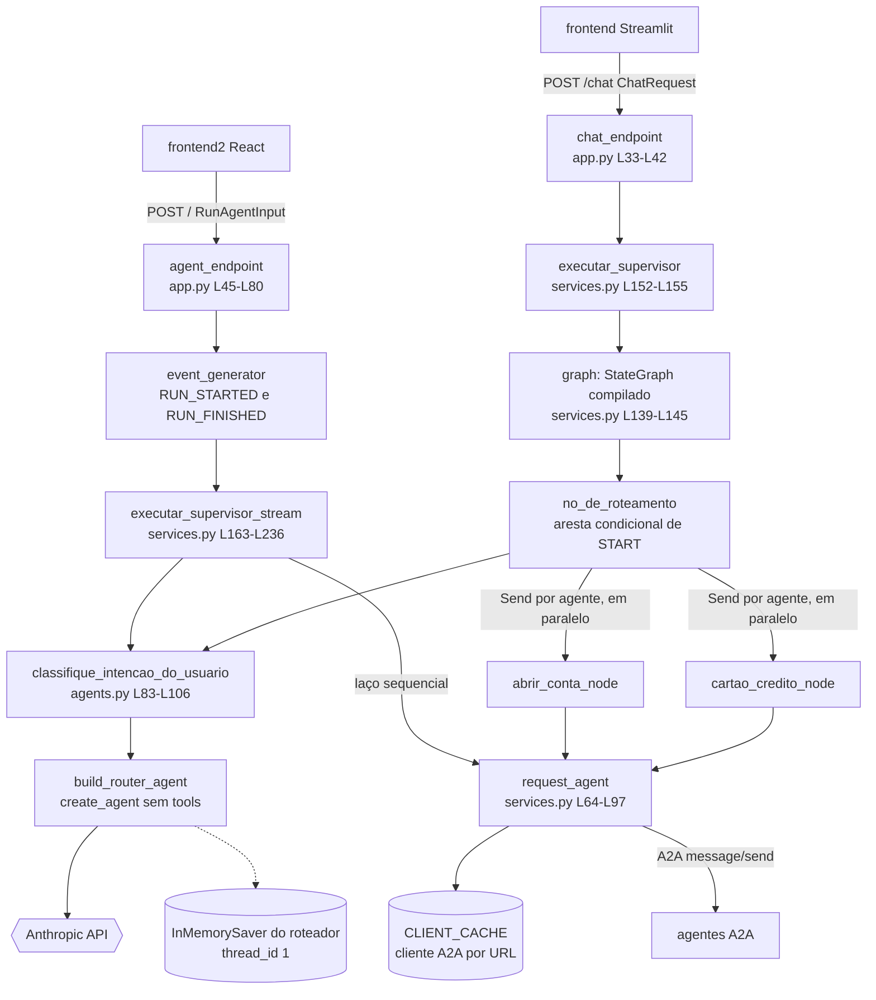

**O grafo LangGraph do caminho `/chat`:**

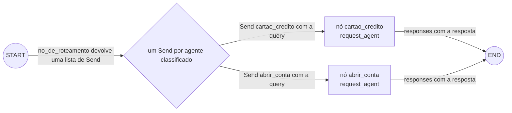

**Ordem dos eventos no caminho AG-UI.** As mensagens que saem de `executar_supervisor_stream` passam pelo `event_generator`, que as codifica em SSE.

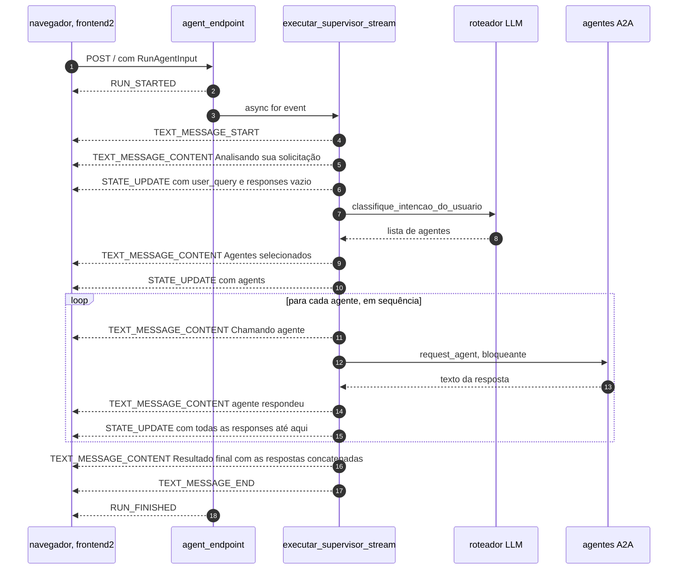

### 7.3 Arquivo por arquivo

#### Arquivo: `supervisor/app.py`

**Responsabilidade:** interface HTTP do supervisor: rota REST síncrona e rota AG-UI com streaming.
**Quem invoca:** o Uvicorn; os frontends.
**O que invoca:** `executar_supervisor`, `executar_supervisor_stream`.

```python
import logging
from typing import cast

from ag_ui.core import (
    BaseEvent,
    EventType,
    RunAgentInput,
    RunFinishedEvent,
    RunStartedEvent,
)
from ag_ui.encoder import EventEncoder
from fastapi import FastAPI, Request
from fastapi.middleware.cors import CORSMiddleware
from fastapi.responses import JSONResponse, StreamingResponse

from src.schemas import ChatRequest
from src.services import executar_supervisor, executar_supervisor_stream

logging.basicConfig(level=logging.INFO)
logger = logging.getLogger(__name__)

app = FastAPI()

app.add_middleware(
    CORSMiddleware,
    allow_origins=["*"],
    allow_credentials=True,
    allow_methods=["*"],
    allow_headers=["*"],
)


@app.post("/chat")
async def chat_endpoint(payload: ChatRequest):
    if not payload.message:
        return JSONResponse(status_code=400, content={"error": "Campo 'message' é obrigatório"})
    try:
        resposta = await executar_supervisor(texto_usuario=payload.message)
        return {"resposta": resposta}
    except Exception as e:
        logger.exception("Erro no /chat")
        return JSONResponse(status_code=500, content={"error": str(e)})


@app.post("/")
async def agent_endpoint(input_data: RunAgentInput, request: Request):

    accept_header = request.headers.get("accept")
    if accept_header is None:
        accept_header = "text/event-stream"

    encoder = EventEncoder(accept=accept_header)

    async def event_generator():

        yield encoder.encode(
            cast(BaseEvent, RunStartedEvent(
                type=EventType.RUN_STARTED,
                thread_id=input_data.thread_id,
                run_id=input_data.run_id
            ))
        )

        # Stream events
        async for event in executar_supervisor_stream(input_data):
            yield encoder.encode(cast(BaseEvent, event))

        # Run finished
        yield encoder.encode(
            cast(BaseEvent, RunFinishedEvent(
                type=EventType.RUN_FINISHED,
                thread_id=input_data.thread_id,
                run_id=input_data.run_id
            ))
        )

    return StreamingResponse(
        event_generator(),
        media_type=encoder.get_content_type()
    )
```

| Linha(s) | Código | Explicação técnica | Motivação / impacto |
|---|---|---|---|
| [L1](../supervisor/app.py#L1) | `import logging` | — | — |
| [L2](../supervisor/app.py#L2) | `from typing import cast` | `cast(T, v)` devolve `v` sem fazer nada em runtime; só informa o tipo ao *type checker* | Usado para "convencer" o checker de que `StateUpdateEvent` é um `BaseEvent` ([L66](../supervisor/app.py#L66)), o que esconde uma incompatibilidade real de tipo |
| [L4-L10](../supervisor/app.py#L4-L10) | `from ag_ui.core import (BaseEvent, EventType, RunAgentInput, RunFinishedEvent, RunStartedEvent)` | Modelos Pydantic do protocolo AG-UI | `RunAgentInput` define o corpo do POST |
| [L11](../supervisor/app.py#L11) | `from ag_ui.encoder import EventEncoder` | Serializa eventos em SSE | Ver [L52](../supervisor/app.py#L52) |
| [L12-L14](../supervisor/app.py#L12-L14) | `from fastapi import FastAPI, Request` / `CORSMiddleware` / `JSONResponse, StreamingResponse` | Peças do FastAPI/Starlette | — |
| [L16](../supervisor/app.py#L16) | `from src.schemas import ChatRequest` | `src/` não tem `__init__.py`: é um *namespace package* (PEP 420), resolvido porque `/app` (cwd) está no `sys.path` | Depende de rodar com `cwd` na pasta do supervisor |
| [L17](../supervisor/app.py#L17) | `from src.services import executar_supervisor, executar_supervisor_stream` | Importar `services` tem **efeitos colaterais**: cria o `HTTPX_CLIENT`, compila o grafo e importa `src.agents` (que roda `load_dotenv()` e cria o `ChatAnthropic` e o `InMemorySaver`) | Toda a inicialização acontece no import, sem `lifespan`. Por isso também não há encerramento ordenado (o `HTTPX_CLIENT` nunca é fechado) |
| [L19](../supervisor/app.py#L19) | `logging.basicConfig(level=logging.INFO)` | Adiciona um handler ao logger raiz em `INFO`. O Uvicorn configura só os próprios loggers | **[Fato]** Os `logger.info` de `src.services` e `src.agents` aparecem no log ([logs/supervisor.err.log](../logs/supervisor.err.log)), ao contrário do que ocorre nos agentes |
| [L20](../supervisor/app.py#L20) | `logger = logging.getLogger(__name__)` | Logger `app` | — |
| [L22](../supervisor/app.py#L22) | `app = FastAPI()` | App ASGI; `/docs` (Swagger) vem ativado | Sem título nem versão |
| [L24-L30](../supervisor/app.py#L24-L30) | `app.add_middleware(CORSMiddleware, allow_origins=["*"], allow_credentials=True, allow_methods=["*"], allow_headers=["*"])` | Com `"*"` **e** credenciais, o Starlette **devolve a própria `Origin` da requisição** em `Access-Control-Allow-Origin` (`starlette/middleware/cors.py:L163-L164`), porque o navegador não aceita `*` com credenciais | É necessário porque o React chama de outra origem (`localhost:3000` → `localhost:8080`). Na prática, **qualquer site** pode chamar o supervisor pelo navegador do usuário. Sem cookies nem autenticação, o impacto aqui é limitado |
| [L33-L34](../supervisor/app.py#L33-L34) | `@app.post("/chat")` / `async def chat_endpoint(payload: ChatRequest):` | O FastAPI valida o JSON contra `ChatRequest`; se faltar campo, responde **422** antes de chegar ao handler | Contrato REST simples, usado pelo Streamlit |
| [L35-L36](../supervisor/app.py#L35-L36) | `if not payload.message: return JSONResponse(status_code=400, ...)` | Rejeita string vazia | Validação extra |
| [L37-L39](../supervisor/app.py#L37-L39) | `resposta = await executar_supervisor(texto_usuario=payload.message)` / `return {"resposta": resposta}` | Executa o grafo (agentes em paralelo) e responde de uma vez | **`session_id` e `client_id` são descartados aqui**. Se o roteador devolver um nome inválido, a resposta é `{"resposta": ""}` com status 200 ([7.5](#75-recursos-de-ia-do-supervisor)) |
| [L40-L42](../supervisor/app.py#L40-L42) | `except Exception as e: logger.exception(...); return JSONResponse(status_code=500, content={"error": str(e)})` | Registra o *stack trace* e devolve a mensagem da exceção | **[Fato]** O log mostra um 500 cuja mensagem tem hostnames internos ("Network communication error fetching agent card from http://abrir_conta_agent:8000/...") ([logs/supervisor.err.log](../logs/supervisor.err.log)). Detalhes internos vazam para o cliente |
| [L45-L46](../supervisor/app.py#L45-L46) | `@app.post("/")` / `async def agent_endpoint(input_data: RunAgentInput, request: Request):` | O corpo é validado como `RunAgentInput`. Os modelos do ag-ui aceitam snake_case e camelCase e **mantêm campos extras** (`extra="allow"`) | Por isso o payload do React (`thread_id`, `forwardedProps`, `user` dentro da mensagem) é aceito ([10.3](#103-arquivo-por-arquivo)) |
| [L48-L50](../supervisor/app.py#L48-L50) | `accept_header = request.headers.get("accept")` / `if accept_header is None: accept_header = "text/event-stream"` | Padrão para o caso sem `Accept` | Prepara uma negociação de formato (SSE ou protobuf) |
| [L52](../supervisor/app.py#L52) | `encoder = EventEncoder(accept=accept_header)` | **[Fato]** No ag-ui-protocol 1.0.0, o construtor ignora `accept` (`ag_ui/encoder/encoder.py:L13-L14`) | As linhas [L48-L52](../supervisor/app.py#L48-L52) não mudam o comportamento nesta versão |
| [L54](../supervisor/app.py#L54) | `async def event_generator():` | Gerador assíncrono; cada `yield` vira um pedaço do corpo HTTP | Consumido pela `StreamingResponse` |
| [L56-L62](../supervisor/app.py#L56-L62) | `yield encoder.encode(cast(BaseEvent, RunStartedEvent(type=EventType.RUN_STARTED, thread_id=..., run_id=...)))` | Primeiro evento, ecoando os IDs do cliente. Codificado como `data: {"type":"RUN_STARTED","threadId":"1","runId":"..."}` + linha em branco (camelCase por `by_alias=True`) | O `thread_id` é **só ecoado**: não chega ao roteador nem aos agentes. A memória não é separada por thread |
| [L64-L66](../supervisor/app.py#L64-L66) | `async for event in executar_supervisor_stream(input_data): yield encoder.encode(cast(BaseEvent, event))` | Repassa e codifica cada evento do serviço. `encode` chama `event.model_dump_json(by_alias=True)`, que funciona com **qualquer** modelo Pydantic | Aceita o `StateUpdateEvent` customizado. Como cada evento é codificado assim que é produzido, o snapshot enviado é o do momento do `yield` |
| [L68-L75](../supervisor/app.py#L68-L75) | `yield encoder.encode(cast(BaseEvent, RunFinishedEvent(...)))` | Fecha o run | **[Inferência]** Se `executar_supervisor_stream` lançar exceção, este evento nunca é enviado. A resposta já saiu com status 200, então o stream é cortado sem `RUN_ERROR` (o código não usa `RunErrorEvent`) |
| [L77-L80](../supervisor/app.py#L77-L80) | `return StreamingResponse(event_generator(), media_type=encoder.get_content_type())` | Responde 200 com `Content-Type: text/event-stream` e envia o corpo aos poucos | Não há *heartbeat*: durante a chamada ao roteador ou aos agentes, nenhum byte é enviado (proxies podem encerrar a conexão ociosa) **[Inferência]** |

#### Arquivo: `supervisor/src/schemas.py`

```python
from pydantic import BaseModel


class ChatRequest(BaseModel):
    message: str
    session_id: str
    client_id: str
```

| Linha(s) | Código | Explicação técnica | Motivação / impacto |
|---|---|---|---|
| [L1](../supervisor/src/schemas.py#L1) | `from pydantic import BaseModel` | Base dos modelos validados | `pydantic` não está no `requirements.txt` (vem do FastAPI) |
| [L4](../supervisor/src/schemas.py#L4) | `class ChatRequest(BaseModel):` | Contrato do `POST /chat` | Aparece no OpenAPI (`/docs`) |
| [L5](../supervisor/src/schemas.py#L5) | `message: str` | Obrigatório | Único campo usado |
| [L6-L7](../supervisor/src/schemas.py#L6-L7) | `session_id: str` / `client_id: str` | Obrigatórios, sem uso | **[Hipótese]** Previstos para separar sessões; o Streamlit envia `"123"` fixo ([frontend/app.py:L31-L32](../frontend/app.py#L31-L32)) |

#### Arquivo: `supervisor/src/agents.py`

**Responsabilidade:** o roteador de intenção (um LLM que devolve JSON com a lista de agentes).
**Quem invoca:** `no_de_roteamento` e `executar_supervisor_stream` ([services.py:L107](../supervisor/src/services.py#L107), [L192](../supervisor/src/services.py#L192)).

```python
import logging
import os
from typing import Any, Dict, List

from dotenv import load_dotenv
from langchain.agents import create_agent
from langchain.chat_models import init_chat_model
from langchain_core.messages import HumanMessage
from langchain_core.output_parsers import JsonOutputParser
from langgraph.checkpoint.memory import InMemorySaver
from pydantic import BaseModel, Field

logger = logging.getLogger(__name__)
load_dotenv()

_llm = init_chat_model(
    model="claude-haiku-5-5",
    model_provider="anthropic",
    api_key=os.getenv("ANTHROPIC_API_KEY"),
)

memory = InMemorySaver()


class RouterOutput(BaseModel):
    agents: List[str] = Field(
        description="Lista de agentes que devem responder a pergunta"
    )


parser = JsonOutputParser(pydantic_object=RouterOutput)


async def build_router_agent():
    agent = create_agent(
        _llm,
        tools=[],
        system_prompt=f"""
Você é o roteador de agentes do MDBank, um banco digital moderno, seguro e confiável, especializado em fornecer soluções financeiras personalizadas para cada cliente.
[... L40-L74 omitidas neste bloco: objetivo, função do roteador, agentes, 8 regras e exemplos (ver a tabela) ...]
Responda SEMPRE em JSON no formato:
{parser.get_format_instructions()!r}
""",
        checkpointer=memory,
    )
    return agent


async def classifique_intencao_do_usuario(
    query: str, thread_id: str = "1"
) -> List[Dict[str, Any]]:
    agent = await build_router_agent()

    try:
        resultado = await agent.ainvoke(
            {"messages": [HumanMessage(content=query)]},
            {"configurable": {"thread_id": thread_id}},
        )

        resposta_texto = str(resultado["messages"][-1].text)

        parsed = parser.parse(resposta_texto)

        agentes = parsed.get("agents", [])

        logger.info(f"Agentes selecionados: {agentes}")

        return [{"query": query, "agent": agente} for agente in agentes]

    except Exception as e:
        logger.error(f"Erro no router: {e}")
        return [{"query": query, "agent": "abrir_conta"}]
```

O prompt completo está em [supervisor/src/agents.py:L38-L77](../supervisor/src/agents.py#L38-L77) e é analisado na tabela.

| Linha(s) | Código | Explicação técnica | Motivação / impacto |
|---|---|---|---|
| [L1-L3](../supervisor/src/agents.py#L1-L3) | `import logging` / `import os` / `from typing import Any, Dict, List` | stdlib | — |
| [L5-L11](../supervisor/src/agents.py#L5-L11) | imports de dotenv, LangChain, LangGraph e Pydantic | Mesmo conjunto dos agentes, mais `JsonOutputParser` e `BaseModel`/`Field` | — |
| [L13-L14](../supervisor/src/agents.py#L13-L14) | `logger = logging.getLogger(__name__)` / `load_dotenv()` | Logger `src.agents`; `.env` carregado na importação | — |
| [L16-L20](../supervisor/src/agents.py#L16-L20) | `_llm = init_chat_model(model="claude-haiku-5-5", model_provider="anthropic", api_key=...)` | Mesmo modelo dos agentes | **[Fato]** Antes era `gpt-4o` com `temperature=0` (commit `a77d144`), o padrão para classificação determinística. A remoção foi forçada pela validação do `langchain_anthropic` para `claude-sonnet-5-5` ([2.3](#23-linha-do-tempo-do-repositório)). Com Haiku 5.5, a API também rejeita valores de amostragem diferentes do padrão |
| [L22](../supervisor/src/agents.py#L22) | `memory = InMemorySaver()` | Memória do roteador | Guarda **só** as mensagens do usuário e os JSONs do roteador. As respostas dos agentes **nunca** entram nela |
| [L25-L28](../supervisor/src/agents.py#L25-L28) | `class RouterOutput(BaseModel): agents: List[str] = Field(description=...)` | Esquema da saída | `List[str]` sem `enum`/`Literal` dos nomes válidos: o esquema aceita qualquer string |
| [L31](../supervisor/src/agents.py#L31) | `parser = JsonOutputParser(pydantic_object=RouterOutput)` | O `pydantic_object` serve para gerar as instruções de formato. `parse()` devolve um **`dict`** e **não valida** contra o modelo **[Teste]** ([A.3](#a3-langchain-core-text-e-jsonoutputparser)) | `{"agents": ["cartao"]}` passa sem erro e vira um destino inexistente |
| [L34-L37](../supervisor/src/agents.py#L34-L37) | `async def build_router_agent(): agent = create_agent(_llm, tools=[], system_prompt=f"""` | `create_agent` **sem tools**: o grafo é uma única chamada ao modelo ([4.4](#44-análise-dos-frameworks-principais)) | Usa a infraestrutura de agente (com checkpointer) para uma classificação simples |
| [L39](../supervisor/src/agents.py#L39) | `Você é o roteador de agentes do MDBank, um banco digital moderno, seguro e confiável, ...` | Papel | — |
| [L41-L45](../supervisor/src/agents.py#L41-L45) | `Objetivo do MDBank: - Auxiliar clientes ... - Evitar informações incorretas ...` | Contexto institucional | Gasta tokens sem ajudar a classificar **[Análise]** |
| [L47-L50](../supervisor/src/agents.py#L47-L50) | `Função do roteador: ... Selecionar os agentes apropriados (cartao_credito, abrir_conta) com base no histórico do cliente ...` | Define a tarefa | O "histórico" disponível é a memória compartilhada de todas as conversas |
| [L52-L54](../supervisor/src/agents.py#L52-L54) | `Agentes disponíveis: - cartao_credito: ... - abrir_conta: ...` | Catálogo **fixo** no prompt | É um dos 4 lugares a mudar ao adicionar um agente, junto com `AGENTS`, as funções de nó e o `add_node` ([services.py:L31-L34](../supervisor/src/services.py#L31-L34), [L117-L144](../supervisor/src/services.py#L117-L144)) |
| [L56-L58](../supervisor/src/agents.py#L56-L58) | `1. Utilize sempre o contexto da conversa (memória)...` / `2. Se o cliente já possui conta, NÃO chame abrir_conta novamente.` | Regras de roteamento com base em memória | **[Inferência]** O roteador não tem tools para checar contas; ele "sabe" que o cliente tem conta só pelo que os usuários **disseram** antes, e de qualquer usuário |
| [L59](../supervisor/src/agents.py#L59) | `3. Uma pergunta pode exigir mais de um agente.` | Habilita múltiplas intenções | Gera o fan-out |
| [L60-L64](../supervisor/src/agents.py#L60-L64) | regras 4 a 8: não inventar; informar quando não for possível; orientar sobre dados sensíveis; tom profissional; explicar o onboarding | Instruções de um **agente conversacional** | **Contradizem** [L67-L68](../supervisor/src/agents.py#L67-L68) ("apenas JSON"): o roteador não pode "informar", "orientar" nem "explicar" dentro de um JSON. **[Hipótese]** Foram copiadas de outro prompt |
| [L67-L68](../supervisor/src/agents.py#L67-L68) | `- JSON deve ser válido e conter apenas os agentes selecionados.` / `- Evite qualquer texto fora do JSON no output.` | Restrição de formato | Se o modelo responder com texto em volta do JSON, `parse` falha e entra o fallback ([L104-L106](../supervisor/src/agents.py#L104-L106)) |
| [L70-L73](../supervisor/src/agents.py#L70-L73) | `- Cliente pede cartão, mas não tem conta → selecione abrir_conta primeiro.` ... | Exemplos (*few-shot* em prosa) | "Primeiro" só tem efeito no caminho sequencial (AG-UI). No `/chat` os agentes rodam em paralelo e a ordem não importa ([11.4](#114-cenário-crítico-cartão-sem-conta-no-modo-paralelo)) |
| [L75-L76](../supervisor/src/agents.py#L75-L76) | `Responda SEMPRE em JSON no formato:` / `{parser.get_format_instructions()!r}` | Dentro de uma f-string, `!r` aplica `repr()`: o bloco de instruções (1.191 caracteres em **inglês**) entra **como literal Python**, entre aspas e com `\n` escritos como dois caracteres **[Teste]** ([A.3](#a3-langchain-core-text-e-jsonoutputparser)) | Funciona, porque o modelo entende, mas é ruído. O próprio bloco proíbe *code fences*, que o `parse` aceitaria de qualquer forma |
| [L78-L80](../supervisor/src/agents.py#L78-L80) | `checkpointer=memory,` / `return agent` | Memória ligada ao grafo | — |
| [L83-L85](../supervisor/src/agents.py#L83-L85) | `async def classifique_intencao_do_usuario(query: str, thread_id: str = "1") -> List[Dict[str, Any]]:` | Assinatura | Thread fixo; nenhum chamador passa outro valor |
| [L86](../supervisor/src/agents.py#L86) | `agent = await build_router_agent()` | Recompila o grafo **a cada mensagem** | Sem rede, mas desnecessário. O prompt é igual em toda chamada |
| [L88-L92](../supervisor/src/agents.py#L88-L92) | `resultado = await agent.ainvoke({"messages": [HumanMessage(content=query)]}, {"configurable": {"thread_id": thread_id}})` | Uma chamada ao LLM com o system prompt + **todo o histórico do thread** + a nova mensagem | O custo cresce linearmente com o número de mensagens (de todos os usuários) |
| [L94](../supervisor/src/agents.py#L94) | `resposta_texto = str(resultado["messages"][-1].text)` | Texto da resposta, sem blocos de thinking | Ver [A.3](#a3-langchain-core-text-e-jsonoutputparser) |
| [L96](../supervisor/src/agents.py#L96) | `parsed = parser.parse(resposta_texto)` | Aceita JSON puro ou dentro de *code fence*; falha se houver texto em volta **[Teste]** | `OutputParserException` → fallback |
| [L98](../supervisor/src/agents.py#L98) | `agentes = parsed.get("agents", [])` | Lê a lista | **[Inferência]** Se o modelo devolver uma lista no topo (`["abrir_conta"]`), `.get` lança `AttributeError` e cai no fallback. Se devolver `"agents": "abrir_conta"` (string), cada **caractere** vira um "agente" |
| [L100](../supervisor/src/agents.py#L100) | `logger.info(f"Agentes selecionados: {agentes}")` | Log | — |
| [L102](../supervisor/src/agents.py#L102) | `return [{"query": query, "agent": agente} for agente in agentes]` | Um item por agente, **todos com a mesma query original** | Não há decomposição da pergunta por agente: cada especialista recebe a frase inteira |
| [L104-L106](../supervisor/src/agents.py#L104-L106) | `except Exception as e: logger.error(f"Erro no router: {e}")` / `return [{"query": query, "agent": "abrir_conta"}]` | **Fallback silencioso** para `abrir_conta` em **qualquer** erro (rede, autenticação, cota, parsing) | **[Fato]** O log real mostra o mecanismo mascarando um erro de configuração: `` Erro no router: `temperature` is not supported for claude-sonnet-5-5... `` seguido de `Classificação: [{'query': 'quero abrir uma conta', 'agent': 'abrir_conta'}]` ([logs/supervisor.err.log](../logs/supervisor.err.log)). O usuário não fica sabendo, e um problema de LLM vira uma conversa sobre abertura de conta |

#### Arquivo: `supervisor/src/services.py`

**Responsabilidade:** orquestração (grafo e stream) e cliente A2A.
**Quem invoca:** `app.py`.
**O que invoca:** `classifique_intencao_do_usuario`, agentes A2A.

**Bloco A — Importações** ([L1-L21](../supervisor/src/services.py#L1-L21))

```python
import logging
import uuid
from operator import add
from typing import Annotated, TypedDict

import httpx
from a2a.client import A2ACardResolver, ClientConfig, ClientFactory
from a2a.types import Message, Part, Role, TextPart
from ag_ui.core import (
    EventType,
    TextMessageContentEvent,
    TextMessageEndEvent,
    TextMessageStartEvent,
)
from langgraph.graph import END, START, StateGraph
from langgraph.types import Send
from pydantic import BaseModel

from src.agents import classifique_intencao_do_usuario

logger = logging.getLogger(__name__)
```

| Linha(s) | Código | Explicação técnica | Motivação / impacto |
|---|---|---|---|
| [L1-L2](../supervisor/src/services.py#L1-L2) | `import logging` / `import uuid` | `uuid4` para IDs de mensagem (A2A e AG-UI) | — |
| [L3](../supervisor/src/services.py#L3) | `from operator import add` | `add(a, b)` = `a + b`; com listas, concatena | É o *reducer* de `responses` ([L46](../supervisor/src/services.py#L46)) |
| [L4](../supervisor/src/services.py#L4) | `from typing import Annotated, TypedDict` | `Annotated[T, meta]` acrescenta metadados ao tipo; o LangGraph lê o reducer desses metadados | — |
| [L6](../supervisor/src/services.py#L6) | `import httpx` | Cliente HTTP assíncrono | — |
| [L7](../supervisor/src/services.py#L7) | `from a2a.client import A2ACardResolver, ClientConfig, ClientFactory` | Descoberta de card, configuração e fábrica de clientes A2A | — |
| [L8](../supervisor/src/services.py#L8) | `from a2a.types import Message, Part, Role, TextPart` | Tipos da mensagem A2A | — |
| [L9-L14](../supervisor/src/services.py#L9-L14) | `from ag_ui.core import (EventType, TextMessageContentEvent, TextMessageEndEvent, TextMessageStartEvent)` | Eventos de texto do AG-UI | Não importa `StateSnapshotEvent`, `StateDeltaEvent`, `RunErrorEvent` nem `StepStartedEvent` |
| [L15-L16](../supervisor/src/services.py#L15-L16) | `from langgraph.graph import END, START, StateGraph` / `from langgraph.types import Send` | API de grafo do LangGraph | — |
| [L17](../supervisor/src/services.py#L17) | `from pydantic import BaseModel` | Para o evento customizado | — |
| [L19](../supervisor/src/services.py#L19) | `from src.agents import classifique_intencao_do_usuario` | Roteador | Importa `src.agents` e seus efeitos colaterais |
| [L21](../supervisor/src/services.py#L21) | `logger = logging.getLogger(__name__)` | Logger `src.services` | — |

**Bloco B — Estado global e tipos** ([L23-L56](../supervisor/src/services.py#L23-L56))

```python
HTTPX_CLIENT = httpx.AsyncClient(timeout=30)

AGENTS = {
    "cartao_credito": "http://cartao_credito_agent:8000",
    "abrir_conta": "http://abrir_conta_agent:8000",
}

CLIENT_CACHE = {}


class State(TypedDict):
    query: str
    responses: Annotated[list[str], add]


class StateUpdateEvent(BaseModel):
    type: str = "STATE_UPDATE"
    state: dict
```

| Linha(s) | Código | Explicação técnica | Motivação / impacto |
|---|---|---|---|
| [L26](../supervisor/src/services.py#L26) | `HTTPX_CLIENT = httpx.AsyncClient(timeout=30)` | Um *pool* de conexões para o processo inteiro. `timeout=30` vale para conectar, ler, escrever e obter conexão do pool | Reaproveita conexões keep-alive com os agentes. **[Inferência]** Se um agente levar mais de 30 s (várias idas ao LLM com thinking e tools), o supervisor recebe `ReadTimeout` e o usuário recebe erro, enquanto o agente **continua executando** e pode até criar a conta |
| [L31-L34](../supervisor/src/services.py#L31-L34) | `AGENTS = {"cartao_credito": "http://cartao_credito_agent:8000", "abrir_conta": "http://abrir_conta_agent:8000"}` | Registro **estático** nome → URL base | A descoberta dinâmica do BFA não é usada |
| [L37](../supervisor/src/services.py#L37) | `CLIENT_CACHE = {}` | Cache de clientes A2A por URL, sem invalidação | Se um card mudar, é preciso reiniciar. Se a 1ª descoberta falhar, nada é guardado e a próxima mensagem tenta de novo |
| [L44-L46](../supervisor/src/services.py#L44-L46) | `class State(TypedDict): query: str; responses: Annotated[list[str], add]` | Esquema do grafo. O reducer `add` junta as escritas concorrentes de `responses` | **[Teste]** Sem o reducer, dois nós paralelos escrevendo `responses` causam `InvalidUpdateError` ("Can receive only one value per step"). Com ele, a ordem final segue **a ordem dos `Send`**, não a de término ([A.4](#a4-langgraph-send-em-paralelo-lista-vazia-e-nó-inexistente)) |
| [L54-L56](../supervisor/src/services.py#L54-L56) | `class StateUpdateEvent(BaseModel): type: str = "STATE_UPDATE"; state: dict` | Evento **fora do padrão AG-UI**. Os tipos padrão são `STATE_SNAPSHOT` (estado completo), `STATE_DELTA` (JSON Patch, RFC 6902) e `CUSTOM` ([4.4](#44-análise-dos-frameworks-principais)) | Funciona só com o parser manual do frontend2. Um cliente AG-UI padrão (`@ag-ui/client`, que valida eventos com zod) não o reconheceria **[Inferência]** |

**Bloco C — Cliente A2A** ([L64-L97](../supervisor/src/services.py#L64-L97))

```python
async def request_agent(message: str, agent_url: str) -> str:

    if agent_url not in CLIENT_CACHE:
        logger.info(f"Descobrindo AgentCard em {agent_url}")

        resolver = A2ACardResolver(
            httpx_client=HTTPX_CLIENT,
            base_url=agent_url,
        )

        agent_card = await resolver.get_agent_card()
        logger.info(f"Agent encontrado: {agent_card.name}")

        config = ClientConfig(httpx_client=HTTPX_CLIENT, streaming=False)
        factory = ClientFactory(config)
        CLIENT_CACHE[agent_url] = factory.create(agent_card)

    client = CLIENT_CACHE[agent_url]

    msg = Message(
        role=Role.user,
        message_id=str(uuid.uuid4()),
        parts=[Part(root=TextPart(text=message))],
    )

    logger.info(f"Enviando mensagem para agente: {message}")

    async for event in client.send_message(msg):
        if isinstance(event, Message):
            for part in event.parts:
                if part.root.kind == "text":
                    return part.root.text

    return "Sem resposta do agente."
```

| Linha(s) | Código | Explicação técnica | Motivação / impacto |
|---|---|---|---|
| [L64](../supervisor/src/services.py#L64) | `async def request_agent(message: str, agent_url: str) -> str:` | Envia um texto a um agente e devolve um texto | Esconde o A2A dos nós do grafo |
| [L66-L67](../supervisor/src/services.py#L66-L67) | `if agent_url not in CLIENT_CACHE:` / `logger.info(...)` | *Check-then-set* sem lock | Duas primeiras chamadas simultâneas resolvem o card duas vezes (inofensivo) |
| [L69-L72](../supervisor/src/services.py#L69-L72) | `resolver = A2ACardResolver(httpx_client=HTTPX_CLIENT, base_url=agent_url)` | Resolvedor do card | Usa o pool compartilhado |
| [L74](../supervisor/src/services.py#L74) | `agent_card = await resolver.get_agent_card()` | `GET {base_url}/.well-known/agent-card.json` (`a2a/utils/constants.py:L3`); falha de rede vira `A2AClientHTTPError(503, ...)` | **[Fato]** É exatamente a exceção do log ([logs/supervisor.err.log](../logs/supervisor.err.log)) quando o agente não estava no ar |
| [L75](../supervisor/src/services.py#L75) | `logger.info(f"Agent encontrado: {agent_card.name}")` | Log | — |
| [L77](../supervisor/src/services.py#L77) | `config = ClientConfig(httpx_client=HTTPX_CLIENT, streaming=False)` | Sem streaming; `polling=False` por padrão, o que resulta em `blocking=True` em cada envio (`a2a/client/base_client.py:L87-L95`) | Simples: uma requisição, uma resposta. Sem progresso parcial do agente |
| [L78-L79](../supervisor/src/services.py#L78-L79) | `factory = ClientFactory(config)` / `CLIENT_CACHE[agent_url] = factory.create(agent_card)` | Escolhe o transporte pelo `preferred_transport` do card (padrão JSON-RPC) e usa **`card.url`** como endpoint (`client_factory.py:L207-L231`) | Ver [3.3](#33-topologia-de-rede-e-endereçamento) |
| [L81](../supervisor/src/services.py#L81) | `client = CLIENT_CACHE[agent_url]` | Cliente em cache | — |
| [L83-L87](../supervisor/src/services.py#L83-L87) | `msg = Message(role=Role.user, message_id=str(uuid.uuid4()), parts=[Part(root=TextPart(text=message))])` | Mensagem A2A sem `context_id` nem `task_id` | Cada chamada é um **contexto A2A novo**. A continuidade da conversa fica só na memória interna (compartilhada) de cada agente |
| [L89](../supervisor/src/services.py#L89) | `logger.info(f"Enviando mensagem para agente: {message}")` | Registra o texto do usuário | Põe CPF e nome em log `INFO` |
| [L91](../supervisor/src/services.py#L91) | `async for event in client.send_message(msg):` | Sem streaming, o gerador produz **um** item: a `Message` ou `(Task, None)` (`base_client.py:L109-L118`), depois de um `message/send` JSON-RPC (`transports/jsonrpc.py:L114-L137`) | Um erro JSON-RPC do agente vira `A2AClientJSONRPCError` (`jsonrpc.py:L135-L136`) e sobe |
| [L92-L95](../supervisor/src/services.py#L92-L95) | `if isinstance(event, Message): for part in event.parts: if part.root.kind == "text": return part.root.text` | Pega a **primeira** parte de texto. `Part` é um *RootModel* (união discriminada), por isso o `.root` | Ignora partes de dados ou arquivos |
| [L97](../supervisor/src/services.py#L97) | `return "Sem resposta do agente."` | Caso o resultado seja uma `Task` ou não tenha texto | Mensagem neutra: o usuário não sabe se houve erro |

**Bloco D — Nós e grafo** ([L105-L155](../supervisor/src/services.py#L105-L155))

```python
async def no_de_roteamento(state: State):
    query = state.get("query", "")
    classifications = await classifique_intencao_do_usuario(query)
    logger.info(f"Classificação: {classifications}")
    return [Send(c["agent"], {"query": c["query"]}) for c in classifications]


async def cartao_credito_node(state: State):
    query = state.get("query", "")
    logger.info("Executando agente CARTAO_CREDITO")
    resposta = await request_agent(query, AGENTS["cartao_credito"])
    return {"responses": [resposta]}


async def abrir_conta_node(state: State):
    query = state.get("query", "")
    logger.info("Executando agente ABRIR_CONTA")
    resposta = await request_agent(query, AGENTS["abrir_conta"])
    return {"responses": [resposta]}


builder = StateGraph(State)
builder.add_node("cartao_credito", cartao_credito_node)
builder.add_node("abrir_conta", abrir_conta_node)
builder.add_conditional_edges(START, no_de_roteamento)
builder.add_edge("cartao_credito", END)
builder.add_edge("abrir_conta", END)
graph = builder.compile()


async def executar_supervisor(texto_usuario: str):
    input_state: State = {"query": texto_usuario, "responses": []}
    result = await graph.ainvoke(input_state)
    return "\n\n".join(result["responses"])
```

> **Conceito — Fan-out com `Send` (map-reduce no LangGraph).** Uma aresta condicional pode devolver uma **lista de `Send(nó, payload)`** em vez do nome do próximo nó. Cada `Send` vira uma execução independente do nó, com o `payload` como estado de entrada, e todas rodam no **mesmo superstep**, em paralelo. As saídas voltam ao estado global pelo *reducer* da chave (`operator.add`). É o padrão *map-reduce*: o roteador "mapeia" a pergunta para N agentes, e o reducer junta as respostas.

| Linha(s) | Código | Explicação técnica | Motivação / impacto |
|---|---|---|---|
| [L105-L106](../supervisor/src/services.py#L105-L106) | `async def no_de_roteamento(state: State):` / `query = state.get("query", "")` | Função de roteamento (não é um nó), chamada pela aresta condicional de `START` | O nome sugere "nó", mas é a função da aresta |
| [L107](../supervisor/src/services.py#L107) | `classifications = await classifique_intencao_do_usuario(query)` | Chamada ao LLM roteador | — |
| [L108](../supervisor/src/services.py#L108) | `logger.info(f"Classificação: {classifications}")` | Log | Aparece em [logs/supervisor.err.log](../logs/supervisor.err.log) |
| [L109](../supervisor/src/services.py#L109) | `return [Send(c["agent"], {"query": c["query"]}) for c in classifications]` | Um `Send` por agente | **[Teste]** Lista vazia: nenhum nó roda e a resposta é `""`. Nome inexistente: o LangGraph 1.2.14 **ignora com um warning** ("Ignoring unknown node name cartao in pending sends") e a resposta também é `""` ([A.4](#a4-langgraph-send-em-paralelo-lista-vazia-e-nó-inexistente)). Nos dois casos o `/chat` devolve 200 com `"resposta": ""` |
| [L117-L121](../supervisor/src/services.py#L117-L121) | `async def cartao_credito_node(state): ... resposta = await request_agent(query, AGENTS["cartao_credito"]); return {"responses": [resposta]}` | Nó que chama o agente de cartão e devolve uma **atualização parcial** do estado | Uma lista com um item, para o reducer concatenar |
| [L129-L133](../supervisor/src/services.py#L129-L133) | `async def abrir_conta_node(state): ...` | Idem, para conta | As duas funções são quase idênticas; uma fábrica de nós evitaria a duplicação |
| [L139](../supervisor/src/services.py#L139) | `builder = StateGraph(State)` | Construtor do grafo com o esquema | — |
| [L140-L141](../supervisor/src/services.py#L140-L141) | `builder.add_node("cartao_credito", ...)` / `builder.add_node("abrir_conta", ...)` | Os nomes dos nós precisam ser **iguais** às strings devolvidas pelo roteador e às chaves de `AGENTS` | Acoplamento por string em 3 lugares |
| [L142](../supervisor/src/services.py#L142) | `builder.add_conditional_edges(START, no_de_roteamento)` | Aresta condicional a partir do início, **sem `path_map`** | O LangGraph não conhece os destinos possíveis antes de rodar (afeta a visualização do grafo). Com `Send` funciona normalmente |
| [L143-L144](../supervisor/src/services.py#L143-L144) | `builder.add_edge("cartao_credito", END)` / `builder.add_edge("abrir_conta", END)` | Os dois nós terminam o grafo | Não há etapa de **síntese** depois dos agentes |
| [L145](../supervisor/src/services.py#L145) | `graph = builder.compile()` | Compila **na importação**, **sem checkpointer** | Cada `ainvoke` é independente. A memória fica no roteador e nos agentes |
| [L152-L153](../supervisor/src/services.py#L152-L153) | `async def executar_supervisor(texto_usuario: str):` / `input_state: State = {"query": texto_usuario, "responses": []}` | Estado inicial | — |
| [L154](../supervisor/src/services.py#L154) | `result = await graph.ainvoke(input_state)` | Roda roteamento e agentes **em paralelo** **[Teste]** | A latência total é aproximadamente roteador + o agente mais lento |
| [L155](../supervisor/src/services.py#L155) | `return "\n\n".join(result["responses"])` | **Agregação por concatenação** | Respostas contraditórias dos dois agentes (por exemplo, "sem conta" e "conta criada") aparecem juntas, sem reconciliação |

**Bloco E — Execução em streaming para AG-UI** ([L163-L236](../supervisor/src/services.py#L163-L236))

No trecho abaixo, os argumentos repetidos `type=EventType.TEXT_MESSAGE_CONTENT, message_id=assistant_id` dos eventos de conteúdo aparecem abreviados como `...`. O resto é literal.

```python
async def executar_supervisor_stream(input_data):
    """
    Retorna eventos para AG-UI, incluindo state compartilhado.
    """
    messages = input_data.messages
    if not messages:
        user_message = ""
    else:
        user_message = messages[-1].content

    assistant_id = str(uuid.uuid4())

    yield TextMessageStartEvent(
        type=EventType.TEXT_MESSAGE_START, message_id=assistant_id, role="assistant"
    )

    yield TextMessageContentEvent(
        type=EventType.TEXT_MESSAGE_CONTENT,
        message_id=assistant_id,
        delta="Analisando sua solicitação...\n\n",
    )

    state = {"user_query": user_message, "responses": []}
    yield StateUpdateEvent(state=state)

    classifications = await classifique_intencao_do_usuario(user_message)
    agentes = [c["agent"] for c in classifications]
    yield TextMessageContentEvent(..., delta=f"Agentes selecionados: {', '.join(agentes)}\n\n")

    state["agents"] = agentes
    yield StateUpdateEvent(state=state)

    respostas = []
    for c in classifications:
        agent_name = c["agent"]
        yield TextMessageContentEvent(..., delta=f"Chamando agente: {agent_name}...\n")
        resposta = await request_agent(c["query"], AGENTS[agent_name])
        respostas.append(resposta)
        yield TextMessageContentEvent(..., delta=f"{agent_name} respondeu\n\n")
        state["responses"].append({agent_name: resposta})
        yield StateUpdateEvent(state=state)

    resposta_final = "\n\n".join(respostas)

    yield TextMessageContentEvent(..., delta=f"Resultado final:\n\n{resposta_final}")

    yield TextMessageEndEvent(type=EventType.TEXT_MESSAGE_END, message_id=assistant_id)
```

| Linha(s) | Código | Explicação técnica | Motivação / impacto |
|---|---|---|---|
| [L163-L166](../supervisor/src/services.py#L163-L166) | `async def executar_supervisor_stream(input_data):` + docstring | **Gerador assíncrono** (tem `yield`): quem o consome recebe os eventos à medida que são produzidos | Implementa o protocolo de eventos sem usar o grafo |
| [L167-L171](../supervisor/src/services.py#L167-L171) | `messages = input_data.messages` / `user_message = messages[-1].content` | Usa **só a última** mensagem, supondo que seja do usuário | No AG-UI o cliente normalmente envia o histórico inteiro e o servidor fica sem estado. Aqui o histórico do cliente é ignorado e vale a memória compartilhada do servidor. `content` também pode ser uma lista de partes (multimodal) **[Inferência]** |
| [L173](../supervisor/src/services.py#L173) | `assistant_id = str(uuid.uuid4())` | ID da mensagem do assistente | Liga os eventos `TEXT_MESSAGE_*` entre si |
| [L176-L178](../supervisor/src/services.py#L176-L178) | `yield TextMessageStartEvent(..., role="assistant")` | Abre a mensagem | Sequência padrão `START → CONTENT* → END` |
| [L181-L185](../supervisor/src/services.py#L181-L185) | `yield TextMessageContentEvent(..., delta="Analisando sua solicitação...\n\n")` | Primeiro texto de progresso | Dá retorno imediato ao usuário, mas **o progresso fica misturado com a resposta final** na mesma mensagem |
| [L188-L189](../supervisor/src/services.py#L188-L189) | `state = {"user_query": user_message, "responses": []}` / `yield StateUpdateEvent(state=state)` | Estado inicial (evento customizado) | O formato do estado (`user_query`) difere do `State` do grafo (`query`) |
| [L192-L193](../supervisor/src/services.py#L192-L193) | `classifications = await classifique_intencao_do_usuario(user_message)` / `agentes = [...]` | Chamada ao roteador; nenhum evento sai durante a espera | Mesmo fallback silencioso de [agents.py:L104-L106](../supervisor/src/agents.py#L104-L106) |
| [L194-L198](../supervisor/src/services.py#L194-L198) | `delta=f"Agentes selecionados: {', '.join(agentes)}\n\n"` | Mostra a decisão de roteamento ao usuário | Transparência; expõe nomes internos |
| [L201-L202](../supervisor/src/services.py#L201-L202) | `state["agents"] = agentes` / `yield StateUpdateEvent(state=state)` | Atualiza o estado | — |
| [L204-L206](../supervisor/src/services.py#L204-L206) | `respostas = []` / `for c in classifications:` / `agent_name = c["agent"]` | Laço **sequencial** | Diferente do `/chat` (paralelo). A ordem do roteador ("abrir_conta primeiro") é respeitada |
| [L208-L212](../supervisor/src/services.py#L208-L212) | `delta=f"Chamando agente: {agent_name}...\n"` | Progresso | — |
| [L214](../supervisor/src/services.py#L214) | `resposta = await request_agent(c["query"], AGENTS[agent_name])` | `AGENTS[agent_name]` sem `.get` | Um nome inválido dá **`KeyError` no meio do stream**: o comportamento difere do `/chat`, que ignora o nome |
| [L215-L221](../supervisor/src/services.py#L215-L221) | `respostas.append(resposta)` / `delta=f"{agent_name} respondeu\n\n"` | Acumula e informa | — |
| [L224-L225](../supervisor/src/services.py#L224-L225) | `state["responses"].append({agent_name: resposta})` / `yield StateUpdateEvent(state=state)` | Envia o **estado completo** a cada passo (semântica de snapshot) | **[Teste]** O frontend2 **concatena** `responses` a cada evento, o que duplica a primeira resposta quando há dois agentes ([A.6](#a6-frontend2-regex-máscara-merge-de-estado-e-sse)) |
| [L227](../supervisor/src/services.py#L227) | `resposta_final = "\n\n".join(respostas)` | Concatenação, como no `/chat` | — |
| [L229-L233](../supervisor/src/services.py#L229-L233) | `delta=f"Resultado final:\n\n{resposta_final}"` | A resposta inteira vai em um único `delta` | Não há streaming de tokens: os agentes respondem de uma vez |
| [L236](../supervisor/src/services.py#L236) | `yield TextMessageEndEvent(...)` | Fecha a mensagem | O `RUN_FINISHED` é emitido por `app.py` |

#### Arquivos de build e configuração do supervisor

| Arquivo | Linha(s) | Conteúdo | Observação |
|---|---|---|---|
| [requirements.txt](../supervisor/requirements.txt) | L1-L10 | `fastapi`, `uvicorn`, `a2a-sdk<1`, `ag-ui-protocol`, `langgraph`, `langchain`, `langchain-anthropic`, `langchain-community`, `httpx`, `python-dotenv` | `a2a-sdk` sem o extra `http-server`, porque o supervisor só usa o cliente. `langchain-community` não é usado. `pydantic` não é declarado |
| [Dockerfile](../supervisor/Dockerfile) | [L18](../supervisor/Dockerfile#L18) | `CMD ["uvicorn", "app:app", "--host", "0.0.0.0", "--port", "8000", "--reload"]` | O resto é igual ao de `recursos`. `--reload` zera a memória do roteador e o `CLIENT_CACHE` a cada mudança |
| [.gitignore](../supervisor/.gitignore) | L1-L137 | Template Python do GitHub | Diferente dos outros projetos. Ignora `.env` ([L98](../supervisor/.gitignore#L98)) e `.vscode/` inteiro ([L134](../supervisor/.gitignore#L134)) |
| [.dockerignore](../supervisor/.dockerignore) | L1-L11 | Igual ao de `recursos` (com quebra de linha final) | — |
| `.vscode/settings.json` | L1-L10 | Interpretador `.venv` + `python-envs.pythonProjects` (venv + pip) | **Existe só localmente**: o próprio `.gitignore` do supervisor o ignora, então não está no repositório (os outros projetos versionam o seu) |

### 7.4 Rastreamento de chamadas

| Função | Quem chama | Parâmetros | Processamento | Dependências | Retorno | Erros | Efeitos colaterais |
|---|---|---|---|---|---|---|---|
| `chat_endpoint` | FastAPI (`POST /chat`) | `ChatRequest` | Valida e chama `executar_supervisor` | — | `{"resposta": str}` / 400 / 500 | Captura tudo e devolve `str(e)` | Log |
| `agent_endpoint` | FastAPI (`POST /`) | `RunAgentInput`, `Request` | Monta o gerador SSE | `EventEncoder` | `StreamingResponse` | Nenhum (o erro corta o stream) | — |
| `executar_supervisor` | `chat_endpoint` | `texto_usuario` | `graph.ainvoke` e junta as respostas | LangGraph | `str` | Propaga | Chamadas LLM e A2A |
| `no_de_roteamento` | LangGraph (aresta de `START`) | `State` | Classifica e cria os `Send` | roteador | `list[Send]` | Nunca falha (o roteador tem fallback) | LLM |
| `cartao_credito_node` / `abrir_conta_node` | LangGraph (`Send`) | `{"query"}` | `request_agent` | A2A | `{"responses": [str]}` | Propaga (o grafo falha inteiro) | A2A |
| `executar_supervisor_stream` | `event_generator` | `RunAgentInput` | Roteia, chama os agentes em sequência e emite eventos | roteador, A2A, ag-ui | gerador de eventos | `KeyError`/A2A propagam e cortam o stream | LLM, A2A |
| `request_agent` | nós e stream | `message`, `agent_url` | Descobre o card (1ª vez) e envia `message/send` | a2a-sdk, httpx | `str` | Propaga erros HTTP e JSON-RPC | Preenche o `CLIENT_CACHE`; log com PII |
| `classifique_intencao_do_usuario` | roteamento e stream | `query`, `thread_id="1"` | Recria o agente, chama o LLM e faz o parse | LangChain, Anthropic | `list[{"query","agent"}]` | **Engole tudo** e devolve `abrir_conta` | Grava na memória do roteador |
| `build_router_agent` | `classifique_...` | — | `create_agent` sem tools | LangChain | grafo | — | — |

### 7.5 Recursos de IA do supervisor

| Recurso | O que é | Como foi implementado | Por que foi escolhido | Limitações | Alternativas |
|---|---|---|---|---|---|
| **Roteamento de intenção por LLM** | Um LLM classifica a mensagem em um ou mais destinos | `create_agent` sem tools + prompt + `JsonOutputParser` ([agents.py:L34-L106](../supervisor/src/agents.py#L34-L106)) | **[Inferência]** Lida com várias intenções e com contexto da conversa sem treinar um classificador | Uma chamada ao LLM (com thinking) por mensagem; não determinístico; saída não validada; fallback silencioso | Roteador semântico (embeddings); o próprio BFA (BM25); regras; **tool calling**, com cada agente exposto como tool do roteador |
| **Saída estruturada por prompt** | Pedir JSON no texto e fazer parse | `get_format_instructions()` + `parse()` | **[Hipótese]** Herdado da versão com `gpt-4o` | Não valida o esquema nem os nomes; quebra com texto em volta | `with_structured_output` / *structured outputs* nativos da API (validados no servidor) ou tool calling com `Literal` |
| **Fan-out paralelo e agregação** | Map-reduce com `Send` e reducer | [services.py:L105-L145](../supervisor/src/services.py#L105-L145) | **[Inferência]** Reduz a latência quando há vários agentes | Corrida entre domínios dependentes; agregação ingênua (concatenação) | Execução condicional/sequencial quando há dependência; um nó de síntese com LLM |
| **Padrão supervisor multiagente** | Um coordenador delega a especialistas | Roteador + agentes A2A remotos | **[Fato]** Objetivo da PoC (README) | O "supervisor" não sintetiza, não verifica nem volta ao laço (não é *supervisor-worker loop*) | Supervisor com LLM em laço (decide, delega, revisa e decide de novo); handoffs |
| **Memória do roteador** | Histórico de classificações | `InMemorySaver`, thread `"1"` | Dar contexto para "já tem conta" | Compartilhada entre usuários; não contém os resultados dos agentes; cresce sem limite | Estado da sessão com fatos verificados (por exemplo, `tem_conta` vindo da tool) |
| **AG-UI no servidor** | Eventos tipados via SSE | `RunStarted`, `TextMessage*`, `RunFinished` + `STATE_UPDATE` customizado | **[Fato]** O README apresenta AG-UI como a camada usuário ↔ agente | Evento fora do padrão; sem `RUN_ERROR`; progresso misturado à resposta; histórico do cliente ignorado | `STATE_SNAPSHOT`/`STATE_DELTA`, `STEP_STARTED/FINISHED`, `RUN_ERROR`; o adaptador AG-UI do próprio LangGraph |

### 7.6 Os dois caminhos de execução comparados

| Dimensão | `POST /chat` (`executar_supervisor`) | `POST /` (`executar_supervisor_stream`) |
|---|---|---|
| Cliente | Streamlit | React (frontend2) |
| Contrato de entrada | `ChatRequest` (próprio) | `RunAgentInput` (AG-UI) |
| Orquestração | Grafo LangGraph | Laço Python, sem grafo |
| Execução dos agentes | **Paralela** (`Send`) | **Sequencial**, na ordem do roteador |
| Nome de agente inválido | Ignorado (warning); resposta `""` | `KeyError`; stream cortado |
| Lista vazia | Resposta `""` | "Resultado final:" vazio |
| Erro de agente | 500 com `str(e)` | Stream cortado, sem `RUN_ERROR` nem `RUN_FINISHED` |
| Saída | JSON único | Eventos SSE com progresso + estado |
| Chamadas ao LLM do supervisor | 1 (roteador) | 1 (roteador) |
| Memória usada | Roteador (thread `"1"`) | Idem; o `thread_id` do AG-UI é só ecoado |

**[Fato]** O mesmo pedido pode ter resultados diferentes conforme o frontend, por causa da ordem de execução ([11.4](#114-cenário-crítico-cartão-sem-conta-no-modo-paralelo)).

### 7.7 Limitações e riscos

1. **Isolamento de sessão inexistente:** `session_id`, `client_id` e `thread_id` são ignorados; a memória do roteador e a dos agentes é uma só para todos os usuários.
2. **Orquestrações divergentes:** paralelo × sequencial, com tratamentos de erro diferentes ([7.6](#76-os-dois-caminhos-de-execução-comparados)).
3. **Roteador frágil:** saída sem validação; fallback silencioso; prompt contraditório; o mesmo texto vai para todos os agentes.
4. **Acoplamento:** adicionar um agente exige mudar 4 lugares; URLs fixas; o BFA é ignorado.
5. **Timeouts:** 30 s no cliente A2A contra laços de agente sem limite; nenhum retry; nenhum *circuit breaker*.
6. **Protocolos:** evento AG-UI fora do padrão; nenhum uso do ciclo de vida de `Task` no A2A.
7. **Segurança:** CORS que reflete qualquer origem com credenciais; mensagens internas de erro expostas; PII em log `INFO`; nenhuma autenticação.

---

## 8. Projeto 4 — `bfa` (registro e descoberta)

### 8.1 Visão geral

| Aspecto | Descrição |
|---|---|
| Nome e propósito | `bfa`, descrito como "Registro unificado de agentes e tools" ([README.md:L28](../README.md#L28)). **[Fato]** A sigla não é expandida em nenhum arquivo. **[Hipótese]** Analogia com BFF (*Backend for Frontend*): *Backend for Agents* |
| Problema que resolve | **Descoberta dinâmica de capacidades.** Em vez de fixar agentes e tools no código, o BFA lê os AgentCards (A2A) e o catálogo de tools (MCP), indexa os textos e responde "qual agente ou tool atende esta frase?" |
| Linguagem | Python |
| Frameworks | FastAPI (com `lifespan`), a2a-sdk (`A2ACardResolver`), httpx, rank-bm25, NumPy |
| Arquitetura | Descoberta na inicialização → registro global em memória → índice BM25 → endpoints REST de consulta |
| Ponto de entrada | `uvicorn app:app` |
| Integrações | Saída: agentes (`GET /.well-known/agent-card.json`) e `recursos` (`GET /tools`). Entrada: **nenhum consumidor** |
| Relação com os demais | Depende de todos os serviços de backend; nenhum depende dele |

### 8.2 Arquitetura e fluxo de execução

**Inicialização (descoberta e indexação):**

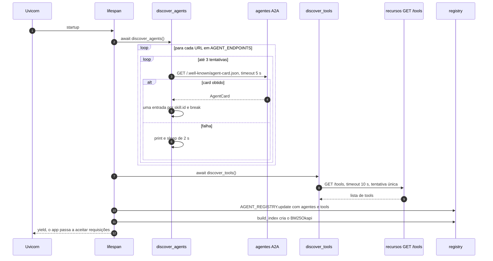

**Consulta:**

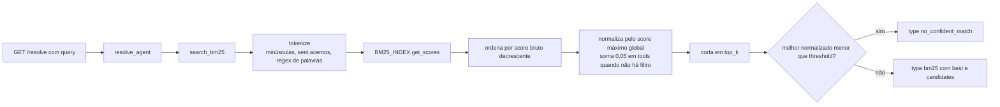

**[Fato]** O `lifespan` termina antes de o servidor aceitar requisições, então a descoberta atrasa a subida. O registro **não é atualizado depois**: se um agente subir mais tarde, é preciso reiniciar o BFA ([docs/execucao-local-uv.md:L216](execucao-local-uv.md)). O log real mostra o registro final só com `cartao_credito`: `abrir_conta` falhou nas 3 tentativas e a descoberta MCP falhou ([logs/bfa.out.log](../logs/bfa.out.log)).

### 8.3 Arquivo por arquivo

#### Arquivo: `bfa/app.py`

```python
from contextlib import asynccontextmanager

from fastapi import FastAPI

from discovery import discover_agents
from mcp_discovery import discover_tools
from registry import AGENT_REGISTRY, build_index, resolve_agent


@asynccontextmanager
async def lifespan(app: FastAPI):

    agents = await discover_agents()
    tools = await discover_tools()

    AGENT_REGISTRY.update(agents)
    AGENT_REGISTRY.update(tools)

    build_index()

    print("Unified registry:", AGENT_REGISTRY)

    yield


app = FastAPI(lifespan=lifespan)


@app.get("/skills")
def listar_skills():
    return AGENT_REGISTRY


@app.get("/resolve")
def resolve(query: str, top_k: int = 3, threshold: float = 0.3):
    result = resolve_agent(query, top_k=top_k, threshold=threshold)

    if not result:
        return {"error": "no match"}

    return result

# /resolve/agents (filter_type="agent") e /resolve/tools (filter_type="tool"): mesma estrutura
# /skills/agents e /skills/tools: filtram AGENT_REGISTRY por "type"

@app.get("/")
async def health():
    return {"status": "ok"}
```

| Linha(s) | Código | Explicação técnica | Motivação / impacto |
|---|---|---|---|
| [L1](../bfa/app.py#L1) | `from contextlib import asynccontextmanager` | Converte um gerador assíncrono em *context manager*. É o formato do `lifespan` do Starlette/FastAPI | O código antes do `yield` roda na subida e o depois, no desligamento |
| [L3](../bfa/app.py#L3) | `from fastapi import FastAPI` | — | — |
| [L5-L7](../bfa/app.py#L5-L7) | `from discovery import discover_agents` / `from mcp_discovery import discover_tools` / `from registry import AGENT_REGISTRY, build_index, resolve_agent` | Imports absolutos por nome de módulo (`cwd=/app`) | `AGENT_REGISTRY` é **o mesmo objeto** dict de `registry.py` |
| [L10-L11](../bfa/app.py#L10-L11) | `@asynccontextmanager` / `async def lifespan(app: FastAPI):` | Hook de ciclo de vida | Substitui o antigo `@app.on_event("startup")` |
| [L13-L14](../bfa/app.py#L13-L14) | `agents = await discover_agents()` / `tools = await discover_tools()` | Descobertas **em sequência** | Poderiam ser concorrentes (`asyncio.gather`). **[Inferência]** No pior caso, com todas as tentativas estourando o timeout, a subida leva cerca de 52 s: 2 agentes × 3 tentativas × (5 s + 2 s de espera) + 10 s do MCP. Com conexão recusada (falha imediata), cerca de 12 s |
| [L16-L17](../bfa/app.py#L16-L17) | `AGENT_REGISTRY.update(agents)` / `AGENT_REGISTRY.update(tools)` | Agentes e tools no **mesmo dicionário** | Uma tool com o mesmo nome de um `skill.id` sobrescreveria o agente. Hoje não há colisão |
| [L19](../bfa/app.py#L19) | `build_index()` | Cria o índice BM25 | — |
| [L21](../bfa/app.py#L21) | `print("Unified registry:", AGENT_REGISTRY)` | Despeja o registro no stdout | Evidência em [logs/bfa.out.log](../logs/bfa.out.log) |
| [L23](../bfa/app.py#L23) | `yield` | Fim da subida | Nada é feito no desligamento |
| [L26](../bfa/app.py#L26) | `app = FastAPI(lifespan=lifespan)` | Registra o lifespan | — |
| [L29-L31](../bfa/app.py#L29-L31) | `@app.get("/skills")` / `def listar_skills(): return AGENT_REGISTRY` | Rota **síncrona** (`def`): o FastAPI a executa no threadpool | Expõe o registro inteiro, inclusive URLs internas |
| [L34-L41](../bfa/app.py#L34-L41) | `def resolve(query: str, top_k: int = 3, threshold: float = 0.3):` ... `return {"error": "no match"}` | Parâmetros de query com tipos validados pelo FastAPI (`query` obrigatório) | "Sem resultado" volta com **status 200** e um corpo de erro |
| [L44-L51](../bfa/app.py#L44-L51) | `def resolve_agents(...)`: `resolve_agent(..., filter_type="agent")` | Busca só agentes | Neste caso o *threshold* funciona ([8.5](#85-recursos-de-ia-e-recuperação-bm25)) |
| [L54-L61](../bfa/app.py#L54-L61) | `def resolve_tools(...)`: `filter_type="tool"` | Busca só tools | — |
| [L64-L66](../bfa/app.py#L64-L66) | `def listar_agents(): return {k: v for k, v in AGENT_REGISTRY.items() if v.get("type") == "agent"}` | *Dict comprehension* com filtro | — |
| [L69-L71](../bfa/app.py#L69-L71) | `def listar_tools(): ...` | Idem para tools | — |
| [L74-L76](../bfa/app.py#L74-L76) | `@app.get("/")` / `async def health(): return {"status": "ok"}` | *Liveness* simples | Responde "ok" mesmo com o registro vazio. Não serve como *readiness* |

#### Arquivo: `bfa/discovery.py`

```python
import asyncio

import httpx
from a2a.client import A2ACardResolver

AGENT_ENDPOINTS = [
    "http://cartao_credito_agent:8000",
    "http://abrir_conta_agent:8000"
]


def normalize(text):
    if not text:
        return ""
    return text.lower().strip()


async def discover_agents():
    registry = {}

    async with httpx.AsyncClient(timeout=5) as client:
        for url in AGENT_ENDPOINTS:

            for attempt in range(3):
                try:
                    resolver = A2ACardResolver(
                        httpx_client=client,
                        base_url=url
                    )

                    card = await resolver.get_agent_card()

                    for skill in card.skills:
                        registry[skill.id] = {
                            "agent_url": url,
                            "name": skill.name,
                            "description": skill.description,
                            "tags": skill.tags,
                            "examples": skill.examples,
                            "type": "agent"
                        }

                    break

                except Exception as e:
                    print(f"Tentativa {attempt+1} falhou para {url}: {e}")
                    await asyncio.sleep(2)

    return registry
```

| Linha(s) | Código | Explicação técnica | Motivação / impacto |
|---|---|---|---|
| [L1](../bfa/discovery.py#L1) | `import asyncio` | Para o `sleep` não bloqueante | — |
| [L3-L4](../bfa/discovery.py#L3-L4) | `import httpx` / `from a2a.client import A2ACardResolver` | Cliente HTTP e resolvedor de card A2A | O BFA usa só esta parte do a2a-sdk |
| [L6-L9](../bfa/discovery.py#L6-L9) | `AGENT_ENDPOINTS = ["http://cartao_credito_agent:8000", "http://abrir_conta_agent:8000"]` | Lista **fixa** | A descoberta é "dinâmica" só no conteúdo: os endereços repetem o `AGENTS` do supervisor. Faltaria um mecanismo de registro (os agentes se anunciarem) ou uma fonte de configuração |
| [L12-L15](../bfa/discovery.py#L12-L15) | `def normalize(text): ...` | Minúsculas + `strip` | **[Fato]** Nunca é usada (código morto). A normalização real está em [registry.py:L15-L21](../bfa/registry.py#L15-L21) |
| [L18-L19](../bfa/discovery.py#L18-L19) | `async def discover_agents():` / `registry = {}` | Acumulador local | — |
| [L21](../bfa/discovery.py#L21) | `async with httpx.AsyncClient(timeout=5) as client:` | Cliente com escopo da descoberta; fechado ao sair | Timeout curto (5 s), adequado para um card estático |
| [L22](../bfa/discovery.py#L22) | `for url in AGENT_ENDPOINTS:` | Um agente por vez | — |
| [L24](../bfa/discovery.py#L24) | `for attempt in range(3):` | Até 3 tentativas | Compensa a falta de `healthcheck` no Compose ([2.5](#25-infraestrutura-transversal)) |
| [L26-L31](../bfa/discovery.py#L26-L31) | `resolver = A2ACardResolver(httpx_client=client, base_url=url)` / `card = await resolver.get_agent_card()` | `GET {url}/.well-known/agent-card.json` | **[Fato]** O log mostra `HTTP Error 503: Network communication error fetching agent card ...` quando o agente ainda não subiu |
| [L33-L41](../bfa/discovery.py#L33-L41) | `for skill in card.skills: registry[skill.id] = {"agent_url": url, "name": ..., "description": ..., "tags": ..., "examples": ..., "type": "agent"}` | Uma entrada **por skill**, com chave `skill.id` | Um agente com N skills vira N entradas. Skills com o mesmo `id` em agentes diferentes se sobrescrevem. `agent_url` é a URL de descoberta, não `card.url` |
| [L43](../bfa/discovery.py#L43) | `break` | Sai do laço de tentativas | — |
| [L45-L47](../bfa/discovery.py#L45-L47) | `except Exception as e: print(f"Tentativa {attempt+1} falhou para {url}: {e}")` / `await asyncio.sleep(2)` | Espera fixa de 2 s, sem backoff exponencial. **Também dorme depois da 3ª falha** | Depois de 3 falhas, o agente fica de fora do registro **sem erro visível**, só no log |
| [L49](../bfa/discovery.py#L49) | `return registry` | — | — |

#### Arquivo: `bfa/mcp_discovery.py`

```python
import json

import httpx

MCP_ENDPOINTS = [
    "http://recursos:8000"
]


async def discover_tools():
    registry = {}

    async with httpx.AsyncClient(timeout=10) as client:
        for url in MCP_ENDPOINTS:
            try:
                response = await client.get(f"{url}/tools")
                tools = response.json()

                if isinstance(tools, str):
                    tools = json.loads(tools)

                for tool in tools:
                    tool_id = tool["name"]

                    tags = tool.get("annotations", {}).get("tags", [])

                    search_text = " ".join([
                        tool.get("name", ""),
                        tool.get("description", ""),
                        " ".join(tags),
                    ]).lower()

                    registry[tool_id] = {
                        "type": "tool",
                        "server_url": url,
                        "name": tool.get("name"),
                        "description": tool.get("description", ""),
                        "input_schema": tool.get("inputSchema", {}),
                        "tags": tags,
                        "search_text": search_text
                    }

            except Exception as e:
                print(f"Erro MCP {url}: {e}")

    return registry
```

| Linha(s) | Código | Explicação técnica | Motivação / impacto |
|---|---|---|---|
| [L1](../bfa/mcp_discovery.py#L1) | `import json` | Para o caso de JSON duplamente codificado | — |
| [L5-L7](../bfa/mcp_discovery.py#L5-L7) | `MCP_ENDPOINTS = ["http://recursos:8000"]` | URL **base** do servidor, sem `/mcp_gateway` | O BFA **não fala MCP**: usa a rota REST customizada `/tools` ([recursos/app.py:L247](../recursos/app.py#L247)). Só funciona com servidores que tenham essa rota, que não faz parte do protocolo |
| [L10-L11](../bfa/mcp_discovery.py#L10-L11) | `async def discover_tools():` / `registry = {}` | — | — |
| [L13](../bfa/mcp_discovery.py#L13) | `async with httpx.AsyncClient(timeout=10) as client:` | Timeout de 10 s | — |
| [L15-L17](../bfa/mcp_discovery.py#L15-L17) | `response = await client.get(f"{url}/tools")` / `tools = response.json()` | Sem `raise_for_status()` | **[Inferência]** Com o 500 de [recursos/app.py:L303-L307](../recursos/app.py#L303-L307), `tools` vira um **dict**. Iterar um dict percorre as chaves (strings), e `tool["name"]` lança `TypeError`, capturado em [L43-L44](../bfa/mcp_discovery.py#L43-L44) |
| [L19-L20](../bfa/mcp_discovery.py#L19-L20) | `if isinstance(tools, str): tools = json.loads(tools)` | Defesa contra resposta serializada duas vezes | **[Hipótese]** Resto de uma versão anterior do endpoint `/tools` |
| [L22-L23](../bfa/mcp_discovery.py#L22-L23) | `for tool in tools:` / `tool_id = tool["name"]` | Chave pelo nome da tool | — |
| [L25](../bfa/mcp_discovery.py#L25) | `tags = tool.get("annotations", {}).get("tags", [])` | Lê as tags não padronizadas | Com FastMCP 4.x vêm vazias ([A.2](#a2-toolannotations-e-campos-extras)) |
| [L27-L31](../bfa/mcp_discovery.py#L27-L31) | `search_text = " ".join([name, description, " ".join(tags)]).lower()` | Texto de indexação pré-calculado (só para tools) | Os `examples` das tools nem são lidos |
| [L33-L41](../bfa/mcp_discovery.py#L33-L41) | `registry[tool_id] = {"type": "tool", "server_url": url, ..., "input_schema": ..., "search_text": ...}` | Entrada de tool | `input_schema` vem do `schema_map` escrito à mão no `recursos` |
| [L43-L44](../bfa/mcp_discovery.py#L43-L44) | `except Exception as e: print(f"Erro MCP {url}: {e}")` | **Uma tentativa só** | Assimétrico em relação aos agentes (3 tentativas). **[Fato]** O log mostra `Erro MCP http://recursos:8000: All connection attempts failed` |
| [L46](../bfa/mcp_discovery.py#L46) | `return registry` | — | — |

#### Arquivo: `bfa/registry.py`

```python
import re
import unicodedata

import numpy as np
from rank_bm25 import BM25Okapi

AGENT_REGISTRY = {}

BM25_INDEX = None
BM25_KEYS = []

BOOST_TOOL = 0.05


def normalize(text: str) -> str:
    if not text:
        return ""
    text = text.lower().strip()
    text = unicodedata.normalize("NFD", text)
    text = text.encode("ascii", "ignore").decode("utf-8")
    return text


def tokenize(text: str):
    text = normalize(text)
    return re.findall(r"\w+", text)


def build_index():
    global BM25_INDEX, BM25_KEYS

    corpus = []
    keys = []

    for skill_id, data in AGENT_REGISTRY.items():
        text = data.get("search_text") or " ".join([
            data.get("name", ""),
            data.get("description", ""),
            " ".join(data.get("tags", [])),
        ])

        tokens = tokenize(text)

        if not tokens:
            continue

        corpus.append(tokens)
        keys.append(skill_id)

    if corpus:
        BM25_INDEX = BM25Okapi(corpus)
        BM25_KEYS = keys


def search_bm25(query: str, top_k: int = 3, filter_type: str | None = None):
    if not BM25_INDEX:
        return []

    tokens = tokenize(query)
    if not tokens:
        return []

    scores = BM25_INDEX.get_scores(tokens)

    max_score = max(scores) if len(scores) > 0 else 1
    if max_score == 0:
        max_score = 1

    ranked_idx = np.argsort(scores)[::-1]

    results = []

    for idx in ranked_idx:
        skill_id = BM25_KEYS[idx]
        data = AGENT_REGISTRY[skill_id]

        if filter_type and data.get("type") != filter_type:
            continue

        raw_score = float(scores[idx])
        norm_score = raw_score / max_score

        if not filter_type and data.get("type") == "tool":
            norm_score += BOOST_TOOL

        results.append({
            "skill": skill_id,
            "score": raw_score,
            "normalized_score": norm_score,
            "type": data.get("type", "agent"),
            "data": data
        })

        if len(results) >= top_k:
            break

    return results


def resolve_agent(
    query: str,
    top_k: int = 3,
    threshold: float = 0.3,
    filter_type: str | None = None
):
    results = search_bm25(query, top_k=top_k, filter_type=filter_type)

    if not results:
        return None

    best = results[0]

    if best["normalized_score"] < threshold:
        return {
            "type": "no_confident_match",
            "best": None,
            "candidates": results
        }

    return {
        "type": "bm25",
        "best": best,
        "candidates": results
    }
```

| Linha(s) | Código | Explicação técnica | Motivação / impacto |
|---|---|---|---|
| [L1-L2](../bfa/registry.py#L1-L2) | `import re` / `import unicodedata` | Regex e normalização Unicode | — |
| [L4-L5](../bfa/registry.py#L4-L5) | `import numpy as np` / `from rank_bm25 import BM25Okapi` | NumPy para ordenar; BM25 clássico | — |
| [L7](../bfa/registry.py#L7) | `AGENT_REGISTRY = {}` | Registro global do processo | Compartilhado com `app.py`; sem lock (só é escrito no `lifespan`) |
| [L9-L10](../bfa/registry.py#L9-L10) | `BM25_INDEX = None` / `BM25_KEYS = []` | Índice e mapeamento linha do corpus → chave do registro | Listas paralelas: a posição `i` do score corresponde a `BM25_KEYS[i]` |
| [L12](../bfa/registry.py#L12) | `BOOST_TOOL = 0.05` | Bônus somado às tools na busca sem filtro | Só altera o `normalized_score`, **não a ordem** (aplicado depois de ordenar, em [L83-L84](../bfa/registry.py#L83-L84)) |
| [L15-L21](../bfa/registry.py#L15-L21) | `text = text.lower().strip()` / `unicodedata.normalize("NFD", text)` / `text.encode("ascii", "ignore").decode("utf-8")` | A forma NFD separa letra e acento ("ã" vira "a" + til combinante); o `encode` ASCII com `ignore` descarta o acento | "Cartão" e "cartao" viram o mesmo token. Bom para português digitado sem acento |
| [L24-L26](../bfa/registry.py#L24-L26) | `def tokenize(text): text = normalize(text); return re.findall(r"\w+", text)` | `\w` = letras, dígitos e **sublinhado** | **[Teste]** `consultar_conta` vira **um único token**, então "consultar" não casa com a tool `consultar_conta`. Não há remoção de *stopwords* nem *stemming* ("consulta" ≠ "consultar") |
| [L29-L30](../bfa/registry.py#L29-L30) | `def build_index():` / `global BM25_INDEX, BM25_KEYS` | Reatribui os globais | — |
| [L35-L40](../bfa/registry.py#L35-L40) | `text = data.get("search_text") or " ".join([name, description, tags])` | Tools usam `search_text`; agentes usam nome + descrição + tags | Os **`examples` das skills não são indexados**, apesar de coletados |
| [L42-L48](../bfa/registry.py#L42-L48) | `tokens = tokenize(text)` / `if not tokens: continue` / `corpus.append(tokens)` / `keys.append(skill_id)` | Corpus de listas de tokens | — |
| [L50-L52](../bfa/registry.py#L50-L52) | `if corpus: BM25_INDEX = BM25Okapi(corpus); BM25_KEYS = keys` | Parâmetros padrão: `k1=1.5`, `b=0.75`, `epsilon=0.25` (`rank_bm25.py:L78-L83`) | Com o corpus vazio (todas as descobertas falharam), o índice fica `None` e toda busca devolve vazio |
| [L55](../bfa/registry.py#L55) | `def search_bm25(query: str, top_k: int = 3, filter_type: str \| None = None):` | `str \| None` é a sintaxe de união do Python ≥ 3.10 | — |
| [L56-L61](../bfa/registry.py#L56-L61) | `if not BM25_INDEX: return []` / `tokens = tokenize(query)` / `if not tokens: return []` | Guardas | — |
| [L63](../bfa/registry.py#L63) | `scores = BM25_INDEX.get_scores(tokens)` | Vetor NumPy com um score por documento (`rank_bm25.py:L107-L121`) | — |
| [L65-L67](../bfa/registry.py#L65-L67) | `max_score = max(scores) ...` / `if max_score == 0: max_score = 1` | Normalização pelo **máximo global**, calculado **antes** do filtro de tipo | **Consequência:** sem filtro, o primeiro resultado tem sempre `normalized_score` 1,0 (ou 1,05, se for tool) quando qualquer token casa. O *threshold* de 0,3 **só rejeita quando nenhum token casa** ([8.5](#85-recursos-de-ia-e-recuperação-bm25)) |
| [L69](../bfa/registry.py#L69) | `ranked_idx = np.argsort(scores)[::-1]` | `argsort` crescente, invertido para decrescente | O `argsort` padrão não é estável: a ordem entre empates é arbitrária |
| [L73-L78](../bfa/registry.py#L73-L78) | `skill_id = BM25_KEYS[idx]` / `data = AGENT_REGISTRY[skill_id]` / `if filter_type and data.get("type") != filter_type: continue` | Filtra **depois** de ordenar | Com filtro, o melhor agente pode ter normalizado < 1: aí o *threshold* funciona |
| [L80-L84](../bfa/registry.py#L80-L84) | `raw_score = float(scores[idx])` / `norm_score = raw_score / max_score` / `if not filter_type and data.get("type") == "tool": norm_score += BOOST_TOOL` | Score bruto e normalizado | Uma tool com score 0 aparece com 0,05 |
| [L86-L92](../bfa/registry.py#L86-L92) | `results.append({"skill": ..., "score": raw_score, "normalized_score": norm_score, "type": ..., "data": data})` | Resultado com os dados completos do registro | A resposta expõe URLs internas e schemas |
| [L94-L97](../bfa/registry.py#L94-L97) | `if len(results) >= top_k: break` / `return results` | Corta em `top_k` | Documentos com score 0 também entram até completar `top_k` |
| [L100-L106](../bfa/registry.py#L100-L106) | `def resolve_agent(query, top_k=3, threshold=0.3, filter_type=None):` / `results = search_bm25(...)` | Camada de decisão | — |
| [L108-L109](../bfa/registry.py#L108-L109) | `if not results: return None` | Sem índice ou sem tokens | `app.py` responde `{"error": "no match"}` |
| [L111-L118](../bfa/registry.py#L111-L118) | `best = results[0]` / `if best["normalized_score"] < threshold: return {"type": "no_confident_match", "best": None, "candidates": results}` | Recusa por baixa confiança | Ver a limitação de [L65-L67](../bfa/registry.py#L65-L67) |
| [L120-L124](../bfa/registry.py#L120-L124) | `return {"type": "bm25", "best": best, "candidates": results}` | Resposta confiante | — |

#### Arquivos de build e configuração do BFA

| Arquivo | Conteúdo | Observação |
|---|---|---|
| [requirements.txt](../bfa/requirements.txt) | `fastapi`, `uvicorn`, `httpx`, `python-dotenv`, `a2a-sdk<1`, `rank-bm25`, `numpy` | `python-dotenv` não é usado. Não há `.env` no BFA |
| [Dockerfile](../bfa/Dockerfile) | Igual ao de `recursos`, com `CMD ["uvicorn", "app:app", "--host", "0.0.0.0", "--port", "8000", "--reload"]` | Com `--reload`, cada reinício refaz a descoberta |
| [.vscode/settings.json](../bfa/.vscode/settings.json) | Interpretador + `python-envs.pythonProjects` | Igual ao do supervisor, mas este é versionado |
| `.dockerignore`, `.gitignore` | Iguais aos de `recursos` | — |

### 8.4 Rastreamento de chamadas

| Função | Quem chama | Parâmetros | Processamento | Dependências | Retorno | Erros | Efeitos colaterais |
|---|---|---|---|---|---|---|---|
| `lifespan` | Starlette (startup) | `app` | Descobre, junta e indexa | `discover_*`, `build_index` | contexto | Exceções não tratadas impedem a subida (mas os `discover_*` engolem tudo) | Preenche os globais |
| `discover_agents` | `lifespan` | — | 3 tentativas por agente | `A2ACardResolver`, `httpx` | `dict` | `print` + `sleep` | Rede |
| `discover_tools` | `lifespan` | — | 1 tentativa | `httpx` | `dict` | `print` | Rede |
| `build_index` | `lifespan` | — | Tokeniza e cria o `BM25Okapi` | `rank_bm25` | `None` | — | Globais |
| `search_bm25` | `resolve_agent` | `query`, `top_k`, `filter_type` | Score, ordenação, normalização, filtro | NumPy | `list[dict]` | — | — |
| `resolve_agent` | Rotas `/resolve*` | idem + `threshold` | Decide se há confiança | `search_bm25` | `dict` ou `None` | — | — |

### 8.5 Recursos de IA e recuperação BM25

> **Conceito — BM25.** Função de ranking lexical: o score de um documento D para a consulta Q é a soma, para cada termo q de Q, de `IDF(q) · f(q,D)·(k1+1) / (f(q,D) + k1·(1 − b + b·|D|/avgdl))`. `f(q,D)` é a frequência do termo em D; `|D|`, o tamanho de D; `avgdl`, o tamanho médio dos documentos. `k1` controla a saturação da frequência e `b`, a normalização pelo tamanho. No `BM25Okapi` do rank-bm25, `IDF(q) = ln(N − n(q) + 0,5) − ln(n(q) + 0,5)`. Esse valor fica **negativo** para termos presentes em mais da metade dos N documentos e, nesse caso, é substituído por `epsilon × IDF médio` (`rank_bm25.py:L85-L105`).

> **Conceito — Descoberta de capacidades (*tool/agent retrieval*).** Com muitas tools ou agentes, mandar todos ao LLM fica caro e confunde o modelo. Um passo de **recuperação** escolhe os candidatos relevantes antes do roteamento ou do tool calling. Pode ser lexical (BM25), semântico (embeddings) ou feito pela própria plataforma: a API da Anthropic oferece uma ferramenta de *tool search* (regex ou BM25) com `defer_loading`.

**Testes com os dados reais dos AgentCards e tools [Teste]** ([A.5](#a5-bfa-ranking-bm25-com-os-dados-reais)):

| Consulta | `/resolve` (sem filtro) | `/resolve/agents` | Leitura |
|---|---|---|---|
| "quero abrir uma conta" | `bm25` → `abrir_conta` (bruto 3,300; norm. 1,0), depois `criar_ou_buscar_conta`, `gerar_prompt_abertura` | `abrir_conta` | Correto |
| "quero um cartão platinum" | `bm25` → `cartao_credito` (1,517), depois `solicitar_cartao`, `consultar_cartao` | `cartao_credito` | Correto |
| "consultar saldo" | `no_confident_match` (todos com score 0) | `no_confident_match` | "consultar" ≠ token `consultar_conta`; "saldo" não existe no corpus |
| "falar com atendente" | **`bm25` (confiante) → `cartao_credito`** (1,295) | `cartao_credito` | **Falso positivo**: o único termo em comum é a palavra vazia "com", da descrição "Ajuda clientes **com** dúvidas…" |

**Por que o resultado sai assim (IDF no corpus de 7 documentos) [Teste]:**

| Termo | Documentos que contêm (df) | IDF | Observação |
|---|---|---|---|
| `conta` | 4 de 7 | 0,289 (piso = 0,25 × IDF médio) | O termo **mais importante do domínio** recebe o peso mínimo, por estar em mais da metade dos documentos |
| `de` | 5 de 7 | 0,289 (piso) | Palavra vazia |
| `uma` | 2 de 7 | **0,788** | Palavra vazia com **mais peso que `conta`** |
| `com` | 1 de 7 | 1,466 | Palavra vazia com o peso máximo: explica o falso positivo |
| `abrir`, `platinum` | 1 de 7 | 1,466 | Termos discriminantes |

Para "quero abrir uma conta", o 2º candidato (`criar_ou_buscar_conta`) soma 1,244 do token `uma` e 0,455 de `conta`, e **nada** de `abrir`.

| Pergunta | Resposta |
|---|---|
| O que é? | Um registro de capacidades com busca lexical em memória |
| Qual problema resolve? | Descobrir agentes e tools sem fixar a lista no roteador |
| Como foi implementado? | `lifespan` + `A2ACardResolver` + `GET /tools` + `BM25Okapi` ([8.3](#83-arquivo-por-arquivo)) |
| Por que foi escolhido? | **[Hipótese]** BM25 não exige modelo de embeddings, banco vetorial nem chamadas externas, e é determinístico e explicável |
| Como funciona internamente? | Normaliza e tokeniza; calcula os scores; ordena; normaliza pelo máximo; aplica o *threshold* |
| Limitações | Corpus minúsculo (7 documentos) distorce o IDF; sem *stopwords* nem *stemming*; o *threshold* quase nunca atua sem filtro; exemplos não indexados; registro congelado na subida; **não integrado ao supervisor** |
| Alternativas | Remover *stopwords* em português e aplicar *stemming* (RSLP); indexar os `examples`; embeddings (busca semântica) ou um híbrido BM25 + embeddings; *threshold* sobre o score bruto ou a margem entre o 1º e o 2º; usar o BFA como etapa de pré-filtragem do roteador LLM |

### 8.6 Limitações e riscos

1. **Órfão:** nenhum serviço consulta o BFA. O supervisor usa `AGENTS` fixo ([supervisor/src/services.py:L31-L34](../supervisor/src/services.py#L31-L34)).
2. **Descoberta frágil:** depende da ordem de subida; sem atualização periódica; a falha de um agente fica silenciosa.
3. **Qualidade de ranking:** falsos positivos por palavras vazias; termos de domínio com peso mínimo; normalização que anula o *threshold*.
4. **Contrato não padronizado:** depende de `/tools` (fora do MCP) e de `annotations` fora do padrão.
5. **Exposição:** `/skills` revela a topologia interna; não há autenticação.

---

## 9. Projeto 5 — `frontend` (Streamlit)

### 9.1 Visão geral

| Aspecto | Descrição |
|---|---|
| Nome e propósito | "MDBank Assistente": chat mínimo em Streamlit |
| Problema que resolve | Interface rápida para exercitar o backend pelo caminho REST (`POST /chat`), sem build de frontend |
| Linguagem | Python |
| Frameworks | Streamlit 1.65 (local), requests |
| Arquitetura | Um script, reexecutado a cada interação |
| Ponto de entrada | `streamlit run app.py --server.port=9090 ...` ([frontend/Dockerfile:L20-L24](../frontend/Dockerfile#L20-L24)) |
| Integrações | `POST http://supervisor:8000/chat`, chamado **pelo servidor** Streamlit, dentro da rede Docker |
| Relação com os demais | Cliente do supervisor; alternativa mais simples ao frontend2 |

### 9.2 Modelo de execução e fluxo

> **Conceito — modelo de execução do Streamlit.** Cada aba do navegador abre uma **sessão** (via WebSocket) no servidor Streamlit. A cada interação (enviar texto, clicar), o **script inteiro roda de novo, do início ao fim**. O que precisa sobreviver entre essas execuções fica em `st.session_state`, um dicionário por sessão. As chamadas de rede do script partem do **servidor**, não do navegador.

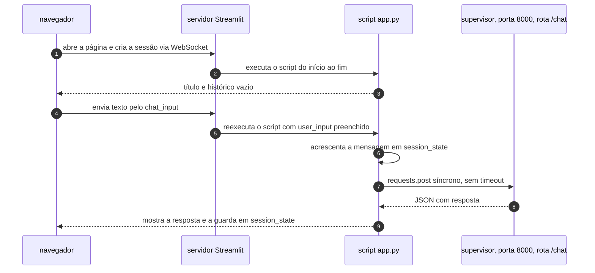

### 9.3 Arquivo por arquivo

#### Arquivo: `frontend/app.py`

```python
import requests
import streamlit as st

API_URL = "http://supervisor:8000/chat"

st.set_page_config(page_title="MDBank Assistente", page_icon="🏦")

st.title("MDBank Assistente")

if "messages" not in st.session_state:
    st.session_state.messages = []

for msg in st.session_state.messages:
    with st.chat_message(msg["role"]):
        st.markdown(msg["content"])

user_input = st.chat_input("Digite sua pergunta")

if user_input:

    st.session_state.messages.append({
        "role": "user",
        "content": user_input
    })

    with st.chat_message("user"):
        st.markdown(user_input)

    payload = {
        "message": user_input,
        "session_id": "123",
        "client_id": "123"
    }

    with st.chat_message("assistant"):
        with st.spinner("Pensando..."):
            response = requests.post(API_URL, json=payload)

            if response.status_code == 200:
                data = response.json()
                resposta = data.get("resposta", "Erro na resposta do servidor")
            else:
                resposta = "Erro ao chamar API"

        st.markdown(resposta)

    st.session_state.messages.append({
        "role": "assistant",
        "content": resposta
    })
```

| Linha(s) | Código | Explicação técnica | Motivação / impacto |
|---|---|---|---|
| [L1](../frontend/app.py#L1) | `import requests` | Cliente HTTP **síncrono** | Bloqueia a thread da sessão durante a chamada. O Streamlit roda cada sessão em uma thread própria, então outros usuários não ficam bloqueados |
| [L2](../frontend/app.py#L2) | `import streamlit as st` | — | — |
| [L4](../frontend/app.py#L4) | `API_URL = "http://supervisor:8000/chat"` | Nome DNS do Compose e porta **interna** | Funciona porque a chamada parte do container. Fora do Docker, precisa do arquivo `hosts` ([3.3](#33-topologia-de-rede-e-endereçamento)) |
| [L6](../frontend/app.py#L6) | `st.set_page_config(page_title=..., page_icon="🏦")` | Título e ícone da aba | Deve ser o primeiro comando Streamlit do script |
| [L8](../frontend/app.py#L8) | `st.title("MDBank Assistente")` | Cabeçalho | — |
| [L10-L11](../frontend/app.py#L10-L11) | `if "messages" not in st.session_state: st.session_state.messages = []` | Inicializa o histórico **da sessão** só na primeira execução | Recarregar a página cria outra sessão e o histórico some da tela, enquanto a memória do servidor (thread `"1"`) continua: a interface e o agente ficam com históricos diferentes |
| [L13-L15](../frontend/app.py#L13-L15) | `for msg in st.session_state.messages: with st.chat_message(msg["role"]): st.markdown(msg["content"])` | Redesenha o histórico a cada execução. `st.markdown` não renderiza HTML (`unsafe_allow_html=False` por padrão) | Necessário pelo modelo de reexecução |
| [L17](../frontend/app.py#L17) | `user_input = st.chat_input("Digite sua pergunta")` | Devolve o texto enviado **na execução disparada pelo envio**; nas demais, `None` | — |
| [L19](../frontend/app.py#L19) | `if user_input:` | Só processa quando houve envio | — |
| [L21-L24](../frontend/app.py#L21-L24) | `st.session_state.messages.append({"role": "user", "content": user_input})` | Grava a mensagem do usuário **antes** da chamada | Se a chamada lançar exceção, a mensagem do usuário fica sem resposta no histórico |
| [L26-L27](../frontend/app.py#L26-L27) | `with st.chat_message("user"): st.markdown(user_input)` | Mostra a mensagem na hora | — |
| [L29-L33](../frontend/app.py#L29-L33) | `payload = {"message": user_input, "session_id": "123", "client_id": "123"}` | Contrato do `ChatRequest` | IDs **fixos**; o backend os ignora de qualquer forma |
| [L35-L36](../frontend/app.py#L35-L36) | `with st.chat_message("assistant"):` / `with st.spinner("Pensando..."):` | Bolha do assistente com indicador de carregamento | Não há resposta progressiva: o REST devolve tudo de uma vez |
| [L37](../frontend/app.py#L37) | `response = requests.post(API_URL, json=payload)` | **Sem `timeout`**: o `requests` espera indefinidamente | **[Inferência]** Exceções de conexão não são capturadas, e o Streamlit mostra o *traceback* na página |
| [L39-L41](../frontend/app.py#L39-L41) | `if response.status_code == 200: data = response.json(); resposta = data.get("resposta", "Erro na resposta do servidor")` | Lê a resposta | `{"resposta": ""}` (roteador com nome inválido) gera uma bolha **vazia** |
| [L42-L43](../frontend/app.py#L42-L43) | `else: resposta = "Erro ao chamar API"` | Mensagem genérica | Descarta o `error` do corpo (422/500) |
| [L45](../frontend/app.py#L45) | `st.markdown(resposta)` | Renderiza o Markdown do LLM | — |
| [L47-L50](../frontend/app.py#L47-L50) | `st.session_state.messages.append({"role": "assistant", "content": resposta})` | Guarda a resposta | Inclusive as mensagens de erro, que passam a fazer parte do histórico exibido |

#### Arquivos de build e configuração do frontend

| Arquivo | Linha(s) | Conteúdo | Observação |
|---|---|---|---|
| [requirements.txt](../frontend/requirements.txt) | L1-L2 | `streamlit`, `requests` | Sem versões |
| [Dockerfile](../frontend/Dockerfile) | L1-L16 | Mesmo início dos outros (Python 3.13 slim, apt, pip) | — |
| | [L18](../frontend/Dockerfile#L18) | `EXPOSE 9090` | Documenta a porta (o Compose a publica) |
| | [L20-L24](../frontend/Dockerfile#L20-L24) | `CMD ["streamlit", "run", "app.py", "--server.address=0.0.0.0", "--server.port=9090", "--server.runOnSave=true", "--server.fileWatcherType=poll"]` | `runOnSave` reexecuta o app quando o código muda; `poll` vigia os arquivos por polling (bind mounts no Windows) |
| (ausente) | — | **Não há `.dockerignore`** | **[Fato]** Existe `frontend/.venv` local. O `COPY . .` leva esse ambiente (compilado para Windows, inútil no Linux) para o contexto de build e para a imagem |
| [.vscode/settings.json](../frontend/.vscode/settings.json) | L1-L3 | Interpretador do `.venv` | — |

**[Fato]** O Streamlit coleta estatísticas de uso por padrão ("Collecting usage statistics. To deactivate, set browser.gatherUsageStats to false.", [logs/frontend.out.log](../logs/frontend.out.log)). O mesmo log imprime as URLs de rede local e **externa** da máquina, omitidas aqui.

### 9.4 Rastreamento de chamadas

O script não define funções. A unidade de execução é a **execução do script** disparada pelo envio de uma mensagem:

| Etapa | Linhas | Dependência | Resultado | Erros |
|---|---|---|---|---|
| Inicializar e redesenhar o histórico | [L10-L15](../frontend/app.py#L10-L15) | `st.session_state` | Interface com o histórico | — |
| Capturar a entrada | [L17-L19](../frontend/app.py#L17-L19) | `st.chat_input` | `user_input` | — |
| Registrar e mostrar a mensagem | [L21-L27](../frontend/app.py#L21-L27) | — | Bolha do usuário | — |
| Chamar o backend | [L29-L37](../frontend/app.py#L29-L37) | `requests` → supervisor | `Response` | Exceção não tratada; sem timeout |
| Mostrar e registrar a resposta | [L39-L50](../frontend/app.py#L39-L50) | — | Bolha do assistente | Erros de API viram texto genérico |

### 9.5 Limitações e riscos

1. Sem `timeout` e sem tratamento de exceção na chamada HTTP.
2. Histórico da interface e memória do servidor dessincronizados (recarregar a página não zera o servidor).
3. `session_id`/`client_id` fixos.
4. Sem `.dockerignore`: o `.venv` local entra na imagem.
5. Telemetria do Streamlit ligada por padrão.

---

## 10. Projeto 6 — `frontend2` (React + AG-UI)

### 10.1 Visão geral

| Aspecto | Descrição |
|---|---|
| Nome e propósito | `mdbank-ag-ui-frontend` ([package.json:L2](../frontend2/package.json#L2)): chat que consome o endpoint AG-UI do supervisor, mostra a resposta à medida que chega e exibe o "state compartilhado" |
| Problema que resolve | Demonstrar o lado cliente do AG-UI: eventos incrementais e estado do agente visível na interface |
| Linguagem | JavaScript (JSX), CSS (Tailwind) |
| Frameworks | React 18, Create React App 5 (`react-scripts`), React Router 6, Tailwind 3 + typography, react-markdown 8, framer-motion 10, lucide-react |
| Arquitetura | SPA com duas rotas e um Context global. A lógica de rede e o parser SSE ficam em `ChatPage.jsx` |
| Ponto de entrada | `npm start` → `react-scripts start` (dev server na porta 3000); `src/index.jsx` monta o app |
| Integrações | `POST http://localhost:8080/` (AG-UI via SSE), chamado **do navegador** |
| Relação com os demais | Cliente do supervisor (caminho `/`) |

### 10.2 Arquitetura de componentes e fluxo

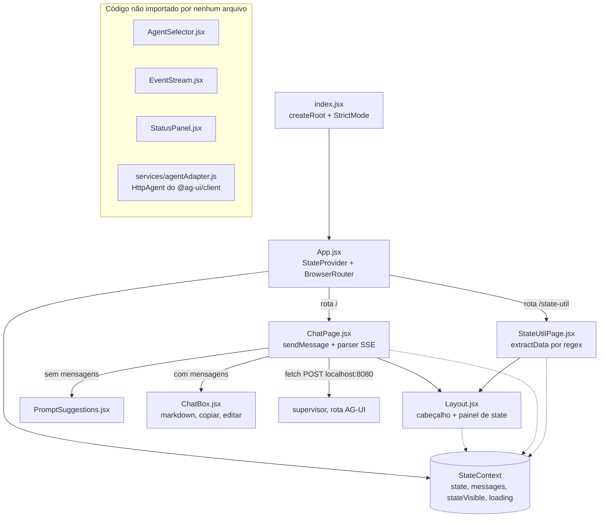

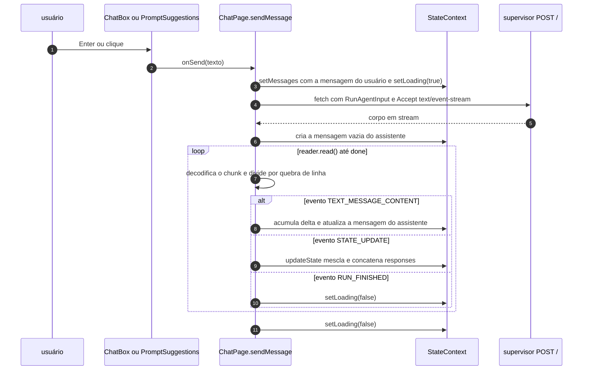

### 10.3 Arquivo por arquivo

#### Arquivo: `frontend2/package.json`

| Linha(s) | Código | Explicação técnica | Motivação / impacto |
|---|---|---|---|
| [L2-L4](../frontend2/package.json#L2-L4) | `"name": "mdbank-ag-ui-frontend"`, `"version": "1.0.0"`, `"private": true` | `private` impede a publicação acidental no npm | — |
| [L5-L10](../frontend2/package.json#L5-L10) | `"start": "react-scripts start"`, `"build"`, `"test"`, `"eject"` | Scripts padrão do CRA: dev server com HMR, build de produção em `build/`, Jest, e `eject` (expõe a configuração do webpack) | O container roda `start` (modo dev) |
| [L11-L25](../frontend2/package.json#L11-L25) | `"dependencies": { "react": "^18.2.0", ..., "lucide-react": "^0.257.0" }` | Faixas *caret*. Em versões `0.x`, `^0.257.0` aceita só `0.257.x` | Ferramentas de build (`tailwindcss`, `postcss`, `autoprefixer`) estão como dependências de runtime, o que é comum em projetos CRA |
| [L16](../frontend2/package.json#L16) | `"@ag-ui/client": "^0.0.47"` | Cliente oficial do AG-UI (RxJS, zod, fast-json-patch) | Usado **só** no código morto ([agentAdapter.js](../frontend2/src/services/agentAdapter.js)) |
| [L26-L28](../frontend2/package.json#L26-L28) | `"devDependencies": { "postcss-cli": "^10.1.0" }` | CLI do PostCSS | Nenhum script a usa: o CRA processa o PostCSS internamente |
| [L29-L40](../frontend2/package.json#L29-L40) | `"browserslist": { "production": [">0.2%", "not dead", "not op_mini all"], "development": [...] }` | Navegadores-alvo para Babel e autoprefixer | Padrão do CRA |
| (ausente) | `"proxy"` | O CRA pode encaminhar chamadas do dev server ao backend | Sem `proxy`, o navegador chama outra origem diretamente, por isso o CORS no supervisor |

#### Arquivo: `frontend2/Dockerfile` e `.dockerignore`

| Linha(s) | Código | Explicação técnica | Motivação / impacto |
|---|---|---|---|
| [Dockerfile:L1](../frontend2/Dockerfile#L1) | `FROM node:20-alpine` | Node 20 em Alpine (musl) | Imagem pequena |
| [L3](../frontend2/Dockerfile#L3) | `WORKDIR /app` | — | — |
| [L6-L7](../frontend2/Dockerfile#L6-L7) | `ENV CHOKIDAR_USEPOLLING=true` / `ENV WATCHPACK_POLLING=true` | Liga o polling no watcher do webpack | Hot reload com bind mount |
| [L9](../frontend2/Dockerfile#L9) | `COPY package*.json ./` | Copia `package.json` e `package-lock.json` | O `pnpm-lock.yaml` só entra no `COPY . .` |
| [L11](../frontend2/Dockerfile#L11) | `RUN npm install` | **Não é `npm ci`**: aceita um lock desatualizado e o completa dentro da imagem | **[Fato]** O lock não tem `react-router-dom` nem `lucide-react`. O build funciona, mas resolve essas versões no momento do build, sem reprodutibilidade |
| [L13](../frontend2/Dockerfile#L13) | `COPY . .` | Respeita o `.dockerignore` (`node_modules`, `build`, `.git`, `.gitignore`, `.env`, `.dockerignore`) | — |
| [L15-L17](../frontend2/Dockerfile#L15-L17) | `EXPOSE 3000` / `CMD ["npm", "start"]` | Dev server do CRA no container | Não é um build de produção servido estaticamente (por exemplo, com nginx) |

#### Arquivo: `frontend2/tailwind.config.js`

```javascript
/** @type {import('tailwindcss').Config} */
module.exports = {
  content: [
    "./src/**/*.{js,jsx,ts,tsx}", // todos os arquivos React
    "./public/index.html",
  ],
  theme: {
    extend: {
      colors: {
        primary: "#2563EB", // azul customizado
        secondary: "#FBBF24", // amarelo
      },
      fontFamily: {
        sans: ["Inter", "sans-serif"],
      },
    },
  },
  plugins: [require("@tailwindcss/typography")],
};
```

| Linha(s) | Código | Explicação técnica | Motivação / impacto |
|---|---|---|---|
| [L1](../frontend2/tailwind.config.js#L1) | `/** @type {import('tailwindcss').Config} */` | Anotação JSDoc para autocompletar no editor | — |
| [L2](../frontend2/tailwind.config.js#L2) | `module.exports = {` | CommonJS. O `react-scripts` 5 detecta o arquivo e liga o Tailwind no PostCSS (o `react-scripts` 5.0.1 depende de `tailwindcss ^3.0.2`, conforme o `package-lock.json`) | Por isso não existe `postcss.config.js` |
| [L3-L6](../frontend2/tailwind.config.js#L3-L6) | `content: ["./src/**/*.{js,jsx,ts,tsx}", "./public/index.html"]` | Arquivos varridos pelo motor JIT para gerar **só** as classes usadas | Classes montadas dinamicamente funcionam porque as strings completas aparecem no código |
| [L9-L12](../frontend2/tailwind.config.js#L9-L12) | `colors: { primary: "#2563EB", secondary: "#FBBF24" }` | Cores extras | **[Fato]** Nenhum componente usa `primary` ou `secondary` |
| [L13-L15](../frontend2/tailwind.config.js#L13-L15) | `fontFamily: { sans: ["Inter", "sans-serif"] }` | Define a fonte `font-sans` | **[Fato]** A fonte Inter **não é carregada** (sem `<link>` nem `@import`): cai na sans-serif do sistema, salvo se a Inter estiver instalada |
| [L18](../frontend2/tailwind.config.js#L18) | `plugins: [require("@tailwindcss/typography")]` | Classes `prose` para texto rico | Usado no Markdown das respostas ([ChatBox.jsx:L45](../frontend2/src/components/ChatBox.jsx#L45)) |

#### Arquivos: `public/index.html`, `src/index.jsx`, `src/index.css`

| Arquivo:Linha(s) | Código | Explicação técnica | Motivação / impacto |
|---|---|---|---|
| [index.html:L1-L7](../frontend2/public/index.html#L1-L7) | `<!doctype html>`, `<html lang="pt-BR">`, `<meta charset="UTF-8" />`, viewport, `<title>MDBank AG-UI</title>` | Documento base que o CRA usa como template | `lang="pt-BR"` ajuda leitores de tela e hifenização |
| [index.html:L8-L9](../frontend2/public/index.html#L8-L9) | `<body class="bg-gray-100">` / `<div id="root"></div>` | Ponto de montagem do React | O fundo é sobrescrito por `index.css` e pelo gradiente do `Layout` |
| [index.jsx:L1-L4](../frontend2/src/index.jsx#L1-L4) | `import React from "react"` / `import ReactDOM from "react-dom/client"` / `import App` / `import "./index.css"` | API de raiz do React 18; o import do CSS é tratado pelo webpack (injeção de `<style>`) | — |
| [index.jsx:L6](../frontend2/src/index.jsx#L6) | `const root = ReactDOM.createRoot(document.getElementById("root"));` | Raiz concorrente do React 18 | Habilita o *automatic batching* de atualizações |
| [index.jsx:L7-L11](../frontend2/src/index.jsx#L7-L11) | `root.render(<React.StrictMode><App /></React.StrictMode>)` | Em desenvolvimento, o StrictMode monta, desmonta e remonta os componentes e executa os efeitos duas vezes, para revelar efeitos colaterais | Inofensivo aqui (o único efeito é o scroll) |
| [index.css:L1-L3](../frontend2/src/index.css#L1-L3) | `@tailwind base;` / `@tailwind components;` / `@tailwind utilities;` | Injeta o reset (Preflight), os componentes e as utilidades | Necessário para o Tailwind |
| [index.css:L6-L10](../frontend2/src/index.css#L6-L10) | `body { background-color: #f9fafb; font-family: 'Inter', sans-serif; }` | Estilo global | Mesma observação sobre a fonte Inter |

#### Arquivo: `frontend2/src/App.jsx`

```jsx
import { BrowserRouter as Router, Routes, Route } from "react-router-dom";
import { StateProvider } from "./StateContext";
import ChatPage from "./ChatPage";
import StateUtilPage from "./StateUtilPage";

export default function App() {
  return (
    <StateProvider>
      <Router>
        <Routes>
          <Route path="/" element={<ChatPage />} />
          <Route path="/state-util" element={<StateUtilPage />} />
        </Routes>
      </Router>
    </StateProvider>
  );
}
```

| Linha(s) | Código | Explicação técnica | Motivação / impacto |
|---|---|---|---|
| [L2](../frontend2/src/App.jsx#L2) | `import { BrowserRouter as Router, Routes, Route } from "react-router-dom";` | Roteamento pela History API (URLs sem `#`) | Em produção estática, o servidor precisaria redirecionar `/state-util` para o `index.html`. O dev server do CRA já faz isso |
| [L3-L5](../frontend2/src/App.jsx#L3-L5) | imports do provider e das páginas | — | — |
| [L9](../frontend2/src/App.jsx#L9) | `<StateProvider>` **por fora** do `<Router>` | O estado sobrevive à navegação entre as rotas | Por isso a página "Conversa" mostra as respostas do chat. Recarregar o navegador perde tudo |
| [L12-L13](../frontend2/src/App.jsx#L12-L13) | `<Route path="/" element={<ChatPage />} />` / `<Route path="/state-util" ...>` | Duas páginas | — |

#### Arquivo: `frontend2/src/StateContext.js`

```javascript
import { createContext, useContext, useState } from "react";

const StateContext = createContext();

export function StateProvider({ children }) {
  const [state, setState] = useState({});
  const [messages, setMessages] = useState([]);
  const [stateVisible, setStateVisible] = useState(true);
  const [loading, setLoading] = useState(false);

  const updateState = (newState) => {
    setState((prev) => ({
      ...prev,
      ...newState,
      responses: [...(prev.responses || []), ...(newState.responses || [])],
    }));
  };

  return (
    <StateContext.Provider
      value={{
        state,
        updateState,
        messages,
        setMessages,
        stateVisible,
        setStateVisible,
        loading,
        setLoading,
      }}
    >
      {children}
    </StateContext.Provider>
  );
}

export const useAppState = () => useContext(StateContext);
```

| Linha(s) | Código | Explicação técnica | Motivação / impacto |
|---|---|---|---|
| [L1](../frontend2/src/StateContext.js#L1) | `import { createContext, useContext, useState } from "react";` | API de Context e estado | O arquivo é `.js` com JSX: o Babel do CRA aceita |
| [L3](../frontend2/src/StateContext.js#L3) | `const StateContext = createContext();` | Valor padrão `undefined` | Usar `useAppState` fora do provider quebraria a desestruturação; todo o app está dentro dele |
| [L6](../frontend2/src/StateContext.js#L6) | `const [state, setState] = useState({});` | Espelho do "state compartilhado" do agente | — |
| [L7-L9](../frontend2/src/StateContext.js#L7-L9) | `messages`, `stateVisible` (padrão `true`), `loading` | Estado da interface | O painel de state começa aberto |
| [L11-L17](../frontend2/src/StateContext.js#L11-L17) | `setState((prev) => ({ ...prev, ...newState, responses: [...(prev.responses \|\| []), ...(newState.responses \|\| [])] }))` | Mescla rasa e **concatenação** de `responses` (semântica de **delta**) | **[Teste]** O backend envia **snapshots** acumulados ([services.py:L224-L225](../supervisor/src/services.py#L224-L225)). Com dois agentes, o resultado é `[{abrir_conta: R1}, {abrir_conta: R1}, {cartao_credito: R2}]` ([A.6](#a6-frontend2-regex-máscara-merge-de-estado-e-sse)). Entre mensagens, `responses` acumula a sessão inteira, enquanto `user_query` e `agents` são sobrescritos |
| [L19-L34](../frontend2/src/StateContext.js#L19-L34) | `<StateContext.Provider value={{ ... }}>` | O objeto `value` é recriado a cada render, então todos os consumidores re-renderizam | Aceitável nesta escala |
| [L37](../frontend2/src/StateContext.js#L37) | `export const useAppState = () => useContext(StateContext);` | Hook de acesso | — |

#### Arquivo: `frontend2/src/Layout.jsx`

| Linha(s) | Código | Explicação técnica | Motivação / impacto |
|---|---|---|---|
| [L1-L2](../frontend2/src/Layout.jsx#L1-L2) | `import { Link } from "react-router-dom";` / `import { useAppState } from "./StateContext";` | Navegação sem recarregar a página | — |
| [L4-L5](../frontend2/src/Layout.jsx#L4-L5) | `export default function AppLayout({ children }) { const { stateVisible, setStateVisible, state } = useAppState();` | Layout compartilhado pelas duas páginas | — |
| [L8](../frontend2/src/Layout.jsx#L8) | `<div className="h-screen flex flex-col bg-gradient-to-br from-gray-900 via-gray-800 to-gray-900 text-white">` | Tela cheia em coluna, tema escuro | — |
| [L10-L28](../frontend2/src/Layout.jsx#L10-L28) | `<header>` com "🏦 MDBank AI", `<Link to="/">Chat</Link>`, `<Link to="/state-util">Conversa</Link>` e o botão `setStateVisible(!stateVisible)` | Navegação e alternância do painel | O rótulo "Conversa" leva à página de *histórico de respostas* (`StateUtilPage`) |
| [L31-L32](../frontend2/src/Layout.jsx#L31-L32) | `<main className="flex-1 flex flex-col overflow-hidden">{children}</main>` | Área da página | — |
| [L35-L42](../frontend2/src/Layout.jsx#L35-L42) | `{stateVisible && (<aside> ... <pre>{JSON.stringify(state, null, 2)}</pre></aside>)}` | Renderização condicional; JSON com indentação | Interface de **depuração**: mostra o estado bruto, com respostas completas e CPF. O React escapa o texto, então não há risco de XSS aqui |

#### Arquivo: `frontend2/src/ChatPage.jsx`

**Responsabilidade:** enviar a mensagem ao endpoint AG-UI, ler o stream SSE e atualizar mensagens e estado.

Código de `sendMessage`, [L10-L97](../frontend2/src/ChatPage.jsx#L10-L97):

```jsx
  async function sendMessage(message) {
    if (!message.trim()) return;

    const userMessage = {
      id: crypto.randomUUID(),
      role: "user",
      content: message,
    };
    setMessages((prev) => [...prev, userMessage]);
    setLoading(true);

    const payload = {
      thread_id: "1",
      run_id: crypto.randomUUID(),
      messages: [
        {
          id: crypto.randomUUID(),
          role: "user",
          content: message,
          user: { id: "user-123" },
        },
      ],
      state: {},
      tools: [],
      context: [],
      forwardedProps: {},
    };

    const response = await fetch("http://localhost:8080/", {
      method: "POST",
      headers: {
        "Content-Type": "application/json",
        Accept: "text/event-stream",
      },
      body: JSON.stringify(payload),
    });

    const reader = response.body.getReader();
    const decoder = new TextDecoder("utf-8");

    let assistantMessage = "";
    const assistantId = crypto.randomUUID();

    setMessages((prev) => [
      ...prev,
      { id: assistantId, role: "assistant", content: "" },
    ]);

    while (true) {
      const { done, value } = await reader.read();
      if (done) break;

      const chunk = decoder.decode(value, { stream: true });
      const lines = chunk.split("\n");

      for (let line of lines) {
        if (!line.startsWith("data:")) continue;
        const jsonStr = line.replace("data:", "").trim();
        if (!jsonStr) continue;

        try {
          const event = JSON.parse(jsonStr);

          if (event.type === "TEXT_MESSAGE_CONTENT") {
            assistantMessage += event.delta;
            setMessages((prev) => {
              const updated = [...prev];
              const index = updated.findIndex((m) => m.id === assistantId);
              if (index !== -1) updated[index].content = assistantMessage;
              return updated;
            });
          }

          if (event.type === "STATE_UPDATE") {
            updateState(event.state);
          }

          if (event.type === "RUN_FINISHED") {
            setLoading(false);
          }
        } catch (err) {
          console.error(err);
        }
      }
    }

    setLoading(false);
  }
```

| Linha(s) | Código | Explicação técnica | Motivação / impacto |
|---|---|---|---|
| [L1-L4](../frontend2/src/ChatPage.jsx#L1-L4) | imports de contexto, layout e componentes | — | — |
| [L7-L8](../frontend2/src/ChatPage.jsx#L7-L8) | `const { messages, setMessages, loading, setLoading, updateState } = useAppState();` | Lê o Context | — |
| [L10-L11](../frontend2/src/ChatPage.jsx#L10-L11) | `async function sendMessage(message) { if (!message.trim()) return;` | Ignora texto vazio | — |
| [L13-L17](../frontend2/src/ChatPage.jsx#L13-L17) | `id: crypto.randomUUID()` | Web Crypto | **[Inferência]** `crypto.randomUUID` só existe em **contexto seguro** (HTTPS ou `localhost`). Acessado por IP da rede local em HTTP, o envio falha com `TypeError` |
| [L18-L19](../frontend2/src/ChatPage.jsx#L18-L19) | `setMessages((prev) => [...prev, userMessage]);` / `setLoading(true);` | Atualização funcional (segura com o *batching*) | — |
| [L21-L36](../frontend2/src/ChatPage.jsx#L21-L36) | `payload = { thread_id: "1", run_id: ..., messages: [{ ..., user: { id: "user-123" } }], state: {}, tools: [], context: [], forwardedProps: {} }` | `RunAgentInput`, misturando snake_case (`thread_id`, `run_id`) e camelCase (`forwardedProps`); o backend aceita os dois. `user` é um campo extra, preservado pelo `extra="allow"` | Envia **só a mensagem atual**, sem o histórico. `thread_id` fixo |
| [L38-L45](../frontend2/src/ChatPage.jsx#L38-L45) | `await fetch("http://localhost:8080/", { method: "POST", headers: {..., Accept: "text/event-stream"}, body })` | URL fixa; **sem `try/catch`**, sem `AbortController`, sem checar `response.ok` | **[Inferência]** Com o servidor fora do ar, a promise é rejeitada e o "Pensando..." fica preso. Com 422/500 (corpo JSON), nenhuma linha começa com `data:`: o assistente fica com uma mensagem vazia |
| [L47-L48](../frontend2/src/ChatPage.jsx#L47-L48) | `const reader = response.body.getReader();` / `const decoder = new TextDecoder("utf-8");` | API de Streams: leitura incremental do corpo | É a base do consumo de SSE via `fetch` (o `EventSource` não aceita POST) |
| [L50-L56](../frontend2/src/ChatPage.jsx#L50-L56) | `let assistantMessage = ""` / `const assistantId = crypto.randomUUID()` / `setMessages([... { id: assistantId, role: "assistant", content: "" }])` | Mensagem vazia que será preenchida | Usa um ID próprio e ignora o `messageId` do servidor |
| [L58-L60](../frontend2/src/ChatPage.jsx#L58-L60) | `while (true) { const { done, value } = await reader.read(); if (done) break;` | Laço de leitura até o fim do stream | — |
| [L62](../frontend2/src/ChatPage.jsx#L62) | `const chunk = decoder.decode(value, { stream: true });` | `stream: true` guarda sequências UTF-8 incompletas para o próximo chunk | Acentos partidos entre chunks são tratados corretamente |
| [L63](../frontend2/src/ChatPage.jsx#L63) | `const lines = chunk.split("\n");` | Divide **cada chunk isoladamente** | **[Teste]** Sem um buffer de linha, um evento partido entre dois chunks vira dois fragmentos inválidos. Os dois falham no `JSON.parse` e o evento **se perde** ([A.6](#a6-frontend2-regex-máscara-merge-de-estado-e-sse)). Respostas longas de agente aumentam a chance de partição |
| [L65-L68](../frontend2/src/ChatPage.jsx#L65-L68) | `if (!line.startsWith("data:")) continue;` / `const jsonStr = line.replace("data:", "").trim();` | Parser SSE mínimo | Ignora os campos `event:`, `id:` e `retry:` do SSE e eventos com várias linhas `data:` |
| [L70-L71](../frontend2/src/ChatPage.jsx#L70-L71) | `try { const event = JSON.parse(jsonStr);` | — | — |
| [L73-L81](../frontend2/src/ChatPage.jsx#L73-L81) | `if (event.type === "TEXT_MESSAGE_CONTENT") { assistantMessage += event.delta; setMessages((prev) => { const updated = [...prev]; ... updated[index].content = assistantMessage; return updated; }); }` | Acumula o texto e atualiza a mensagem | **[Análise]** Copia o array, mas **altera o objeto da mensagem no lugar** (`updated[index].content = ...`), contra o princípio de imutabilidade do React; funciona porque a referência do array muda. Ignora `TEXT_MESSAGE_START/END` e o `messageId` |
| [L83-L85](../frontend2/src/ChatPage.jsx#L83-L85) | `if (event.type === "STATE_UPDATE") { updateState(event.state); }` | Consome o evento customizado do backend | Ver a duplicação em [StateContext.js:L11-L17](../frontend2/src/StateContext.js#L11-L17) |
| [L87-L89](../frontend2/src/ChatPage.jsx#L87-L89) | `if (event.type === "RUN_FINISHED") { setLoading(false); }` | Fim do run | Não há tratamento de `RUN_ERROR` (que o backend também não emite) |
| [L90-L92](../frontend2/src/ChatPage.jsx#L90-L92) | `} catch (err) { console.error(err); }` | Erro de parse só vai para o console | O usuário não percebe a perda |
| [L96](../frontend2/src/ChatPage.jsx#L96) | `setLoading(false);` | Garante o fim do carregamento quando o stream termina | Não roda se o `fetch` falhar (não há `finally`) |
| [L99-L112](../frontend2/src/ChatPage.jsx#L99-L112) | `<AppLayout>{messages.length === 0 ? <PromptSuggestions onSelect={sendMessage} /> : <ChatBox ... onSend={sendMessage} loading={loading} />}</AppLayout>` | Estado vazio com sugestões, ou o chat | — |

#### Arquivo: `frontend2/src/components/ChatBox.jsx`

| Linha(s) | Código | Explicação técnica | Motivação / impacto |
|---|---|---|---|
| [L1-L4](../frontend2/src/components/ChatBox.jsx#L1-L4) | `useState, useRef, useEffect`; `ReactMarkdown`; `remarkGfm`; `Copy, Pencil` | Hooks, Markdown com GFM e ícones | — |
| [L6](../frontend2/src/components/ChatBox.jsx#L6) | `export default function ChatBox({ messages, setMessages, onSend, loading })` | Recebe dados e callbacks por props | — |
| [L7-L8](../frontend2/src/components/ChatBox.jsx#L7-L8) | `const [input, setInput] = useState("");` / `const endRef = useRef();` | Textarea controlado; sentinela para o scroll | — |
| [L10-L12](../frontend2/src/components/ChatBox.jsx#L10-L12) | `navigator.clipboard.writeText(text)` | API de Clipboard (exige contexto seguro); a promise não é tratada | Falha silenciosa fora de HTTPS/localhost |
| [L14-L20](../frontend2/src/components/ChatBox.jsx#L14-L20) | `function edit(index) { if (msg.role === "user") { setInput(msg.content); setMessages((prev) => prev.slice(0, index)); } }` | "Editar" corta o histórico **da interface** a partir da mensagem | **[Fato]** Nada é enviado ao backend: a memória do servidor continua com as mensagens antigas, e a conversa visível deixa de corresponder ao contexto do agente |
| [L22-L24](../frontend2/src/components/ChatBox.jsx#L22-L24) | `useEffect(() => { endRef.current?.scrollIntoView({ behavior: "smooth" }); }, [messages, loading]);` | Rola até o fim a cada mudança | `?.` evita erro antes da montagem |
| [L27-L29](../frontend2/src/components/ChatBox.jsx#L27-L29) | `<div className="flex flex-col flex-1 h-0">` / `<div className="flex-1 overflow-y-auto ...">` | O truque `h-0` + `flex-1` permite scroll interno em um contêiner flex | — |
| [L30-L41](../frontend2/src/components/ChatBox.jsx#L30-L41) | `messages.map((msg, i) => <div key={msg.id} className={...}>` | `key` estável (UUID); alinhamento e cor por papel | — |
| [L42-L51](../frontend2/src/components/ChatBox.jsx#L42-L51) | `msg.role === "assistant" ? <ReactMarkdown remarkPlugins={[remarkGfm]} className="prose prose-invert">{msg.content}</ReactMarkdown> : msg.content` | Markdown só para o assistente. O `className` é aceito no react-markdown 8 (removido no 9) | Por padrão, o react-markdown não interpreta HTML bruto (seria preciso `rehype-raw`), o que protege contra HTML injetado na saída do LLM |
| [L53-L62](../frontend2/src/components/ChatBox.jsx#L53-L62) | botões copiar (todas) e editar (só usuário), visíveis no *hover* (`group-hover:opacity-100`) | Ações por mensagem | — |
| [L67](../frontend2/src/components/ChatBox.jsx#L67) | `{loading && <div className="text-gray-400">Pensando...</div>}` | Indicador | — |
| [L69](../frontend2/src/components/ChatBox.jsx#L69) | `<div ref={endRef} />` | Sentinela de scroll | — |
| [L73-L95](../frontend2/src/components/ChatBox.jsx#L73-L95) | `<textarea ... onKeyDown={(e) => { if (e.key === "Enter" && !e.shiftKey) { e.preventDefault(); onSend(input); setInput(""); } }} />` + botão "Enviar" | Enter envia; Shift+Enter quebra a linha | **Não há `disabled={loading}`**: dá para enviar outra mensagem durante um stream e abrir duas leituras concorrentes. A primeira que termina desliga o `loading` **[Inferência]** |

#### Arquivo: `frontend2/src/components/PromptSuggestions.jsx`

| Linha(s) | Código | Explicação técnica | Motivação / impacto |
|---|---|---|---|
| [L1](../frontend2/src/components/PromptSuggestions.jsx#L1) | `export default function PromptSuggestions({ onSelect })` | Estado vazio do chat | — |
| [L2-L7](../frontend2/src/components/PromptSuggestions.jsx#L2-L7) | `["Quero abrir uma conta", "Consultar saldo", "Solicitar cartão", "Falar com atendente"]` | Atalhos de prompt | **[Fato]** "Consultar saldo" e "Falar com atendente" não têm agente nem tool. O roteador só pode escolher entre os dois agentes, e o BFA, se fosse usado, devolveria "sem match" e um falso positivo ([8.5](#85-recursos-de-ia-e-recuperação-bm25)) |
| [L10-L22](../frontend2/src/components/PromptSuggestions.jsx#L10-L22) | `suggestions.map((s, i) => <button key={i} onClick={() => onSelect(s)}>` | Usar o índice como `key` é aceitável em lista estática | Chama `sendMessage` direto |

#### Arquivo: `frontend2/src/StateUtilPage.jsx`

**Responsabilidade:** mostrar o histórico de respostas do state e "extrair" dados estruturados (nome, CPF, conta, cartão) **do texto livre do LLM** com expressões regulares.

| Linha(s) | Código | Explicação técnica | Motivação / impacto |
|---|---|---|---|
| [L2-L7](../frontend2/src/StateUtilPage.jsx#L2-L7) | imports de React, `ReactMarkdown`, `remarkGfm`, `motion`, `AnimatePresence`, contexto e layout | — | `import React` não é necessário com o JSX *runtime* automático do CRA 5 |
| [L10-L11](../frontend2/src/StateUtilPage.jsx#L10-L11) | `const { state } = useAppState();` / `const responses = state.responses \|\| [];` | Lê as respostas acumuladas (e duplicadas) | — |
| [L16-L17](../frontend2/src/StateUtilPage.jsx#L16-L17) | `const extractData = (text) => { if (typeof text !== "string") return null;` | Guarda de tipo | — |
| [L20-L23](../frontend2/src/StateUtilPage.jsx#L20-L23) | `text.match(/(?:\**\s*nome\s*(?:completo)?\s*\**\s*[:\-]?\s*)([\p{L}\s]+)/iu)` | `\p{L}` (qualquer letra Unicode) exige a flag `u`. `\s` **inclui quebra de linha** | **[Teste]** `"Nome: Maria Silva\nCPF: ..."` → `Nome = "Maria Silva\nCPF"`. `"**Nome:** Maria Silva"` (Markdown típico de LLM) → **não casa**. "Me informe seu nome completo." → `Nome = "completo"` |
| [L25-L26](../frontend2/src/StateUtilPage.jsx#L25-L26) | `text.match(/cpf\s*[:\-]?\s*([\d.-]{11,14})/i)` | CPF com ou sem pontuação | Pega a primeira ocorrência |
| [L28-L31](../frontend2/src/StateUtilPage.jsx#L28-L31) | `/(?:\**\s*N[uú]mero\s*(?:da\s*)?conta\s*\**\s*[:\-]?\s*)(\d+)/i` | Número da conta | Mesmo problema com `**Número da conta:**` (os dois-pontos antes dos asteriscos) **[Teste]** |
| [L33-L36](../frontend2/src/StateUtilPage.jsx#L33-L36) | `/(?:\**\s*Saldo\s*\**\s*[:\-]?\s*R\$\s*)([\d.,]+)/i` | Exige o prefixo "R$" | — |
| [L38-L41](../frontend2/src/StateUtilPage.jsx#L38-L41) | `/(?:n[uú]mero\s*(?:do\s*cart[ãa]o)?\s*[:]?[\s\*]*)(\d{4,16})/i` | Aceita asteriscos depois dos dois-pontos | Qualquer "número" seguido de 4 a 16 dígitos vira número de cartão |
| [L43-L46](../frontend2/src/StateUtilPage.jsx#L43-L46) | `/(?:tipo\s*[:]?[\s\*]*)([\p{L}\s]+)[\*]*/iu` | Tipo do cartão | **[Teste]** "Quais tipos de conta você deseja?" → `CartaoTipo = "s de conta você deseja"` |
| [L48-L51](../frontend2/src/StateUtilPage.jsx#L48-L51) | `/limite\s*(?:disponível)?\s*[:]?[\sR$]*([\d.,]+)/i` | Limite | — |
| [L53](../frontend2/src/StateUtilPage.jsx#L53) | `return Object.keys(data).length ? data : null;` | — | — |
| [L59-L69](../frontend2/src/StateUtilPage.jsx#L59-L69) | `for (const r of responses) { if (typeof r === "string") ... else for (const value of Object.values(r)) if (value && value.trim()) ... }` | Achata `[{agente: texto}]` em uma lista de mensagens | Herda a duplicação do `StateContext` |
| [L74-L79](../frontend2/src/StateUtilPage.jsx#L74-L79) | ``if (clean.length <= 8) return clean.slice(0, 4) + " ****"; return `${clean.slice(0, 4)} **** **** ${clean.slice(-2)}`;`` | Máscara supondo um PAN longo | **[Teste]** Os cartões do sistema têm **6 dígitos**: `maskCardNumber("123456")` → `"1234 ****"` **mostra 4 dos 6 dígitos** |
| [L84-L87](../frontend2/src/StateUtilPage.jsx#L84-L87) | `const cardVariants = { hidden: { opacity: 0, y: 20 }, visible: { opacity: 1, y: 0 } };` | Variantes de animação do framer-motion | — |
| [L89-L100](../frontend2/src/StateUtilPage.jsx#L89-L100) | `<AppLayout>` / título "📋 Histórico de Respostas" / estado vazio | — | — |
| [L102-L124](../frontend2/src/StateUtilPage.jsx#L102-L124) | `<AnimatePresence>{filteredResponses.map(({ message, data }, i) => <motion.div key={i} initial="hidden" animate="visible" exit={...} variants={cardVariants} ...>` | Entrada e saída animadas; cor conforme o tipo de dado extraído | `key={i}` com `AnimatePresence` só funciona bem porque a lista só cresce |
| [L125-L130](../frontend2/src/StateUtilPage.jsx#L125-L130) | `<ReactMarkdown remarkPlugins={[remarkGfm]} className="whitespace-pre-wrap text-white">{message}</ReactMarkdown>` | Mostra a resposta original | — |
| [L131-L160](../frontend2/src/StateUtilPage.jsx#L131-L160) | Quando `isCard`: um "cartão" visual com `data.CartaoTipo`, a marca **"VISA" fixa** ([L141](../frontend2/src/StateUtilPage.jsx#L141)), o número mascarado, o limite e o nome | Visualização | A bandeira é inventada pela interface: não existe no backend |
| [L161-L172](../frontend2/src/StateUtilPage.jsx#L161-L172) | Senão: *chips* `chave: valor` | Exibição genérica | Mostra o CPF por inteiro |

**Avaliação [Análise]:** a página tenta recuperar dados estruturados **depois** que o LLM os transformou em prosa. A alternativa robusta é o backend publicar os dados das tools (que já vêm estruturados do MCP, em `structuredContent`) no estado AG-UI, com `STATE_SNAPSHOT`/`STATE_DELTA`.

#### Código morto em `frontend2`

| Arquivo | Conteúdo | Evidência | Observação |
|---|---|---|---|
| [components/AgentSelector.jsx](../frontend2/src/components/AgentSelector.jsx) (L1-L28) | Botões para escolher "Conta", "Cartão" ou "Supervisor" (`ids` `conta`, `cartao`, `supervisor`) | Nenhum import **[Fato]** | **[Hipótese]** Restos de um desenho em que o usuário escolhia o agente. Os IDs não batem com os nomes do backend |
| [components/EventStream.jsx](../frontend2/src/components/EventStream.jsx) (L1-L17) | Lista de eventos (`e.content`) | Nenhum import | **[Hipótese]** Painel de depuração de eventos AG-UI |
| [components/StatusPanel.jsx](../frontend2/src/components/StatusPanel.jsx) (L1-L14) | Lista de alertas | Nenhum import | — |
| [services/agentAdapter.js](../frontend2/src/services/agentAdapter.js) (L1-L60) | `class MDBankAgent` cria `new HttpAgent({ url })` do `@ag-ui/client` **e nunca o usa**. `run()` faz `fetch` com o contrato **REST** `{message, session_id, client_id, agent}` e lê `data.resposta` | Nenhum import | **Não é um cliente AG-UI**, apesar do nome e da dependência: usa o contrato do `/chat`. **[Inferência]** Por não ser alcançável a partir do `index.jsx`, o webpack não o inclui no bundle |

#### Lockfiles

| Arquivo | Função | Achado |
|---|---|---|
| [package-lock.json](../frontend2/package-lock.json) | Lock do npm (`lockfileVersion` 3, 1.431 pacotes) | Sem `react-router-dom` e `lucide-react` ([4.5](#45-discrepâncias-entre-o-declarado-o-importado-e-o-instalado), D8). Versões resolvidas: React 18.3.1, react-markdown 8.0.7, Tailwind 3.4.19, framer-motion 10.18.0, `@ag-ui/client` 0.0.47 |
| [pnpm-lock.yaml](../frontend2/pnpm-lock.yaml) | Lock do pnpm (`lockfileVersion` 9.0) | Ainda mais desatualizado (faltam 5 dependências). Nenhum script ou Dockerfile usa pnpm |

### 10.4 Rastreamento de chamadas

| Função / componente | Quem chama | Parâmetros | Processamento | Retorno / efeito | Erros |
|---|---|---|---|---|---|
| `StateProvider` | `App` | `children` | Cria 4 estados e `updateState` | Context | — |
| `updateState(newState)` | `ChatPage` (evento `STATE_UPDATE`) | estado do backend | Mescla e concatena `responses` | Atualiza `state` | Duplicação (snapshot tratado como delta) |
| `ChatPage.sendMessage(message)` | `ChatBox.onSend`, `PromptSuggestions.onSelect` | texto | `fetch` → laço SSE → eventos | Atualiza `messages`, `state`, `loading` | Sem `try/catch` no `fetch`; erros de parse vão para o console |
| `ChatBox.edit(index)` | botão lápis | índice | Corta o histórico local | Texto volta para o campo | Sem sincronia com o backend |
| `ChatBox.copy(text)` | botão copiar | texto | Clipboard API | — | Promise sem tratamento |
| `StateUtilPage.extractData(text)` | render da página | texto do LLM | 7 regex | `dict` ou `null` | Falsos positivos e negativos |
| `maskCardNumber(number)` | render do cartão | string | Máscara | string | Expõe 4 de 6 dígitos |

### 10.5 AG-UI no cliente: o que foi implementado e o que falta

| Aspecto do AG-UI | No frontend2 | Com `@ag-ui/client` (`HttpAgent`) **[Inferência a partir das dependências do pacote]** |
|---|---|---|
| Transporte | `fetch` + parser SSE manual, sem buffer | Parser SSE robusto, eventos como *Observable* (RxJS) |
| Validação de eventos | Nenhuma | Esquemas zod; `STATE_UPDATE` seria rejeitado |
| Estado compartilhado | `STATE_UPDATE` customizado + merge por concatenação | `STATE_SNAPSHOT` + `STATE_DELTA` aplicados com JSON Patch (`fast-json-patch`) |
| Histórico | Envia só a última mensagem | Envia `messages` completo, mantido pelo agente cliente |
| Mensagens | Ignora `TEXT_MESSAGE_START/END` e `messageId` | Monta as mensagens por `messageId` |
| Erros | Sem `RUN_ERROR` | Trata `RUN_ERROR` |
| Ferramentas no frontend | Não há (`tools: []`) | Suporta *frontend tools* (`TOOL_CALL_*`) |

### 10.6 Limitações e riscos

1. **Estado:** respostas duplicadas e acumuladas por sessão ([StateContext.js:L11-L17](../frontend2/src/StateContext.js#L11-L17)).
2. **Streaming:** perda de eventos partidos entre chunks; sem tratamento de erro de rede; `loading` pode ficar preso.
3. **Extração por regex:** frágil; falha no formato Markdown mais comum; falsos positivos.
4. **Privacidade na interface:** painel de state com dados brutos e CPF; máscara de cartão que expõe 4 de 6 dígitos; bandeira "VISA" inventada.
5. **Configuração:** URL e `thread_id` fixos; `crypto.randomUUID` exige contexto seguro.
6. **Manutenção:** quatro arquivos mortos; dois lockfiles desatualizados; dependência `@ag-ui/client` sem uso real; dev server no container.

---

## 11. Fluxos de execução e integração

### 11.1 Fluxo A — Streamlit → `POST /chat` (agentes em paralelo)

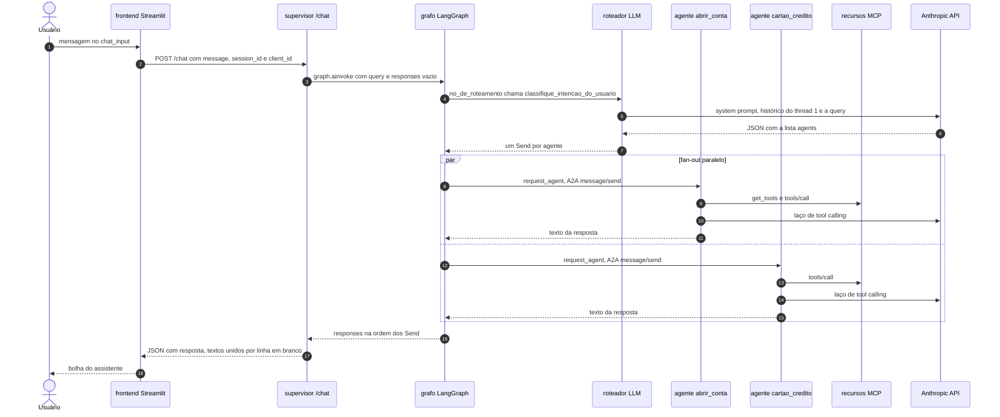

| Etapa | Componente | Síncrono/assíncrono | Ponto de falha | Tratamento |
|---|---|---|---|---|
| 1–2 | Streamlit → supervisor | HTTP síncrono (`requests`), sem timeout | Supervisor fora do ar | Exceção não tratada na página |
| 3–7 | Roteador | `async`; uma chamada LLM | Erro de LLM ou de parse | Fallback silencioso para `abrir_conta` |
| 8–17 | Fan-out | Tarefas concorrentes no mesmo superstep | Agente fora do ar, timeout de 30 s, `InternalError` do agente | O grafo falha inteiro e o `/chat` devolve 500 com `str(e)` |
| 18–20 | Agregação e resposta | — | Nome inválido ou lista vazia | 200 com `"resposta": ""` |

### 11.2 Fluxo B — React → `POST /` (AG-UI, agentes em sequência)

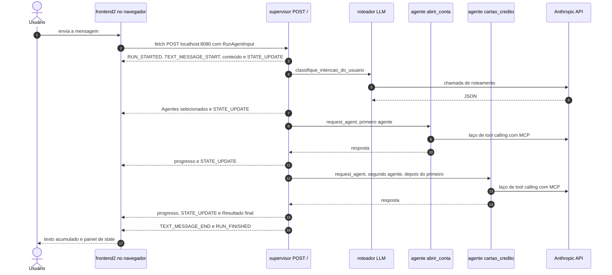

| Etapa | Síncrono/assíncrono | Ponto de falha | Tratamento |
|---|---|---|---|
| Envio | `fetch` assíncrono; a resposta HTTP sai logo, com o corpo em stream | Rede ou CORS | Promise rejeitada sem tratamento; o "Pensando..." fica preso |
| Roteamento | `await` dentro do gerador; nenhum byte sai durante a espera | LLM | Fallback silencioso |
| Agentes | `await` sequencial | Nome inválido (`KeyError`), A2A, timeout | O stream é cortado, sem `RUN_ERROR` nem `RUN_FINISHED` |
| Consumo | Laço `reader.read()` | Evento partido entre chunks | Evento perdido, erro só no console |

### 11.3 Fluxo C — Subida do ambiente e descoberta do BFA

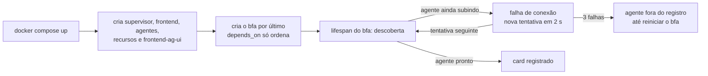

A sequência detalhada está em [8.2](#82-arquitetura-e-fluxo-de-execução). **[Fato]** O log local mostra exatamente o ramo "3 falhas" para `abrir_conta` ([logs/bfa.out.log](../logs/bfa.out.log)).

### 11.4 Cenário crítico: cartão sem conta no modo paralelo

Pedido de exemplo: *"Sou Maria, CPF 000.000.000-00, quero abrir uma conta e já pedir um cartão gold"*. O roteador escolhe os dois agentes ([supervisor/src/agents.py:L59](../supervisor/src/agents.py#L59), [L71](../supervisor/src/agents.py#L71)).

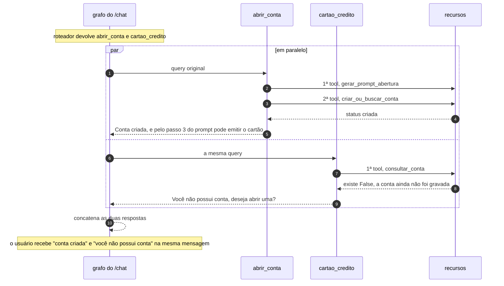

**[Inferência]** O resultado depende da ordem das chamadas, mas a corrida é provável. O agente de cartão consulta a conta **na sua 1ª chamada de tool** ([cartoes.py:L50-L54](../agents/cartao_credito/agent/cartoes.py#L50-L54)), enquanto o agente de conta só cria a conta **na 2ª**, depois de `gerar_prompt_abertura` ([abrir_conta.py:L45-L47](../agents/abrir_conta/agent/abrir_conta.py#L45-L47)). No caminho AG-UI, com a ordem `[abrir_conta, cartao_credito]`, a conta já existe quando o agente de cartão roda, e o resultado é consistente.

### 11.5 Matriz de falhas, timeouts e retries

| Salto | Timeout | Retries | Se falhar | O usuário vê |
|---|---|---|---|---|
| React → supervisor | nenhum | nenhum | Promise rejeitada, `loading` preso | "Pensando..." sem fim |
| Streamlit → supervisor | nenhum (`requests`) | nenhum | Exceção na página | *Traceback* do Streamlit |
| Supervisor → Anthropic (roteador) | 600 s (SDK, 5 s para conectar) | 2 (408/409/429/5xx/conexão) | Fallback para `abrir_conta` | Resposta do agente de conta, sem aviso |
| Supervisor → agente (A2A) | 30 s (`httpx`) | nenhum | `/chat`: 500 com `str(e)`. Stream: corte | Mensagem técnica ou chat interrompido |
| Agente → Anthropic | 600 s | 2 | Exceção no executor → JSON-RPC `InternalError` | Como no salto anterior |
| Agente → MCP | 30 s; leitura SSE 300 s | nenhum | Exceção (falha de conexão) | Como acima |
| Tool → erro de negócio | — | — | `{"status": "erro", ...}` como resultado normal | O LLM explica |
| Tool → `db.json` | — | — | `print`; a tool devolve sucesso | Confirmação de algo que não foi gravado |
| BFA → agentes | 5 s | 3 tentativas, 2 s fixos | Agente fora do registro | — (o BFA não é usado) |
| BFA → MCP | 10 s | nenhum | Sem tools no registro | — |

**[Inferência] Combinação perigosa:** o timeout do supervisor (30 s) é menor que o tempo possível de um laço de agente (várias chamadas ao LLM, `recursion_limit` 9.999). O supervisor desiste, mas **o agente continua** e pode criar a conta ou o cartão. O usuário recebe erro de algo que de fato aconteceu.

### 11.6 Chamadas ao LLM por mensagem e custo

O número de chamadas abaixo é estimado a partir dos fluxos que os prompts exigem: cada `tool_use` custa uma chamada ao modelo, e a resposta final custa mais uma. **[Inferência]**

| Cenário | Chamadas ao LLM (mínimo típico) |
|---|---|
| "Quero abrir uma conta" (sem dados) | 1 (roteador) + 1 (o agente pede nome e CPF) = **2** |
| "Sou Maria, CPF …, quero abrir conta" | 1 + 3 (`gerar_prompt_abertura` → `criar_ou_buscar_conta` → resposta) = **4** |
| "Quero um cartão gold, CPF …" (com conta) | 1 + 3 (`consultar_conta` → `solicitar_cartao` → resposta) = **4** |
| Conta + cartão, dois agentes no `/chat` | 1 + ~3 + ~3 = **~7** (os dois agentes em paralelo) |

**O que pesa no custo:**

1. **Histórico compartilhado e sem limite.** Cada chamada reenvia o system prompt, os schemas das 5 tools (nos agentes) e **todo o histórico do thread `"1"`**, que acumula as conversas de todos os usuários. Cada chamada custa O(N) tokens no tamanho do histórico, e uma sessão inteira custa O(N²).
2. **Mudança de faixa de preço.** O Haiku 5.5 custa US$ 0,10 / US$ 0,50 por milhão de tokens de entrada/saída para prompts de até 100K tokens, e US$ 0,50 / US$ 2,50 acima disso (referência da API da Anthropic, 2026-10). **[Inferência]** Com o thread único nunca zerado (só um reinício o limpa), os prompts acabam passando de 100K tokens e o preço por token sobe 5 vezes. Perto de 1M tokens (o tamanho da janela de contexto), as chamadas começam a falhar.
3. **Thinking adaptativo.** Ligado por padrão no Haiku 5.5, com `effort` padrão `medium`. É cobrado como saída, até para uma classificação simples (o roteador).
4. **Sem *prompt caching*.** O código não usa `cache_control`. System prompt e tools são um prefixo estável, ideal para cache (leituras custam cerca de 0,1× o preço normal), mas não se sabe se o prefixo atinge o tamanho mínimo cacheável do modelo. Não foi medido.
5. **Sem teto de iterações** (`recursion_limit` 9.999) e `max_tokens` padrão de 128K por resposta.

A contagem real de tokens não foi feita, para não chamar a API. A forma correta de medir é a API de contagem de tokens da Anthropic, ou o campo `usage` das respostas.

### 11.7 Operações síncronas e assíncronas

| Componente | Assíncrono | Síncrono / bloqueante |
|---|---|---|
| `recursos` | Tools e resources (`async def`) | `save_db`/`load_db` (E/S de arquivo no event loop) |
| `agents` | Toda a cadeia A2A → LangChain → Anthropic/MCP | `message/send` é bloqueante **para o cliente** (espera o fim) |
| `supervisor` | Rotas, grafo, gerador SSE, cliente A2A | — |
| `bfa` | `lifespan`, descoberta | Rotas `def` (rodam no threadpool) |
| `frontend` | — | Script inteiro; `requests.post` |
| `frontend2` | `fetch`, `reader.read()` | Render do React |

### 11.8 Limites entre componentes e projetos

| Fronteira | Protocolo | Autenticação | Dados sensíveis que cruzam | Validação na entrada |
|---|---|---|---|---|
| Navegador → supervisor | AG-UI / SSE | **Nenhuma**; o CORS reflete a origem | Nome e CPF em texto livre | `RunAgentInput` (Pydantic, `extra="allow"`) |
| Streamlit → supervisor | REST | Nenhuma | Idem | `ChatRequest` |
| Supervisor → agentes | A2A JSON-RPC | Nenhuma (o AgentCard não declara esquemas de segurança) | Idem | Tipos A2A |
| Agentes → recursos | MCP Streamable HTTP | Nenhuma | CPF, nome, dados de conta e cartão | JSON Schema das tools (só tipos) |
| Serviços → Anthropic | HTTPS | API key | **Todo o histórico**, com dados pessoais | — |
| Recursos → disco | Arquivo | — | Tudo, em texto plano | — |
| BFA → agentes e recursos | HTTP GET | Nenhuma | Metadados | — |

**[Fato]** Todas as portas internas (agentes 8081/8082, MCP 8084, BFA 8083) são publicadas no host ([docker-compose.yml](../docker-compose.yml)). Qualquer processo com acesso à máquina pode chamar o MCP e criar contas sem passar pelo supervisor.

---

## 12. Decisões arquiteturais e trade-offs

As decisões abaixo foram **reconstruídas a partir do código e do histórico git**. Não há ADRs, issues ou discussões registradas no repositório. O campo "Motivação" separa o que está documentado do que é inferido.

### ADR-01 — Uma fronteira, um protocolo (AG-UI / A2A / MCP)

| Campo | Conteúdo |
|---|---|
| Contexto | Assistente multiagente com interface, orquestração, especialistas e dados |
| Decisão | AG-UI entre usuário e supervisor; A2A entre supervisor e agentes; MCP entre agentes e dados |
| Evidência | [README.md:L3](../README.md#L3), [L18](../README.md#L18); imports em todos os projetos |
| Motivação | **Documentada:** demonstrar a pilha de protocolos. **Inferida:** interoperabilidade e baixo acoplamento entre equipes e tecnologias |
| Benefícios | Contratos padronizados e descobríveis; cada camada pode trocar de implementação; ótimo valor didático |
| Limitações e riscos | Três SDKs jovens e em mudança rápida (FastMCP 4.x, a2a-sdk 0.3, ag-ui 1.0) sem versão fixada; mais saltos de rede; os usos ficaram parciais (sem `Task` no A2A, só tools no MCP, eventos fora do padrão no AG-UI) |
| Alternativas | Monólito com tools locais; REST interno com OpenAPI; *agent-as-tool* via MCP no lugar do A2A |
| Trade-offs | Performance: mais latência por salto. Complexidade: alta para o tamanho do domínio. Escalabilidade: boa por serviço. Manutenção: três protocolos para acompanhar |
| Alterar implica | Reescrever os clientes e servidores de cada fronteira; os prompts não mudam |

### ADR-02 — Roteamento de intenção por LLM com saída JSON

| Campo | Conteúdo |
|---|---|
| Contexto | Pedidos em linguagem natural podem envolver um ou mais domínios |
| Decisão | `create_agent` sem tools + prompt + `JsonOutputParser`, com memória por `thread_id` ([supervisor/src/agents.py](../supervisor/src/agents.py)) |
| Evidência | Código; o commit `a77d144` já nasceu assim, com `gpt-4o` e `temperature=0` |
| Motivação | **Inferida:** flexibilidade (várias intenções, contexto) sem treinar um classificador |
| Benefícios | Entende paráfrases; aceita várias intenções; fácil de mudar pelo prompt |
| Limitações e riscos | Não determinístico; saída sem validação; fallback silencioso; custo e latência de uma chamada LLM por mensagem; prompt contraditório |
| Alternativas | Saída estruturada nativa ou tool calling com `Literal`; roteador semântico por embeddings; o próprio BFA; os agentes como tools de um único LLM |
| Trade-offs | Precisão vs. custo e latência; flexibilidade vs. previsibilidade |
| Alterar implica | Mudar `classifique_intencao_do_usuario` (e mais nada, se o contrato `[{"query", "agent"}]` for mantido) |

### ADR-03 — Fan-out paralelo (`Send`) no `/chat` e laço sequencial no AG-UI

| Campo | Conteúdo |
|---|---|
| Contexto | Vários agentes por mensagem; duas interfaces |
| Decisão | O `/chat` usa `StateGraph` + `Send` + reducer `add`. O `/` reimplementa a orquestração como um laço com eventos |
| Evidência | [services.py:L105-L155](../supervisor/src/services.py#L105-L155), [L163-L236](../supervisor/src/services.py#L163-L236) |
| Motivação | **Inferida:** o grafo dá paralelismo de graça; o laço manual facilita intercalar eventos de progresso. **[Hipótese]** O caminho AG-UI foi adicionado depois, sem adaptar o grafo |
| Benefícios | Menor latência no `/chat`; progresso visível no AG-UI |
| Limitações e riscos | **Duas semânticas** para a mesma intenção; corrida entre domínios dependentes no paralelo; tratamentos de erro diferentes |
| Alternativas | Um único grafo com `astream` (modos `updates`/`custom`) gerando os eventos AG-UI; dependências explícitas (cartão depois de conta); um adaptador AG-UI pronto para LangGraph |
| Trade-offs | Latência vs. consistência; simplicidade local vs. duplicação |
| Alterar implica | Unificar exige rever o formato do estado (`query` vs. `user_query`) e os eventos |

### ADR-04 — Um serviço por agente especialista, exposto via A2A

| Campo | Conteúdo |
|---|---|
| Contexto | Domínios com prompts e fluxos próprios |
| Decisão | `abrir_conta` e `cartao_credito` como serviços independentes (`A2AStarletteApplication`) |
| Evidência | [agents/](../agents), [docker-compose.yml:L19-L35](../docker-compose.yml#L19-L35) |
| Motivação | **Documentada:** o A2A como camada "agente ↔ agente" (README). **Inferida:** deploy e escala independentes |
| Benefícios | Isolamento de falhas e de dependências; cada agente pode usar outra stack |
| Limitações e riscos | Código quase duplicado (o `cartao_credito` cacheia o agente e o `abrir_conta` não); responsabilidades sobrepostas nos prompts; memória por processo |
| Alternativas | Subgrafos no mesmo processo; um único agente com mais tools |
| Trade-offs | Independência vs. duplicação e latência de rede |
| Alterar implica | Juntar os agentes elimina o A2A; extrair um pacote comum reduziria a duplicação |

### ADR-05 — Dados e regras em um servidor MCP, regras reforçadas nos prompts

| Campo | Conteúdo |
|---|---|
| Contexto | Impedir que o LLM invente dados ou pule regras |
| Decisão | Tools MCP com a regra "conta antes de cartão" ([recursos/app.py:L204-L208](../recursos/app.py#L204-L208)), repetida nos prompts do roteador e dos dois agentes |
| Evidência | Código dos 4 lugares |
| Motivação | **Documentada:** "Prompts obrigam o uso de tools, e as regras de negócio são reforçadas na tool `solicitar_cartao`" ([docs/arquitetura.md:L24](arquitetura.md)) |
| Benefícios | Garantia determinística da regra principal; o domínio fica fora dos agentes |
| Limitações e riscos | As demais regras (tipos válidos, CPF) só existem em prompt; quatro cópias da mesma regra podem divergir |
| Alternativas | Todas as regras nas tools (validação de tipo e CPF); prompts mais curtos, que só descrevem o objetivo |
| Trade-offs | Robustez vs. flexibilidade conversacional |
| Alterar implica | Mover validações para as tools muda as mensagens de erro que o LLM recebe |

### ADR-06 — Memória com `InMemorySaver` e `thread_id` fixo

| Campo | Conteúdo |
|---|---|
| Contexto | Conversas em várias mensagens (nome em uma, CPF em outra) |
| Decisão | Checkpointer em memória por processo, com `thread_id="1"` padrão em todas as funções |
| Evidência | [agents.py:L22](../supervisor/src/agents.py#L22), [L84](../supervisor/src/agents.py#L84); [abrir_conta.py:L27](../agents/abrir_conta/agent/abrir_conta.py#L27), [L61](../agents/abrir_conta/agent/abrir_conta.py#L61); [cartoes.py:L27](../agents/cartao_credito/agent/cartoes.py#L27), [L81](../agents/cartao_credito/agent/cartoes.py#L81) |
| Motivação | **Inferida:** o caminho mais simples para ter memória numa PoC com um usuário |
| Benefícios | Zero infraestrutura; continuidade imediata |
| Limitações e riscos | **Vazamento entre usuários**; concorrência no mesmo thread; perda no reinício (inclusive com `--reload`); crescimento sem limite |
| Alternativas | `thread_id` por sessão (derivado do `session_id` ou do `threadId` do AG-UI), propagado via `context_id`/`metadata` do A2A; checkpointer persistente (SQLite/Postgres); resumo ou *compaction* do histórico |
| Trade-offs | Simplicidade vs. isolamento e segurança |
| Alterar implica | Mudar as assinaturas de `run_agent` e do roteador e passar a identidade da sessão em todos os saltos |

### ADR-07 — Persistência em arquivo JSON com estado em memória

| Campo | Conteúdo |
|---|---|
| Contexto | Guardar contas e cartões da PoC |
| Decisão | Dicionários globais + `db.json` reescrito a cada mudança |
| Evidência | [recursos/app.py:L13-L40](../recursos/app.py#L13-L40) |
| Motivação | **Inferida:** dados mock, sem infraestrutura de banco |
| Benefícios | Fácil de inspecionar e de zerar (apagar o arquivo) |
| Limitações e riscos | Não atômico, sem lock, TOCTOU, falhas silenciosas, caminho absoluto, dados pessoais versionados |
| Alternativas | SQLite com transações e restrições `UNIQUE`; escrita atômica (`os.replace`) com lock |
| Trade-offs | Simplicidade vs. integridade |
| Alterar implica | Só o `recursos` muda: o contrato MCP isola os consumidores |

### ADR-08 — Registro de capacidades com BM25 (BFA), sem integração

| Campo | Conteúdo |
|---|---|
| Contexto | Evitar listas fixas de agentes e tools no roteador |
| Decisão | Serviço separado que lê cards e tools e indexa com BM25 |
| Evidência | [bfa/](../bfa); nenhum consumidor |
| Motivação | **[Hipótese]** Preparar a descoberta dinâmica para quando houver muitos agentes |
| Benefícios | Busca determinística e explicável, sem infraestrutura |
| Limitações e riscos | Não integrado; descoberta só na subida; ranking frágil em corpus pequeno |
| Alternativas | Gerar `AGENTS` e o prompt do roteador a partir dos cards; busca semântica; *tool search* da plataforma |
| Trade-offs | Generalidade vs. complexidade não aproveitada |
| Alterar implica | Integrar exige mudar o supervisor (registro e prompt dinâmicos); remover não afeta nada |

### ADR-09 — Migração de provedor (OpenAI → Anthropic)

| Campo | Conteúdo |
|---|---|
| Contexto | O código inicial usava `gpt-4o` com `temperature` 0 / 0.2 / 0.3 |
| Decisão | Trocar para `claude-sonnet-5-5` (commit `2769290`) e depois para `claude-haiku-5-5` (commit `b95d574`); remover `temperature`; ler a resposta com `.text` |
| Evidência | Diffs do git; erro de `temperature` em [logs/supervisor.err.log](../logs/supervisor.err.log), 30 minutos antes da remoção; validação no cliente em `langchain_anthropic/chat_models.py:L1809-L1828` |
| Motivação | **Comprovada:** `temperature` foi removida porque o `langchain_anthropic` a rejeita para o Sonnet 5.5, e a API também rejeita valores diferentes do padrão no Haiku 5.5. **Inferida:** `.text` foi adotado porque o `content` do Claude é uma lista de blocos (thinking, texto, tool_use). **[Hipótese]** A troca para o Haiku buscou custo e latência |
| Benefícios | `init_chat_model` limitou a migração a strings; o custo por token caiu |
| Limitações e riscos | O roteador perdeu o controle de determinismo (`temperature=0`); o thinking adaptativo ficou ligado sem ajuste de `effort`; sobras do OpenAI nos venvs |
| Alternativas | `effort="low"` no roteador; saída estruturada nativa; modelo diferente para o roteador e para os agentes |
| Trade-offs | Custo vs. qualidade de raciocínio |
| Alterar implica | Os prompts foram escritos para o `gpt-4o`. **[Inferência]** Vale reavaliá-los no modelo atual |

### ADR-10 — Dois frontends e consumo manual de SSE

| Campo | Conteúdo |
|---|---|
| Contexto | Demonstrar a interação síncrona e a orientada a eventos |
| Decisão | Streamlit (REST) e React (AG-UI com parser manual); `@ag-ui/client` declarado mas sem uso |
| Evidência | [frontend/app.py](../frontend/app.py), [frontend2/src/ChatPage.jsx](../frontend2/src/ChatPage.jsx), [services/agentAdapter.js](../frontend2/src/services/agentAdapter.js) |
| Motivação | **Inferida:** o parser manual aceita o evento customizado `STATE_UPDATE`, que um cliente com validação rejeitaria |
| Benefícios | Duas formas de testar o backend; parser sem dependências |
| Limitações e riscos | Parser sem buffer; estado duplicado; dois caminhos de backend para manter |
| Alternativas | `HttpAgent` do `@ag-ui/client` + eventos padrão; um único frontend |
| Trade-offs | Controle vs. robustez |
| Alterar implica | Adotar o cliente oficial exige trocar o `STATE_UPDATE` por `STATE_SNAPSHOT`/`STATE_DELTA` no backend |

### ADR-11 — Ambiente de desenvolvimento: Compose com bind mount e `--reload`; modo local com IPs de loopback

| Campo | Conteúdo |
|---|---|
| Contexto | Desenvolver e depurar vários serviços com URLs fixas |
| Decisão | Compose com volumes e `--reload`; localmente, cada serviço em um IP `127.0.0.x:8000` mais o arquivo `hosts` |
| Evidência | [docker-compose.yml](../docker-compose.yml), Dockerfiles, [MD_BANK_IA.code-workspace](../MD_BANK_IA.code-workspace), [docs/execucao-local-uv.md](execucao-local-uv.md) |
| Motivação | **Documentada:** rodar sem mudar o código e com hot reload ([docs/execucao-local-uv.md:L64](execucao-local-uv.md)) |
| Benefícios | Ciclo de desenvolvimento rápido; depuração com breakpoints |
| Limitações e riscos | Imagens com perfil de dev; `hosts` exige administrador; URLs fixas em vez de configuração por variável de ambiente; `/app/db.json` não funciona fora do Docker no Windows |
| Alternativas | URLs por variável de ambiente; perfis do Compose (dev/prod); `localhost` com portas diferentes |
| Trade-offs | Zero mudança de código vs. flexibilidade de configuração |
| Alterar implica | Passar as URLs para variáveis de ambiente afeta os 4 projetos Python e o frontend2 |

### ADR-12 — Dependências sem versão fixada (exceto `a2a-sdk<1`)

| Campo | Conteúdo |
|---|---|
| Contexto | PoC com bibliotecas de IA em evolução rápida |
| Decisão | `requirements.txt` sem versões; `npm install` em vez de `npm ci` |
| Evidência | Todos os `requirements.txt`; [frontend2/Dockerfile:L11](../frontend2/Dockerfile#L11) |
| Motivação | **Inferida:** ter sempre a versão mais nova. O `a2a-sdk<1` (commit `2769290`) mostra que já houve uma quebra |
| Benefícios | Menos manutenção de versões no curto prazo |
| Limitações e riscos | **Já causou problemas** ([4.5](#45-discrepâncias-entre-o-declarado-o-importado-e-o-instalado): D6, D7, D10); builds não reproduzíveis |
| Alternativas | `pyproject.toml` + `uv.lock` por serviço; versões fixas com atualização periódica |
| Trade-offs | Atualização automática vs. reprodutibilidade |
| Alterar implica | Escolher e testar uma combinação compatível (por exemplo, `fastmcp` e `mcp` alinhados) |

---

## 13. Comparativo entre projetos

### 13.1 Visão técnica

| Dimensão | `recursos` | `agents` | `supervisor` | `bfa` | `frontend` | `frontend2` |
|---|---|---|---|---|---|---|
| Objetivo | Dados e regras via MCP | Especialistas de domínio | Roteamento, delegação e agregação | Registro e busca de capacidades | Chat REST simples | Chat AG-UI com state |
| Arquitetura | Módulo único | 3 camadas por agente | Interface + serviços + roteador | Descoberta + registro + índice | Script único | SPA com Context |
| Linguagem | Python | Python | Python | Python | Python | JavaScript |
| Frameworks | FastMCP | a2a-sdk, LangChain, langchain-mcp-adapters | FastAPI, LangGraph, LangChain, a2a-sdk, ag-ui | FastAPI, a2a-sdk, rank-bm25 | Streamlit | React, CRA, Tailwind |
| Execução | ASGI assíncrono | ASGI assíncrono + laço LLM | ASGI; fan-out paralelo ou laço sequencial | ASGI; rotas no threadpool | Reexecução do script | Event loop do navegador |
| Estado | Dicts + `db.json` | `InMemorySaver` (thread `"1"`); cache do agente (cartão) | `InMemorySaver` do roteador; `CLIENT_CACHE` | Registro e índice globais | `session_state` por aba | Context React |
| Orquestração | — | `create_agent` (modelo ↔ tools) | `StateGraph` + `Send` / laço | `lifespan` | — | — |
| Integrações | Entrada MCP e REST; saída arquivo | Entrada A2A; saída MCP e Anthropic | Entrada REST e AG-UI; saída A2A e Anthropic | Saída: card A2A e REST | Saída REST | Saída AG-UI/SSE |
| Usa LLM | Não | Sim | Sim | Não | Não | Não |

### 13.2 Qualidade

| Dimensão | `recursos` | `agents` | `supervisor` | `bfa` | `frontend` | `frontend2` |
|---|---|---|---|---|---|---|
| Linhas de código | 307 | 334 | 429 | 295 | 50 | 680 |
| Complexidade [Análise] | Baixa | Média | Alta | Média | Baixa | Média |
| Resiliência | Falhas de escrita silenciosas; sem lock | Sem tratamento no executor; 2 retries do SDK | Fallback silencioso; timeout de 30 s; sem retries no A2A | 3 tentativas (agentes), 1 (MCP) | Sem timeout | Sem `try/catch` no `fetch` |
| Observabilidade | `print` + `ctx.info` | `logging` sem configuração (INFO invisível) | `logging` INFO | `print` | Telemetria do Streamlit | `console.error` |
| Vantagens | Regra determinística; contrato padrão | Especialistas isolados, deploy independente | Ponto de entrada único; dois estilos de interação | Descoberta sem dependências pesadas | Mínimo e direto | Progresso visível; state na interface |
| Limitações | Persistência frágil; `annotations` fora do padrão | Memória compartilhada; prompts sobrepostos | Orquestrações divergentes; roteador sem validação | Sem consumidores; ranking frágil | Sem timeout; históricos dessincronizados | Estado duplicado; SSE sem buffer; regex |

### 13.3 O que é compartilhado e o que é específico

**Compartilhado:**

- **Protocolos:** A2A em 3 projetos (servidor nos agentes, cliente no supervisor, leitor de card no BFA); MCP em 2 (servidor e clientes); AG-UI em 2 (servidor e cliente).
- **Pilha de LLM:** `init_chat_model("claude-haiku-5-5", "anthropic")` + `create_agent` + `InMemorySaver` + `thread_id="1"`, igual nos três serviços com LLM.
- **Operação:** mesmo modelo de Dockerfile (Python 3.13 slim + build-essential + `--reload`); URLs fixas com o DNS do Compose na porta 8000; `load_dotenv()` na importação; `.dockerignore` e `.gitignore` copiados.
- **Padrões de erro:** `except Exception` amplo seguido de `print` ou valor padrão, em quase todos os projetos.

**Específico:**

- `recursos`: resources e prompts MCP, `Context`, rota customizada, persistência.
- `agents`: `AgentExecutor`/`EventQueue`, AgentCard, prompts procedurais, cache *lazy* (cartão).
- `supervisor`: `Send` + reducer, `JsonOutputParser`, eventos AG-UI e `StreamingResponse`.
- `bfa`: BM25, normalização Unicode, `lifespan` com retries.
- `frontend`: modelo de reexecução do Streamlit.
- `frontend2`: Streams API, Context, React Router, regex de extração, framer-motion.

---

## 14. Riscos, limitações e oportunidades de melhoria

Nenhuma mudança foi aplicada ao código. A tabela é uma recomendação priorizada. Esforço: **P** (horas), **M** (dias), **G** (semanas).

| ID | Categoria | Risco | Evidência | Gravidade | Oportunidade de melhoria | Esforço |
|---|---|---|---|---|---|---|
| R01 | Privacidade | Memória e contexto compartilhados entre usuários | [ADR-06](#adr-06--memória-com-inmemorysaver-e-thread_id-fixo) | Crítica | `thread_id` por sessão, propagado do frontend → supervisor → A2A (`context_id`/metadados) → agentes | M |
| R02 | Privacidade | CPF e nome em logs e notificações; `db.json` com dados pessoais versionado | [recursos/app.py:L166](../recursos/app.py#L166), [services.py:L89](../supervisor/src/services.py#L89), [2.6](#26-variáveis-de-ambiente-e-segredos) | Alta | Mascarar PII nos logs; tirar `db.json` do git (e avaliar a limpeza do histórico) e usar um arquivo de exemplo fictício | P |
| R03 | Segurança | Nenhuma autenticação; CORS que reflete qualquer origem; portas internas publicadas | [11.8](#118-limites-entre-componentes-e-projetos) | Alta | Autenticação no supervisor; CORS restrito às origens do frontend; publicar só os frontends; esquemas de segurança no AgentCard; autenticação no FastMCP | M |
| R04 | Segurança | Exceções internas devolvidas ao cliente | [supervisor/app.py:L40-L42](../supervisor/app.py#L40-L42), [6.4](#64-rastreamento-de-chamadas) | Média | Mensagem genérica + ID de correlação; detalhes só no log | P |
| R05 | Correção | Duas orquestrações com semânticas diferentes | [7.6](#76-os-dois-caminhos-de-execução-comparados) | Alta | Um único grafo; o stream AG-UI gerado a partir de `graph.astream` | M |
| R06 | Correção | Corrida "cartão sem conta" no modo paralelo | [11.4](#114-cenário-crítico-cartão-sem-conta-no-modo-paralelo) | Alta | Dependência explícita (conta → cartão) ou um único agente de onboarding | M |
| R07 | Correção | Saída do roteador sem validação; fallback silencioso | [agents.py:L94-L106](../supervisor/src/agents.py#L94-L106) | Alta | `Literal["abrir_conta","cartao_credito"]` com saída estruturada nativa ou tool calling; erro explícito + `RUN_ERROR`; contar os fallbacks | P |
| R08 | Correção | Prompt do roteador contraditório; responsabilidades sobrepostas entre os agentes | [agents.py:L60-L68](../supervisor/src/agents.py#L60-L68), [abrir_conta.py:L48-L49](../agents/abrir_conta/agent/abrir_conta.py#L48-L49) | Média | Prompt do roteador só com a classificação; tirar o passo de cartão do agente de conta | P |
| R09 | Dados | JSON não atômico, sem lock, TOCTOU, números sem unicidade | [5.6](#56-limitações-e-riscos) | Alta | SQLite com transação e `UNIQUE`; números sequenciais | M |
| R10 | Dados | CPF sem normalização nem validação; tipo de cartão livre | [recursos/app.py:L72](../recursos/app.py#L72), [L200](../recursos/app.py#L200) | Média | Normalizar para dígitos e validar o dígito verificador; `Literal` no tipo | P |
| R11 | Operação | Dependências sem versão; lockfiles desatualizados; venvs quebrados | [4.5](#45-discrepâncias-entre-o-declarado-o-importado-e-o-instalado) | Alta | `pyproject.toml` + `uv.lock` por serviço; `npm ci` com um único lockfile | M |
| R12 | Operação | `--stateless false` faz o contrário do que aparenta | [5.3](#53-arquivos-de-build-e-configuração) | Baixa | Remover o flag ou usar `--stateless=false` | P |
| R13 | Operação | Sem healthchecks; `--reload` nas imagens; caminho `/app/db.json` | [2.5](#25-infraestrutura-transversal) | Média | `healthcheck` + `depends_on: condition: service_healthy`; perfis dev/prod; caminho por variável de ambiente | P |
| R14 | Resiliência | Timeout de 30 s no A2A contra laço de agente sem teto | [11.5](#115-matriz-de-falhas-timeouts-e-retries) | Média | Timeouts coerentes; limitar as iterações do agente; `Task` A2A com streaming ou polling para operações longas | M |
| R15 | Resiliência | Sem retries nem *circuit breaker* entre serviços; frontends sem timeout | idem | Média | Retries com backoff só em operações idempotentes; timeouts nos clientes | P |
| R16 | Custo | Histórico crescente compartilhado; mudança de faixa de preço; sem cache; thinking sem `effort` | [11.6](#116-chamadas-ao-llm-por-mensagem-e-custo) | Média | Histórico por sessão com corte ou *compaction*; *prompt caching* do prefixo estável; `effort` baixo no roteador; medir com a contagem de tokens | M |
| R17 | Interface | Estado duplicado; SSE sem buffer; extração por regex | [10.6](#106-limitações-e-riscos) | Média | `STATE_SNAPSHOT`/`STATE_DELTA` + `@ag-ui/client`; buffer de linhas; dados estruturados das tools no state | M |
| R18 | Manutenção | BFA sem uso; registro de agentes fixo em 4 lugares | [8.6](#86-limitações-e-riscos) | Média | Gerar `AGENTS` e o catálogo do roteador a partir dos AgentCards (via BFA) ou remover o BFA | M |
| R19 | Manutenção | Código e dependências mortos | `normalize` em [bfa/discovery.py:L12-L15](../bfa/discovery.py#L12-L15), `solicitar_cartao_prompt`, 4 arquivos no frontend2, `langchain-community` | Baixa | Remover | P |
| R20 | Observabilidade | Sem tracing nem correlação entre serviços | [13.2](#132-qualidade) | Média | LangSmith ou OpenTelemetry; logs estruturados; ID de requisição propagado (metadados A2A, `_meta` do MCP) | M |
| R21 | Qualidade | **[Fato]** Não há testes automatizados no repositório | Nenhum arquivo de teste | Média | Testes unitários das tools; testes de contrato A2A/MCP; conjunto de conversas de regressão para o roteador e os agentes | M |

**Ordem sugerida** (estende a de [docs/arquitetura.md:L208-L215](arquitetura.md)): R01 → R02 → R07 → R05/R06 → R11 → R09 → R03 → R17 → R16 → R20/R21 → R18.

---

## 15. Glossário de conceitos técnicos

| Termo | Definição | Onde aparece |
|---|---|---|
| **A2A (Agent2Agent)** | Protocolo aberto de comunicação entre agentes: descoberta por AgentCard, mensagens e tarefas via JSON-RPC/HTTP | agents, supervisor, bfa |
| **Adaptive thinking** | Raciocínio interno do modelo, cuja quantidade o próprio modelo decide; ligado por padrão no Claude Haiku 5.5 e cobrado como tokens de saída | Implícito nas chamadas ao `claude-haiku-5-5` |
| **AG-UI** | Protocolo de eventos entre um agente de backend e a interface (texto incremental, ferramentas, estado compartilhado) | supervisor, frontend2 |
| **AgentCard** | Documento JSON publicado em `/.well-known/agent-card.json` com nome, URL, skills e capacidades | [agents/abrir_conta/server.py:L37-L46](../agents/abrir_conta/server.py#L37-L46) |
| **AgentExecutor** | Interface do a2a-sdk onde fica a lógica do agente; publica eventos em vez de devolver valores | [executor.py](../agents/abrir_conta/executor.py) |
| **AgentSkill** | Capacidade anunciada no AgentCard (id, descrição, tags, exemplos) | [server.py:L11-L31](../agents/abrir_conta/server.py#L11-L31) |
| **ASGI** | Interface assíncrona entre servidores web Python (Uvicorn) e frameworks (Starlette/FastAPI) | Todos os backends |
| **BM25 / IDF** | Ranking lexical por frequência de termos; o IDF dá mais peso a termos raros | [bfa/registry.py](../bfa/registry.py) |
| **Checkpointer** | Componente do LangGraph que salva o estado do grafo a cada passo, por `thread_id` | `InMemorySaver` |
| **Context (FastMCP)** | Objeto injetado nas tools com acesso a log, resources e prompts do servidor | [recursos/app.py:L123](../recursos/app.py#L123) |
| **Contexto seguro** | Página servida por HTTPS ou `localhost`; requisito de APIs como `crypto.randomUUID` e Clipboard | frontend2 |
| **CORS** | Mecanismo do navegador que controla chamadas entre origens diferentes | [supervisor/app.py:L24-L30](../supervisor/app.py#L24-L30) |
| **`create_agent`** | Fábrica do LangChain 1.x que compila um grafo de agente com laço modelo ↔ tools | agents, supervisor |
| **Effort** | Parâmetro da API Anthropic que regula a profundidade de raciocínio e o gasto de tokens | Não configurado |
| **EventQueue** | Fila do a2a-sdk onde o executor publica `Message`/`Task`/atualizações | executor |
| **Fan-out / fan-in** | Disparar várias tarefas em paralelo e juntar os resultados | `Send` + reducer |
| **Few-shot** | Exemplos de entrada e saída no prompt para orientar o modelo | [agents.py:L70-L73](../supervisor/src/agents.py#L70-L73) |
| **Function calling / tool calling** | O modelo devolve um pedido estruturado para chamar uma função (`tool_use`); a aplicação executa e devolve o resultado (`tool_result`) | Agentes |
| **InMemorySaver** | Checkpointer que guarda o estado só na RAM do processo | 3 serviços |
| **JSON-RPC 2.0** | Protocolo de chamada remota em JSON (`method`, `params`, `id`, `result`/`error`) | A2A e MCP |
| **JSON Patch (RFC 6902)** | Lista de operações (`add`, `replace`, `remove`) para alterar um documento JSON; base do `STATE_DELTA` | Alternativa ao `STATE_UPDATE` |
| **JsonOutputParser** | Parser do LangChain que gera instruções de formato e extrai JSON do texto | [agents.py:L31](../supervisor/src/agents.py#L31) |
| **LangChain** | Biblioteca de abstrações para aplicações com LLM (modelos, mensagens, tools, parsers, agentes) | agents, supervisor |
| **LangGraph** | Biblioteca de grafos de estado para fluxos e agentes, com checkpoints e paralelismo | agents (indireto), supervisor |
| **Lifespan** | Hook de inicialização e encerramento de apps ASGI | [bfa/app.py:L10-L23](../bfa/app.py#L10-L23) |
| **MCP (Model Context Protocol)** | Protocolo entre aplicações de LLM (*host*/cliente) e servidores de ferramentas e dados | recursos, agents |
| **Message / Part (A2A)** | Mensagem com papel (`user`/`agent`) composta de partes (texto, arquivo, dados) | [services.py:L83-L87](../supervisor/src/services.py#L83-L87) |
| **Prompt (MCP)** | Modelo de mensagens parametrizado oferecido pelo servidor, normalmente escolhido pelo usuário | [recursos/app.py:L87-L102](../recursos/app.py#L87-L102) |
| **Prompt caching** | Reaproveitar, com custo menor, um prefixo idêntico do prompt entre chamadas | Não usado |
| **ReAct** | Padrão em que o modelo alterna raciocínio, ação (tool) e observação até responder | Laço do `create_agent` |
| **Reducer** | Função que diz como juntar atualizações da mesma chave do estado (aqui, `operator.add`) | [services.py:L46](../supervisor/src/services.py#L46) |
| **Resource / resource template (MCP)** | Dado endereçado por URI; um template tem parâmetros na URI | `conta://{cpf}` |
| **Roteador (*router pattern*)** | Componente que escolhe para qual agente ou fluxo enviar um pedido | Supervisor |
| **RunAgentInput** | Corpo da requisição AG-UI (`threadId`, `runId`, `messages`, `state`, `tools`, `context`) | [supervisor/app.py:L46](../supervisor/app.py#L46) |
| **`Send`** | Objeto do LangGraph que cria uma execução dinâmica de um nó com um payload próprio | [services.py:L109](../supervisor/src/services.py#L109) |
| **SSE (Server-Sent Events)** | Stream HTTP de texto no formato `data: ...` + linha em branco, do servidor para o cliente | AG-UI |
| **`STATE_SNAPSHOT` / `STATE_DELTA`** | Eventos AG-UI padrão de estado completo e de mudança incremental | Alternativa ao `STATE_UPDATE` |
| **StateGraph** | Grafo do LangGraph com esquema de estado tipado | [services.py:L139-L145](../supervisor/src/services.py#L139-L145) |
| **Streamable HTTP** | Transporte MCP com um endpoint HTTP que recebe POSTs e responde com JSON ou SSE | `/mcp_gateway` |
| **`st.session_state`** | Dicionário por sessão do Streamlit que sobrevive às reexecuções do script | [frontend/app.py:L10-L11](../frontend/app.py#L10-L11) |
| **Superstep** | Rodada do LangGraph em que todos os nós prontos rodam em paralelo antes de as escritas serem aplicadas | Fan-out do supervisor |
| **Supervisor (padrão multiagente)** | Coordenador que delega a especialistas e consolida os resultados | Supervisor (sem laço de revisão) |
| **System prompt** | Instruções fixas que definem o papel e as regras do modelo | Roteador e agentes |
| **Task (A2A)** | Unidade de trabalho com ciclo de vida (`submitted`, `working`, `completed`, ...) | Não usada (só `Message`) |
| **`thread_id`** | Chave que separa as conversas no checkpointer | Fixo em `"1"` |
| **TOCTOU** | *Time-of-check to time-of-use*: a condição verificada muda antes do uso | [recursos/app.py:L168-L182](../recursos/app.py#L168-L182) |
| **Token / janela de contexto** | Unidade de texto cobrada pelos LLMs / limite de tokens por chamada (1M no Haiku 5.5) | Custos |
| **ToolAnnotations (MCP)** | *Hints* padronizados de comportamento de uma tool (`readOnlyHint`, `destructiveHint`, ...) | Usado fora do padrão |
| **ToolNode** | Nó do LangGraph que executa as tools pedidas pelo modelo e devolve `ToolMessage`s | Dentro do `create_agent` |
| **Write-through** | Gravar na memória e no armazenamento a cada mudança | `save_db` |

---

## 16. Referências aos arquivos e linhas de código

### 16.1 Índice de arquivos analisados

| Arquivo | Linhas | Projeto | Seção |
|---|---|---|---|
| [recursos/app.py](../recursos/app.py) | 307 | 1 | [5.2](#52-arquivo-recursosapppy) |
| [recursos/Dockerfile](../recursos/Dockerfile) · [requirements.txt](../recursos/requirements.txt) · [db.json](../recursos/db.json) | 18 · 1 · 26 | 1 | [5.3](#53-arquivos-de-build-e-configuração), [5.2](#52-arquivo-recursosapppy) |
| [agents/abrir_conta/server.py](../agents/abrir_conta/server.py) | 65 | 2 | [6.3](#63-arquivo-por-arquivo) |
| [agents/abrir_conta/executor.py](../agents/abrir_conta/executor.py) | 27 | 2 | [6.3](#63-arquivo-por-arquivo) |
| [agents/abrir_conta/agent/abrir_conta.py](../agents/abrir_conta/agent/abrir_conta.py) | 69 | 2 | [6.3](#63-arquivo-por-arquivo) |
| [agents/cartao_credito/server.py](../agents/cartao_credito/server.py) | 55 | 2 | [6.3](#63-arquivo-por-arquivo) |
| [agents/cartao_credito/executor.py](../agents/cartao_credito/executor.py) | 26 | 2 | [6.3](#63-arquivo-por-arquivo) |
| [agents/cartao_credito/agent/cartoes.py](../agents/cartao_credito/agent/cartoes.py) | 92 | 2 | [6.3](#63-arquivo-por-arquivo) |
| [agents/*/requirements.txt](../agents/abrir_conta/requirements.txt) · [Dockerfile](../agents/abrir_conta/Dockerfile) | 9 · 18 | 2 | [6.3](#63-arquivo-por-arquivo) |
| [supervisor/app.py](../supervisor/app.py) | 80 | 3 | [7.3](#73-arquivo-por-arquivo) |
| [supervisor/src/schemas.py](../supervisor/src/schemas.py) | 7 | 3 | [7.3](#73-arquivo-por-arquivo) |
| [supervisor/src/agents.py](../supervisor/src/agents.py) | 106 | 3 | [7.3](#73-arquivo-por-arquivo) |
| [supervisor/src/services.py](../supervisor/src/services.py) | 236 | 3 | [7.3](#73-arquivo-por-arquivo) |
| [supervisor/requirements.txt](../supervisor/requirements.txt) · [Dockerfile](../supervisor/Dockerfile) · [.gitignore](../supervisor/.gitignore) | 10 · 18 · 137 | 3 | [7.3](#73-arquivo-por-arquivo) |
| [bfa/app.py](../bfa/app.py) | 76 | 4 | [8.3](#83-arquivo-por-arquivo) |
| [bfa/discovery.py](../bfa/discovery.py) | 49 | 4 | [8.3](#83-arquivo-por-arquivo) |
| [bfa/mcp_discovery.py](../bfa/mcp_discovery.py) | 46 | 4 | [8.3](#83-arquivo-por-arquivo) |
| [bfa/registry.py](../bfa/registry.py) | 124 | 4 | [8.3](#83-arquivo-por-arquivo) |
| [bfa/requirements.txt](../bfa/requirements.txt) · [Dockerfile](../bfa/Dockerfile) · [.vscode/settings.json](../bfa/.vscode/settings.json) | 7 · 18 · 11 | 4 | [8.3](#83-arquivo-por-arquivo) |
| [frontend/app.py](../frontend/app.py) | 50 | 5 | [9.3](#93-arquivo-por-arquivo) |
| [frontend/Dockerfile](../frontend/Dockerfile) · [requirements.txt](../frontend/requirements.txt) | 24 · 2 | 5 | [9.3](#93-arquivo-por-arquivo) |
| [frontend2/package.json](../frontend2/package.json) · [Dockerfile](../frontend2/Dockerfile) · [.dockerignore](../frontend2/.dockerignore) | 41 · 17 · 6 | 6 | [10.3](#103-arquivo-por-arquivo) |
| [frontend2/tailwind.config.js](../frontend2/tailwind.config.js) · [public/index.html](../frontend2/public/index.html) | 19 · 11 | 6 | [10.3](#103-arquivo-por-arquivo) |
| [frontend2/src/index.jsx](../frontend2/src/index.jsx) · [index.css](../frontend2/src/index.css) · [App.jsx](../frontend2/src/App.jsx) | 11 · 10 · 18 | 6 | [10.3](#103-arquivo-por-arquivo) |
| [frontend2/src/StateContext.js](../frontend2/src/StateContext.js) · [Layout.jsx](../frontend2/src/Layout.jsx) | 37 · 46 | 6 | [10.3](#103-arquivo-por-arquivo) |
| [frontend2/src/ChatPage.jsx](../frontend2/src/ChatPage.jsx) | 113 | 6 | [10.3](#103-arquivo-por-arquivo) |
| [frontend2/src/StateUtilPage.jsx](../frontend2/src/StateUtilPage.jsx) | 184 | 6 | [10.3](#103-arquivo-por-arquivo) |
| [frontend2/src/components/ChatBox.jsx](../frontend2/src/components/ChatBox.jsx) · [PromptSuggestions.jsx](../frontend2/src/components/PromptSuggestions.jsx) | 98 · 25 | 6 | [10.3](#103-arquivo-por-arquivo) |
| [AgentSelector.jsx](../frontend2/src/components/AgentSelector.jsx) · [EventStream.jsx](../frontend2/src/components/EventStream.jsx) · [StatusPanel.jsx](../frontend2/src/components/StatusPanel.jsx) · [agentAdapter.js](../frontend2/src/services/agentAdapter.js) | 28 · 17 · 14 · 60 | 6 (código morto) | [10.3](#103-arquivo-por-arquivo) |
| [docker-compose.yml](../docker-compose.yml) · [scripts/](../scripts) · [MD_BANK_IA.code-workspace](../MD_BANK_IA.code-workspace) | 72 · 91 · 88 | transversal | [2.5](#25-infraestrutura-transversal) |

### 16.2 Referências por tema

| Tema | Referências |
|---|---|
| Regra "conta antes de cartão" | [recursos/app.py:L204-L208](../recursos/app.py#L204-L208); [cartoes.py:L56-L61](../agents/cartao_credito/agent/cartoes.py#L56-L61); [abrir_conta.py:L39-L44](../agents/abrir_conta/agent/abrir_conta.py#L39-L44); [supervisor/src/agents.py:L71](../supervisor/src/agents.py#L71) |
| `thread_id` fixo | [supervisor/src/agents.py:L84](../supervisor/src/agents.py#L84); [abrir_conta.py:L61](../agents/abrir_conta/agent/abrir_conta.py#L61); [cartoes.py:L81](../agents/cartao_credito/agent/cartoes.py#L81); [frontend2/src/ChatPage.jsx:L22](../frontend2/src/ChatPage.jsx#L22) |
| Configuração do LLM | [supervisor/src/agents.py:L16-L20](../supervisor/src/agents.py#L16-L20); [abrir_conta.py:L12-L16](../agents/abrir_conta/agent/abrir_conta.py#L12-L16); [cartoes.py:L12-L16](../agents/cartao_credito/agent/cartoes.py#L12-L16) |
| Cliente MCP | [abrir_conta.py:L18-L31](../agents/abrir_conta/agent/abrir_conta.py#L18-L31); [cartoes.py:L18-L33](../agents/cartao_credito/agent/cartoes.py#L18-L33) |
| Servidor e cliente A2A | [agents/abrir_conta/server.py:L37-L65](../agents/abrir_conta/server.py#L37-L65); [supervisor/src/services.py:L64-L97](../supervisor/src/services.py#L64-L97); [bfa/discovery.py:L21-L47](../bfa/discovery.py#L21-L47) |
| Servidor e cliente AG-UI | [supervisor/app.py:L45-L80](../supervisor/app.py#L45-L80); [supervisor/src/services.py:L163-L236](../supervisor/src/services.py#L163-L236); [frontend2/src/ChatPage.jsx:L21-L94](../frontend2/src/ChatPage.jsx#L21-L94) |
| Grafo LangGraph | [supervisor/src/services.py:L44-L46](../supervisor/src/services.py#L44-L46), [L105-L155](../supervisor/src/services.py#L105-L155) |
| Persistência | [recursos/app.py:L13-L40](../recursos/app.py#L13-L40) |
| Descoberta e BM25 | [bfa/app.py:L10-L23](../bfa/app.py#L10-L23); [bfa/registry.py:L29-L124](../bfa/registry.py#L29-L124) |
| URLs fixas | [supervisor/src/services.py:L31-L34](../supervisor/src/services.py#L31-L34); [bfa/discovery.py:L6-L9](../bfa/discovery.py#L6-L9); [bfa/mcp_discovery.py:L5-L7](../bfa/mcp_discovery.py#L5-L7); [frontend/app.py:L4](../frontend/app.py#L4); [frontend2/src/ChatPage.jsx:L38](../frontend2/src/ChatPage.jsx#L38) |

### 16.3 Evidências em código de bibliotecas (versões dos `.venv` locais)

| Biblioteca (versão) | Arquivo:linhas em `site-packages` | O que comprova |
|---|---|---|
| a2a-sdk 0.3.26 | `a2a/utils/constants.py:L3-L6` | Caminhos do card (atual e legado) e RPC `/` |
| a2a-sdk 0.3.26 | `a2a/client/client_factory.py:L207-L231` | O cliente usa `card.url` e escolhe o transporte |
| a2a-sdk 0.3.26 | `a2a/client/base_client.py:L87-L118` | `blocking` padrão; caminho sem streaming devolve um único resultado |
| a2a-sdk 0.3.26 | `a2a/server/request_handlers/default_request_handler.py:L199-L362` | Ciclo de `message/send` e tratamento de erro |
| a2a-sdk 0.3.26 | `a2a/server/apps/jsonrpc/jsonrpc_app.py:L406-L410` | Exceção vira `InternalError(str(e))` |
| ag-ui-protocol 1.0.0 | `ag_ui/encoder/encoder.py:L13-L36` | `accept` ignorado; formato SSE |
| ag-ui-protocol 1.0.0 | `ag_ui/_generated/models.py:L44-L48`, `L90-L120`, `L1544-L1584` | `extra="allow"`, tipos de evento, `RunAgentInput` |
| langchain 1.4.4 | `langchain/agents/factory.py:L1611-L1615`, `L1897-L1899`, `L1991-L2040` | Nós `model`/`tools`, `recursion_limit` 9.999, `Send` por tool call |
| langchain 1.4.4 | `langchain/chat_models/base.py:L57` | `"anthropic"` → `ChatAnthropic` |
| langchain-core 1.6.10 | `langchain_core/output_parsers/format_instructions.py:L13` | Texto das instruções de formato |
| langgraph-prebuilt 1.1.0 | `langgraph/prebuilt/tool_node.py:L383-L391` | Erros de tool relançados, exceto `ToolInvocationError` |
| langchain-anthropic 1.7.6 | `langchain_anthropic/chat_models.py:L1684-L1693`, `L1809-L1828`; `data/_profiles.py:L143-L170` | `max_tokens` pelo perfil; validação de amostragem; perfil do Haiku 5.5 |
| anthropic 1.13.0 | `anthropic/_constants.py:L10-L11` | Timeout de 600 s e 2 retries |
| langchain-mcp-adapters 0.3.2 | `langchain_mcp_adapters/client.py:L166-L211`; `tools.py:L99-L151`, `L273-L274`, `L460-L480`, `L533`; `sessions.py:L56-L57`, `L167`, `L451` | Sessão por chamada, tratamento de `isError`, apelido `http`, timeouts |
| fastmcp 4.1.0 | `fastmcp/server/context.py:L574-L607`, `L834-L848`; `fastmcp/tools/base.py:L367-L432`, `L584-L586`; `fastmcp/server/server.py:L825`, `L1794-L1799`; `fastmcp/cli/cli.py:L508-L513`; `fastmcp/server/dependencies.py:L340-L360` | API de `Context`, conversão de resultados, `tags`/`meta`, flag `--stateless`, injeção de `Context` |
| starlette 1.7.0 | `starlette/middleware/cors.py:L163-L164` | Origem refletida com credenciais |
| python-dotenv 1.2.4 | `dotenv/main.py:L340-L374` | Busca do `.env` a partir do arquivo que chama |
| rank-bm25 0.2.2 | `rank_bm25.py:L78-L121` | Parâmetros, IDF com piso, cálculo dos scores |

### 16.4 Divergências na documentação existente

| Documento:linha | O que diz | O que o código e o repositório mostram |
|---|---|---|
| [docs/execucao-docker.md:L21](execucao-docker.md) | `git checkout feature/modulo1` | **[Fato]** O repositório só tem o branch `main` (local e remoto) |
| [docs/execucao-docker.md:L45](execucao-docker.md) | "o `.gitignore` do projeto não ignora `.env`" | Ignora: [.gitignore:L1-L4](../.gitignore#L1-L4) |
| [docs/execucao-docker.md:L121](execucao-docker.md) | Os dados em `recursos/db.json` são preservados | Verdade no Docker. Fora dele, o caminho `/app/db.json` não aponta para `recursos/db.json` ([5.2](#52-arquivo-recursosapppy)) |
| [docs/execucao-local-uv.md:L218](execucao-local-uv.md) | "Adicione `logs/` ao `.gitignore`" | Os arquivos `*.log` já são ignorados ([.gitignore:L32](../.gitignore#L32)) |
| [docs/execucao-local-uv.md:L226-L227](execucao-local-uv.md) | Verificação em `/.well-known/agent.json` | Endpoint legado: o SDK registra aviso de depreciação ([logs/cartao_credito.err.log](../logs/cartao_credito.err.log)). O atual é `agent-card.json` |
| [docs/arquitetura.md:L46](arquitetura.md), [L61](arquitetura.md) | Elemento C4 com o id `openai` e o rótulo "Anthropic API" | Resto da época do `gpt-4o` |

### 16.5 Como este documento foi validado

- Todo link relativo para arquivo do repositório e toda âncora interna foram conferidos por script (arquivo existente, intervalo de linhas dentro do tamanho do arquivo, âncora correspondente a um título).
- Os links para `logs/*.log` só funcionam **localmente**: a pasta `logs/` não é versionada.
- Os diagramas Mermaid foram escritos com rótulos entre aspas e sem caracteres reservados, e conferidos manualmente contra o código citado. Não foram renderizados por ferramenta nesta análise.

---

## Apêndice A — Scripts de verificação executados

Os scripts rodaram em um diretório temporário **fora do repositório**, com o Python do `.venv` de cada projeto em modo isolado (`python -I`) e o Node local (v24.18.0). Nenhum importa os serviços, abre portas ou chama o LLM, com uma exceção: o A.5 importa `bfa/registry.py`, um módulo sem efeitos colaterais, só para leitura. Os caracteres não ASCII aparecem como `�` em algumas saídas por causa da codificação do console (cp1252), não do conteúdo.

### A.1 CLI do FastMCP: `--stateless false`

**Objetivo:** saber como o parser do CLI (cyclopts) interpreta `"--stateless", "false"` do [recursos/Dockerfile:L18](../recursos/Dockerfile#L18).
**Limitação:** o CLI real não pôde ser executado, porque o ambiente local está quebrado (D6). O script reproduz a declaração do parâmetro (`fastmcp/cli/cli.py:L508-L513`) com o mesmo cyclopts 5.2.0 instalado no `.venv` de `recursos`.

<details>
<summary>Script <code>check_cyclopts_flag.py</code></summary>

```python
import importlib.metadata as md
from typing import Annotated
import cyclopts
print("cyclopts", md.version("cyclopts"))
app = cyclopts.App(result_action="return_value")
@app.default
def run(server_spec: str, *server_args: str,
        stateless: Annotated[bool, cyclopts.Parameter("--stateless")] = False):
    return f"stateless={stateless!r} server_args={server_args!r}"
for argv in (["app.py:mcp", "--stateless", "false"], ["app.py:mcp", "--stateless=false"], ["app.py:mcp"]):
    try:
        print(argv, "->", app(argv))
    except SystemExit as e:
        print(argv, "-> SystemExit", e.code)
    except Exception as e:
        print(argv, "-> ERROR", type(e).__name__, e)
```

</details>

```text
cyclopts 5.2.0
['app.py:mcp', '--stateless', 'false'] -> stateless=True server_args=('false',)
['app.py:mcp', '--stateless=false'] -> stateless=False server_args=()
['app.py:mcp'] -> stateless=False server_args=()
```

**Conclusão:** com essa versão, o argumento do Dockerfile **liga** o modo stateless.

### A.2 `ToolAnnotations` e campos extras

**Objetivo:** saber se `tags`/`examples` passados em `annotations` sobrevivem ([recursos/app.py:L112-L121](../recursos/app.py#L112-L121)).

<details>
<summary>Script <code>check_toolannotations.py</code></summary>

```python
payload = {"tags": ["conta", "cpf"], "examples": ["ver se tenho conta"]}
try:
    from mcp_types import ToolAnnotations as NewTA
    a = NewTA(**payload)
    print("mcp_types (usado pelo fastmcp 4.1.0) -> tags:", getattr(a, "tags", "<DESCARTADO>"), "| examples:", getattr(a, "examples", "<DESCARTADO>"))
except Exception as e:
    print("mcp_types import failed:", e)
try:
    from mcp.types import ToolAnnotations as OldTA
    b = OldTA(**payload)
    print("mcp.types (mcp 1.30.0)               -> tags:", getattr(b, "tags", "<DESCARTADO>"), "| examples:", getattr(b, "examples", "<DESCARTADO>"))
except Exception as e:
    print("mcp.types import failed:", e)
```

</details>

```text
mcp_types (usado pelo fastmcp 4.1.0) -> tags: <DESCARTADO> | examples: <DESCARTADO>
mcp.types (mcp 1.30.0)               -> tags: ['conta', 'cpf'] | examples: ['ver se tenho conta']
```

Uma tentativa anterior de importar o próprio `fastmcp` no mesmo ambiente falhou, o que confirma D6:

```text
fastmcp 4.1.0
mcp 1.30.0
mcp-types 2.3.0
IMPORT fastmcp FAILED: ImportError FastMCP server support is not installed. Install `fastmcp` or `fastmcp-slim[server]`.
```

### A.3 langchain-core: `.text` e `JsonOutputParser`

**Objetivo:** confirmar o comportamento de `.text`, das instruções de formato com `!r` e do `parse()` usados em [supervisor/src/agents.py](../supervisor/src/agents.py) e nos agentes. Ambiente: `.venv` do supervisor.

<details>
<summary>Script <code>check_langchain_core.py</code></summary>

```python
import importlib.metadata as md
from typing import List
from pydantic import BaseModel, Field
from langchain_core.messages import AIMessage
from langchain_core.output_parsers import JsonOutputParser
print("langchain-core", md.version("langchain-core"))
print("AIMessage.text is property:", isinstance(AIMessage.__dict__.get("text") or getattr(type(AIMessage(content="x")), "text", None), property))
m = AIMessage(content=[{"type": "text", "text": "Olá"}, {"type": "tool_use", "id": "t1", "name": "x", "input": {}}, {"type": "text", "text": " mundo"}])
print("content (list) ->", type(m.content).__name__, "| .text ->", repr(m.text))
class RouterOutput(BaseModel):
    agents: List[str] = Field(description="Lista de agentes que devem responder a pergunta")
parser = JsonOutputParser(pydantic_object=RouterOutput)
fi = parser.get_format_instructions()
print("---- format_instructions (len=%d) ----" % len(fi))
print(fi)
print("---- f-string with !r (first 160 chars) ----")
print(f"{fi!r}"[:160])
for txt in ['{"agents": ["abrir_conta"]}', '```json\n{"agents": ["abrir_conta", "cartao_credito"]}\n```', 'Claro! {"agents": []}', '{"agents": ["cartao"]}']:
    try:
        r = parser.parse(txt)
        print("parse", repr(txt[:40]), "->", type(r).__name__, r)
    except Exception as e:
        print("parse", repr(txt[:40]), "-> EXC", type(e).__name__, str(e)[:80])
```

</details>

```text
langchain-core 1.6.10
AIMessage.text is property: True
content (list) -> list | .text -> 'Ol� mundo'
---- format_instructions (len=1191) ----
STRICT OUTPUT FORMAT:
- Return only the JSON value that conforms to the schema. Do not include any additional text, explanations, headings, or separators.
- Do not wrap the JSON in Markdown or code fences (no ``` or ```json).
- Do not prepend or append any text (e.g., do not write "Here is the JSON:").
- The response must be a single top-level JSON value exactly as required by the schema (object/array/etc.), with no trailing commas or comments.

The output should be formatted as a JSON instance that conforms to the JSON schema below.

As an example, for the schema {"properties": {"foo": {"title": "Foo", "description": "a list of strings", "type": "array", "items": {"type": "string"}}}, "required": ["foo"]} the object {"foo": ["bar", "baz"]} is a well-formatted instance of the schema. The object {"properties": {"foo": ["bar", "baz"]}} is not well-formatted.

Here is the output schema (shown in a code block for readability only � do not include any backticks or Markdown in your output):
```
{"properties": {"agents": {"description": "Lista de agentes que devem responder a pergunta", "items": {"type": "string"}, "title": "Agents", "type": "array"}}, "required": ["agents"]}
```
---- f-string with !r (first 160 chars) ----
'STRICT OUTPUT FORMAT:\n- Return only the JSON value that conforms to the schema. Do not include any additional text, explanations, headings, or separators.\n- 
parse '{"agents": ["abrir_conta"]}' -> dict {'agents': ['abrir_conta']}
parse '```json\n{"agents": ["abrir_conta", "cart' -> dict {'agents': ['abrir_conta', 'cartao_credito']}
parse 'Claro! {"agents": []}' -> EXC OutputParserException Invalid json output: Claro! {"agents": []}
parse '{"agents": ["cartao"]}' -> dict {'agents': ['cartao']}
```

Os `�` são "á" e "—": o travessão está no código-fonte do langchain-core (`output_parsers/format_instructions.py:L13`).

**Conclusões:** `.text` é propriedade e ignora blocos que não são texto. O `!r` embute as instruções como literal Python. `parse()` devolve `dict`, aceita *code fence*, falha com texto em volta e **aceita nomes de agente inexistentes**.

### A.4 LangGraph: `Send` em paralelo, lista vazia e nó inexistente

**Objetivo:** reproduzir a estrutura do grafo de [supervisor/src/services.py:L139-L145](../supervisor/src/services.py#L139-L145) com nós de mentira (sem A2A). Ambiente: `.venv` do supervisor.

<details>
<summary>Scripts <code>check_langgraph.py</code> e <code>check_langgraph_reducer.py</code></summary>

```python
# check_langgraph.py
import asyncio, time, importlib.metadata as md
from operator import add
from typing import Annotated, TypedDict
from langgraph.graph import END, START, StateGraph
from langgraph.types import Send
print("langgraph", md.version("langgraph"))

class State(TypedDict):
    query: str
    responses: Annotated[list[str], add]

def make_graph(targets):
    async def router(state):
        return [Send(t, {"query": state["query"]}) for t in targets]
    async def a(state):
        await asyncio.sleep(0.5); return {"responses": ["A:" + state["query"]]}
    async def b(state):
        await asyncio.sleep(0.5); return {"responses": ["B:" + state["query"]]}
    g = StateGraph(State)
    g.add_node("abrir_conta", a); g.add_node("cartao_credito", b)
    g.add_conditional_edges(START, router)
    g.add_edge("abrir_conta", END); g.add_edge("cartao_credito", END)
    return g.compile()

async def main():
    for targets in (["abrir_conta", "cartao_credito"], [], ["cartao"]):
        t0 = time.perf_counter()
        try:
            r = await make_graph(targets).ainvoke({"query": "q", "responses": []})
            print(targets, "->", r["responses"], "in %.2fs" % (time.perf_counter() - t0))
        except Exception as e:
            print(targets, "-> EXC", type(e).__name__, str(e)[:120])
asyncio.run(main())
```

```python
# check_langgraph_reducer.py (trecho principal)
class WithReducer(TypedDict):
    query: str
    responses: Annotated[list[str], add]

class NoReducer(TypedDict):
    query: str
    responses: list[str]
# nó "abrir_conta" dorme 0,2 s e "cartao_credito" 0,1 s; os dois escrevem "responses"
# testa as duas ordens de Send com e sem reducer
```

</details>

```text
Ignoring unknown node name cartao in pending sends
langgraph 1.2.14
['abrir_conta', 'cartao_credito'] -> ['A:q', 'B:q'] in 0.51s
[] -> [] in 0.01s
['cartao'] -> [] in 0.00s
```

```text
WithReducer ['abrir_conta', 'cartao_credito'] -> ['A', 'B']
WithReducer ['cartao_credito', 'abrir_conta'] -> ['B', 'A']
NoReducer ['abrir_conta', 'cartao_credito'] -> EXC InvalidUpdateError At key 'responses': Can receive only one value per step. Use an Annotated key to handle multiple values.
NoReducer ['cartao_credito', 'abrir_conta'] -> EXC InvalidUpdateError At key 'responses': Can receive only one value per step. Use an Annotated key to handle multiple values.
```

**Conclusões:** os nós rodam **em paralelo** (0,51 s para dois nós de 0,5 s). Lista vazia e nome inexistente terminam sem erro e com `responses` vazio (no segundo caso, só com um aviso). O reducer é obrigatório, e a ordem final segue a ordem dos `Send`.

### A.5 BFA: ranking BM25 com os dados reais

**Objetivo:** medir o ranking com os textos reais dos AgentCards ([agents/*/server.py](../agents/abrir_conta/server.py)) e das tools ([recursos/app.py](../recursos/app.py)), reconstruídos à mão no script, usando o `bfa/registry.py` real. Ambiente: `.venv` do BFA. Dois cenários: tools com tags (FastMCP antigo) e sem tags (FastMCP 4.x).

<details>
<summary>Script <code>check_bfa_bm25.py</code></summary>

```python
import sys, json
sys.path.insert(0, sys.argv[1])  # bfa project dir (read-only import of registry.py)
import registry as r

agents = {
 "abrir_conta": {"agent_url": "http://abrir_conta_agent:8000", "name": "Abertura de Conta MDBank",
   "description": "Ajuda clientes a abrir uma conta bancária e explica os tipos de contas disponíveis.",
   "tags": ["conta","abrir conta","abrir conta no banco","conta corrente","conta poupança","abrir conta digital","cadastro bancário"], "type": "agent"},
 "cartao_credito": {"agent_url": "http://cartao_credito_agent:8000", "name": "Cartões de Crédito MDBank",
   "description": "Ajuda clientes com dúvidas, solicitação e limites de cartões de crédito.",
   "tags": ["cartão","credito","limite","platinum","gold","silver","mdzao"], "type": "agent"},
}
tools_def = [
 ("consultar_conta", "Consulta se um cliente possui conta bancária a partir do CPF", ["conta","banco","consulta","cpf"]),
 ("consultar_cartao", "Consulta se o cliente possui cartão de crédito", ["cartao","credito","consulta"]),
 ("criar_ou_buscar_conta", "Cria uma conta bancária ou retorna uma existente", ["conta","criar","banco"]),
 ("solicitar_cartao", "Solicita emissão de cartão de crédito para um cliente", ["cartao","credito","emitir"]),
 ("gerar_prompt_abertura", "Gera um prompt para abertura de conta", ["prompt","conta"]),
]
def tools(with_tags):
    out = {}
    for name, desc, tags in tools_def:
        tags = tags if with_tags else []
        out[name] = {"type": "tool", "server_url": "http://recursos:8000", "name": name, "description": desc,
                     "input_schema": {}, "tags": tags, "search_text": " ".join([name, desc, " ".join(tags)]).lower()}
    return out

queries = ["quero abrir uma conta", "quero um cartão platinum", "consultar saldo", "falar com atendente"]
for with_tags in (True, False):
    r.AGENT_REGISTRY.clear(); r.AGENT_REGISTRY.update(agents); r.AGENT_REGISTRY.update(tools(with_tags)); r.build_index()
    print(f"\n##### tools com tags={with_tags} | corpus={len(r.BM25_KEYS)} docs")
    for q in queries:
        res = r.resolve_agent(q, top_k=3, threshold=0.3)
        resa = r.resolve_agent(q, top_k=3, threshold=0.3, filter_type="agent")
        fmt = lambda x: None if not x else (x["type"], [(c["skill"], round(c["score"],3), round(c["normalized_score"],3)) for c in x["candidates"]])
        print(f"/resolve        q={q!r}: {fmt(res)}")
        print(f"/resolve/agents q={q!r}: {fmt(resa)}")
```

O script complementar `check_bfa_idf.py` reaproveita esses dados e imprime `df`/`idf` por termo e a contribuição de cada token por documento.

</details>

```text
##### tools com tags=True | corpus=7 docs
/resolve        q='quero abrir uma conta': ('bm25', [('abrir_conta', 3.3, 1.0), ('criar_ou_buscar_conta', 1.699, 0.565), ('gerar_prompt_abertura', 0.475, 0.194)])
/resolve/agents q='quero abrir uma conta': ('bm25', [('abrir_conta', 3.3, 1.0), ('cartao_credito', 0.0, 0.0)])
/resolve        q='quero um cart�o platinum': ('bm25', [('cartao_credito', 1.517, 1.0), ('solicitar_cartao', 0.669, 0.491), ('consultar_cartao', 0.397, 0.311)])
/resolve/agents q='quero um cart�o platinum': ('bm25', [('cartao_credito', 1.517, 1.0), ('abrir_conta', 0.0, 0.0)])
/resolve        q='consultar saldo': ('no_confident_match', [('gerar_prompt_abertura', 0.0, 0.05), ('solicitar_cartao', 0.0, 0.05), ('criar_ou_buscar_conta', 0.0, 0.05)])
/resolve/agents q='consultar saldo': ('no_confident_match', [('cartao_credito', 0.0, 0.0), ('abrir_conta', 0.0, 0.0)])
/resolve        q='falar com atendente': ('bm25', [('cartao_credito', 1.295, 1.0), ('solicitar_cartao', 0.0, 0.05), ('gerar_prompt_abertura', 0.0, 0.05)])
/resolve/agents q='falar com atendente': ('bm25', [('cartao_credito', 1.295, 1.0), ('abrir_conta', 0.0, 0.0)])

##### tools com tags=False | corpus=7 docs
(o 1º colocado é o mesmo em todas as consultas, com scores menores: abrir_conta 3.141 e cartao_credito 1.412;
 em 'quero um cartão platinum' o 3º candidato passa a ser gerar_prompt_abertura, 0.317, casado pela palavra "um")
```

```text
N docs: 7 | avg_idf: 1.154 | eps = 0.25*avg_idf = 0.289
  termo 'conta'   df=4  idf=0.289      termo 'uma'   df=2  idf=0.788
  termo 'cartao'  df=3  idf=0.251      termo 'um'    df=3  idf=0.251
  termo 'de'      df=5  idf=0.289      termo 'com'   df=1  idf=1.466
  termo 'abrir'   df=1  idf=1.466      termo 'consultar'  df=0  idf=0.000
query 'quero abrir uma conta' tokens: ['quero', 'abrir', 'uma', 'conta']
    abrir_conta           {'quero': 0.0, 'abrir': 2.213, 'uma': 0.544, 'conta': 0.543}
    criar_ou_buscar_conta {'quero': 0.0, 'abrir': 0.0, 'uma': 1.244, 'conta': 0.455}
query 'falar com atendente' tokens: ['falar', 'com', 'atendente']
    cartao_credito        {'falar': 0.0, 'com': 1.295, 'atendente': 0.0}
```

(Os `np.float64(...)` da saída original foram simplificados para números. A saída do IDF foi reorganizada em colunas e mostra uma seleção dos termos.)

### A.6 frontend2: regex, máscara, merge de estado e SSE

**Objetivo:** executar a lógica de [StateUtilPage.jsx:L16-L54](../frontend2/src/StateUtilPage.jsx#L16-L54), [L74-L79](../frontend2/src/StateUtilPage.jsx#L74-L79), [StateContext.js:L11-L17](../frontend2/src/StateContext.js#L11-L17) e do parser de [ChatPage.jsx:L62-L69](../frontend2/src/ChatPage.jsx#L62-L69), copiada literalmente, com dados **fictícios**. Ambiente: Node v24.18.0.

<details>
<summary>Script <code>check_frontend2.js</code></summary>

```javascript
// Lógica copiada literalmente de frontend2/src/StateUtilPage.jsx (L16-L54, L74-L79) e StateContext.js (L11-L17)
const extractData = (text) => {
  if (typeof text !== "string") return null;
  const data = {};
  const nameMatch = text.match(/(?:\**\s*nome\s*(?:completo)?\s*\**\s*[:\-]?\s*)([\p{L}\s]+)/iu);
  if (nameMatch) data.Nome = nameMatch[1].trim();
  const cpfMatch = text.match(/cpf\s*[:\-]?\s*([\d.-]{11,14})/i);
  if (cpfMatch) data.CPF = cpfMatch[1].trim();
  const accountMatch = text.match(/(?:\**\s*N[uú]mero\s*(?:da\s*)?conta\s*\**\s*[:\-]?\s*)(\d+)/i);
  if (accountMatch) data.Conta = accountMatch[1].trim();
  const saldoMatch = text.match(/(?:\**\s*Saldo\s*\**\s*[:\-]?\s*R\$\s*)([\d.,]+)/i);
  if (saldoMatch) data.Saldo = `R$ ${saldoMatch[1].trim()}`;
  const cardNumberMatch = text.match(/(?:n[uú]mero\s*(?:do\s*cart[ãa]o)?\s*[:]?[\s\*]*)(\d{4,16})/i);
  if (cardNumberMatch) data.CartaoNumero = cardNumberMatch[1].trim();
  const cardTypeMatch = text.match(/(?:tipo\s*[:]?[\s\*]*)([\p{L}\s]+)[\*]*/iu);
  if (cardTypeMatch) data.CartaoTipo = cardTypeMatch[1].trim();
  const cardLimitMatch = text.match(/limite\s*(?:disponível)?\s*[:]?[\sR$]*([\d.,]+)/i);
  if (cardLimitMatch) data.CartaoLimite = `R$ ${cardLimitMatch[1].trim()}`;
  return Object.keys(data).length ? data : null;
};
const maskCardNumber = (number) => {
  if (!number) return "**** **** **** ****";
  const clean = number.replace(/\D/g, "");
  if (clean.length <= 8) return clean.slice(0, 4) + " ****";
  return `${clean.slice(0, 4)} **** **** ${clean.slice(-2)}`;
};
const samples = [
  "Nome: Maria Silva\nCPF: 123.456.789-00\nNúmero da conta: 12345\nSaldo: R$ 0,00",
  "Conta criada! **Nome:** Maria Silva\n**Número da conta:** 12345",
  "Quais tipos de conta você deseja? Me informe seu nome completo.",
  "Cartão emitido. Número do cartão: 123456, Tipo: platinum, Limite: R$ 3000",
];
for (const s of samples) console.log(JSON.stringify(s), "\n   ->", JSON.stringify(extractData(s)));
console.log("maskCardNumber('123456') ->", maskCardNumber("123456"));

// Simulação do merge de STATE_UPDATE (StateContext.updateState) com a sequência emitida por services.py:L188-L225
let state = {};
const updateState = (newState) => { state = { ...state, ...newState, responses: [...(state.responses || []), ...(newState.responses || [])] }; };
const backendEvents = [
  { user_query: "q", responses: [] },
  { user_query: "q", responses: [], agents: ["abrir_conta", "cartao_credito"] },
  { user_query: "q", responses: [{ abrir_conta: "R1" }], agents: ["abrir_conta", "cartao_credito"] },
  { user_query: "q", responses: [{ abrir_conta: "R1" }, { cartao_credito: "R2" }], agents: ["abrir_conta", "cartao_credito"] },
];
backendEvents.forEach(updateState);
console.log("state.responses após 1 mensagem com 2 agentes ->", JSON.stringify(state.responses));

// Simulação do parser SSE de ChatPage.jsx:L62-L69 com um evento partido entre dois chunks
const parsed = [], errors = [];
const chunks = ['data: {"type":"TEXT_MESSAGE_CONTENT","delta":"Olá, mu', 'ndo"}\n\n'];
for (const chunk of chunks) for (let line of chunk.split("\n")) {
  if (!line.startsWith("data:")) continue;
  const jsonStr = line.replace("data:", "").trim(); if (!jsonStr) continue;
  try { parsed.push(JSON.parse(jsonStr)); } catch (e) { errors.push(e.name); }
}
console.log("SSE com evento partido -> eventos lidos:", parsed.length, "| erros:", errors);
```

</details>

```text
"Nome: Maria Silva\nCPF: 123.456.789-00\nNúmero da conta: 12345\nSaldo: R$ 0,00"
   -> {"Nome":"Maria Silva\nCPF","CPF":"123.456.789-00","Conta":"12345","Saldo":"R$ 0,00"}
"Conta criada! **Nome:** Maria Silva\n**Número da conta:** 12345"
   -> null
"Quais tipos de conta você deseja? Me informe seu nome completo."
   -> {"Nome":"completo","CartaoTipo":"s de conta você deseja"}
"Cartão emitido. Número do cartão: 123456, Tipo: platinum, Limite: R$ 3000"
   -> {"CartaoNumero":"123456","CartaoTipo":"platinum","CartaoLimite":"R$ 3000"}
maskCardNumber('123456') -> 1234 ****
state.responses após 1 mensagem com 2 agentes -> [{"abrir_conta":"R1"},{"abrir_conta":"R1"},{"cartao_credito":"R2"}]
SSE com evento partido -> eventos lidos: 0 | erros: [ 'SyntaxError' ]
```

**Conclusões:** o nome invade a linha seguinte. O Markdown em negrito com dois-pontos não é reconhecido. Há falsos positivos em perguntas. A máscara expõe 4 de 6 dígitos. O merge duplica a primeira resposta. Um evento partido entre chunks se perde.
