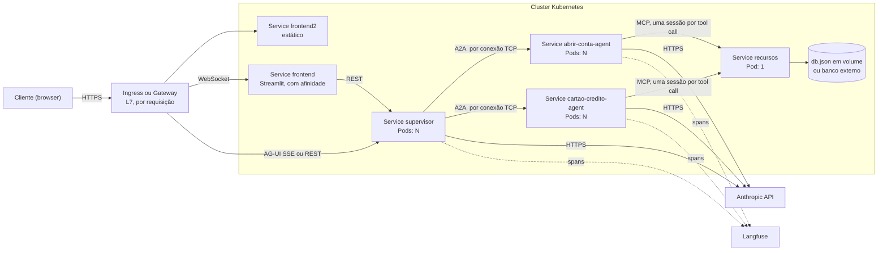

<!-- Documento de arquitetura do MD Bank. Voltar: [README](../README.md) -->

# Arquitetura em Kubernetes: distribuição de requisições e comportamentos

> Como o MD Bank se comportaria implantado em um cluster Kubernetes: por onde cada requisição passa, quem decide o destino em cada salto e o que muda (ou quebra) quando há mais de uma réplica. Complementa a [análise de arquitetura](arquitetura.md) e o [AI Codebase Deep Dive](AI_CODEBASE_DEEP_DIVE.md).

| Item | Valor |
|---|---|
| Data da análise | 2026-10-17 |
| Revisão analisada | branch `main` no commit `0b40fa4`, árvore de trabalho limpa |
| Método | Leitura do código versionado e do código-fonte das bibliotecas instaladas nos `.venv` locais, consulta à documentação oficial do Kubernetes e reaproveitamento dos achados e do teste do [Deep Dive](AI_CODEBASE_DEEP_DIVE.md) |
| O que **não** foi feito | O repositório não tem manifests Kubernetes. Nenhum cluster, container ou serviço foi iniciado, nenhuma chamada ao LLM foi feita e nenhum arquivo do projeto foi alterado (só este documento foi criado). O comportamento em cluster é derivado e está marcado como tal |

## Convenções

**Evidência.** A legenda é a do Deep Dive, sem o marcador [Hipótese] (não há decisões de projeto a explicar aqui) e com um marcador a mais para o que vem da documentação do Kubernetes:

| Marcador | Significado |
|---|---|
| **[Fato]** | Comprovado pelo código do repositório ou pelo código-fonte das bibliotecas instaladas. A fonte é citada. |
| **[Teste]** | Comprovado por um script isolado. Aqui, só o do [Apêndice A do Deep Dive](AI_CODEBASE_DEEP_DIVE.md#apêndice-a--scripts-de-verificação-executados) (A.1). |
| **[Doc K8s]** | Comportamento descrito na documentação oficial do Kubernetes, com a página citada na [seção 10](#10-referências). Não foi observado em cluster. |
| **[Inferência]** | Conclusão técnica derivada das evidências acima, mas não observada em execução. |

**Referências.** O formato é `caminho/arquivo.py:L10-L25`, com link para a linha. Bibliotecas de terceiros aparecem pelo pacote, versão e caminho em `site-packages` ([seção 9](#9-evidências-em-bibliotecas)). Os números de linha valem para o commit `0b40fa4`. O Deep Dive foi escrito sobre o commit `b95d574`, antes da observabilidade (`b61c5b9`). As linhas que ele cita em `supervisor/`, `agents/*/server.py`, `agents/*/executor.py` e `agents/*/agent/*.py` estão, por isso, deslocadas em relação a este commit.

**Versões.** As versões citadas vêm dos `.venv` locais. As imagens Docker resolvem as versões no build e podem diferir (Deep Dive, Convenções → Versões).

**Dados sensíveis omitidos.** Nenhum valor de `.env` nem do `recursos/db.json` aparece aqui.

## 1. Resumo

Em Kubernetes, uma requisição passa por **duas distribuições independentes**: o router LLM escolhe o *tipo* de agente, e o Service com o kube-proxy escolhe o *pod* daquele agente. O código só implementa a primeira. A segunda fica com a plataforma, e o código tem estado em memória e endereços fixos que não resistem a mais de uma réplica.

- **[Fato]** O supervisor conhece uma única URL por agente e nunca escolhe entre réplicas ([services.py:L33-L36](../supervisor/src/services.py#L33-L36)).
- **[Doc K8s]** O kube-proxy escolhe o destino quando a conexão é aberta. **[Inferência]** Como o `httpx` do supervisor reaproveita conexões, um pod do supervisor tende a falar sempre com os mesmos pods do agente quando há tráfego contínuo ([5.2](#52-balanceamento)).
- **[Fato]** O estado vive na memória do processo em quatro lugares: a memória do router, a de cada agente e o banco inteiro no `recursos`. Com N réplicas, a resposta passa a depender de qual pod atendeu ([5.3](#53-estado-e-consistência)).
- **[Fato]** Os nomes `abrir_conta_agent` e `cartao_credito_agent` têm `_`, que o Kubernetes não aceita em nomes de Service (**[Doc K8s]**). Além disso, o `AgentCard.url` fixo faz o `send_message` falhar mesmo quando a descoberta funciona ([5.1](#51-endereçamento-e-descoberta)).
- O que **já se comporta bem**: o trace do Langfuse atravessa pods ([5.7](#57-observabilidade-entre-pods)), o MCP do `recursos` sobe em modo stateless por acidente ([5.2](#52-balanceamento)) e o fluxo atual não depende do `InMemoryTaskStore` ([5.3](#53-estado-e-consistência)).

**Veredito.** Hoje, 1 réplica por componente é o único modo previsível. Escalar o supervisor e os agentes exige externalizar a memória. Escalar o `recursos` exige trocar o `db.json` por um banco. A [seção 6](#6-bloqueadores-e-ordem-de-correção) ordena as correções.

## 2. Duas distribuições independentes

| Eixo | Pergunta | Quem decide | No repositório |
|---|---|---|---|
| Semântico | Qual *tipo* de agente resolve o pedido? | Router LLM, que devolve 1..N agentes | [agents.py:L83-L106](../supervisor/src/agents.py#L83-L106) |
| Físico | Qual *pod* desse agente atende? | Service e kube-proxy (L4) | não existe |

Pense em dois registros. O **AgentCard** diz *o que* cada agente sabe fazer (capacidade). Os **Endpoints do Service** dizem *onde* ele roda (instâncias). Hoje o primeiro é um dicionário fixo (`AGENTS`, [services.py:L33-L36](../supervisor/src/services.py#L33-L36)), repetido no prompt do router e nos nós do grafo ([Deep Dive, R18](AI_CODEBASE_DEEP_DIVE.md#14-riscos-limitações-e-oportunidades-de-melhoria)). O BFA, que seria o registro dinâmico de capacidades, não é consumido por ninguém ([Deep Dive, achado 7](AI_CODEBASE_DEEP_DIVE.md#principais-achados)). O segundo registro o Kubernetes já fornece.

## 3. Topologia no cluster

Mapeamento sugerido, sem manifests. A última coluna descreve o que acontece **com o código atual**.

| Componente | Objeto | Service | Estado no processo | Com N>1 réplicas |
|---|---|---|---|---|
| frontend2 (React) | Deployment com build estático atrás de nginx (hoje roda `npm start`) | `frontend2` | nenhum no servidor | seguro |
| frontend (Streamlit) | Deployment | `frontend` | `st.session_state` por sessão | exige afinidade de sessão |
| supervisor | Deployment | `supervisor` | `InMemorySaver` do router, `CLIENT_CACHE` | memória do router fragmentada |
| abrir_conta | Deployment | `abrir-conta-agent` | `InMemorySaver`, `InMemoryTaskStore` | memória do agente fragmentada |
| cartao_credito | Deployment | `cartao-credito-agent` | idem, mais o agente compilado em cache | idem |
| recursos | Deployment com estratégia `Recreate` e volume, ou banco externo | `recursos` | contas e cartões inteiros em dicionários | **leituras defasadas e escritas perdidas** |
| bfa | Deployment (opcional) | `bfa` | registro e índice BM25 | seguro: cada réplica monta o próprio registro na subida |
| Langfuse | serviço externo ou auto-hospedado | — | — | — |

**[Fato]** Dentro dos containers, supervisor, agentes, `recursos` e BFA escutam na porta 8000 (`CMD` de cada `Dockerfile`, linha 18). As portas 8080 a 8084 do [diagrama de componentes](img/arquitetura2.png) são as publicadas pelo Compose ([docker-compose.yml:L7](../docker-compose.yml#L7), [L26](../docker-compose.yml#L26), [L35](../docker-compose.yml#L35), [L44](../docker-compose.yml#L44), [L58](../docker-compose.yml#L58)). Em cluster, o Service pode expor qualquer porta e apontar para 8000.

## 4. Caminho de uma requisição

Exemplo: "quero um cartão, meu CPF é X", pelos dois frontends.

| # | Salto | Quem escolhe o destino | Granularidade |
|---|---|---|---|
| 1 | Browser → Ingress ou Gateway → supervisor (frontend2) | Ingress ou Gateway (L7) | por requisição. No AG-UI a resposta é um stream SSE, e a conexão fica em **um** pod até o fim do run ([app.py:L59-L85](../supervisor/app.py#L59-L85)) |
| 2 | Streamlit → supervisor | kube-proxy, via Service | por conexão. O `requests.post` não tem timeout ([frontend/app.py:L37](../frontend/app.py#L37)) |
| 3 | supervisor → Anthropic (router) | egress da rede do cluster | 1 chamada HTTPS |
| 4 | supervisor → agente (A2A) | kube-proxy, via Service | por conexão TCP ([5.2](#52-balanceamento)) |
| 5 | agente → Anthropic (tool calling) | egress | várias chamadas por pergunta |
| 6 | agente → `recursos` (MCP) | kube-proxy, via Service | uma sessão MCP por tool call |
| 7 | pods → Langfuse | egress | fora do caminho da resposta |

- **[Fato]** O fan-out do salto 4 é paralelo no `/chat` (LangGraph `Send`, [services.py:L127](../supervisor/src/services.py#L127)) e sequencial no AG-UI, na ordem em que o LLM devolveu os agentes ([services.py:L249-L269](../supervisor/src/services.py#L249-L269); [Deep Dive, 11.4](AI_CODEBASE_DEEP_DIVE.md#114-cenário-crítico-cartão-sem-conta-no-modo-paralelo)).
- **[Fato]** `request_agent` é um POST A2A bloqueante: `streaming=False` ([services.py:L91](../supervisor/src/services.py#L91)) e `message/send` espera a resposta completa (a2a-sdk, `transports/jsonrpc.py:L128-L137`). A conexão fica aberta durante todo o laço de LLM e tools do agente.
- **[Fato]** O `abrir_conta` recompõe o agente a cada request, o que inclui uma sessão MCP extra para `get_tools()` ([abrir_conta.py:L32-L33](../agents/abrir_conta/agent/abrir_conta.py#L32-L33), [L63-L64](../agents/abrir_conta/agent/abrir_conta.py#L63-L64)). O `cartao_credito` guarda o agente compilado ([cartoes.py:L83-L87](../agents/cartao_credito/agent/cartoes.py#L83-L87)).
- **[Fato]** O contexto do trace do Langfuse vai em `Message.metadata` ([services.py:L97-L103](../supervisor/src/services.py#L97-L103)), não na memória do processo.
- **[Inferência]** Uma pergunta típica faz de 2 a cerca de 7 chamadas ao LLM ([Deep Dive, 11.6](AI_CODEBASE_DEEP_DIVE.md#116-chamadas-ao-llm-por-mensagem-e-custo)) e várias sessões MCP. Os pods passam a maior parte do tempo esperando I/O, e o teto de vazão é a quota da Anthropic, compartilhada por todos os pods, não a CPU.

## 5. Comportamentos em cluster

### 5.1 Endereçamento e descoberta

- **[Fato]** Todos os endereços internos estão fixos no código, sem variáveis de ambiente ([Deep Dive, 3.3](AI_CODEBASE_DEEP_DIVE.md#33-topologia-de-rede-e-endereçamento)):
  - `AGENTS` ([services.py:L33-L36](../supervisor/src/services.py#L33-L36));
  - a URL do MCP nos agentes ([abrir_conta.py:L24](../agents/abrir_conta/agent/abrir_conta.py#L24), [cartoes.py:L24](../agents/cartao_credito/agent/cartoes.py#L24));
  - os agentes e o MCP no BFA ([discovery.py:L6-L9](../bfa/discovery.py#L6-L9), [mcp_discovery.py:L6](../bfa/mcp_discovery.py#L6));
  - a API do supervisor no Streamlit ([frontend/app.py:L4](../frontend/app.py#L4));
  - a `url` do próprio `AgentCard` ([abrir_conta/server.py:L42](../agents/abrir_conta/server.py#L42), [cartao_credito/server.py:L33](../agents/cartao_credito/server.py#L33)).
- **[Doc K8s]** O nome de um Service deve ser um *RFC 1123 label name*: até 63 caracteres, só minúsculas, dígitos e `-`, começando por letra ([Service][k8s-service], [Object names][k8s-names]). **[Fato]** `abrir_conta_agent` e `cartao_credito_agent` têm `_`, então não podem ser Services. Nomes válidos (por exemplo, `abrir-conta-agent`) exigem mudar juntos [services.py:L34-L35](../supervisor/src/services.py#L34-L35), [abrir_conta/server.py:L42](../agents/abrir_conta/server.py#L42), [cartao_credito/server.py:L33](../agents/cartao_credito/server.py#L33) e [bfa/discovery.py:L7-L8](../bfa/discovery.py#L7-L8). Os hosts `recursos`, `supervisor` e `bfa` já são válidos.
- **Armadilha do `card.url`.** **[Fato]** O cliente A2A envia as mensagens para `card.url`, não para a URL de onde baixou o card (a2a-sdk 0.3.26, `client_factory.py:L207-L208`; [Deep Dive, 3.3](AI_CODEBASE_DEEP_DIVE.md#33-topologia-de-rede-e-endereçamento)). **[Inferência]** Se o Service for renomeado e só o `AGENTS` for corrigido, a descoberta funciona (o log registra "Agent encontrado", [services.py:L89](../supervisor/src/services.py#L89)) e o `send_message` falha depois, por DNS. A `url` do card precisa vir de uma variável de ambiente, com o endereço do Service.
- **[Fato]** O supervisor baixa o card no primeiro request, uma vez por pod ([services.py:L80-L93](../supervisor/src/services.py#L80-L93)), e guarda o cliente em `CLIENT_CACHE` ([services.py:L39](../supervisor/src/services.py#L39)) sem expiração. **[Inferência]** Isso tolera qualquer ordem de subida dos pods, porque o card é estático e idêntico em todas as réplicas ([server.py:L39-L48](../agents/abrir_conta/server.py#L39-L48)). Em contrapartida, um card alterado só é visto depois de reiniciar o supervisor.
- **[Fato]** O BFA descobre os agentes uma única vez, na subida, com 3 tentativas de 2 s por agente ([discovery.py:L24](../bfa/discovery.py#L24), [L47](../bfa/discovery.py#L47); [app.py:L10-L23](../bfa/app.py#L10-L23)), e nunca atualiza. **[Inferência]** Num cluster, onde a ordem de subida não é controlada, um agente que sobe depois nunca entra no registro. Para virar fonte de descoberta, o BFA precisaria de atualização periódica.

### 5.2 Balanceamento

- **[Doc K8s]** No modo iptables, o kube-proxy instala regras que, por padrão, escolhem um Pod ao acaso, e a escolha acontece quando o cliente conecta ao IP virtual do Service ([Virtual IPs][k8s-vips]). Services headless não passam pelo kube-proxy: o DNS devolve os IPs dos Pods e a plataforma não balanceia ([Service][k8s-service]). Confirme o modo do seu cluster, porque a documentação lista outros (como IPVS, com escalonadores configuráveis).
- **[Inferência]** Como a decisão é tomada na abertura da conexão, as requisições seguintes na mesma conexão seguem o mesmo destino. O balanceamento efetivo é por conexão TCP, não por requisição HTTP.
- **[Fato]** O supervisor usa um único `httpx.AsyncClient` global ([services.py:L28](../supervisor/src/services.py#L28)), com os limites padrão do httpx 0.28.1: 100 conexões, 20 keep-alive e `keepalive_expiry=5.0` s (`httpx/_config.py:L178`, `L247`; `_client.py:L1368`).
- **[Inferência]** Com tráfego contínuo, o pool reaproveita as conexões ociosas, e um pod do supervisor fica "grudado" nos mesmos pods do agente. Com tráfego baixo (mais de 5 s ocioso), cada requisição abre uma conexão nova e cai num pod aleatório. O resultado é uma distribuição desigual que piora sob carga (pod quente). Para balancear por requisição, use um service mesh L7 (Linkerd, Istio), um Service headless com balanceamento no cliente ou conexões de vida curta.
- **[Inferência]** Acima de 100 chamadas A2A simultâneas por pod do supervisor, a requisição espera no pool até o `PoolTimeout` de 30 s (o `timeout=30` do cliente vale para o pool também).
- **[Fato]** Cada tool call abre uma sessão MCP própria (langchain-mcp-adapters 0.3.2, `tools.py:L460-L480`). **[Inferência]** Se cada sessão usa um cliente HTTP novo, o balanceamento do agente para o `recursos` é por chamada.
- **MCP stateless por acidente. [Teste]** O Dockerfile do `recursos` passa `--stateless false` ([Dockerfile:L18](../recursos/Dockerfile#L18)). O CLI trata `--stateless` como flag booleano, então o `false` vira argumento posicional e o modo stateless é **ligado** ([Deep Dive, achado 5 e A.1](AI_CODEBASE_DEEP_DIVE.md#principais-achados), cyclopts 5.2.0). **[Fato]** No FastMCP 4.1.0, `stateless` chega ao servidor HTTP como `stateless_http` (`cli/run.py:L264-L265`, `server/mixins/transport.py:L294-L300`), e nesse modo cada requisição usa um transporte novo, sem sessão (`server/http.py:L651`). **[Inferência]** Em cluster, o MCP não precisa de afinidade de sessão (`Mcp-Session-Id`). Se alguém "corrigir" o flag para `--stateless=false`, as sessões voltam a ser stateful e passam a exigir afinidade. A confirmação em runtime está na [seção 7](#7-como-validar-sem-cluster).

### 5.3 Estado e consistência

| Estado | Onde | Com N réplicas |
|---|---|---|
| Memória do router | `InMemorySaver` ([agents.py:L22](../supervisor/src/agents.py#L22), usado em [L78](../supervisor/src/agents.py#L78)) | por pod |
| Memória dos agentes | `InMemorySaver` ([abrir_conta.py:L29](../agents/abrir_conta/agent/abrir_conta.py#L29), [cartoes.py:L29](../agents/cartao_credito/agent/cartoes.py#L29)) | por pod |
| `thread_id` | padrão `"1"` em [agents.py:L84](../supervisor/src/agents.py#L84), [abrir_conta.py:L63](../agents/abrir_conta/agent/abrir_conta.py#L63) e [cartoes.py:L83](../agents/cartao_credito/agent/cartoes.py#L83). Os executors chamam `run_agent(mensagem=...)` sem passar outro ([abrir_conta/executor.py:L31](../agents/abrir_conta/executor.py#L31), [cartao_credito/executor.py:L30](../agents/cartao_credito/executor.py#L30)). O React manda `thread_id: "1"` ([ChatPage.jsx:L22](../frontend2/src/ChatPage.jsx#L22)) e o Streamlit manda `session_id: "123"` ([frontend/app.py:L31](../frontend/app.py#L31)) | uma thread global **por pod** |
| Cache de clientes A2A | `CLIENT_CACHE` ([services.py:L39](../supervisor/src/services.py#L39)) | por pod, benigno (card estático) |
| Tasks A2A | `InMemoryTaskStore` ([abrir_conta/server.py:L55](../agents/abrir_conta/server.py#L55), [cartao_credito/server.py:L45](../agents/cartao_credito/server.py#L45)) | por pod, fora do fluxo atual (veja abaixo) |
| Agente de cartões compilado | `agent` global ([cartoes.py:L31](../agents/cartao_credito/agent/cartoes.py#L31), [L86-L87](../agents/cartao_credito/agent/cartoes.py#L86-L87)) | por pod, com as tools MCP carregadas uma vez |
| Banco | `contas_mdbank` e `cartoes_mdbank` carregados no import ([recursos/app.py:L38-L40](../recursos/app.py#L38-L40)), leitura só da memória ([L73](../recursos/app.py#L73), [L80](../recursos/app.py#L80)), escrita regravando o arquivo inteiro ([L30-L35](../recursos/app.py#L30-L35)) | **cada réplica tem um snapshot e sobrescreve o arquivo das outras** |

Consequências:

- **Continuidade da conversa.** O agente de cartões é instruído a recuperar o CPF da memória ([cartoes.py:L69](../agents/cartao_credito/agent/cartoes.py#L69)). **[Inferência]** Com 2 réplicas do agente e balanceamento uniforme, uma pergunta de continuação ("quero um cartão", depois de informar o CPF) tem cerca de 50% de chance de cair no pod que lembra, e o usuário vê o agente pedindo o CPF de novo.
- **Isolamento entre usuários.** O vazamento do [Deep Dive, achado 1 e ADR-06](AI_CODEBASE_DEEP_DIVE.md#adr-06--memória-com-inmemorysaver-e-thread_id-fixo) continua em cluster, mas passa a ser não determinístico: depende do pod atendido. **[Inferência]** Propagar o `thread_id` não basta, porque os dois frontends mandam constantes e o identificador vem do cliente. O supervisor precisa derivá-lo da identidade autenticada, e o A2A tem onde carregá-lo (`Message.context_id`, a2a-sdk `types.py:L1441`), campo que hoje não é preenchido ([services.py:L97-L103](../supervisor/src/services.py#L97-L103)).
- **Afinidade de sessão não corrige a memória. [Doc K8s]** `sessionAffinity: ClientIP` existe (padrão `None`, timeout padrão de 10800 s) ([Virtual IPs][k8s-vips]). **[Inferência]** No salto supervisor → agente, o IP de origem é o do pod do supervisor, não o do usuário. A afinidade fixaria todo o tráfego de um pod do supervisor num pod do agente, sem preservar nem isolar a conversa de ninguém. A correção é externalizar o estado.
- **O `recursos` precisa ser singleton.** **[Inferência]** Cenário concreto com 2 réplicas: o `abrir_conta` cria a conta na réplica A, o `cartao_credito` consulta a réplica B e recebe `existe: False` para uma conta recém-criada. Um volume compartilhado com acesso de escrita múltiplo não resolve, porque a B nunca relê o arquivo. A corrida "cartão sem conta" do [Deep Dive, 11.4](AI_CODEBASE_DEEP_DIVE.md#114-cenário-crítico-cartão-sem-conta-no-modo-paralelo) ganha, assim, uma segunda causa.
- **Sem volume, as escritas não sobrevivem.** **[Fato]** O arquivo está em `/app/db.json` ([recursos/app.py:L13](../recursos/app.py#L13)), e o `COPY . .` ([recursos/Dockerfile:L16](../recursos/Dockerfile#L16)) leva o `db.json` versionado para a imagem. **[Inferência]** Num reschedule, o pod volta com o arquivo da imagem e perde o que foi gravado.
- **Enquanto o banco for um arquivo.** **[Doc K8s]** A estratégia `Recreate` mata todos os pods antigos antes de criar os novos, ao contrário do `RollingUpdate`, que sobrepõe pods ([Deployments][k8s-deploy]). **[Doc K8s]** `ReadWriteOnce` permite que vários pods no **mesmo nó** montem o volume, e `ReadWriteOncePod` garante um único pod no cluster (estável desde a v1.29, só para volumes CSI) ([Persistent Volumes][k8s-pv]). **[Inferência]** Uma réplica, `Recreate` e `ReadWriteOncePod` evitam dois escritores no mesmo arquivo. A correção definitiva é um banco com transação ([Deep Dive, ADR-07](AI_CODEBASE_DEEP_DIVE.md#adr-07--persistência-em-arquivo-json-com-estado-em-memória)).
- **`InMemoryTaskStore`.** **[Fato]** Os executors só enfileiram uma `Message` ([abrir_conta/executor.py:L35-L37](../agents/abrir_conta/executor.py#L35-L37)), e o a2a-sdk devolve a `Message` sem passá-la pelo task manager (`result_aggregator.py:L135-L139`). **[Inferência]** O store por pod não participa do fluxo atual. Passaria a importar com tasks longas (consulta e cancelamento), que pedem um store compartilhado ([Deep Dive, R14](AI_CODEBASE_DEEP_DIVE.md#14-riscos-limitações-e-oportunidades-de-melhoria)).

### 5.4 Tempo, streaming, falhas e retries

A matriz completa de timeouts e retries está no [Deep Dive, 11.5](AI_CODEBASE_DEEP_DIVE.md#115-matriz-de-falhas-timeouts-e-retries). O que muda em cluster:

- **[Fato]** Cada chamada A2A tem o timeout de 30 s do `httpx` ([services.py:L28](../supervisor/src/services.py#L28)), sem retry, e o laço do agente não tem teto de iterações. Na "combinação perigosa" do Deep Dive, o supervisor desiste e o agente continua, podendo gravar a conta ou o cartão. **[Inferência]** Em cluster há mais maneiras de cortar o lado do cliente enquanto o agente segue trabalhando: o timeout de leitura do Ingress ou Gateway, a saída de um pod do supervisor num rollout e o SIGKILL ao fim do período de graça. O inverso também vale: se o pod do agente morre depois de gravar e antes de responder, o supervisor vê um erro de algo que aconteceu.
- **[Fato]** O `/chat` devolve 500 com `str(e)` ([app.py:L45-L47](../supervisor/app.py#L45-L47)). No AG-UI, o `200` já foi enviado quando o erro ocorre, e o gerador não tem `try/except` ([app.py:L59-L80](../supervisor/app.py#L59-L80)). **[Inferência]** O stream é cortado sem `RUN_ERROR` e sem `RUN_FINISHED`.
- **[Fato]** Durante cada `await request_agent` ([services.py:L258](../supervisor/src/services.py#L258)) o stream não emite nenhum byte. **[Inferência]** A janela ociosa chega a cerca de 30 s por agente (o timeout do `httpx`). Os controladores de borda têm timeouts de leitura e buffering de resposta próprios, com padrões que variam: configure-os para SSE e desligue o buffering do stream. O ideal é emitir um heartbeat periódico.
- **[Doc K8s]** O comunicado de novembro de 2025 anuncia que a manutenção do Ingress NGINX seguiria em regime de melhor esforço até março de 2026, sem novas versões nem correções de bugs ou de vulnerabilidades depois disso ([comunicado][k8s-ingress-nginx]). Para a borda, escolha um controlador de Ingress ou Gateway que ainda seja mantido.
- **[Fato]** O router captura qualquer exceção e cai para `abrir_conta` ([agents.py:L104-L106](../supervisor/src/agents.py#L104-L106)). **[Inferência]** Com 429 ou 5xx da Anthropic, cuja quota é compartilhada por todos os pods, o resultado é um roteamento errado em vez de um erro. Cada chamada ao LLM ainda tem 2 retries do SDK ([Deep Dive, 11.5](AI_CODEBASE_DEEP_DIVE.md#115-matriz-de-falhas-timeouts-e-retries)), que aumentam a pressão sobre a quota quando todos os pods tentam de novo.
- **[Inferência]** Não habilite retries automáticos de `POST` na malha ou no gateway para A2A e MCP. `criar_ou_buscar_conta` e `solicitar_cartao` só são idempotentes por CPF dentro de uma réplica e sem lock ([Deep Dive, 5.6](AI_CODEBASE_DEEP_DIVE.md#56-limitações-e-riscos)), e cada retry refaz o laço do LLM, com custo.

### 5.5 Ciclo de vida: probes, subida e encerramento

- **Probes.** **[Fato]** O supervisor define apenas `POST /chat` e `POST /` ([app.py:L36](../supervisor/app.py#L36), [L50](../supervisor/app.py#L50)), sem rota de saúde. Os demais já têm algo utilizável:
  - agentes: o card em `/.well-known/agent-card.json` (a2a-sdk, `utils/constants.py:L3`);
  - `recursos`: `GET /tools` ([app.py:L247](../recursos/app.py#L247)), que responde sem chamar o LLM;
  - BFA: `GET /` ([app.py:L74-L76](../bfa/app.py#L74-L76)).

  **[Fato]** O Compose não tem healthchecks, só um `depends_on` do BFA ([docker-compose.yml:L45](../docker-compose.yml#L45)). Em cluster, readiness e liveness substituem isso.
- **Imagens de desenvolvimento.** **[Fato]** Quatro `Dockerfile` rodam `uvicorn --reload` ([supervisor](../supervisor/Dockerfile#L18), [abrir_conta](../agents/abrir_conta/Dockerfile#L18), [cartao_credito](../agents/cartao_credito/Dockerfile#L18) e [bfa](../bfa/Dockerfile#L18), linha 18 de cada um), o frontend2 roda `npm start` ([Dockerfile:L17](../frontend2/Dockerfile#L17)) e o Compose monta o código por bind mount ([docker-compose.yml:L8-L9](../docker-compose.yml#L8-L9)). Em cluster, use imagem imutável, sem `--reload` e sem bind mount. **[Inferência]** Prefira um worker por pod e escale por réplicas: mais workers no mesmo pod multiplicam o estado em memória.
- **Segredos.** **[Fato]** No Compose, as chaves chegam pelo bind mount do código e `load_dotenv()` (não há `env_file`). Nas imagens, o `COPY . .` ([supervisor/Dockerfile:L16](../supervisor/Dockerfile#L16), [recursos/Dockerfile:L16](../recursos/Dockerfile#L16)) leva um `.env` presente no diretório de build, porque os `.dockerignore` de supervisor, agentes, `recursos` e BFA não o excluem. **[Inferência]** Um build local seguido de push publica a `ANTHROPIC_API_KEY` numa camada da imagem. Num CI com checkout limpo o `.env` não existe, pois o [.gitignore](../.gitignore) o ignora. Em cluster, injete `ANTHROPIC_API_KEY` e `LANGFUSE_*` por Secret: o código já lê `os.getenv` ([agents.py:L19](../supervisor/src/agents.py#L19)).
- **Encerramento.** **[Doc K8s]** O kubelet envia SIGTERM e, passado o período de graça (30 s por padrão), SIGKILL. O hook `preStop` roda antes e consome o mesmo período ([Pod Lifecycle][k8s-lifecycle]). **[Inferência]** O uvicorn trata SIGTERM com shutdown gracioso e só então o interpretador roda os handlers `atexit`, como o `flush` do Langfuse ([app.py:L25](../supervisor/app.py#L25)). Streams SSE e laços de agente que passam do período de graça são mortos, e os spans pendentes se perdem. Ajuste `terminationGracePeriodSeconds` para cobrir uma requisição longa e use `preStop` com a readiness para tirar o pod do balanceamento antes do SIGTERM.
- **Autoscaling.** **[Inferência]** Os pods esperam I/O (seção 4), então um HPA por CPU reage tarde. Prefira requisições em andamento ou latência (HPA com métricas customizadas, KEDA) e limite a concorrência por pod para respeitar a quota da Anthropic.

### 5.6 Exposição e segurança

- **[Fato]** O React roda no navegador e chama `fetch("http://localhost:8080/")` ([ChatPage.jsx:L38](../frontend2/src/ChatPage.jsx#L38)). Em cluster, o supervisor precisa ser publicado pelo Ingress ou Gateway, e a URL deve vir de configuração de build (o CRA embute variáveis `REACT_APP_*` no bundle) ou de um caminho relativo na mesma origem. **[Inferência]** Publicar o supervisor expõe um serviço sem autenticação e com CORS que reflete qualquer origem com credenciais ([app.py:L27-L33](../supervisor/app.py#L27-L33); [Deep Dive, 11.8 e R03](AI_CODEBASE_DEEP_DIVE.md#118-limites-entre-componentes-e-projetos)).
- **[Fato]** O Streamlit chama o supervisor por dentro do cluster ([frontend/app.py:L4](../frontend/app.py#L4)) e guarda o histórico em `st.session_state` ([L10-L11](../frontend/app.py#L10-L11)). **[Inferência]** A conexão do Streamlit com o navegador é um WebSocket e o estado vive no processo, então mais de uma réplica exige afinidade de sessão no Ingress.
- **[Fato]** Não há autenticação entre os serviços, e o AgentCard não declara esquemas de segurança ([Deep Dive, 11.8](AI_CODEBASE_DEEP_DIVE.md#118-limites-entre-componentes-e-projetos)). O a2a-sdk 0.3.26 suporta `AgentCard.security_schemes` (`types.py:L1807`). No Compose, todas as portas internas são publicadas no host. **[Inferência]** Em cluster, use Services `ClusterIP`, NetworkPolicy (só supervisor → agentes, só agentes → `recursos`, e egress apenas para a Anthropic e o Langfuse) e autenticação entre serviços (service mesh com mTLS ou os esquemas do AgentCard).

### 5.7 Observabilidade entre pods

- **[Fato]** `request_agent` envia `langfuse_trace_id`, `langfuse_parent_span_id` e `langfuse_session_id` em `Message.metadata` ([services.py:L97-L103](../supervisor/src/services.py#L97-L103), [observability.py:L99-L109](../supervisor/observability.py#L99-L109)), e o executor do agente abre o span `agent.<nome>` dentro desse trace ([abrir_conta/executor.py:L21-L30](../agents/abrir_conta/executor.py#L21-L30)). **[Inferência]** Como o contexto viaja na mensagem, o trace permanece íntegro qualquer que seja o pod do supervisor e do agente.
- **[Fato]** Sem `LANGFUSE_PUBLIC_KEY` e `LANGFUSE_SECRET_KEY`, a observabilidade vira no-op ([observability.py:L22-L23](../supervisor/observability.py#L22-L23), [L42-L44](../supervisor/observability.py#L42-L44)). O `.env.example` também define `LANGFUSE_HOST`. Em cluster, as chaves vão por Secret, e os pods precisam de egress até o host do Langfuse.
- **[Fato]** A sessão do Langfuse é o `thread_id` do AG-UI ([services.py:L199](../supervisor/src/services.py#L199)), que o React fixa em `"1"`, ou o `session_id` do `/chat` ([services.py:L173](../supervisor/src/services.py#L173)), que o Streamlit fixa em `"123"`. **[Inferência]** Todas as conversas de cada frontend caem na mesma sessão do Langfuse. Para correlacionar por usuário ou conversa em cluster, os frontends precisam gerar identificadores reais.
- **[Fato]** O CPF é mascarado no cliente, antes do envio ([observability.py:L26-L34](../supervisor/observability.py#L26-L34), [L48](../supervisor/observability.py#L48)). O `flush` ao encerrar depende de shutdown limpo ([5.5](#55-ciclo-de-vida-probes-subida-e-encerramento)).

## 6. Bloqueadores e ordem de correção

| # | Bloqueador | Efeito em cluster | Correção sugerida | Deep Dive |
|---|---|---|---|---|
| K1 | Memória por pod e `thread_id` constante ([5.3](#53-estado-e-consistência)) | Conversa fragmentada entre réplicas e misturada entre usuários | `thread_id` gerado no frontend e derivado da identidade autenticada, propagado por `context_id` do A2A, com checkpointer externo (Postgres ou Redis) | R01, ADR-06 |
| K2 | `recursos` com banco em memória e arquivo ([5.3](#53-estado-e-consistência)) | Leituras defasadas e escritas perdidas com N>1 | Banco com transação. Até lá: 1 réplica, `Recreate` e `ReadWriteOncePod` | R09, ADR-07 |
| K3 | Endereços fixos, nomes inválidos e `card.url` ([5.1](#51-endereçamento-e-descoberta)) | O Service não é criado, ou o `send_message` falha após a descoberta | Variáveis de ambiente para `AGENTS`, MCP, API e `url` do card, com nomes como `abrir-conta-agent` | R18, R13 |
| K4 | Imagens de desenvolvimento, sem probes, encerramento abrupto e segredo no build ([5.5](#55-ciclo-de-vida-probes-subida-e-encerramento)) | Rollout instável, streams perdidos, chave na camada da imagem | Imagem imutável, probes, `terminationGracePeriodSeconds`, Secret, `.dockerignore` com `.env` e `db.json` | R13, R02, R11 |
| K5 | Balanceamento por conexão no A2A e quota da Anthropic ([5.2](#52-balanceamento)) | Pod quente e 429 em cascata | Service mesh L7 ou Service headless, limite de concorrência por pod, HPA por concorrência ou latência | novo (o custo está em R16) |
| K6 | Timeouts, erro no stream e retries ([5.4](#54-tempo-streaming-falhas-e-retries)) | Cortes silenciosos e trabalho duplicado | Heartbeat no SSE, `RUN_ERROR`, timeouts coerentes entre as camadas, sem retry automático de `POST` | R14, R15, R07, R04 |
| K7 | Exposição sem autenticação ([5.6](#56-exposição-e-segurança)) | Supervisor público e aberto | Autenticação no gateway, CORS restrito, NetworkPolicy, esquemas de segurança no AgentCard | R03 |

**Ordem sugerida para a implantação.** Ela estende a [ordem do Deep Dive](AI_CODEBASE_DEEP_DIVE.md#14-riscos-limitações-e-oportunidades-de-melhoria) com o objetivo "rodar em cluster":

1. **Subir com 1 réplica por componente:** K3 → K4 → K7 (antes de publicar o supervisor) → K6, que já se manifesta com uma réplica.
2. **Escalar horizontalmente:** K1 → K2 → K5.

## 7. Como validar sem cluster

1. **Modo do MCP.** Suba o `recursos` pelo Docker e procure no log a linha `Starting MCP server 'ContaService' with transport 'http' (stateless) on http://...` (formato em `server/mixins/transport.py:L358-L360`). Com `(stateless)`, o resultado confirma o [Teste] do Deep Dive em runtime. Sem ele, a imagem resolveu uma versão do FastMCP com outro comportamento. O ambiente local de `recursos` está quebrado ([Deep Dive, achado 4](AI_CODEBASE_DEEP_DIVE.md#principais-achados)), então o Docker é o lugar para testar.
2. **Réplicas no Compose (experimento sugerido, não executado).** `container_name` e `ports` fixos impedem o `--scale` ([docker-compose.yml:L20](../docker-compose.yml#L20) e [L25-L26](../docker-compose.yml#L25-L26) para `abrir_conta_agent`, [L29](../docker-compose.yml#L29) e [L34-L35](../docker-compose.yml#L34-L35) para `cartao_credito_agent`, [L52](../docker-compose.yml#L52) e [L57-L58](../docker-compose.yml#L57-L58) para `recursos`). Num arquivo de override, remova esses campos do serviço alvo e suba com `docker compose up --scale <serviço>=2`.
   - **[Inferência]** O DNS embutido do Docker devolve os IPs das réplicas, o que aproxima o balanceamento por conexão do kube-proxy.
   - **[Inferência]** Com 2 réplicas de `recursos`, consultar uma conta recém-criada deve devolver `existe: False` em parte das chamadas.
   - **[Inferência]** Com 2 réplicas de um agente, o CPF "lembrado" deve sumir quando a outra réplica responde.
   - Quem respondeu aparece nos logs de cada container (`agent.execute.cartao_credito`, [executor.py:L16](../agents/cartao_credito/executor.py#L16)).

## 8. Limites desta análise

- Não há manifests nem cluster. O comportamento do Kubernetes vem da documentação oficial, e o do código em cluster é inferido. A estimativa de cerca de 50% de cair no pod certo assume balanceamento uniforme e saltos independentes.
- As imagens Docker (Python 3.13, dependências sem versão fixada) podem resolver versões diferentes das dos `.venv` locais (Python 3.14). O `.venv` de `recursos` mistura versões ([Deep Dive, achado 4](AI_CODEBASE_DEEP_DIVE.md#principais-achados)), então o [Teste] do `--stateless` reproduz a declaração do parâmetro, não o CLI real.
- As páginas do Kubernetes foram consultadas em 2026-10-17, e o texto usa só o que foi lido nelas. Defaults como o modo do kube-proxy dependem da versão e da distribuição do cluster.
- Não há testes de carga, dimensionamento nem estimativa de custo.

## 9. Evidências em bibliotecas

Versões dos `.venv` locais. Os arquivos estão em `site-packages`.

| Biblioteca (versão) | Arquivo:linhas | O que comprova |
|---|---|---|
| a2a-sdk 0.3.26 | `a2a/client/client_factory.py:L207-L208` | O cliente usa `card.url` como endereço de transporte |
| a2a-sdk 0.3.26 | `a2a/client/transports/jsonrpc.py:L128-L137`, `L202-L222` | `message/send` é um POST único, sem timeout próprio (vale o do `httpx`) |
| a2a-sdk 0.3.26 | `a2a/server/tasks/result_aggregator.py:L135-L139` | A `Message` é devolvida sem passar pelo task manager |
| a2a-sdk 0.3.26 | `a2a/utils/constants.py:L3` | O card fica em `/.well-known/agent-card.json` |
| a2a-sdk 0.3.26 | `a2a/types.py:L1441`, `L1807` | `Message.context_id` e `AgentCard.security_schemes` existem |
| httpx 0.28.1 | `httpx/_config.py:L178`, `L247`; `httpx/_client.py:L1368` | `AsyncClient` usa `DEFAULT_LIMITS` (100 conexões, 20 keep-alive) e `keepalive_expiry=5.0` |
| langchain-mcp-adapters 0.3.2 | `langchain_mcp_adapters/tools.py:L460-L480` | Uma sessão MCP é criada a cada chamada de tool |
| fastmcp 4.1.0 | `fastmcp/cli/cli.py:L508-L514` | `--stateless` é um flag booleano |
| fastmcp 4.1.0 | `fastmcp/cli/run.py:L264-L265`; `fastmcp/server/mixins/transport.py:L294-L300`, `L356-L360`; `fastmcp/server/http.py:L651` | `stateless` vira `stateless_http`, o log de subida mostra `(stateless)` e o modo é sem sessão |
| cyclopts 5.2.0 | [Deep Dive, A.1](AI_CODEBASE_DEEP_DIVE.md#apêndice-a--scripts-de-verificação-executados) | `--stateless false` vira `stateless=True` com `server_args=('false',)` |

## 10. Referências

| Página do Kubernetes | O que sustenta |
|---|---|
| [Virtual IPs and Service Proxies][k8s-vips] | O modo iptables escolhe o backend ao acaso quando o cliente conecta. `sessionAffinity: ClientIP` (padrão `None`, timeout padrão de 10800 s) |
| [Service][k8s-service] | O nome do Service deve ser um *RFC 1123 label name*. Services headless não passam pelo kube-proxy, e o DNS devolve os IPs dos Pods |
| [Object Names and IDs][k8s-names] | Regras do label DNS: até 63 caracteres, minúsculas, dígitos e `-`, começando por letra |
| [Persistent Volumes][k8s-pv] | `ReadWriteOnce` (um nó, vários pods possíveis) e `ReadWriteOncePod` (um único pod, estável desde a v1.29, só CSI) |
| [Deployments][k8s-deploy] | `Recreate` mata todos os pods antigos antes de criar os novos. No `RollingUpdate`, `maxUnavailable` e `maxSurge` têm 25% como padrão |
| [Pod Lifecycle][k8s-lifecycle] | Encerramento com SIGTERM, período de graça padrão de 30 s e SIGKILL depois. O `preStop` roda antes e conta nesse período |
| [Comunicado de aposentadoria do Ingress NGINX][k8s-ingress-nginx] | Anúncio (2025-11-11) de manutenção de melhor esforço até março de 2026, sem novas versões nem correções depois. Não foi verificado se o cronograma se cumpriu |

Seções do [Deep Dive](AI_CODEBASE_DEEP_DIVE.md) usadas aqui: [3.3](AI_CODEBASE_DEEP_DIVE.md#33-topologia-de-rede-e-endereçamento), [5.6](AI_CODEBASE_DEEP_DIVE.md#56-limitações-e-riscos), [11.4](AI_CODEBASE_DEEP_DIVE.md#114-cenário-crítico-cartão-sem-conta-no-modo-paralelo), [11.5](AI_CODEBASE_DEEP_DIVE.md#115-matriz-de-falhas-timeouts-e-retries), [11.6](AI_CODEBASE_DEEP_DIVE.md#116-chamadas-ao-llm-por-mensagem-e-custo), [11.8](AI_CODEBASE_DEEP_DIVE.md#118-limites-entre-componentes-e-projetos), [ADR-06](AI_CODEBASE_DEEP_DIVE.md#adr-06--memória-com-inmemorysaver-e-thread_id-fixo), [ADR-07](AI_CODEBASE_DEEP_DIVE.md#adr-07--persistência-em-arquivo-json-com-estado-em-memória), [14](AI_CODEBASE_DEEP_DIVE.md#14-riscos-limitações-e-oportunidades-de-melhoria) e [A.1](AI_CODEBASE_DEEP_DIVE.md#apêndice-a--scripts-de-verificação-executados).

[k8s-vips]: https://kubernetes.io/docs/reference/networking/virtual-ips/
[k8s-service]: https://kubernetes.io/docs/concepts/services-networking/service/
[k8s-names]: https://kubernetes.io/docs/concepts/overview/working-with-objects/names/
[k8s-pv]: https://kubernetes.io/docs/concepts/storage/persistent-volumes/
[k8s-deploy]: https://kubernetes.io/docs/concepts/workloads/controllers/deployment/
[k8s-lifecycle]: https://kubernetes.io/docs/concepts/workloads/pods/pod-lifecycle/
[k8s-ingress-nginx]: https://kubernetes.io/blog/2025/11/11/ingress-nginx-retirement/
