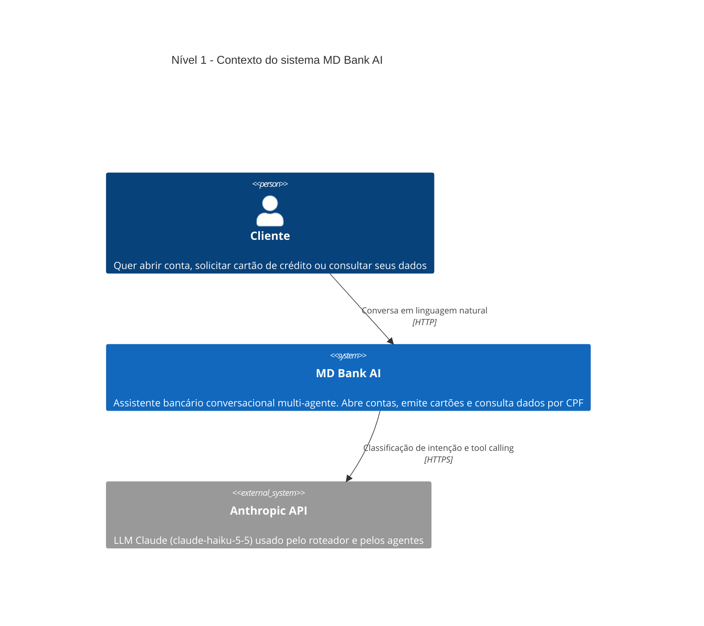
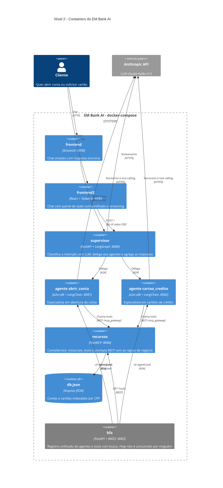
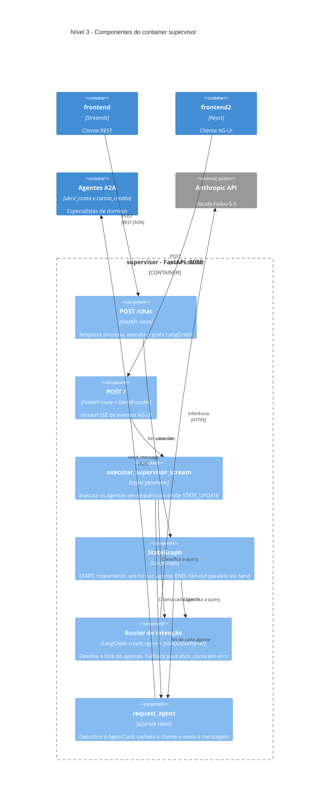

<!-- Documento de arquitetura do MD Bank. Voltar: [README](../README.md) -->

# Análise de arquitetura (engenharia reversa)

> Análise estática do código em 2026-10-10. Os containers não foram executados; o comportamento em runtime é inferido do código.

## O que é

O EM Bank é um **assistente bancário conversacional multi-agente** de um banco digital fictício. É uma PoC/laboratório de arquitetura de agentes de IA, com dados mock. O cliente conversa em linguagem natural e o sistema:

- **abre conta**: coleta nome e CPF, verifica se já existe conta e cria uma com número e saldo 0;
- **emite cartão de crédito**: tipos `platinum`, `gold`, `silver` e `mdzao`. Exige conta pré-existente e gera número e limite;
- **consulta** conta e cartão por CPF.

Funcionalmente, é um funil de onboarding: "quero um cartão" sem conta leva à abertura de conta e depois ao cartão.

## Problema que resolve

| Dor | Como o projeto responde |
|---|---|
| Fluxos bancários em formulários e telas separadas | Interface única em linguagem natural |
| Uma pergunta pode exigir mais de um domínio (quer cartão, mas não tem conta) | Um **roteador LLM** seleciona 1..N agentes especialistas |
| Acoplar o chatbot a cada sistema do banco | Agentes expõem **AgentCards (A2A)** e as capacidades vêm de **tools MCP**, com descoberta padronizada |
| LLM inventando dados | Prompts obrigam o uso de tools, e as regras de negócio são reforçadas na tool `solicitar_cartao` |

O valor do repositório é demonstrar uma **pilha de três protocolos**:

- **AG-UI**: agente para usuário.
- **A2A**: agente para agente.
- **MCP**: agente para ferramenta e dados.

## Arquitetura

A arquitetura segue o modelo C4 (níveis 1 a 3), escrito em Mermaid. Os diagramas renderizam no GitHub. No VS Code, é preciso uma extensão com suporte a Mermaid.

### Nível 1: Contexto do sistema

### Nível 2: Containers

O `bfa` aparece em cinza porque nenhum outro container o consome hoje (veja os pontos de atenção).

### Nível 3: Componentes do supervisor

O `supervisor` é o único container com lógica de orquestração própria. Os dois caminhos de entrada (`/chat` e `/`) usam o mesmo router, mas executam os agentes de formas diferentes (veja o ponto de atenção 3).

### Inventário de containers

| Componente | Papel | Tecnologia | Porta |
|---|---|---|---|
| [frontend](../frontend/app.py) | Chat simples, resposta síncrona | Streamlit + requests | 9090 |
| [frontend2](../frontend2/src/ChatPage.jsx) | Chat com painel de "state compartilhado" e streaming | React 18, Tailwind, SSE manual | 3000 |
| [supervisor](../supervisor/app.py) | Orquestrador: classifica a intenção, delega e agrega | FastAPI, LangGraph, a2a-sdk, ag-ui-protocol | 8080 |
| [agents/abrir_conta](../agents/abrir_conta/server.py) | Especialista em onboarding de conta | a2a-sdk (Starlette) + `create_agent` | 8081 |
| [agents/cartao_credito](../agents/cartao_credito/server.py) | Especialista em cartões | idem | 8082 |
| [recursos](../recursos/app.py) | Camada de dados e regras de negócio exposta como MCP | FastMCP | 8084 |
| [bfa](../bfa/app.py) | Registro unificado de agentes e tools com busca BM25 | FastAPI, rank-bm25 | 8083 |

### Integrações e contratos

| De → Para | Protocolo | Detalhe |
|---|---|---|
| Browser → supervisor | AG-UI sobre SSE | `RUN_STARTED`, `TEXT_MESSAGE_*`, `RUN_FINISHED`, mais `STATE_UPDATE` customizado |
| Streamlit → supervisor | REST JSON | `POST /chat {message, session_id, client_id}` |
| supervisor → agentes | A2A | `A2ACardResolver` descobre o card e `client.send_message` (sem streaming), com cache de clientes. Veja [request_agent](../supervisor/src/services.py) |
| agentes → recursos | MCP via `langchain-mcp-adapters` | Tools carregadas dinamicamente de `http://recursos:8000/mcp_gateway` |
| agentes/supervisor → Anthropic | API | `claude-haiku-5-5`, via `ANTHROPIC_API_KEY` no `.env` de cada serviço |
| bfa → agentes e recursos | A2A card + REST `/tools` | Indexa skills e tools em BM25 |

### Superfície MCP do `recursos`

- **Resources**: `conta://{cpf}` e `cartao://{cpf}`.
- **Tools**: `consultar_conta`, `consultar_cartao`, `criar_ou_buscar_conta`, `solicitar_cartao` e `gerar_prompt_abertura`.
- **Prompts**: `abrir_conta_prompt` e `solicitar_cartao_prompt`.
- **Persistência**: arquivo `db.json` no volume montado (`./recursos`).

## Fluxo principal

Exemplo: "Quero um cartão, meu CPF é X" para um cliente sem conta.

1. O frontend envia a mensagem ao supervisor.
2. O router LLM devolve JSON `{"agents": ["abrir_conta","cartao_credito"]}`. Veja [agents.py](../supervisor/src/agents.py).
3. O supervisor chama cada agente por A2A.
4. O agente de cartão chama `consultar_conta`. Se `existe=False`, informa e oferece a abertura. Se `True`, chama `solicitar_cartao`.
5. A tool MCP valida a conta, grava no `db.json` e responde.
6. O supervisor concatena as respostas (`"\n\n".join`) e devolve ao frontend.

## Pontos de atenção

Em ordem de relevância:

1. **O BFA é órfão.** Nada o consome. O supervisor usa o dicionário fixo `AGENTS` em [services.py](../supervisor/src/services.py), nós fixos no grafo e agentes listados no prompt do router. Adicionar um agente exige alterar três lugares, e a descoberta dinâmica construída não é usada.
2. **A memória é compartilhada entre todos os usuários.** O router e os agentes usam `thread_id="1"` por padrão. `session_id` e `client_id` do `ChatRequest` são ignorados, e o `thread_id` do AG-UI não é propagado. Dois clientes diferentes compartilham contexto, incluindo CPF, o que é grave para um domínio bancário.
3. **Há duas orquestrações divergentes.**
   - `/chat` passa pelo grafo LangGraph e executa os agentes **em paralelo** (`Send`).
   - `/` (AG-UI) ignora o grafo e executa **em sequência**, na ordem que o LLM devolveu.
   - No cenário "cartão sem conta", o paralelo cria uma corrida: o agente de cartão pode consultar a conta antes de ela existir.
4. **Streaming só parcial e fora do padrão.** O AG-UI emite mensagens de status ("Chamando agente…"), mas os agentes respondem de uma vez. `STATE_UPDATE` não é um tipo padrão do AG-UI (os padrões são `STATE_SNAPSHOT` e `STATE_DELTA`). O frontend2 faz parsing manual de SSE em vez de usar `@ag-ui/client`.
5. **Código morto no frontend2.** [agentAdapter.js](../frontend2/src/services/agentAdapter.js), `AgentSelector`, `EventStream` e `StatusPanel` não são importados. A [StateUtilPage](../frontend2/src/StateUtilPage.jsx) extrai nome, CPF e saldo por regex sobre texto livre do LLM, o que é frágil. O ideal seria dados estruturados no state.
6. **Segurança e compliance (aceitável em PoC, bloqueante em produção).**
   - CPF em texto plano no `db.json`, sem autenticação entre serviços e CORS `*`.
   - Não há `.env` versionado, e o compose não define `env_file`. A chave Anthropic depende de arquivos locais.
   - Limite e número do cartão são `random`, sem relação com o tipo.
7. **Regras de negócio espalhadas e sobrepostas.**
   - "Conta antes de cartão" aparece no prompt do router, nos prompts dos dois agentes e na tool. Só a tool é confiável.
   - O agente `abrir_conta` tem fluxo de `solicitar_cartao` no prompt, sobrepondo o agente de cartão.
8. **Resiliência fraca.**
   - O router faz fallback silencioso para `abrir_conta` em qualquer exceção.
   - `abrir_conta` reconstrói o agente e rebusca as tools MCP a cada request, enquanto `cartao_credito` faz cache.
   - `InMemorySaver` e `InMemoryTaskStore` perdem tudo no restart.
   - O `db.json` não tem lock de concorrência.
   - O compose usa `--reload` e volumes (perfil de dev) e não tem healthchecks. Por isso o BFA precisa de retries.

## Maturidade e próximos passos

É uma **PoC bem estruturada para estudo de arquitetura agêntica**. A separação supervisor / agentes / recursos e o uso de protocolos abertos estão corretos. Para evoluir, a ordem mais lógica seria:

1. isolar a sessão (`thread_id` real);
2. unificar as duas orquestrações;
3. ligar o BFA ao supervisor como fonte de descoberta;
4. tipar o state em vez de usar regex.

## Observabilidade (Langfuse)

Os três serviços agênticos (`supervisor`, `abrir_conta`, `cartao_credito`) enviam traces ao Langfuse via SDK v3 (OpenTelemetry). Cada um tem um `observability.py` idêntico; sem `LANGFUSE_PUBLIC_KEY`/`LANGFUSE_SECRET_KEY` tudo vira no-op.

- **Trace único por pergunta**: span raiz `supervisor.chat` (`/chat`) ou `supervisor.stream` (AG-UI), com router LLM e nós LangGraph aninhados via `CallbackHandler`.
- **Propagação via A2A**: `request_agent` abre o span `a2a.request_agent` e envia `langfuse_trace_id`, `langfuse_parent_span_id` e `langfuse_session_id` em `Message.metadata`; o `executor.py` do agente abre `agent.<nome>` dentro desse trace.
- **Sessão**: `session_id` = `thread_id` do AG-UI (ou UUID no `/chat`).
- **Privacidade**: CPFs são mascarados (`mask` do cliente) antes do envio.
- **Configuração**: copie `.env.example` para `.env` em cada serviço e preencha as chaves.
