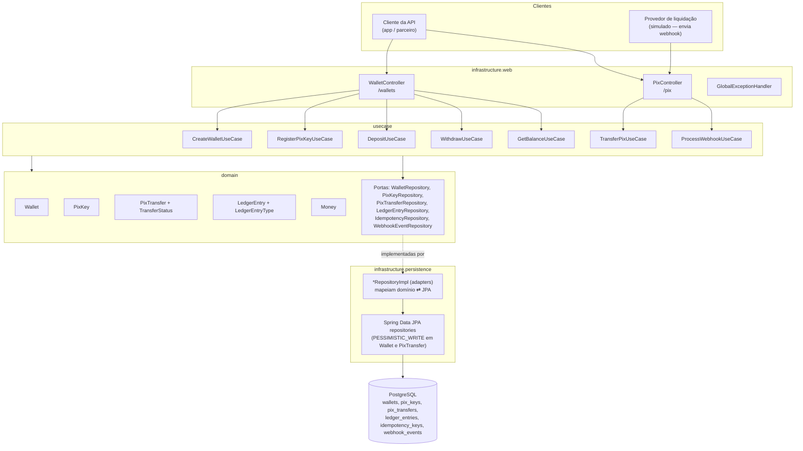
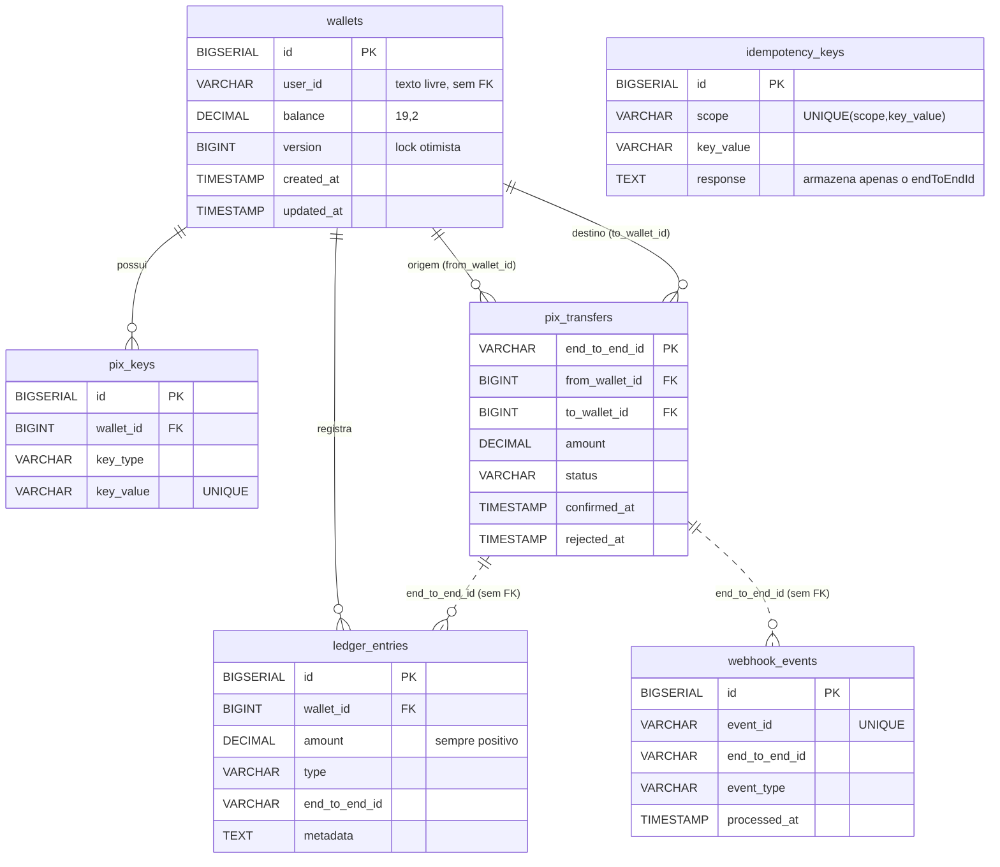
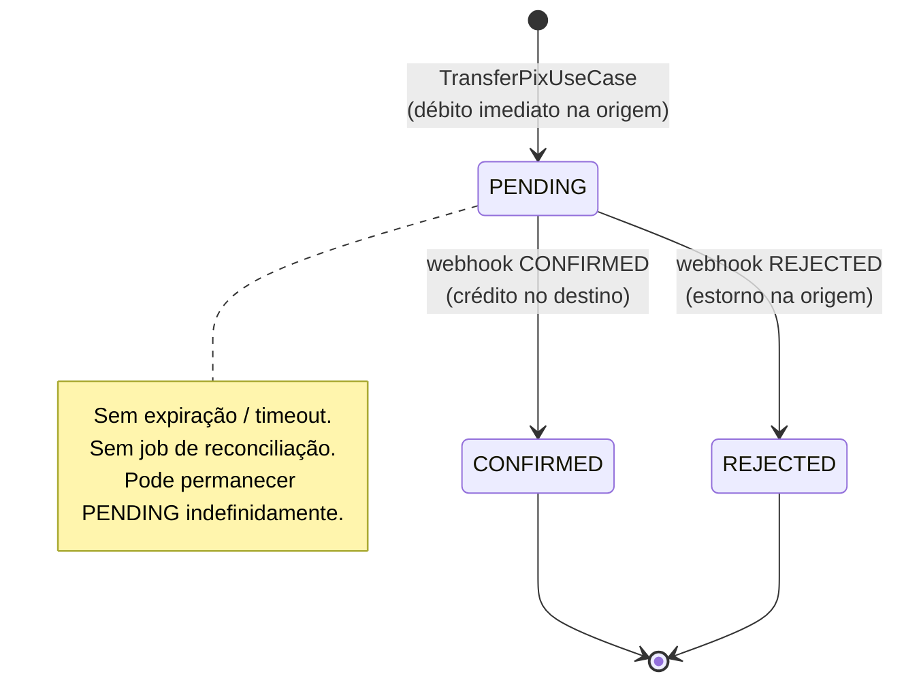
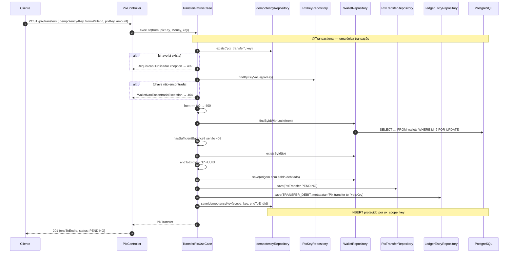
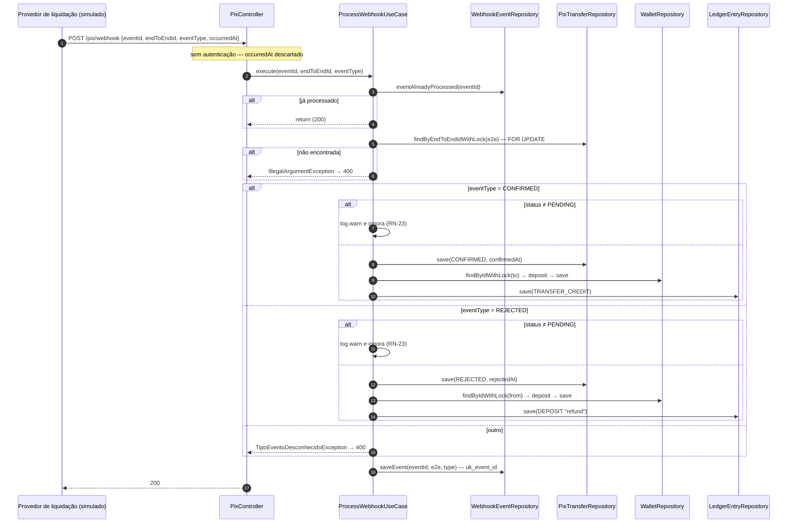
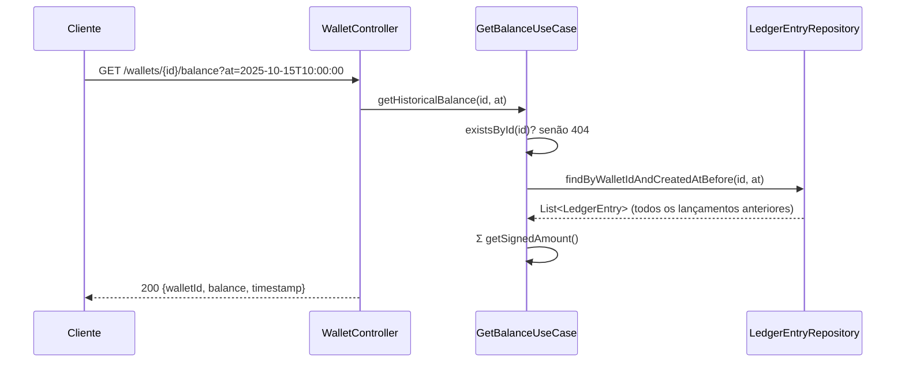
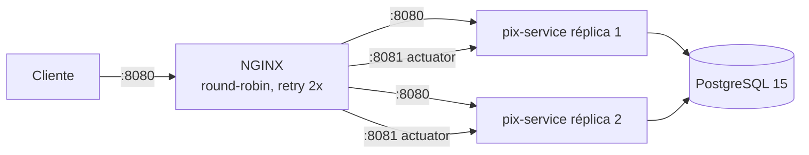

# 01 — Arquitetura Atual do Pix Service

> **Escopo:** engenharia reversa do repositório `pix-service` (commit base `698ff49`, branch `main`).
> **Método:** leitura integral do código-fonte (`src/main`, `src/test`), migrações Flyway, configurações, Dockerfile/Compose/NGINX, workflows de CI, README e histórico git. Uma checagem de compilação foi reproduzida isoladamente com `javac` (Maven não estava disponível no ambiente).
> **Restrição respeitada:** nenhum arquivo de código-fonte foi alterado.

## Legenda de evidências

| Marcador | Significado |
|---|---|
| **[FATO]** | Verificado diretamente no código, configuração ou histórico git, com evidência (arquivo e linha). |
| **[HIPÓTESE]** | Inferência técnica plausível a partir do código, **não** verificada por execução. |
| **[REF. EXTERNA]** | Afirmação baseada em conhecimento externo ao repositório (BCB, PostgreSQL, Spring, GitHub). |
| **[RECOMENDAÇÃO]** | Proposta do autor deste documento. |

Os links de evidência são relativos a este arquivo e apontam para linhas específicas.

---

## Sumário executivo

- **[FATO]** O sistema é um **monólito Spring Boot 2.7.18 / Java 11** organizado em três pacotes no estilo Clean Architecture (`domain`, `usecase`, `infrastructure`), com **um único deployable**, **um único schema PostgreSQL** e **seis tabelas**.
- **[FATO]** Expõe **7 endpoints de negócio** (5 de carteira e 2 de Pix) implementados por **7 casos de uso**.
- **[FATO]** **Não há integrações externas de saída**: nenhum cliente HTTP, mensageria, DICT ou SPI. A liquidação é **simulada** por um webhook de entrada sem autenticação.
- **Pontos fortes [FATO]:** cada caso de uso roda em uma única transação ACID, há locking pessimista nas carteiras e transferências, um ledger append-only e idempotência apoiada em constraints únicas no banco.
- **Achados críticos [FATO]:**
  1. O build está quebrado: há `@Override` em métodos removidos das interfaces de porta.
  2. Não há autenticação, autorização nem verificação de titularidade da carteira.
  3. O webhook de liquidação é público.
  4. Transferências `PENDING` nunca expiram.
  5. Há PII (chave Pix) em logs e persistida no ledger.
  6. Há divergências entre a documentação e o código: porta, comportamento da idempotência e códigos HTTP.

---

## 1. Stack tecnológica

| Item | Valor | Evidência |
|---|---|---|
| Linguagem / runtime | Java 11 | [pom.xml#L22-L24](../../pom.xml#L22-L24) |
| Framework | Spring Boot 2.7.18 (Web, Data JPA, Validation, Actuator) | [pom.xml#L8-L51](../../pom.xml#L8-L51) |
| Banco | PostgreSQL 15 (driver runtime), Flyway | [pom.xml#L54-L71](../../pom.xml#L54-L71), [docker-compose.local.yml#L5](../../docker-compose.local.yml#L5) |
| Métricas | Micrometer + Prometheus | [pom.xml#L75-L78](../../pom.xml#L75-L78), [application.yml#L47-L58](../../src/main/resources/application.yml#L47-L58) |
| Documentação de API | SpringFox 3.0.0 (Swagger 2) | [pom.xml#L92-L102](../../pom.xml#L92-L102), [SwaggerConfig.java#L70-L79](../../src/main/java/com/elton/pixservice/infrastructure/config/SwaggerConfig.java#L70-L79) |
| Testes | JUnit 5, Mockito, Testcontainers 1.19.3, REST Assured 5.4.0 | [pom.xml#L105-L174](../../pom.xml#L105-L174) |
| Performance | Gatling 3.9.5 (módulo separado) | [performance-tests/pom.xml#L20-L21](../../performance-tests/pom.xml#L20-L21) |
| Deploy | Docker multi-stage, Compose com 2 réplicas e NGINX | [Dockerfile](../../Dockerfile), [docker-compose.distributed.yml#L143-L145](../../docker-compose.distributed.yml#L143-L145) |
| Segurança (Spring Security, OAuth2) | **Ausente** | Nenhuma dependência no [pom.xml](../../pom.xml); busca por `SecurityFilterChain`, `@PreAuthorize` sem resultados |
| Mensageria / HTTP client / Scheduler | **Ausente** | Busca por `RestTemplate`, `WebClient`, `Feign`, `Kafka`, `Rabbit`, `@Scheduled`, `@Async`, `ApplicationEvent` sem resultados |

---

## 2. Visão de componentes

**[FATO]** As dependências respeitam a direção `infrastructure → usecase → domain`. A exceção são os controllers, que instanciam `Money` diretamente ([PixController.java#L44](../../src/main/java/com/elton/pixservice/infrastructure/web/controller/PixController.java#L44)). Isso é aceitável, porque `Money` é um VO de domínio.

**[FATO]** Os casos de uso dependem de **classes concretas** do Spring (`@Service`, `@Transactional`). Não há uma camada de "application ports" de entrada: os controllers chamam os casos de uso diretamente ([WalletController.java#L30-L34](../../src/main/java/com/elton/pixservice/infrastructure/web/controller/WalletController.java#L30-L34)).

---

## 3. Modelo de dados

Evidências: [V1__create_tables.sql](../../src/main/resources/db/migration/V1__create_tables.sql) (wallets [L2-L9](../../src/main/resources/db/migration/V1__create_tables.sql#L2-L9), pix_keys [L14-L22](../../src/main/resources/db/migration/V1__create_tables.sql#L14-L22), ledger [L28-L37](../../src/main/resources/db/migration/V1__create_tables.sql#L28-L37), transfers [L43-L54](../../src/main/resources/db/migration/V1__create_tables.sql#L43-L54), idempotency [L61-L68](../../src/main/resources/db/migration/V1__create_tables.sql#L61-L68), webhook [L73-L80](../../src/main/resources/db/migration/V1__create_tables.sql#L73-L80)).

Otimizações de banco em [V2__database_optimizations.sql](../../src/main/resources/db/migration/V2__database_optimizations.sql):

- **Autovacuum agressivo** ([L30-L42](../../src/main/resources/db/migration/V2__database_optimizations.sql#L30-L42)).
- **Índices BRIN** ([L58-L70](../../src/main/resources/db/migration/V2__database_optimizations.sql#L58-L70)).
- **Trigger anti-no-op** em `wallets` ([L100-L113](../../src/main/resources/db/migration/V2__database_optimizations.sql#L100-L113)).
- **Compressão LZ4** ([L124-L128](../../src/main/resources/db/migration/V2__database_optimizations.sql#L124-L128)).
- **View materializada** `mv_wallet_stats` ([L135-L148](../../src/main/resources/db/migration/V2__database_optimizations.sql#L135-L148)).
- **Função** `run_maintenance()` ([L157-L185](../../src/main/resources/db/migration/V2__database_optimizations.sql#L157-L185)).

O particionamento existe apenas como script desativado (`V2__implement_partitioning.sql.disabled`).

**[FATO]** O ledger é "imutável" **apenas por convenção de código**: não há trigger, `REVOKE` ou regra no banco que impeça `UPDATE`/`DELETE` em `ledger_entries`. Além disso, existem scripts de `TRUNCATE` para todas as tabelas ([scripts/truncate-all-tables.sql#L13](../../scripts/truncate-all-tables.sql#L13)).

**[REF. EXTERNA / HIPÓTESE]** `run_maintenance()` executa `REINDEX INDEX CONCURRENTLY` dentro de uma função PL/pgSQL ([L170-L172](../../src/main/resources/db/migration/V2__database_optimizations.sql#L170-L172)). O PostgreSQL não permite `REINDEX CONCURRENTLY` dentro de um bloco de transação, e uma função sempre executa dentro de uma transação. Portanto, a função provavelmente falha quando é chamada. Isso não foi executado para confirmar.

---

## 4. APIs REST

| # | Método e path | Caso de uso | Sucesso | Erros mapeados (efetivos) | Evidência |
|---|---|---|---|---|---|
| A1 | `POST /wallets` | `CreateWalletUseCase.execute` | 201 | 400 (validação) | [WalletController.java#L36-L50](../../src/main/java/com/elton/pixservice/infrastructure/web/controller/WalletController.java#L36-L50) |
| A2 | `POST /wallets/{id}/pix-keys` | `RegisterPixKeyUseCase.execute` | 201 | 404 carteira; 409 chave duplicada; 400 formato | [WalletController.java#L52-L70](../../src/main/java/com/elton/pixservice/infrastructure/web/controller/WalletController.java#L52-L70) |
| A3 | `POST /wallets/{id}/deposit` | `DepositUseCase.execute` | 200 | **400** carteira inexistente (`IllegalArgumentException`); 400 valor | [WalletController.java#L72-L89](../../src/main/java/com/elton/pixservice/infrastructure/web/controller/WalletController.java#L72-L89) |
| A4 | `POST /wallets/{id}/withdraw` | `WithdrawUseCase.execute` | 200 | 404 carteira; 409 saldo insuficiente; 400 valor | [WalletController.java#L91-L108](../../src/main/java/com/elton/pixservice/infrastructure/web/controller/WalletController.java#L91-L108) |
| A5 | `GET /wallets/{id}/balance[?at=ISO]` | `GetBalanceUseCase.getCurrentBalance` / `getHistoricalBalance` | 200 | 404 carteira | [WalletController.java#L110-L129](../../src/main/java/com/elton/pixservice/infrastructure/web/controller/WalletController.java#L110-L129) |
| A6 | `POST /pix/transfers` (header `Idempotency-Key`) | `TransferPixUseCase.execute` | 201 (`PENDING`) | **404** chave Pix inexistente; 400 mesma carteira; 409 saldo/duplicidade | [PixController.java#L33-L57](../../src/main/java/com/elton/pixservice/infrastructure/web/controller/PixController.java#L33-L57) |
| A7 | `POST /pix/webhook` | `ProcessWebhookUseCase.execute` | 200 | **400** transferência inexistente (`IllegalArgumentException`); 400 tipo desconhecido; 409 corrida em `event_id` | [PixController.java#L59-L71](../../src/main/java/com/elton/pixservice/infrastructure/web/controller/PixController.java#L59-L71) |
| — | `/actuator/{health,info,metrics,prometheus}` | Spring Actuator | — | — | [application.yml#L47-L58](../../src/main/resources/application.yml#L47-L58) |

**[FATO]** O mapeamento de exceções para HTTP fica centralizado em [GlobalExceptionHandler.java](../../src/main/java/com/elton/pixservice/infrastructure/exception/GlobalExceptionHandler.java):

| Exceção | HTTP | Linhas |
|---|---|---|
| `WalletNaoEncontradaException` | 404 | [L27-L41](../../src/main/java/com/elton/pixservice/infrastructure/exception/GlobalExceptionHandler.java#L27-L41) |
| `SaldoInsuficienteException`, `ChavePixJaRegistradaException`, `RequisicaoDuplicadaException` | 409 | [L45-L91](../../src/main/java/com/elton/pixservice/infrastructure/exception/GlobalExceptionHandler.java#L45-L91) |
| `ValorInvalidoException`, `ChavePixInvalidaException`, `TransferenciaInvalidaException`, `TipoEventoDesconhecidoException` | 400 | [L95-L157](../../src/main/java/com/elton/pixservice/infrastructure/exception/GlobalExceptionHandler.java#L95-L157) |
| `DataIntegrityViolationException` | 409, com tradução da constraint violada | [L247-L268](../../src/main/java/com/elton/pixservice/infrastructure/exception/GlobalExceptionHandler.java#L247-L268) |
| `Exception` (genérica) | 500 | [L270-L284](../../src/main/java/com/elton/pixservice/infrastructure/exception/GlobalExceptionHandler.java#L270-L284) |

**[HIPÓTESE]** A anotação `@Valid` está apenas nas interfaces `*ControllerApi` ([PixControllerApi.java#L42](../../src/main/java/com/elton/pixservice/infrastructure/web/controller/api/PixControllerApi.java#L42), [L55](../../src/main/java/com/elton/pixservice/infrastructure/web/controller/api/PixControllerApi.java#L55)), não nas implementações. O Spring MVC 5.1+ herda anotações de parâmetros declaradas em interfaces, então a validação provavelmente funciona. Os testes que cobririam isso estão desativados (§13).

---

## 5. Modelo de domínio

### 5.1 Entidades e Value Objects

| Elemento | Tipo DDD | Responsabilidade e invariantes | Evidência |
|---|---|---|---|
| `Money` | Value Object imutável | Escala 2 casas, `HALF_UP`, não nulo, igualdade por `compareTo` | [Money.java#L13-L92](../../src/main/java/com/elton/pixservice/domain/valueobject/Money.java#L13-L92) |
| `Wallet` | Entidade (raiz candidata) | `deposit` exige valor > 0; `withdraw` exige valor > 0 e saldo suficiente | [Wallet.java#L32-L51](../../src/main/java/com/elton/pixservice/domain/entity/Wallet.java#L32-L51) |
| `PixKey` | Entidade | Valida formato por tipo (CPF, EMAIL, PHONE, EVP) | [PixKey.java#L26-L73](../../src/main/java/com/elton/pixservice/domain/entity/PixKey.java#L26-L73) |
| `PixTransfer` | Entidade (raiz candidata) | `confirm()` e `reject()` protegidos pela máquina de estados | [PixTransfer.java#L30-L48](../../src/main/java/com/elton/pixservice/domain/entity/PixTransfer.java#L30-L48) |
| `TransferStatus` | Enum com regra de transição | `PENDING → CONFIRMED`, `PENDING → REJECTED`; os demais estados são terminais | [TransferStatus.java#L13-L23](../../src/main/java/com/elton/pixservice/domain/valueobject/TransferStatus.java#L13-L23) |
| `LedgerEntry` | Entidade (registro imutável por convenção) | `getSignedAmount()` define o sinal por tipo | [LedgerEntry.java#L34-L45](../../src/main/java/com/elton/pixservice/domain/entity/LedgerEntry.java#L34-L45) |
| `LedgerEntryType` | Enum | `DEPOSIT`, `WITHDRAW`, `TRANSFER_DEBIT`, `TRANSFER_CREDIT` | [LedgerEntryType.java#L6-L11](../../src/main/java/com/elton/pixservice/domain/valueobject/LedgerEntryType.java#L6-L11) |
| `PixKeyType` | Enum | `CPF`, `EMAIL`, `PHONE`, `EVP` | [PixKeyType.java#L6-L11](../../src/main/java/com/elton/pixservice/domain/valueobject/PixKeyType.java#L6-L11) |

**[FATO]** As entidades usam `@Data` do Lombok ([Wallet.java#L20](../../src/main/java/com/elton/pixservice/domain/entity/Wallet.java#L20)), o que gera `setBalance()` e `setStatus()` públicos. As invariantes **podem ser contornadas** por qualquer chamador, porque o encapsulamento depende de disciplina e não do modelo.

### 5.2 Máquina de estados da transferência

### 5.3 Catálogo de regras de negócio (todas **[FATO]**)

| ID | Regra | Evidência |
|---|---|---|
| RN-01 | Valores monetários têm 2 casas decimais com arredondamento `HALF_UP` | [Money.java#L20](../../src/main/java/com/elton/pixservice/domain/valueobject/Money.java#L20) |
| RN-02 | Valor monetário não pode ser nulo | [Money.java#L17-L19](../../src/main/java/com/elton/pixservice/domain/valueobject/Money.java#L17-L19) |
| RN-03 | Depósito deve ser > 0 (domínio) e ≥ 0,01 (DTO) | [Wallet.java#L33-L35](../../src/main/java/com/elton/pixservice/domain/entity/Wallet.java#L33-L35), [DepositRequest.java#L15-L16](../../src/main/java/com/elton/pixservice/infrastructure/web/dto/DepositRequest.java#L15-L16) |
| RN-04 | Saque deve ser > 0 | [Wallet.java#L40-L42](../../src/main/java/com/elton/pixservice/domain/entity/Wallet.java#L40-L42) |
| RN-05 | Saldo não pode ficar negativo | [Wallet.java#L43-L45](../../src/main/java/com/elton/pixservice/domain/entity/Wallet.java#L43-L45) |
| RN-06 | Carteira nasce com saldo 0 e versão 0 | [CreateWalletUseCase.java#L24-L28](../../src/main/java/com/elton/pixservice/usecase/CreateWalletUseCase.java#L24-L28) |
| RN-07 | Chave Pix é globalmente única (checagem na aplicação e constraint no banco) | [RegisterPixKeyUseCase.java#L32-L34](../../src/main/java/com/elton/pixservice/usecase/RegisterPixKeyUseCase.java#L32-L34), [V1#L21](../../src/main/resources/db/migration/V1__create_tables.sql#L21) |
| RN-08 | Chave Pix só pode ser registrada para carteira existente | [RegisterPixKeyUseCase.java#L27-L29](../../src/main/java/com/elton/pixservice/usecase/RegisterPixKeyUseCase.java#L27-L29) |
| RN-09 | CPF tem 11 dígitos após remover não numéricos; **dígitos verificadores não são validados** | [PixKey.java#L49-L54](../../src/main/java/com/elton/pixservice/domain/entity/PixKey.java#L49-L54) |
| RN-10 | E-mail é validado por regex | [PixKey.java#L56-L60](../../src/main/java/com/elton/pixservice/domain/entity/PixKey.java#L56-L60) |
| RN-11 | Telefone tem 10 a 11 dígitos; não exige `+55` nem DDD válido | [PixKey.java#L62-L67](../../src/main/java/com/elton/pixservice/domain/entity/PixKey.java#L62-L67) |
| RN-12 | EVP só tem o comprimento validado (36); o EVP é informado pelo cliente, não gerado pelo sistema | [PixKey.java#L69-L73](../../src/main/java/com/elton/pixservice/domain/entity/PixKey.java#L69-L73) |
| RN-13 | Transferência exige `Idempotency-Key`; chave repetida no escopo `pix_transfer` gera 409 | [TransferPixUseCase.java#L39-L44](../../src/main/java/com/elton/pixservice/usecase/TransferPixUseCase.java#L39-L44), [V1#L67](../../src/main/resources/db/migration/V1__create_tables.sql#L67) |
| RN-14 | Destino é resolvido pela chave Pix (busca local, sem DICT) | [TransferPixUseCase.java#L47-L50](../../src/main/java/com/elton/pixservice/usecase/TransferPixUseCase.java#L47-L50) |
| RN-15 | É proibido transferir para a mesma carteira | [TransferPixUseCase.java#L52-L54](../../src/main/java/com/elton/pixservice/usecase/TransferPixUseCase.java#L52-L54) |
| RN-16 | A origem precisa ter saldo suficiente | [TransferPixUseCase.java#L60-L62](../../src/main/java/com/elton/pixservice/usecase/TransferPixUseCase.java#L60-L62) |
| RN-17 | O débito na origem é imediato e a transferência nasce `PENDING` | [TransferPixUseCase.java#L73-L84](../../src/main/java/com/elton/pixservice/usecase/TransferPixUseCase.java#L73-L84) |
| RN-18 | `endToEndId = "E" + UUID sem hífens` | [TransferPixUseCase.java#L70](../../src/main/java/com/elton/pixservice/usecase/TransferPixUseCase.java#L70) |
| RN-19 | Máquina de estados `PENDING → CONFIRMED`/`REJECTED`, com estados terminais | [TransferStatus.java#L13-L23](../../src/main/java/com/elton/pixservice/domain/valueobject/TransferStatus.java#L13-L23) |
| RN-20 | `CONFIRMED` credita o destino e gera lançamento `TRANSFER_CREDIT` | [ProcessWebhookUseCase.java#L57-L85](../../src/main/java/com/elton/pixservice/usecase/ProcessWebhookUseCase.java#L57-L85) |
| RN-21 | `REJECTED` estorna a origem e gera lançamento do tipo **`DEPOSIT`** com metadata "refund" | [ProcessWebhookUseCase.java#L87-L115](../../src/main/java/com/elton/pixservice/usecase/ProcessWebhookUseCase.java#L87-L115) |
| RN-22 | Cada `eventId` de webhook é processado no máximo uma vez | [ProcessWebhookUseCase.java#L31-L34](../../src/main/java/com/elton/pixservice/usecase/ProcessWebhookUseCase.java#L31-L34), [V1#L79](../../src/main/resources/db/migration/V1__create_tables.sql#L79) |
| RN-23 | Transição inválida no webhook é **ignorada silenciosamente** (log `warn`), e o evento é marcado como processado | [ProcessWebhookUseCase.java#L58-L62](../../src/main/java/com/elton/pixservice/usecase/ProcessWebhookUseCase.java#L58-L62), [L88-L92](../../src/main/java/com/elton/pixservice/usecase/ProcessWebhookUseCase.java#L88-L92), [L52](../../src/main/java/com/elton/pixservice/usecase/ProcessWebhookUseCase.java#L52) |
| RN-24 | Tipo de evento desconhecido gera 400 | [ProcessWebhookUseCase.java#L47-L48](../../src/main/java/com/elton/pixservice/usecase/ProcessWebhookUseCase.java#L47-L48) |
| RN-25 | Toda movimentação de saldo gera lançamento no ledger **na mesma transação** | [DepositUseCase.java#L33-L39](../../src/main/java/com/elton/pixservice/usecase/DepositUseCase.java#L33-L39), [WithdrawUseCase.java#L34-L40](../../src/main/java/com/elton/pixservice/usecase/WithdrawUseCase.java#L34-L40), [TransferPixUseCase.java#L87-L94](../../src/main/java/com/elton/pixservice/usecase/TransferPixUseCase.java#L87-L94), [ProcessWebhookUseCase.java#L75-L82](../../src/main/java/com/elton/pixservice/usecase/ProcessWebhookUseCase.java#L75-L82) |
| RN-26 | Saldo histórico é a soma assinada dos lançamentos com `created_at < t` (estritamente antes) | [GetBalanceUseCase.java#L46-L51](../../src/main/java/com/elton/pixservice/usecase/GetBalanceUseCase.java#L46-L51) |
| RN-27 | Sinal dos lançamentos: `DEPOSIT`/`TRANSFER_CREDIT` são positivos; `WITHDRAW`/`TRANSFER_DEBIT` são negativos | [LedgerEntry.java#L34-L45](../../src/main/java/com/elton/pixservice/domain/entity/LedgerEntry.java#L34-L45) |

**Regras ausentes [FATO por ausência no código]:**

- **Limites:** não há limite por transação, diário ou noturno.
- **Fraude e autorização:** não há análise antifraude nem autorização do titular.
- **Ciclo de vida de chaves:** não há limite de chaves por conta, exclusão, portabilidade ou reivindicação, nem vínculo entre CPF e titular.
- **Pendências:** não há expiração de pendências.
- **Devoluções:** não há MED / devolução especial.
- **Produtos Pix:** não há agendamento, QR Code, Pix Saque ou Pix Troco.

**[REF. EXTERNA]** No arranjo Pix, o `EndToEndId` segue o formato `E` + ISPB (8) + data e hora `AAAAMMDDHHmm` + 11 caracteres alfanuméricos. A RN-18 **não** segue esse formato, o que é aceitável para uma simulação, mas é incompatível com o SPI real.

---

## 6. Funcionalidades identificadas

### F1 — Abrir carteira

- **Objetivo de negócio:** criar a conta transacional de um usuário.
- **Problema que resolve:** dar ao usuário um contêiner de saldo para operar no Pix.
- **Regras:** RN-06. O `userId` é texto livre, sem validação de existência nem de unicidade. Um mesmo usuário pode ter N carteiras ([V1#L4](../../src/main/resources/db/migration/V1__create_tables.sql#L4), [L11](../../src/main/resources/db/migration/V1__create_tables.sql#L11): índice não único).
- **Classes e métodos:** `WalletController.createWallet` → `CreateWalletUseCase.execute` → `WalletRepository.save`.
- **API, eventos e dependências:** A1. Nenhum evento. Tabela `wallets`.
- **Evidências:** [CreateWalletUseCase.java#L20-L34](../../src/main/java/com/elton/pixservice/usecase/CreateWalletUseCase.java#L20-L34), [CreateWalletRequest.java#L15-L17](../../src/main/java/com/elton/pixservice/infrastructure/web/dto/CreateWalletRequest.java#L15-L17).

### F2 — Registrar chave Pix

- **Objetivo de negócio:** associar um identificador amigável (CPF, e-mail, telefone ou aleatório) a uma carteira, para que ela receba transferências.
- **Problema que resolve:** evitar que o pagador precise conhecer dados bancários do recebedor.
- **Regras:** RN-07 a RN-12.
  - **[FATO]** A unicidade é checada **antes** da validação de formato ([RegisterPixKeyUseCase.java#L32-L43](../../src/main/java/com/elton/pixservice/usecase/RegisterPixKeyUseCase.java#L32-L43)).
  - **[FATO]** Não há normalização do valor: `123.456.789-01` e `12345678901` são chaves **distintas**.
  - **[FATO]** Não há verificação de posse da chave, por exemplo, se o CPF pertence ao titular ou se o e-mail foi confirmado.
- **Classes e métodos:** `WalletController.registerPixKey` → `RegisterPixKeyUseCase.execute` → `PixKey.validate`, `PixKeyRepository.existsByKeyValue/save`.
- **API, eventos e dependências:** A2. Tabela `pix_keys`. Constraint `uk_pix_key_value` traduzida para 409 pelo handler ([GlobalExceptionHandler.java#L253-L254](../../src/main/java/com/elton/pixservice/infrastructure/exception/GlobalExceptionHandler.java#L253-L254)).
- **Evidências:** [RegisterPixKeyUseCase.java#L22-L49](../../src/main/java/com/elton/pixservice/usecase/RegisterPixKeyUseCase.java#L22-L49), [PixKey.java#L26-L73](../../src/main/java/com/elton/pixservice/domain/entity/PixKey.java#L26-L73).

### F3 — Depositar

- **Objetivo de negócio:** creditar recursos na carteira.
- **Problema que resolve:** dar entrada de fundos.
- **Regras:** RN-03, RN-25.
  - **[FATO]** Não existe origem de fundos (boleto, TED, cartão): qualquer chamador credita qualquer valor em qualquer carteira.
  - **[FATO]** Carteira inexistente gera `IllegalArgumentException` (400), enquanto os demais casos de uso respondem 404 ([DepositUseCase.java#L26-L27](../../src/main/java/com/elton/pixservice/usecase/DepositUseCase.java#L26-L27)).
- **Classes e métodos:** `DepositUseCase.execute` → `WalletRepository.findByIdWithLock`, `Wallet.deposit`, `LedgerEntryRepository.save`.
- **API, eventos e dependências:** A3. Tabelas `wallets` e `ledger_entries`. Lock `SELECT … FOR UPDATE`.
- **Evidências:** [DepositUseCase.java#L22-L44](../../src/main/java/com/elton/pixservice/usecase/DepositUseCase.java#L22-L44).

### F4 — Sacar

- **Objetivo de negócio:** retirar recursos da carteira.
- **Problema que resolve:** dar saída de fundos sem destino Pix.
- **Regras:** RN-04, RN-05, RN-25. Não há destino do saque, que é apenas um débito.
- **Classes e métodos:** `WithdrawUseCase.execute` → `findByIdWithLock`, `Wallet.withdraw`, `LedgerEntryRepository.save`.
- **API, eventos e dependências:** A4. Tabelas `wallets` e `ledger_entries`.
- **Evidências:** [WithdrawUseCase.java#L23-L45](../../src/main/java/com/elton/pixservice/usecase/WithdrawUseCase.java#L23-L45).

### F5 — Consultar saldo atual

- **Objetivo de negócio:** informar o saldo disponível.
- **Problema que resolve:** permitir a consulta de posição.
- **Regras:** lê o saldo materializado em `wallets.balance`, sem lock.
- **Classes e métodos:** `GetBalanceUseCase.getCurrentBalance`.
- **API, eventos e dependências:** A5 sem `at`.
- **Evidências:** [GetBalanceUseCase.java#L26-L34](../../src/main/java/com/elton/pixservice/usecase/GetBalanceUseCase.java#L26-L34).

### F6 — Consultar saldo histórico

- **Objetivo de negócio:** reconstituir o saldo em um instante passado, para auditoria e extrato.
- **Problema que resolve:** permitir prova de posição em uma data específica.
- **Regras:** RN-26, RN-27.
  - **[FATO]** Carrega **todos** os lançamentos anteriores a `t` em memória e soma em Java ([GetBalanceUseCase.java#L46-L51](../../src/main/java/com/elton/pixservice/usecase/GetBalanceUseCase.java#L46-L51)). O custo é O(n) por consulta.
  - **[FATO]** `created_at` vem de `LocalDateTime.now()` da JVM ([LedgerEntryJpaEntity.java#L46-L49](../../src/main/java/com/elton/pixservice/infrastructure/persistence/entity/LedgerEntryJpaEntity.java#L46-L49)), em coluna `TIMESTAMP` sem fuso.
  - **[HIPÓTESE]** Com várias réplicas, um desvio de relógio entre JVMs pode reordenar lançamentos na reconstituição histórica.
- **Classes e métodos:** `GetBalanceUseCase.getHistoricalBalance` → `LedgerEntryRepository.findByWalletIdAndCreatedAtBefore` → `LedgerEntry.getSignedAmount`.
- **API, eventos e dependências:** A5 com `at`.
- **Evidências:** [GetBalanceUseCase.java#L36-L56](../../src/main/java/com/elton/pixservice/usecase/GetBalanceUseCase.java#L36-L56).

### F7 — Iniciar transferência Pix

- **Objetivo de negócio:** enviar dinheiro a um recebedor identificado por chave Pix.
- **Problema que resolve:** permitir pagamento instantâneo entre carteiras.
- **Regras:** RN-13 a RN-18, RN-25.
  - **[FATO]** O `fromWalletId` vem do corpo da requisição e **não há verificação de que o chamador é titular da carteira** ([TransferPixRequest.java#L19-L21](../../src/main/java/com/elton/pixservice/infrastructure/web/dto/TransferPixRequest.java#L19-L21)).
  - **[FATO]** A metadata do lançamento grava a chave Pix do destinatário em texto claro ([TransferPixUseCase.java#L92](../../src/main/java/com/elton/pixservice/usecase/TransferPixUseCase.java#L92)).
- **Classes e métodos:** `PixController.transferPix` → `TransferPixUseCase.execute` → `IdempotencyRepository.exists/saveIdempotencyKey`, `PixKeyRepository.findByKeyValue`, `WalletRepository.findByIdWithLock/existsById/save`, `Wallet.withdraw`, `PixTransferRepository.save`, `LedgerEntryRepository.save`.
- **API, eventos e dependências:** A6. Tabelas `idempotency_keys`, `pix_keys`, `wallets`, `pix_transfers` e `ledger_entries`. **Nenhum evento é publicado** para o sistema de liquidação; a notificação de saída não existe.
- **Evidências:** [TransferPixUseCase.java#L33-L102](../../src/main/java/com/elton/pixservice/usecase/TransferPixUseCase.java#L33-L102), [PixController.java#L33-L57](../../src/main/java/com/elton/pixservice/infrastructure/web/controller/PixController.java#L33-L57).

### F8 — Confirmar liquidação (webhook `CONFIRMED`)

- **Objetivo de negócio:** efetivar o crédito no recebedor quando a liquidação é confirmada.
- **Problema que resolve:** fechar o ciclo da transferência.
- **Regras:** RN-19, RN-20, RN-22, RN-23.
  - **[FATO]** O campo `occurredAt` é obrigatório no DTO ([WebhookRequest.java#L24-L25](../../src/main/java/com/elton/pixservice/infrastructure/web/dto/WebhookRequest.java#L24-L25)), mas **não é repassado nem persistido** ([PixController.java#L64-L68](../../src/main/java/com/elton/pixservice/infrastructure/web/controller/PixController.java#L64-L68)).
  - **[FATO]** O endpoint não tem autenticação, assinatura HMAC nem mTLS.
- **Classes e métodos:** `PixController.processWebhook` → `ProcessWebhookUseCase.execute` → `processConfirmation`.
- **API, eventos e dependências:** A7. Tabelas `webhook_events`, `pix_transfers`, `wallets` e `ledger_entries`.
- **Evidências:** [ProcessWebhookUseCase.java#L26-L85](../../src/main/java/com/elton/pixservice/usecase/ProcessWebhookUseCase.java#L26-L85).

### F9 — Rejeitar liquidação e estornar (webhook `REJECTED`)

- **Objetivo de negócio:** devolver o valor ao pagador quando a liquidação falha.
- **Problema que resolve:** evitar que o pagador perca recursos.
- **Regras:** RN-19, RN-21, RN-22, RN-23.
  - **[FATO]** O estorno é lançado como `DEPOSIT` e não como um tipo próprio, o que torna indistinguíveis no ledger um depósito real e um estorno; só o texto da metadata os diferencia.
- **Classes e métodos:** `ProcessWebhookUseCase.processRejection`.
- **API, eventos e dependências:** A7.
- **Evidências:** [ProcessWebhookUseCase.java#L87-L115](../../src/main/java/com/elton/pixservice/usecase/ProcessWebhookUseCase.java#L87-L115).

### F10 — Idempotência de transferência (transversal)

- **Objetivo de negócio:** garantir débito *exactly-once* mesmo com reenvio pelo cliente.
- **Problema que resolve:** evitar débito duplicado.
- **Regras:** RN-13.
  - **[FATO]** O duplicado **não recebe a resposta original**: recebe 409. O comentário no código admite isso ([TransferPixUseCase.java#L42](../../src/main/java/com/elton/pixservice/usecase/TransferPixUseCase.java#L42)), e o README afirma o contrário ([README.md#L533](../../README.md#L533)).
  - **[FATO]** A chave não é vinculada ao payload: a mesma chave com corpo diferente também gera 409.
  - **[FATO]** O campo `response` armazena apenas o `endToEndId` ([TransferPixUseCase.java#L97](../../src/main/java/com/elton/pixservice/usecase/TransferPixUseCase.java#L97)).
- **Evidências:** [IdempotencyRepositoryImpl.java](../../src/main/java/com/elton/pixservice/infrastructure/persistence/repository/IdempotencyRepositoryImpl.java), [V1#L61-L68](../../src/main/resources/db/migration/V1__create_tables.sql#L61-L68).

### F11 — Deduplicação de eventos de webhook (transversal)

- **Objetivo de negócio:** tolerar entrega *at-least-once* do provedor de liquidação.
- **Problema que resolve:** evitar crédito ou estorno duplicado.
- **Regras:** RN-22, RN-23.
- **Evidências:** [WebhookEventRepositoryImpl.java#L15-L30](../../src/main/java/com/elton/pixservice/infrastructure/persistence/repository/WebhookEventRepositoryImpl.java#L15-L30), [V1#L73-L80](../../src/main/resources/db/migration/V1__create_tables.sql#L73-L80).

### F12 — Auditoria e reconciliação (manual, fora da aplicação)

- **Objetivo de negócio:** comprovar a consistência entre o saldo materializado e o ledger, e rastrear uma transferência ponta a ponta.
- **Problema que resolve:** permitir auditoria e investigação de divergências.
- **Regras:** saldo materializado = Σ lançamentos assinados ([USEFUL_QUERIES.sql#L68](../../uteis/USEFUL_QUERIES.sql#L68)). O rastreio por E2E faz uma união entre `pix_transfers`, `ledger_entries` e `webhook_events` ([USEFUL_QUERIES.sql#L209](../../uteis/USEFUL_QUERIES.sql#L209)).
- **[FATO]** Essas consultas existem **apenas como SQL avulso para uso humano**. Não há endpoint, job ou alerta.
- **Evidências:** [uteis/USEFUL_QUERIES.sql](../../uteis/USEFUL_QUERIES.sql).

---

## 7. Fluxos ponta a ponta

### 7.1 Iniciar transferência Pix (F7 + F10)

### 7.2 Processar webhook (F8, F9, F11)

### 7.3 Saldo histórico (F6)

---

## 8. Concorrência, consistência e limites transacionais

### 8.1 Limites transacionais por caso de uso **[FATO]**

| Caso de uso | Locks adquiridos | Escritas atômicas na mesma transação |
|---|---|---|
| CreateWallet | — | `wallets` |
| RegisterPixKey | — | `pix_keys` |
| Deposit | `wallets[id]` FOR UPDATE | `wallets`, `ledger_entries` |
| Withdraw | `wallets[id]` FOR UPDATE | `wallets`, `ledger_entries` |
| TransferPix | `wallets[from]` FOR UPDATE | `wallets`, `pix_transfers`, `ledger_entries`, `idempotency_keys` |
| ProcessWebhook | `pix_transfers[e2e]` FOR UPDATE, depois `wallets[to\|from]` FOR UPDATE | `pix_transfers`, `wallets`, `ledger_entries`, `webhook_events` |

Locks: [WalletJpaRepository.java#L16-L18](../../src/main/java/com/elton/pixservice/infrastructure/persistence/repository/WalletJpaRepository.java#L16-L18), [PixTransferJpaRepository.java#L17-L19](../../src/main/java/com/elton/pixservice/infrastructure/persistence/repository/PixTransferJpaRepository.java#L17-L19). Lock otimista adicional: [WalletJpaEntity.java#L30-L32](../../src/main/java/com/elton/pixservice/infrastructure/persistence/entity/WalletJpaEntity.java#L30-L32).

**Conclusão [FATO]:** a transação de transferência abrange **Contas + Pagamentos + Ledger + Idempotência**, e a do webhook abrange **Liquidação + Pagamentos + Contas + Ledger**. Esses conceitos são fortemente acoplados por **atomicidade**. Separá-los em serviços distintos exigiria saga/outbox, mecanismos que hoje não existem.

### 8.2 Análise de corridas

| Cenário | Comportamento | Classificação |
|---|---|---|
| Mesma `Idempotency-Key` em paralelo | As duas requisições passam no `exists`; a segunda espera o lock da carteira; ao inserir em `idempotency_keys`, viola `uk_scope_key`, a transação inteira faz rollback e retorna 409 ([GlobalExceptionHandler.java#L255-L256](../../src/main/java/com/elton/pixservice/infrastructure/exception/GlobalExceptionHandler.java#L255-L256)). **Não há débito duplicado.** | **[HIPÓTESE]** forte (análise estática) |
| Mesmo `eventId` em paralelo | O segundo espera o lock da transferência, vê o estado terminal e ignora; ao inserir em `webhook_events`, viola `uk_event_id` e retorna **409** ao provedor, não 200. Não há crédito duplicado, mas o provedor pode tratar o 409 como falha e reenviar. | **[HIPÓTESE]** forte |
| `CONFIRMED` e depois `REJECTED` (eventIds distintos) | O segundo evento é ignorado com `warn` e registrado como processado: um conflito de liquidação **fica invisível** fora dos logs. | **[FATO]** (RN-23) |
| Transferências cruzadas simultâneas A→B e B→A | A trava `wallets[A]` FOR UPDATE; B trava `wallets[B]`. O `INSERT` em `pix_transfers` verifica a FK de `to_wallet_id` com `FOR KEY SHARE`, que conflita com o `FOR UPDATE` já mantido pela outra transação. O resultado é um **deadlock** detectado pelo PostgreSQL, que responde 500 genérico. | **[HIPÓTESE]** + **[REF. EXTERNA]** (semântica de locks de FK do PostgreSQL); não reproduzido |
| Webhook chega antes do commit da transferência | 400 "Transfer not found", sem registro do evento, e o provedor precisa reenviar. | **[FATO]** |

---

## 9. Integrações, eventos e mensageria

| Tipo | Situação | Evidência |
|---|---|---|
| Integrações de saída (SPI, DICT, PSPs, antifraude, notificações) | **Inexistentes** | Busca por clientes HTTP e mensageria sem resultados |
| Integração de entrada | Webhook `POST /pix/webhook`, síncrono e sem autenticação | [PixController.java#L59-L71](../../src/main/java/com/elton/pixservice/infrastructure/web/controller/PixController.java#L59-L71) |
| Eventos de domínio / outbox | **Inexistentes** | Busca por `ApplicationEvent`, `@EventListener`, `Outbox` sem resultados |
| Persistência | PostgreSQL único, via JPA (Hibernate), `ddl-auto: validate` e Flyway | [application.yml#L21-L39](../../src/main/resources/application.yml#L21-L39) |

**[FATO]** O README cita um "sistema de eventos e webhooks para processamento assíncrono" ([README.md#L85](../../README.md#L85)), mas o processamento é síncrono e o único "evento" é o webhook de entrada.

---

## 10. Infraestrutura, observabilidade e CI/CD

### 10.1 Deploy

- **[FATO]** A imagem é multi-stage, executa com usuário não root e tem healthcheck pelo actuator na porta 8081 ([Dockerfile#L75-L88](../../Dockerfile#L75-L88), [L126-L130](../../Dockerfile#L126-L130)).
- **[FATO]** O Compose distribuído sobe 2 réplicas e o NGINX ([docker-compose.distributed.yml#L145](../../docker-compose.distributed.yml#L145), [nginx.conf#L80-L96](../../nginx/nginx.conf#L80-L96)). Ele monta `./nginx/conf.d` e `./monitoring/*`, que **não existem** no repositório ([docker-compose.distributed.yml#L192](../../docker-compose.distributed.yml#L192), [L257](../../docker-compose.distributed.yml#L257)).
- **[REF. EXTERNA]** O `proxy_next_upstream` ([nginx.conf#L169-L171](../../nginx/nginx.conf#L169-L171)) não reenvia `POST` por padrão no NGINX ≥ 1.9.13, porque requisições não idempotentes precisam da flag `non_idempotent`. Portanto, não há risco de transferência duplicada por retry do balanceador.
- **[FATO]** O diagrama [design_pix-design-pix.jpg](../../design_pix-design-pix.jpg) mostra uma **arquitetura-alvo** com API Gateway (autenticação, autorização, rate limiting, WAF, certificado), ALB, RDS e APM (logs, tracing, alarmes, métricas). **Nada disso, exceto métricas e logs, está implementado** no repositório.

### 10.2 Observabilidade

- **[FATO]** O sistema usa logs SLF4J em texto, sem correlation ID nem MDC ([application.yml#L66-L67](../../src/main/resources/application.yml#L66-L67)).
- **[FATO]** O perfil padrão tem `show-sql: true` e SQL em `DEBUG` ([application.yml#L24](../../src/main/resources/application.yml#L24), [L65](../../src/main/resources/application.yml#L65)).
- **[FATO]** Valores de chave Pix (CPF, e-mail, telefone) são registrados em log em texto claro ([TransferPixUseCase.java#L35-L36](../../src/main/java/com/elton/pixservice/usecase/TransferPixUseCase.java#L35-L36), [RegisterPixKeyUseCase.java#L24](../../src/main/java/com/elton/pixservice/usecase/RegisterPixKeyUseCase.java#L24)) e **persistidos** na metadata do ledger ([TransferPixUseCase.java#L92](../../src/main/java/com/elton/pixservice/usecase/TransferPixUseCase.java#L92)).
- **[FATO]** As métricas se limitam às padrão do Actuator/Micrometer. Não há métricas de negócio (transferências por status, tempo em `PENDING`, divergência de saldo).
- **[FATO]** O health está com `show-details: always` no perfil padrão ([application.yml#L53-L54](../../src/main/resources/application.yml#L53-L54)).

### 10.3 CI/CD

- **[FATO]** Os workflows chamam `./mvnw` ([ci.yml#L35-L41](../../.github/workflows/ci.yml#L35-L41)), mas o repositório contém apenas `mvnw.cmd`, sem `mvnw` nem `.mvn/wrapper`. Os jobs Linux falham na primeira etapa.
- **[REF. EXTERNA]** `actions/upload-artifact@v3` ([ci.yml#L48](../../.github/workflows/ci.yml#L48)) foi descontinuado pelo GitHub.
- **[FATO]** As etapas de integração e checkstyle mascaram falhas com `|| echo` ([ci.yml#L44](../../.github/workflows/ci.yml#L44), [L82](../../.github/workflows/ci.yml#L82)).

---

## 11. Dependências e acoplamentos

Matriz de uso das portas por caso de uso (**[FATO]**):

| Caso de uso \ Porta | Wallet | PixKey | PixTransfer | Ledger | Idempotency | WebhookEvent |
|---|:-:|:-:|:-:|:-:|:-:|:-:|
| CreateWallet | W | | | | | |
| RegisterPixKey | R | R/W | | | | |
| Deposit | R/W (lock) | | | W | | |
| Withdraw | R/W (lock) | | | W | | |
| GetBalance | R | | | R | | |
| TransferPix | R/W (lock) | R | W | W | R/W | |
| ProcessWebhook | R/W (lock) | | R/W (lock) | W | | R/W |

Observações:

- **[FATO]** `Wallet` e `Ledger` são usados por 5 dos 7 casos de uso. São o núcleo transacional compartilhado.
- **[FATO]** Não há FKs entre `ledger_entries.end_to_end_id` ou `webhook_events.end_to_end_id` e `pix_transfers`. A ligação é lógica, feita por string.
- **[FATO]** O `user_id` não referencia nenhuma entidade de identidade, e não há contexto de identidade no sistema.

---

## 12. Achados e divergências

| ID | Achado | Tipo | Severidade | Evidência |
|---|---|---|---|---|
| AC-01 | **Build quebrado:** o commit `0db3f6d` removeu `findResponse`, `findByWalletId` e `findByEndToEndId` das portas, mas os adapters mantêm `@Override`, o que gera erro de compilação (reproduzido com `javac`: *"method does not override or implement a method from a supertype"*). O teste também referencia um método removido. | FATO | Crítica | [IdempotencyRepositoryImpl.java#L29-L33](../../src/main/java/com/elton/pixservice/infrastructure/persistence/repository/IdempotencyRepositoryImpl.java#L29-L33), [LedgerEntryRepositoryImpl.java#L29-L35](../../src/main/java/com/elton/pixservice/infrastructure/persistence/repository/LedgerEntryRepositoryImpl.java#L29-L35), [PixKeyRepositoryImpl.java#L34-L40](../../src/main/java/com/elton/pixservice/infrastructure/persistence/repository/PixKeyRepositoryImpl.java#L34-L40), [PixTransferRepositoryImpl.java#L27-L31](../../src/main/java/com/elton/pixservice/infrastructure/persistence/repository/PixTransferRepositoryImpl.java#L27-L31), [ProcessWebhookUseCaseTest.java#L249](../../src/test/java/com/elton/pixservice/usecase/ProcessWebhookUseCaseTest.java#L249) |
| AC-02 | Não há autenticação nem autorização, e nada verifica que o chamador é titular de `fromWalletId` ou `{id}`. | FATO | Crítica | [pom.xml](../../pom.xml), [TransferPixRequest.java#L19-L21](../../src/main/java/com/elton/pixservice/infrastructure/web/dto/TransferPixRequest.java#L19-L21) |
| AC-03 | O webhook é público: qualquer pessoa confirma ou rejeita transferências, por exemplo, para forçar o estorno ao pagador. | FATO | Crítica | [PixController.java#L59-L71](../../src/main/java/com/elton/pixservice/infrastructure/web/controller/PixController.java#L59-L71) |
| AC-04 | O depósito não tem origem de fundos: é possível criar saldo arbitrário. | FATO | Alta (em produção) | [DepositUseCase.java#L22-L44](../../src/main/java/com/elton/pixservice/usecase/DepositUseCase.java#L22-L44) |
| AC-05 | Transferências `PENDING` não expiram nem são reconciliadas; o valor fica retido indefinidamente sem webhook. | FATO | Alta | Ausência de `@Scheduled`; [TransferStatus.java](../../src/main/java/com/elton/pixservice/domain/valueobject/TransferStatus.java) |
| AC-06 | Conflitos de liquidação (evento oposto após estado terminal) são descartados apenas com log. | FATO | Alta | [ProcessWebhookUseCase.java#L58-L62](../../src/main/java/com/elton/pixservice/usecase/ProcessWebhookUseCase.java#L58-L62) |
| AC-07 | PII (chave Pix) aparece em logs e persistida na metadata do ledger, um risco de LGPD. | FATO | Alta | [TransferPixUseCase.java#L35](../../src/main/java/com/elton/pixservice/usecase/TransferPixUseCase.java#L35), [L92](../../src/main/java/com/elton/pixservice/usecase/TransferPixUseCase.java#L92) |
| AC-08 | Possível deadlock em transferências cruzadas, com resposta 500. | HIPÓTESE | Média | §8.2 |
| AC-09 | A idempotência responde 409 em vez de reproduzir a resposta original, ao contrário do que diz o README. | FATO | Média | [TransferPixUseCase.java#L42](../../src/main/java/com/elton/pixservice/usecase/TransferPixUseCase.java#L42), [README.md#L533](../../README.md#L533) |
| AC-10 | Códigos HTTP inconsistentes: depósito em carteira inexistente gera 400; chave inexistente gera 404, embora o Swagger e o README digam 400; webhook com transferência inexistente gera 400, embora o Swagger diga 404. | FATO | Média | [DepositUseCase.java#L27](../../src/main/java/com/elton/pixservice/usecase/DepositUseCase.java#L27), [TransferPixUseCase.java#L48](../../src/main/java/com/elton/pixservice/usecase/TransferPixUseCase.java#L48), [PixControllerApi.java#L33](../../src/main/java/com/elton/pixservice/infrastructure/web/controller/api/PixControllerApi.java#L33), [README.md#L700](../../README.md#L700) |
| AC-11 | Porta divergente: a aplicação usa 8089, mas o README e o Swagger dizem 8080. O README cita `docker-compose up -d` sem existir `docker-compose.yml` e referencia 5 documentos ausentes. | FATO | Baixa | [application.yml#L42](../../src/main/resources/application.yml#L42), [README.md#L119](../../README.md#L119), [README.md#L138](../../README.md#L138) |
| AC-12 | O CI usa `./mvnw`, que não existe. | FATO | Alta | [ci.yml#L35](../../.github/workflows/ci.yml#L35) |
| AC-13 | O ledger é imutável só por convenção; o estorno é tipado como `DEPOSIT`. | FATO | Média | §3, RN-21 |
| AC-14 | Chave Pix sem normalização e sem validação de dígito verificador do CPF. | FATO | Média | [PixKey.java#L49-L54](../../src/main/java/com/elton/pixservice/domain/entity/PixKey.java#L49-L54) |
| AC-15 | Entidades com setters públicos (`@Data`) permitem burlar invariantes. | FATO | Baixa | [Wallet.java#L20](../../src/main/java/com/elton/pixservice/domain/entity/Wallet.java#L20) |
| AC-16 | `run_maintenance()` provavelmente falha por usar `REINDEX CONCURRENTLY` dentro de uma função. | HIPÓTESE / REF. EXTERNA | Baixa | [V2#L170-L172](../../src/main/resources/db/migration/V2__database_optimizations.sql#L170-L172) |

---

## 13. Cobertura de testes

| Classe de teste | Tipo | Estado | Evidência |
|---|---|---|---|
| `MoneyTest`, `TransferStatusTest`, `WalletTest`, `PixKeyTest`, `PixTransferTest` | Unitário (domínio) | Ativo | [src/test/.../domain](../../src/test/java/com/elton/pixservice/domain) |
| `CreateWalletUseCaseTest`, `TransferPixUseCaseTest`, `ProcessWebhookUseCaseTest`, `WithdrawUseCaseTest` | Unitário (Mockito) | Ativo, mas **não compila** (AC-01) | [src/test/.../usecase](../../src/test/java/com/elton/pixservice/usecase) |
| `PixTransferEndToEndTest` | E2E (MockMvc + Testcontainers) | `@Disabled` | [PixTransferEndToEndTest.java#L38](../../src/test/java/com/elton/pixservice/PixTransferEndToEndTest.java#L38) |
| `PixControllerRestAssuredTest`, `WalletControllerRestAssuredTest`, `WalletControllerIntegrationTest` | Integração | `@Disabled` | [PixControllerRestAssuredTest.java#L20](../../src/test/java/com/elton/pixservice/infrastructure/web/controller/PixControllerRestAssuredTest.java#L20) |
| `DepositUseCase`, `GetBalanceUseCase`, `RegisterPixKeyUseCase` | — | **Sem teste unitário** | — |
| `PixServiceSimulation` | Carga (Gatling) | Módulo separado; os resultados citados no README não são verificáveis, porque `PERFORMANCE_RESULTS.md` não existe | [PixServiceSimulation.java](../../performance-tests/src/test/java/com/elton/pixservice/performance/PixServiceSimulation.java) |

**[FATO]** Nenhum teste ativo exercita concorrência real, locks ou constraints do banco. As garantias de *exactly-once* descritas no README **não são verificadas por testes automatizados ativos**.
